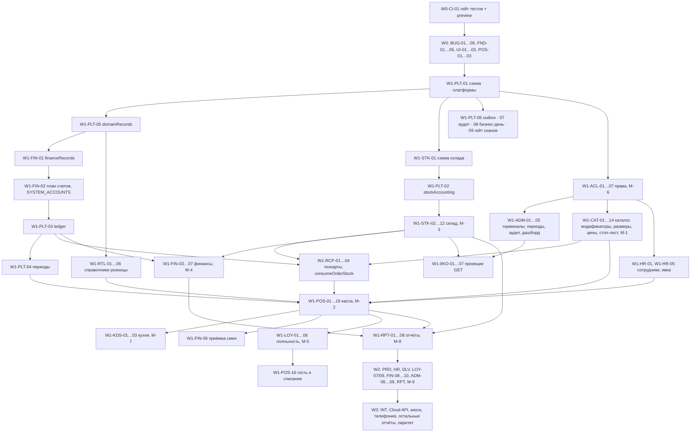

# IMPLEMENTATION-PLAN — перенос функционала bahandi-pos в sandyq

> Пути: с 2026-09-27 `src/` → `frontend/app/`, `public/` → `frontend/public/`, `website/` → `frontend/site/`. Пути `S:` ниже даны по старой раскладке.
> Статус: план реализации от 2026-09-24, **выполнен** — W0–W3 сделаны, кроме задач, перечисленных в §0 (на 2026-09-26). Блоки задач ниже оставлены как были написаны до реализации: пути «изменить / создать» в них — план, а не описание кода; как устроено сейчас — `docs/03-ARCHITECTURE.md`, что осталось людям — `TODO.md`.
> Основа: `reference/archive/PLAN.md` (решения D1–D9, разрывы §3–§4, баги §6/§7/§12, миграции §10, матрица паритета §13), `docs/04-POS-DESIGN.md`, `docs/05-OFFICE-DESIGN.md`, `reference/bahandi-screenshots/` (132 скриншота живого стенда), код обоих репозиториев.
> Пути: **B:** — `bahandi-pos/`, **S:** — `sandyq/`. Скриншоты — относительно `reference/bahandi-screenshots/`.
> Документ собран из восьми доменных разборов (фундамент W0; платформа, права, корпорация, iiko; каталог и техкарты; розница, касса, кухня; склад и производство; финансы и персонал; лояльность, доставка, интеграции; отчёты), затем сведён: дубли объединены, пересечения разрешены (§3.0), покрытие экранов и багов проверено (§5, §6).

---

## 0. Статус выполнения (2026-09-26)

Каждая задача закрыта коммитом с её ID в `git log` (несколько ID в одном коммите пишутся через «/», например `W3-ADM-10/11/12`).

| Волна | Статус | Не сделано / открыто |
|---|---|---|
| W0 | сделана | W0-CI-01: preview-деплоев и ручного approve прод-деплоя нет (D9 — нужен платный тариф Convex или отдельный staging-проект, approve — права администратора репо); e2e (W0-CI-03) работает локально, но не в CI |
| W1 | сделана | Сверка скриншотов с эталоном bahandi (критерий паритета) есть только для W0 (`reference/app-screenshots/W0/`); модификаторы iiko (тип MODIFIER) не проецируются — строки техкарт с ними пропускаются |
| W2 | сделана | W2-ACL-08 и W2-RPT-06: код готов, письма ждут `RESEND_API_KEY` (до ключа — dead-letter) |
| W3 | 25 из 27 | W3-INT-05 (киоск) не делается — решение Г-8; **W3-RPT-07** (финальная сверка паритета отчётов и скриншотов, `scripts/check-report-coverage.mjs`) открыта |

Решения владельца — §2.5; ключи, вопросы бухгалтеру, шефу и юристу, шаги запуска prod — `TODO.md`.

### 0.1 После W3: редизайн кассы (2026-09-26, вне нумерации задач)

По итогам разбора кассы (`.impeccable/critique/`) касса доработана поверх W1-POS-10…19 и W3-POS-01. Коммиты `c032de4`, `cf18b4b`, `490f67b`, `425baa1`, `fec894d`:

- **Деньги и контроль.** Слепой пересчёт на сервере: `lib/policy.ts` `seesExpectedCash` (ожидаемую наличность открытой смены видят только manager и administrator), `shifts.current` / `closePreview` / `history` для кассира без ожидаемого; новая мутация `convex/domains/shifts/mutations.ts` `reconcileCount` («Сверить», аудит `shift.count`). Оплата: способ выбирается явно; `src/pos/features/checkout/model/use-checkout-attempt.ts` — один ключ идемпотентности на попытку и таймаут 10 с; экран «Оплачено» — `src/pos/features/checkout/ui/payment-complete.tsx`. Нет связи — `src/pos/model/use-connection.ts` (`useServerOffline`): полоса под шапкой, «Оплатить» / «На кухню» выключены. Предпросмотр скидки, подтверждение «Убрать позицию?» на последней порции.
- **Зал.** `convex/domains/orders/floor.ts` (query `orders.floor`) и `src/pos/features/order-taking/ui/floor-grid.tsx` — сетка зала вместо ввода номера стола («Зал · N открыто», `table-dialog.tsx` удалён); «Перенести на стол» по залу и столу; `guest-count-control.tsx` — число гостей (`orders.guestCount`).
- **Касание и тексты.** Цели 48 px, казахские названия блюд, модификаторов (`modifierNamesKk` из `hydrateOrder`) и строк возврата с `lang="kk"`, тексты без разработческих формулировок, `src/shared/lib/error-message.ts`; тема и плотность — в профиле; сортировка каталога и строка-подсказка убраны; действия с заказом — 4 плитки + «Ещё»; цвета статусов (`--success-surface`, `--warning-surface`, `--destructive-surface`); `categories.colorToken` и «Цвет в кассе» в офисе; знак Sandyq в шапке; отклик кнопки на нажатие.
- **Язык интерфейса.** `src/pos/i18n/` (`ru.ts`, `kk.ts`, `locale-provider.tsx`, `language-switch.tsx`, `names.ts`, `errors.ts`) и `src/shared/lib/ui-labels.tsx` — переключатель RU / KK в профиле. Вычитка казахских текстов носителем — `TODO.md` §3.
- **e2e.** `scripts/e2e-pos.sh` — сид dev и все e2e одной командой; `e2e/fixtures.ts` ждёт PIN-пад (маршрут кассы — отдельный чанк, `76e8a66`).

Открыто после редизайна (`TODO.md` §7): экран кухни только по-русски, у `categories` нет `nameKk`, кассир может вычислить ожидаемую наличность по истории заказов или перебором ошибок закрытия, число гостей не печатается в чеке.

## 1. Краткое резюме

**Итог.** В sandyq появляется весь функционал bahandi-pos с той же раскладкой экранов, в дизайне Sandyq:
- касса, экран кухни (`/kitchen`) и 90 разделов офиса в 12 группах;
- киоск, Cloud API, телефония, карточки интеграций и все 190 отчётов.

Курьерское приложение `/courier` в объём не входит (§3.0 п. 8).

**Касса — гибрид.** Раскладка берётся у bahandi: заказ слева, каталог справа. Ресторанные функции sandyq сохраняются:
- несколько открытых чеков с переключателем столов в шапке заказа;
- сервисный сбор по типу заказа (15 % «В зале»);
- кнопка «На кухню».

**Способ переноса.** Код переносится по доменам в структуру sandyq (`convex/domains/<d>/{queries,mutations}.ts`, `src/pos`, `src/office`, `src/kitchen`, `src/shared`). Код bahandi целиком не копируется, его баги не переносятся (§6).

### 1.1 Объём и оценка

| Волна | Что входит | Задач | Инженеро-дней |
|---|---|---|---|
| **W0 — Подготовка** | CI-гейт и preview-деплой, баги sandyq S-1…S-22, роутер, токены и примитивы дизайна, оболочка офиса, движок реестров, вход в кассу в новом дизайне, гарды, e2e-инфраструктура | 21 | 37 |
| **W1 — Ядро ресторана** | платформа учёта (движения, двойная запись, периоды, outbox, аудит), права, каталог с модификаторами, размерами, ценами и стоп-листом, техкарты с автосписанием, справочники розницы, касса целиком, кухня, склад, финансы (план счетов, проводки, приёмка смен, M-4), сотрудники и явка, лояльность со списанием, iiko-проекции, каркас отчётов и 34 ключевых отчёта, дашборд | 109 | 269,5 |
| **W2 — Операции** | производство, персонал и зарплата РК, доставка без курьерского UI, банкеты со схемой зала, услуги, обязательства, платежи, корпорация, очередь интеграций, рассылки отчётов, iiko-техкарты и цены, расходные накладные, 64 отчёта | 41 | 111,5 |
| **W3 — До полного паритета** | кампании, выписки, платёжный календарь, бюджеты, мотивация, медкнижки, план кухни, шаблоны печати, оборудование, настройки, настоящее «Избранное», Cloud API, внешнее меню, киоск, телефония, карточки интеграций и ЕГАИС, горячие клавиши, 92 отчёта | 27 | 73,5 |
| **Всего** | | **198** | **491,5** |

По доменам (инженеро-дни):

| Домен | W0 | W1 | W2 | W3 | Всего |
|---|---|---|---|---|---|
| Фундамент: CI, баги, дизайн, оболочка (CI/BUG/FND/UI/DOC) | 32,5 | — | — | — | 32,5 |
| Платформа, права, корпорация, iiko (PLT/ACL/ADM/IIKO) | — | 64 | 17,5 | 10,5 | 92 |
| Каталог и техкарты (CAT/RCP) | — | 36 | 2 | — | 38 |
| Розница, касса, кухня (RTL/POS/KDS) | 4,5 | 81 | 4 | 3 | 92,5 |
| Склад и производство (STK/PRD) | — | 31 | 21 | 4,5 | 56,5 |
| Финансы и персонал (FIN/HR) | — | 20 | 18 | 12 | 50 |
| Лояльность, доставка, интеграции (LOY/DLV/INT) | — | 12 | 23,5 | 19,5 | 55 |
| Отчёты (RPT) | — | 25,5 | 25,5 | 24 | 75 |
| **Итого** | **37** | **269,5** | **111,5** | **73,5** | **491,5** |

Сроки при параллельной работе:
- команда из 3 инженеров — примерно 8 календарных месяцев без учёта ожидания решений из §2;
- команда из 4 инженеров — примерно 6 месяцев.

Критический путь: W0-CI-01 → W0 фундамент → W1-PLT-01 → W1-FIN-01/02 → W1-PLT-02/03 → W1-STK-01 → W1-RCP-03 → W1-POS-02 → W1-POS-03…19 → W1-RPT-02 (§4).

### 1.2 Главные риски (подробно в §9)

1. **CI деплоит `convex/**` сразу в прод с реальными данными.** Поэтому первая задача — гейт тестов и preview-деплой (W0-CI-01). Любая схема меняется в два деплоя: сначала optional-поля, затем миграция с dryRun, затем ужесточение.
2. **Бухгалтерская модель не утверждена:** план счетов РК, НДС, учёт бонусов, ставки зарплаты 2026. Без этого проводки W1 будут черновыми (блокеры §2 Б-3…Б-6).
3. **Данные меню без техкарт.** Автосписание и фудкост на проде останутся пустыми, пока нет техкарт (CSV от технолога или iiko assemblyCharts в W2).
4. **Объём.** 90 разделов, 190 отчётов и ~490 инженеро-дней. Нужны строгие критерии паритета (PLAN §9) и запрет заглушек: нереализованный отчёт помечается «В разработке», а не показывает нули.
5. **Персональные данные** (гости, сотрудники, iiko) — нужно решение BRD §9 / D7 до импорта и до рассылок.

---

## 2. Блокеры и решения, которые нужны от пользователя

Каждый блокер: вопрос → рекомендация → какие задачи ждут решения. Пока решения нет, задача делается по рекомендации (если это безопасно) и помечается «черновик до решения».

### 2.1 Решения уровня проекта (PLAN §1, BRD)

| # | Вопрос | Рекомендация | Блокирует |
|---|---|---|---|
| D2 | Палитра: цвета сайта или skill-палитра | Цвета сайта (`DESIGN.md`: cream `#FFF7EC`, ink `#121316`, wine `#8C2323`, gold `#B28F6F`, rust `#A33009`). Skill-палитру держать вторичной темой `[data-palette=skill]` | W0-FND-02, все задачи UI |
| D3 | Шрифты | Golos Text для UI, Cormorant для display; self-host через `@fontsource` | W0-FND-02 |
| D6 | Фискализация (ОФД, ККМ РК) | Оставить `nonFiscal: true` на всех печатных формах. Поле `fiscal` у типа оплаты хранить, но не исполнять. Карточка «Фискальные сервисы» — только конфигурация | W1-POS-17, W1-POS-19, W3-INT-01, отчёт `integrations-07` |
| D7 / BRD §9 | ПДн из iiko (сотрудники, гости, заказы, явка) и слияние истории iiko | Импортировать только мастер-данные без ПДн: склады, терминалы, единицы, поставщики без контактов, продукты, остатки. Гостей, заказы и смены iiko не импортировать до решения | W2-RTL-01, слияние отчётов с iiko (RB-2), импорт гостей (B-LOY-4) |
| D9 | Preview- или staging-деплой Convex | Preview-деплои есть только на платном тарифе Convex. Иначе нужен отдельный staging-проект Convex со своим секретом и GitHub Environment с approve для прод-деплоя | W0-CI-01 и все миграции |
| BRD §5 | Пилот (какие филиалы), замена iiko или работа рядом, клиентский сайт | Пилот на 3 филиалах Sandyq (Алматы, Шымкент, Түркістан), работа рядом с iiko, без клиентского заказа (сайт — только потребитель внешнего меню W3) | порядок выката W1, W3-INT-03/04 |
| BRD §5 / Б-B3 | Сопоставление 3 филиалов Sandyq с подразделениями iiko (из 12 Sandyq-подразделений) | Подтвердить у Haidar соответствие «Sandyq Алматы / Шымкент / Түркістан» ↔ подразделения iiko. Без этого импорт терминалов создаст дубли | W1-IIKO-02, W1-IIKO-03 |
| `website/` | Доделывать маркетинговый сайт или удалить (PLAN §11) | Вне объёма плана; гарды W0-CI-02 его исключают | — |

### 2.2 Бухгалтерия и финансы

| # | Вопрос | Рекомендация | Блокирует |
|---|---|---|---|
| Б-1 (Б-B2, FB-1, E-2) | Состав и коды плана счетов (Типовой план счетов РК) для системных проводок | Утвердить с бухгалтером таблицу `SYSTEM_ACCOUNTS` из W1-FIN-02 до старта W1. До утверждения использовать коды Типового плана как черновик. Доменный код ссылается только на ключи, поэтому коды меняются без правки кода | W1-FIN-02, W1-PLT-03, все проводки |
| Б-2 (E-1, FB-4) | Плательщик ли юрлицо Sandyq НДС; цены прихода с НДС или без | Флаг `vatPayer` у организации и контрагента, по умолчанию «не плательщик». Цена строки прихода — «с НДС», как на скриншоте | W1-STK-10, W2-FIN-08 |
| Б-3 (FB-2, B-LOY-2) | Учёт бонусов: оценочное обязательство при начислении или признание только при списании | Признавать при списании (Дт «Обязательства по лояльности» Кт «Выручка»), начисление вести забалансово до решения бухгалтера | W1-LOY-03 |
| Б-4 (FB-3) | Ставки и правила зарплаты 2026 (МЗП, МРП, ИПН 10/15 % и порог, СН, СО, ОПВР, ВОСМС/ООСМС) | Seed версии «2026» как черновик; активирует бухгалтер после сверки с НК РК 2026 | W2-HR-06 |
| Б-5 (FB-6, FB-7) | Зарплата в целых тенге или с тиынами; выплата через кассу или банк | Целые тенге (округление по строке налога); оба способа выплаты | W2-HR-06 |
| Б-6 (FB-8) | Формат банковских выписок (1С-клиент, Halyk, Kaspi Business) | Начать с CSV в формате bahandi, маппер под банк Sandyq — когда будет образец | W3-FIN-11 |
| Б-7 (C-4, RB-5) | Пороги фудкоста (30 / 35 %) | Хранить в «Настройках системы», значения по умолчанию из POS-DESIGN §6.4; подтверждает финансовый директор | W1-RCP-02, отчёты меню |

### 2.3 Операции ресторана

| # | Вопрос | Рекомендация | Блокирует |
|---|---|---|---|
| О-1 (D5-a) | Процент сервисного сбора по типам заказа | 15 % «В зале», 0 % «С собой» и «Доставка»; настраивается в типе заказа | W1-RTL-02, W1-POS-03 |
| О-2 (Б-B1, RB-4) | Отсечка бизнес-дня (ночные смены) | 04:00 для всех трёх филиалов; подтвердить у управляющих. Нужна **до** бэкфилла M-8 | W1-PLT-08, M-8 |
| О-3 (C-1) | Техкарты реального меню (ингредиенты нигде не лежат) | Пилот: 10 ключевых блюд вручную по CSV технолога (W1-RCP-04), параллельно проекция iiko assemblyCharts (W2-IIKO-08) | W1-RCP-04, фудкост, автосписание на проде |
| О-4 (C-2) | Источник цены: `productPrices` по филиалам или приказы о ценах | `productPrices` = постоянная цена филиала; приказы — временные и плановые изменения поверх (порядок `resolvePrice`). Приказ с `replacesPreviousMenu` не переписывает `productPrices` | W1-CAT-02, W1-CAT-10 |
| О-5 (C-3) | Станции кухни (`prepArea`) | Горячий цех / холодный цех / бар / выпечка / выдача; подтвердить с шефом. От этого зависит маппинг категория → станция в M-1 | W1-CAT-01, M-1, W1-KDS-01 |
| О-6 (KDS-auth) | Доступ к экрану кухни | PIN-роль `kitchen` на кухонном терминале; токен устройства — позже | W1-KDS-01/02 |
| О-7 (QR) | Kaspi QR | Только ручное подтверждение кассиром (как у bahandi); интеграция с Kaspi Pay — отдельный проект | W1-POS-17 |
| О-8 (PRN) | Принтеры чеков | Браузерная печать 80 мм; драйвер ESC/POS вне W1 | W1-POS-17/19, W3-ADM-10/11 |
| О-9 (E-3, E-5) | Структура складов филиала; отрицательные остатки | M-3 создаёт только `<restaurant>-main`, остальные склады заводятся в UI. `allowNegativeStock: false` для основного склада и `true` для кухни на период пилота | W1-STK-02, W1-STK-08, W1-RCP-03 |
| О-10 (E-6) | Нужны ли тестовые `stockBalances`/`stockMovements` на проде | Показать отчёт dryRun M-3; тестовые данные перенести с пометкой legacy | W1-STK-02 |
| О-11 (Б-B4) | Продукты iiko общие для 8 брендов: как отфильтровать Sandyq и как объединить с seed-меню | Импортировать только группы Sandyq; продукты без совпадения — `enabled:false`; объединять вручную в офисе. До решения флаг `--with-products` выключен | W1-IIKO-04 |
| О-12 (Б-B7) | Новые терминалы из iiko на проде | Импортировать с `active:false`, включать вручную в офисе | W1-IIKO-03 |

### 2.4 Гости, доставка, интеграции

| # | Вопрос | Рекомендация | Блокирует |
|---|---|---|---|
| Г-1 (B-LOY-1) | Правила программы «Базовая»: процент начисления, максимум списания, срок жизни бонусов | Оставить 1 % начисления, списание до 30 % чека, срок 365 дней. До решения `maxRedemptionPercent: 0` (списание выключено) | W1-LOY-02/03 |
| Г-2 (B-LOY-3, FB-5) | Согласия и ПДн гостей и сотрудников (закон РК о ПДн, трансграничная передача — Convex вне РК) | Требовать согласия `personal-data` + `cross-border` при создании гостя в офисе. Гостей из кассы пометить `consentState: unknown` и исключить из рассылок. Маскировать ПДн без `office.guests.pii` / `office.employees.pii`. Формулировки подтверждает юрист | W1-LOY-04, W1-HR-01, W3-LOY-08 |
| Г-3 (B-DLV-1) | Каналы доставки: своя доставка, агрегаторы, самовывоз | Начать с «Телефон» и «Сайт»; агрегаторы — через вебхуки Cloud API после выбора | W2-DLV-08, W3-INT-03 |
| Г-4 (B-DLV-2) | Способы оплаты доставки и момент признания выручки | Наличные курьеру и карта онлайн; выручка при `delivered`; `settlementMode` у источника | W2-DLV-03 |
| Г-5 (B-DLV-3) | Смена для доставки | Отдельный виртуальный терминал доставки на ресторан, смену открывает менеджер. Без открытой смены `delivered` блокируется | W2-DLV-03 |
| Г-6 (B-INT-1, Б-B6, RB-3) | Провайдеры SMS, email, телефонии | SMS — например, Mobizon или SMSC.kz; email — Resend или SMTP организации; телефония — облачная АТС с вебхуками. До выбора: dead-letter, а пароли офиса сбрасывает администратор скриптом | W2-ACL-08, W2-RPT-06, W3-LOY-08, W3-DLV-09, W3-INT-06 |
| Г-7 (B-INT-2) | Провайдер карт для зон и геокодирования | 2GIS (лучшее покрытие адресов РК); до решения — ручные координаты и SVG-превью полигона | W2-DLV-06 |
| Г-8 (B-INT-4) | Есть ли у Sandyq киоски | Если нет — W3-INT-05 реализовать по контракту без запуска в бой. Смену киоска открывать автоматически, закрывать ночным кроном | W3-INT-05 |
| Г-9 (B-INT-5) | Потребители Cloud API и внешнего меню | Первый потребитель — сайт sandyq.kz (меню и стоп-лист); секрет через env, ротация по образцу `scripts/rotate-ci-deploy-key.sh` | W3-INT-03/04 |
| Г-10 (RB-1) | Считать ли 3 алкогольных отчёта (ЕГАИС) реализованными | Статус «Недоступно для KZ», бейдж «187 из 187 + 3 н/п для KZ», а не «190/190» | W1-RPT-01 |
| Г-11 (RB-6) | Ведёт ли бизнес сертификаты, купоны, рефералку, корпоративных клиентов, концепции | Если нет — статус отчёта «Недоступно: механика выключена», а не пустой отчёт | W2-RPT-02, W3-RPT-03/04 |

---

### 2.5 Решения владельца (2026-09-26)

Открытые вопросы, проверки и ключи — в `TODO.md`.

| # | Решение | Что меняется |
|---|---|---|
| Б-B4 / О-11 | Брать данные из iiko: только группы Sandyq, продукты без совпадения с seed-меню — `enabled: false`, объединение вручную в офисе | W1-IIKO-04/05, W2-IIKO-08/09 разблокированы |
| D7 | Заказы и смены iiko импортировать **без ПДн** (без имён и телефонов гостей, сотрудники только по коду); гостей iiko не импортировать | W2-RTL-01 разблокирован |
| Б-B6 / Г-6 | Email — Resend (ключ владелец добавит позже), SMS — Mobizon (ключа пока нет) | До ключей адаптеры — dead-letter |
| Б-1, Б-2, Б-4, Б-5, Б-7, О-1, О-2, О-5, Г-1, D6, Г-3/4/5, Г-2, О-3 | Приняты рекомендации §2.1–2.4; уточнения бухгалтера, шефа и юриста — в `TODO.md` | Г-1: списание бонусов до 30 % (на prod включить в офисе) |
| Г-7 | 2GIS | Ключ API — в `TODO.md` |
| Пункт 17 | Запуск prod: доступы к кассе и вход в офис — да | Порядок — `TODO.md` §5 |
| Б-6 | Выписки всех банков Sandyq (Kaspi Business, Halyk и др.) | Нужны образцы файлов |
| Г-8 | Киоска нет | W3-INT-05 не делается |
| Г-9 | Потребитель Cloud API и внешнего меню — sandyq.kz | W3-INT-03/04 |
| Г-11 | Сертификаты, купоны, рефералка, корпоративные клиенты не используются | Статус отчётов «Недоступно: механика выключена» |

## Соглашения плана

- **ID задачи** `W<волна>-<ДОМЕН>-<NN>`. Домены: CI, BUG, FND, UI, DOC (фундамент W0); PLT — платформа учёта; ACL — права; ADM — корпорация и администрирование; IIKO; CAT — каталог и цены; RCP — техкарты; RTL — справочники и реестры розницы; POS — касса; KDS — кухня; STK — склад; PRD — производство; FIN — финансы; HR — персонал; LOY — гости и лояльность; DLV — доставка; INT — интеграции, Cloud API, киоск; RPT — отчёты.
- **Оценки** в инженеро-днях: S ≤ 1,5 дня, M — 2–3 дня, L ≥ 4 дней.
- **Жёсткие правила** (действуют для каждой задачи, в блоках отдельно не повторяются):
  1. **Никогда не писать в iiko.** Только GET. Каждый новый эндпоинт — запись в `scripts/iiko/endpoint-registry.mjs` и allowlist в `sanitizeRecord`.
  2. **CI деплоит `convex/**` сразу в прод `clear-flamingo-97` с реальными данными.** Первая задача — W0-CI-01 (гейт тестов и typecheck, preview-деплой). Схема меняется в два деплоя: сначала поля `v.optional`, затем миграция с `dryRun`, затем ужесточение (PLAN §10).
  3. **Ошибки бэкенда — только `ConvexError`.** Каждая публичная функция вызывает `requireOperator` (касса) или `requireOfficeCapability` + `requireRestaurantScope` (офис). Исключения — явный allowlist: `posTerminalOptions`, `listCategories` для экрана до входа, HTTP-эндпоинты Cloud API и киоска с HMAC-подписью. Проверяет гард W0-CI-02.
  4. **Никаких секретов, паролей и PIN** в документах и коде. Прод-операции — через одноразовый deploy-ключ (mint → use → delete); исключение — CI-секрет `CONVEX_DEPLOY_KEY`.
  5. **Цвета, шрифты, радиусы — только токены** (POS-DESIGN §2–4). В `.tsx` ноль hex, ноль `text-[Npx]` меньше 12 px, ноль палитровых классов Tailwind. Проверяет гард W0-CI-02.
- **Критерий паритета (PLAN §9)** для любого экрана:
  - скриншот sandyq лежит в `reference/app-screenshots/<wave>/` рядом со скриншотом bahandi;
  - все кнопки, вкладки, поля и колонки со скриншота bahandi есть и работают (баги из PLAN §12.1 исправлены, а не повторены);
  - экран проходит чек-лист POS-DESIGN §9 (касса, кухня) или OFFICE-DESIGN §10 (офис).

---

## 3. Задачи по волнам

### 3.0 Правки, внесённые при сведении

Доменные разборы пересекались. Ниже — как решено; текст задач в §3 уже приведён к этим решениям.

1. **Выбор терминала и вход.** Задача фундамента «POS: выбор терминала, вход, блокировка» (прежний W0-UI-04) объединена с **W0-POS-01** (выбор терминала) и **W0-POS-02** (вход, блокировка, клавиатура). Query `posTerminalOptions` создаётся один раз, в W0-POS-01 (`convex/domains/auth/queries.ts`). W1-ADM-01 её только расширяет (адрес, `kind`, `salesWarehouseId`) и не создаёт вторую функцию.
2. **План счетов.** Владелец `SYSTEM_ACCOUNTS`, хранения плана счетов (`financeRecords`, `moduleId: "chart-of-accounts"`) и seed — **W1-FIN-02**. W1-PLT-03 отвечает только за `lib/ledger.ts` (`postJournalEntry`, `reverseJournalEntries`) и зависит от W1-FIN-02. Поэтому W1-FIN-01/02 стоят на критическом пути платформы (§4).
3. **Избранное кассира.** Бэкенд (`favoriteIds`, `favoriteProducts`, `toggleFavorite`) — **W1-CAT-13**. W1-POS-09 делает уведомления и авторизованную допродажу и использует W1-CAT-13 (оценка 1,5 дня вместо 2).
4. **Явка.** Задача «Журнал явки: clockIn / clockOut из POS и автоявка» перенесена из W2 в **W1-HR-05**: кнопка «Отметить приход / уход» в профиле (W1-POS-14), автоявка при открытии и закрытии смены (W1-POS-08) и табель `employees-03` (W1-RPT-08) нужны уже в W1. Поле «Отклонение от расписания» остаётся пустым до W2-HR-04.
5. **Алиасы старых прав.** Сейчас sandyq проверяет `office.catalog.*`, `office.finance.*`, `office.workforce.*`, `office.loyalty.*`, `office.stock.*`, `office.reports.*`, а новые разделы — `office.<id раздела>.<действие>`. В W1-ACL-01 добавляется таблица алиасов «старое право → набор новых». W1-ACL-02 (M-6) переписывает роли на новые id, иначе существующие роли потеряют доступ. Администратор с `*` не затронут.
6. **Поля заказа для отчётов.** W1-POS-01 дополнительно вводит `orders.businessDate` (строка `YYYY-MM-DD` по отсечке W1-PLT-08), `orders.guestCount?` и индекс `payments.by_restaurant_created`. Без них отчёты не могут пересчитать день и посчитать гостей.
7. **Тикеты кухни.** Индекс `kitchenTickets.by_order` перестаёт быть уникальным: отправка на кухню до оплаты создаёт несколько тикетов на заказ (W1-POS-04, W1-KDS-01). Это меняет действующий код `S:convex/domains/kitchen/*` и `orders.checkout`.
8. **Курьер исключён.** Не планируются:
   - маршрут `/courier` и экраны курьера;
   - `courierLocations`, `recordLocation`, `courierMobile*`, GPS;
   - строки PLAN §2 «Курьерское PWA», §4.4, §9 W2 п. 3, §13.1 «Курьер», POS-DESIGN §6.5 и §11.6;
   - баг L-21.
   
   Доставке оставлено только то, что нужно без курьерского UI: назначение курьера из офиса и статусы (W2-DLV-07). Отчёты доставки строятся по статусам из офиса. reference/archive/PLAN.md нужно поправить отдельно.
9. **Волна Cloud API — W3.** PLAN §3.13 пишет W2, а §9 и §13.2 — W3; взято W3.
10. **Канонические таблицы вместо `platformRecords`.** Организации, рестораны, подразделения, терминалы и закрытие периода редактируются прямо в канонических таблицах, чтобы был один источник истины. `platformRecords` остаётся для шаблонов печати, оборудования, настроек системы и карточек интеграций.
11. **Гости, согласия и столы.** Гости остаются отдельной типизированной таблицей `guests`, а не `loyaltyRecords` с `data: any`. Согласия — append-only таблица `guestConsents`. Столы — таблица `diningTables`, общая для схемы зала (W2-LOY-07) и переключателя столов кассы.
12. **Таблицы производства bahandi не создаются.** Заготовка — это продукт с `itemType: "preparation"` и техкартой (W2-PRD-01), одна модель рецептов вместо двух.
13. **Миграции.** M-3 расширена: нужны `stockMovements.externalId`, `sourceModuleId`, `amount`, и выполняется она согласованно с M-4. Добавлены **M-8** (бэкфилл `dailySalesFacts`) и **M-9** (бэкфилл `dailyStockFacts`) — §7.
14. **Новые баги bahandi**, найденные при разборе, — B-E1…B-E5 (§6).
15. **Баги sandyq S-*.** Все закрываются в W0 (задачи W0-BUG-*). Доменные задачи W1 их функционально перекрывают и не должны вернуть: S-8 → W1-POS-07/W1-LOY-03, S-10 → W1-POS-08, S-12 → W1-POS-19, S-13/S-21 → W1-POS-16, S-14 → W0-POS-02 + W1-HR-01, S-15/S-22 → W1-POS-17.

Формат каждой задачи — §4.3 задания: Зачем · Бэкенд · Фронтенд · Паритет · Исходники bahandi · Файлы sandyq · Тесты · Критерии приёмки · Зависимости и оценка. **B:** — `bahandi-pos/`, **S:** — `sandyq/`. Правки, внесённые при сведении, перечислены в §3.0.

### 3.W0 — Подготовка

#### W0-CI-01 — Гейт тестов и typecheck перед деплоем + preview-деплой
- **Зачем:** D9 (§1), §9 W0 п.1, §10 (правило миграций), жёсткое правило задания «CI деплоит convex/** сразу в прод».
- **Бэкенд:** схему не меняет. `S:.github/workflows/deploy-backend.yml` сейчас: `npm ci` → `npx convex deploy` без проверок (строки 18–28). Нужно:
  - новый job `verify` (на `pull_request` и `push`): `npm ci` → `npm run typecheck` (`tsc -b`) → `npm test` (vitest + convex-test) → `node scripts/check-guards.mjs` (W0-CI-02) → `npx convex dev --once --typecheck enable` против **dev/preview**-деплоя (`CONVEX_DEPLOY_KEY_PREVIEW`), а не прода;
  - job `deploy` с `needs: verify`, только `push` в `main`, `environment: production` с ручным approve в GitHub Environments;
  - `pull_request` → `npx convex deploy --preview-create <branch>` (Convex preview deployments) или отдельный staging-деплой `sandyq-staging`; фронтенд PR → Azure SWA preview environment (`deploy-frontend.yml` с `action: upload` для PR и `action: close` при закрытии PR);
  - убрать неизвестный вход `skip_api_build` (warning в логе CI, `deploy-frontend.yml:52`).
  - Секреты: `CONVEX_DEPLOY_KEY_PREVIEW` через `scripts/rotate-ci-deploy-key.sh` (добавить параметр имени секрета и деплоймента), никаких ключей в репо.
- **Фронтенд:** —
- **Паритет:** —
- **Исходники bahandi:** B:package.json (`convex:check`, `audit:office-data`) — пример скриптов проверки; CI в bahandi нет.
- **Файлы sandyq:** изменить `.github/workflows/deploy-backend.yml`, `.github/workflows/deploy-frontend.yml`, `scripts/rotate-ci-deploy-key.sh`; создать `.github/workflows/verify.yml` (или job внутри), `docs/runbooks/ci.md` не нужен — дописать раздел в `README.md` «CI/CD».
- **Тесты:** тестовый PR с падающим `tsc` → deploy не запускается; тестовый PR с изменением `convex/**` → preview-деплой создан, прод не тронут (проверить `npx convex env list --prod` и историю деплоев в dashboard).
- **Критерии приёмки:** ни один `push` в `main` не деплоит `convex/**` без зелёного `verify`; прод-деплой требует approve; PR получает preview-URL фронта и отдельный Convex-деплой; `package.json` `convex:check` используется в CI.
- **Зависимости / оценка:** нет; **M, 1,5 дня**. Блокер: доступ админа к GitHub Environments и Convex preview (тариф Convex Pro для preview deployments — уточнить; иначе отдельный staging-проект).

#### W0-CI-02 — Скрипты-гарды: хардкод, авторизация, ConvexError
- **Зачем:** жёсткие правила задания §3; POS-DESIGN §9 (grep-проверки); §9 W0 «Готово, когда…»; PLAN §7 FE-строки; B-1 (не переносить функции без авторизации).
- **Бэкенд:** `scripts/check-guards.mjs` проверяет:
  1. каждая `export const X = query|mutation|action(` в `convex/**` (кроме `_generated`, `*.test.ts`) содержит `requireOperator|requireSession|requireManagerApproval|requireOfficeCapability` либо внесена в allowlist `scripts/guards/public-allowlist.json` (стартовый список: `domains/auth/actions:login`, `domains/catalog/queries:listCategories`, будущий `posTerminalOptions`, HTTP-роуты Cloud API с HMAC). Сейчас без проверки 9 функций: `auth/actions:login` (ок, allowlist), `auth/mutations:revoke`, `catalog/queries:listCategories|listProducts|getProduct`, `iiko/queries:importRun|endpointStates|mirrorCounts`, `iiko/mutations:saveOverlay`;
  2. каждая офисная функция с аргументом `restaurantExternalId`/`restaurantId` вызывает `requireRestaurantScope` (эвристика + allowlist);
  3. `throw new Error(` в `convex/**` → 0 (сейчас 0 — зафиксировать);
  4. `v.any()` в аргументах публичных функций → 0 (сейчас `iiko/mutations.ts:165`).
- **Фронтенд:** grep по `src/**/*.tsx`: `#[0-9a-fA-F]{3,8}` (сейчас 0), `rgb\(` , `bg-white|text-white` (сейчас 3), палитровые классы `-(slate|gray|zinc|amber|orange|emerald|red|green|blue|…)-\d{2,3}`, `text-\[(6|7|8|9|10|11)px\]` (сейчас 1), `font-(extrabold|black)` (сейчас 29), `uppercase` вне allowlist (сейчас 21), `(api as any)` (сейчас 0), `outline-none` без `focus-visible:` в той же строке (сейчас 5 файлов POS). Исключения — только `src/**/print/*` (печатные формы, POS-DESIGN §6.6).
- **Паритет:** —
- **Исходники bahandi:** B:package.json `audit:office-data`; счёт хардкода B — POS-DESIGN §7.
- **Файлы sandyq:** создать `scripts/check-guards.mjs`, `scripts/guards/public-allowlist.json`, `scripts/guards/uppercase-allowlist.json`; изменить `package.json` (`"guards": "node scripts/check-guards.mjs"`).
- **Тесты:** vitest на сам скрипт с фикстурами (функция без require → падение; hex в tsx → падение).
- **Критерии приёмки:** `npm run guards` в CI (W0-CI-01); на момент конца W0 — 0 нарушений без allowlist; allowlist ревьюится в PR.
- **Зависимости / оценка:** W0-CI-01; включение как блокирующего шага после W0-BUG-01 и W0-FND-05; **S, 1 день**.

#### W0-CI-03 — Инфраструктура e2e, скриншот-сверки и axe
- **Зачем:** PLAN §9 «Критерий паритета», POS-DESIGN §9, OFFICE-DESIGN §10, L-5.
- **Бэкенд:** компактный тестовый seed для e2e (`scripts/seed-e2e.mjs`, dev/preview только, guard как у `seed-sandyq.mjs:29-31`): 1 организация, 1 ресторан, 2 терминала, 20 блюд, 3 сотрудника (кассир, менеджер, админ) с PIN, сгенерированными в скрипте (не в репо), тестовый офис-пользователь через Convex Auth sign-up.
- **Фронтенд:** Playwright (`@playwright/test`), `@axe-core/playwright`; проекты: `pos-1280` (1280×800), `pos-1440`, `office-1440` (1440×900), `kitchen-1920` (1920×1080); каждый в `day` и `night` (через `localStorage` `data-theme`). Хелперы: `loginPos(code,pin)`, `loginOffice()`, `openSection(id)`, `snap(name)` → `reference/app-screenshots/<wave>/<surface>/NN-<id>-{day,night}.png`. Скрипт `scripts/compare-screens.mjs` собирает HTML-отчёт «bahandi слева / sandyq справа» по `reference/archive/PLAN.md` §13 (путь bahandi из матрицы).
- **Паритет:** все файлы `reference/bahandi-screenshots/{pos,office,office-details,kitchen}/*` — как левая колонка отчёта (courier/ пропускается).
- **Исходники bahandi:** B:scripts/verify-bahandi-flow.mjs (smoke-сценарий как образец).
- **Файлы sandyq:** создать `playwright.config.ts`, `e2e/fixtures.ts`, `e2e/smoke/pos-sale.spec.ts`, `e2e/smoke/office-sections.spec.ts` (обход всех разделов, пустые/ошибочные состояния), `e2e/a11y/axe.spec.ts`, `e2e/regressions/dialog-close-click.spec.ts` (L-5: открыть диалог → закрыть → сразу клик по кнопке под overlay → действие выполнено), `scripts/seed-e2e.mjs`, `scripts/compare-screens.mjs`; изменить `package.json` (`e2e`, `e2e:screens`), `.gitignore` (`test-results/`, `playwright-report/`).
- **Тесты:** сами e2e; запуск в CI job `e2e` против preview-деплоя (W0-CI-01).
- **Критерии приёмки:** `npm run e2e` зелёный на preview; axe 0 нарушений (serious/critical) на экранах W0; L-5 тест проходит; отчёт сверки генерируется.
- **Зависимости / оценка:** W0-CI-01, W0-FND-01; **M, 2,5 дня**.

#### W0-BUG-01 — Закрыть публичные функции без авторизации (S-1…S-4)
- **Зачем:** S-1, S-2, S-3, S-4, §3 «Общие правила», B-1.
- **Бэкенд (проверено):**
  - S-1 подтверждён: `S:convex/domains/iiko/mutations.ts:164-172` `saveOverlay` — публичная `mutation`, `data: v.any()`. Перевести в `internalMutation`; публичная обёртка появится в W1 (типизированные overlay по B:schema 598, `office.data-exchange.edit`).
  - S-2 подтверждён: `S:convex/domains/iiko/queries.ts:5,12,20` `importRun`, `endpointStates`, `mirrorCounts` без проверки → добавить `requireOfficeCapability(ctx, "office.data-exchange.view")`; скрипты `scripts/iiko/*` должны использовать internal-версии (`internal.domains.iiko.internal.*`) — проверить `scripts/iiko/reconcile.mjs`.
  - S-3 подтверждён: `S:convex/domains/auth/mutations.ts` `revoke({sessionToken})` без проверки — любой, кто знает токен, отзывает сессию (сам токен секретен, но правило «ни одной публичной функции без require»). Решение: `revoke` → `internalMutation` (используется ли фронтом — grep `revoke` в `src/`; если нет — internal), `logout` остаётся с `requireOperator`.
  - S-4 подтверждён: `S:convex/domains/catalog/queries.ts:32` `listProducts({restaurantExternalId,…})`, `:64` `getProduct({productId, restaurantExternalId})` без проверки. Добавить аргумент `sessionToken` + `requireOperator`, ресторан брать из сессии (`access.restaurant.externalId`), а не из аргумента. `listCategories` (`:24`) — в allowlist (нужен до входа? проверить: до входа каталог не рисуется → тоже перевести на `requireOperator`, allowlist не нужен). Офисный каталог уже на `domains/catalog/*` офисных функциях (проверить `catalog-workspace.tsx` вызовы).
- **Фронтенд:** `S:src/pos/features/catalog/data/*` — передавать `sessionToken`; убрать `restaurantExternalId` из вызовов.
- **Паритет:** —
- **Исходники bahandi:** B:convex/catalog.ts (без авторизации — **не повторять**), B:convex/posAccess.ts (паттерн `requireOperator`).
- **Файлы sandyq:** изменить `convex/domains/iiko/{mutations,queries}.ts`, создать `convex/domains/iiko/internal.ts`, изменить `convex/domains/auth/mutations.ts`, `convex/domains/catalog/queries.ts`, `src/pos/features/catalog/data/use-catalog.ts`, `scripts/iiko/*.mjs` (вызовы internal через deploy key `npx convex run`), `convex/posFlows.test.ts`.
- **Тесты:** convex-test: вызов без сессии/без офисной роли → `ConvexError`; `listProducts` с чужим рестораном в аргументе игнорируется (цена из ресторана сессии).
- **Критерии приёмки:** `npm run guards` (W0-CI-02) показывает 0 публичных функций вне allowlist `[auth/actions:login]`.
- **Зависимости / оценка:** W0-CI-01; **S, 1 день**.

#### W0-BUG-02 — Кухня: изоляция по ресторану и аудит (S-5, промежуточно)
- **Зачем:** S-5, §3.7 (полное решение — W1 кухня + M-7).
- **Бэкенд (проверено):** `S:convex/domains/kitchen/queries.ts:10-25` `board` делает `query("kitchenTickets")` по статусу без фильтра ресторана; `mutations.ts:40` `setStatus` проверяет только `requireOperator`. Временно (до M-7): фильтровать тикеты по `ticket.orderId → order.restaurantId === access.restaurant._id`; в `setStatus` — то же + `writeAudit(ctx, access, {action: "kitchen.status", …})`. Постоянное поле `kitchenTickets.restaurantId` (optional) + индекс `by_restaurant_status_created` и миграция M-7 — задача кухонного домена W1 (не дублировать).
- **Фронтенд:** —
- **Паритет:** —
- **Исходники bahandi:** B:convex/kitchen.ts:6,20 (та же дыра — не повторять).
- **Файлы sandyq:** изменить `convex/domains/kitchen/{queries,mutations}.ts`, `convex/posFlows.test.ts`.
- **Тесты:** convex-test: тикет ресторана А не виден и не меняется сессией ресторана Б; `auditEvents` пишется.
- **Критерии приёмки:** межресторанная утечка закрыта; аудит статусов есть.
- **Зависимости / оценка:** W0-BUG-01; **S, 0,5 дня**.

#### W0-BUG-03 — Scope ресторанов в офисных queries и workforce (S-6, S-7)
- **Зачем:** S-6, S-7, §3.2 «Закрыть дыры sandyq».
- **Бэкенд (проверено):**
  - S-6: `reports/queries.ts:8,22,83`, `finance/queries.ts:15,36,45`, `stock/queries.ts:8,31`, `loyalty/queries.ts:30,41` вызывают только `requireOfficeCapability`, без фильтра `user.restaurantScopes` — пользователь с ограниченным scope видит все рестораны. Добавить хелпер `S:convex/lib/officeAccess.ts` `scopedRestaurantFilter(user)` / `assertRestaurantInScope`, применять к аргументу-фильтру и к выдаче (`hasScope`, строка :25 уже есть). `loyalty.getOrderGuest`, `findGuestByPhone` (`:8,:19`) на `requireOperator` — ок.
  - S-7: `workforce/mutations.ts` `setEmployeeActive`, `resetPin`, `updateEmployeeAssignment` не проверяют, что сотрудник принадлежит ресторану в scope пользователя (resolveRestaurantIds проверяет только новые рестораны). Добавить `requireEmployeeInScope(ctx, user, employee)`: все `employee.restaurantIds` ∩ scope ≠ ∅ (для admin `*`).
- **Фронтенд:** фильтры ресторанов в офисе брать из `restaurantsForFilter` (уже отфильтрованного).
- **Паритет:** —
- **Исходники bahandi:** B:convex/officeAccess.ts:18 `hasOfficeScope`.
- **Файлы sandyq:** изменить `convex/lib/officeAccess.ts`, `convex/domains/{reports,finance,stock,loyalty}/queries.ts`, `convex/domains/workforce/mutations.ts`; создать `convex/officeScope.test.ts`.
- **Тесты:** convex-test: пользователь со scope `[A]` не видит данные B ни в одном из 9 queries; `resetPin` сотрудника B → ошибка.
- **Критерии приёмки:** гард W0-CI-02 п.2 зелёный.
- **Зависимости / оценка:** W0-BUG-01; **M, 1,5 дня**.

#### W0-BUG-04 — Возврат не сторнирует баллы лояльности (S-8)
- **Зачем:** S-8, §3.5 «Баллы лояльности при возврате».
- **Бэкенд (проверено):** `S:convex/domains/orders/mutations.ts` импортирует только `accrueLoyaltyPoints` (`:9`), в `refund` обратной операции нет. Добавить `S:convex/lib/loyalty.ts` `reverseLoyaltyPoints(ctx, order, refundAmount, occurredAt)`: `points = floor(accruedPoints × refundAmount / order.total)`, `loyaltyTransactions.kind: "reversal"` (расширить union, optional-совместимо), баланс не ниже 0 (если баллы уже потрачены — баланс в 0 и запись `shortfall` в транзакции). Идемпотентность по `refund idempotencyKey`. Полная модель счетов — M-5 в W1 (не дублировать; функция переедет на `loyaltyAccounts`).
- **Фронтенд:** —
- **Паритет:** —
- **Исходники bahandi:** B:convex/loyaltyCore.ts `reverseOrderLoyalty`.
- **Файлы sandyq:** изменить `convex/lib/loyalty.ts`, `convex/domains/orders/mutations.ts`, `convex/schema.ts` (`loyaltyTransactions.kind` + `"reversal"`), `convex/posFlows.test.ts`.
- **Тесты:** convex-test: оплата 10 000 → +100 баллов; частичный возврат 5 000 → −50; повтор того же возврата → без изменений.
- **Критерии приёмки:** сумма баллов гостя согласована с чистой выручкой по его заказам.
- **Зависимости / оценка:** W0-CI-01; **S, 0,5 дня**.

#### W0-BUG-05 — Отчёты и X-отчёт: возвраты, округление, backfill (S-9, S-10, S-11)
- **Зачем:** S-9, S-10, S-11.
- **Бэкенд (проверено):**
  - S-9: `reports/queries.ts:22-80` `salesSummary` — `ctx.db.query("orders").collect()` (полный скан, `:30`), затем N+1 `orderLines`/`payments` на заказ; выручка по оплатам sale без вычета refund. Исправить сейчас: брать `payments` через индекс по времени (`by_created`) в диапазоне, вычитать `type: "refund"`; N+1 убрать. Долгосрочно — `dailySalesFacts` (домен отчётов W1).
  - S-10: `shifts/queries.ts:108` `discounts += Math.max(0, order.subtotal * (order.discountPercent/100))` — дробное значение, не совпадает с округлённой скидкой заказа. Суммировать сохранённое `order.discountAmount` (есть ли поле — проверить `schema.ts orders`; если нет — `order.subtotal + serviceCharge − total` либо `lib/money.ts discountAmount()` с тем же округлением).
  - S-11: `finance/mutations.ts:54-56` ключ идемпотентности `orders:${orderId}` для sale-платежей — при сплите на N платежей все получают один `sourceExternalId`, и `known` не обновляется в цикле → либо дубли, либо (если `postLedgerEntry` уникализирует) потеря частей. Ключ → `payments:${payment._id}`, `known.add` в цикле.
- **Фронтенд:** —
- **Паритет:** —
- **Исходники bahandi:** B:convex/reportCalculators.ts (пример агрегатов по индексу).
- **Файлы sandyq:** изменить `convex/domains/reports/queries.ts`, `convex/domains/shifts/queries.ts`, `convex/domains/finance/mutations.ts`, тесты.
- **Тесты:** convex-test: продажа + возврат → `salesSummary.net` = разница; скидка 7 % на 1 999 ₸ → X-отчёт = сумма округлённых скидок; сплит 2 оплаты → 2 проводки.
- **Критерии приёмки:** цифры X-отчёта, отчёта продаж и журнала совпадают на тестовом наборе.
- **Зависимости / оценка:** W0-CI-01; **M, 1 день**.

#### W0-BUG-06 — Ошибки POS-UI (S-12, S-13, S-14, S-15, S-17, S-21, S-22)
- **Зачем:** S-12…S-15, S-17, S-21, S-22.
- **Бэкенд:** S-14 — единое правило PIN 4–6 цифр на сервере: `workforce/mutations.ts:35-36` сейчас `^\d{4,12}$` → `^\d{4,6}$` (код сотрудника 3–12 цифр оставить); вход `auth/actions.ts` принимает как есть.
- **Фронтенд (проверено):**
  - S-12: `shift-dialog.tsx:65` сейчас `useState(String(expectedCash))` — **расхождение с PLAN** (там «нулём»): поле предзаполнено ожидаемой суммой, что ломает слепой пересчёт (POS-DESIGN §6.2 «ожидаемое показывать только после ввода»). Исправить: пустое поле, ожидаемое и расхождение показывать после ввода.
  - S-13: `discount-dialog.tsx:22` `useState(currentPercent)` не синхронизируется при смене чека — `useEffect` на `open`/`currentPercent` или `key={orderId}` у диалога.
  - S-14: `login-screen.tsx:34` `if (active.length >= 6) return` — оставить 6 после серверного правила 4–6; добавить ввод с физической клавиатуры + Enter (POS-DESIGN §5 PinPad) — в W0-FND-04.
  - S-15: `payment-dialog.tsx:107-114` чипы «+{step}» делают `roundUpTo(row.amount, step)` — подпись заменить на «до {step}»/реальный номинал («10 000», «20 000», «Без сдачи»), как в bahandi `pos/18`.
  - S-17: `outline-none` без замены в `catalog-panel.tsx`, `guest-dialog.tsx`, `payment-dialog.tsx`, `discount-dialog.tsx`, `shift-dialog.tsx` → `focus-visible:outline-2 outline-ring outline-offset-2` через Input-примитив (W0-FND-03).
  - S-21: `guest-dialog.tsx:44-52` `handleDetach` без `catch` → `setError(errorMessage(caught, "Не удалось открепить гостя"))`.
  - S-22: `payment-dialog.tsx:70` `key={index}` → стабильный `row.id` (`crypto.randomUUID()` при создании строки).
- **Паритет:** `pos/08-shift-close.jpg` (слепой пересчёт), `pos/17-discount.jpg`, `pos/18-payment-cash.jpg` (пресеты «Без сдачи / 5 000 / 10 000»).
- **Исходники bahandi:** B:src/features/pos-operations/ui/shift-dialog.tsx (слепой пересчёт), B:src/components/pos/payment-dialog.tsx (пресеты).
- **Файлы sandyq:** изменить `src/pos/features/shifts/ui/shift-dialog.tsx`, `src/pos/features/order-taking/ui/discount-dialog.tsx`, `src/pos/features/session/ui/login-screen.tsx`, `src/pos/features/checkout/ui/payment-dialog.tsx`, `src/pos/features/loyalty/ui/guest-dialog.tsx`, `src/pos/features/catalog/ui/catalog-panel.tsx`, `convex/domains/workforce/mutations.ts`.
- **Тесты:** vitest + testing-library: пустое поле пересчёта; смена чека → процент скидки обновлён; ошибка detach показана; удаление средней строки оплаты не сдвигает ввод соседней.
- **Критерии приёмки:** POS-DESIGN §9 (фокус видим), guards W0-CI-02 (`outline-none`).
- **Зависимости / оценка:** W0-FND-03 (для S-17); **M, 1,5 дня**.

#### W0-FND-01 — Роутер и снятие `min-width` с body (S-19)
- **Зачем:** §4 «Роутинг», §9 W0 п.3, S-19, §13.1 маршруты.
- **Бэкенд:** —
- **Фронтенд:** сейчас `S:src/App.tsx` выбирает поверхность по `pathname.startsWith("/office")`, раздел офиса в `useState` (`S:src/office/router.tsx:20`) — нет deep-link, F5 сбрасывает. Ввести `react-router` v7 (data router): маршруты `/` → redirect `/pos`, `/pos`, `/kitchen`, `/office` → `/office/dashboard`, `/office/:section`, `/office/:section/:id`, `*` → NotFound с орнаментом. **`/courier` не добавляется** (курьерское PWA вне объёма). Guard-и маршрутов: офис — Convex Auth + `office.<section>.view`, иначе экран «Нет доступа» (OFFICE-DESIGN §7). Сохранить `?terminal=` для POS. `staticwebapp.config.json` уже делает SPA-fallback — проверить `/kitchen` и `/office/*/:id`. S-19: `S:src/shared/styles/index.css:45-54` убрать `min-width:1024px; overflow:hidden` и `font-feature-settings "cv02…"` (POS-DESIGN §3.1); ограничения ширины перенести в layout POS (`min-w-[1280px]` запрещён гардами — использовать токен/`@container`), офис — собственный скролл контента.
- **Паритет:** маршруты из `reference/archive/PLAN.md` §13.1/§13.2 (колонка «Маршрут»).
- **Исходники bahandi:** B:src/App.tsx:59-63 (pushState), :118-120 `destinationFromLocation`.
- **Файлы sandyq:** изменить `src/App.tsx`, `src/main.tsx`, `src/office/router.tsx`, `src/pos/router.tsx`, `src/shared/styles/index.css`, `staticwebapp.config.json`, `package.json` (`react-router`); создать `src/kitchen/router.tsx` (пустая оболочка для W1), `src/shared/routing/{routes.ts,guards.tsx}`, `src/office/model/navigation.ts` (перенос B:navigation.ts, W0-UI-01).
- **Тесты:** vitest (router memory): `/office/stock` открывает раздел после reload; неизвестный раздел → NotFound; без права → «Нет доступа». e2e: F5 на `/office/nomenclature` сохраняет раздел.
- **Критерии приёмки:** deep-link на каждый из 6 текущих разделов работает; body без `min-width`; POS на 1280×800 без горизонтального скролла.
- **Зависимости / оценка:** W0-CI-01; **M, 1,5 дня**.

#### W0-FND-02 — Токены темы день/ночь, `@custom-variant dark`, шрифты (S-16)
- **Зачем:** D2, D3, POS-DESIGN §2–4, §2.2, S-16, PLAN §7 FE «нет `@custom-variant dark`», §13.1 «Ночная тема» (W0).
- **Бэкенд:** —
- **Фронтенд (проверено):** `S:src/shared/styles/theme.css` сейчас на skill-палитре (`--ink`, `--walnut`, `--kilim-hi`, `--brass`), night-блок `:88-117` не переопределяет `--success`, `--warning`, `--destructive` (S-16 подтверждён; day `:49-52`), есть неиспользуемые `--product-*`, `--canvas-dot`. Сделать:
  - полный набор семантических токенов POS-DESIGN §2.1 (day) и §2.2 (night) — **все** токены в обоих блоках, включая `--nav-raised`, `--nav-muted`, `--nav-accent`, `--gold`, `--rust`, `--overlay`, `--hairline`;
  - токены категорий `--cat-*` (§2.3) вместо `--product-*`;
  - шкала текста `--text-caption…--text-hero` (§3.2), радиусы `--radius-control 2px / card 6px / panel 8px / round`, тени `--shadow-panel/float`, `--control-h` (44/48), `--space-1…6` (§4); плотность `[data-density=compact]` реально меняет `--control-h`, `--space-*`, высоту строк таблиц;
  - `@custom-variant dark (&:where([data-theme=night], [data-theme=night] *));` в `index.css`, `@theme inline` мост токенов в Tailwind v4;
  - шрифты self-host через `@fontsource/golos-text` (400–700) и `@fontsource/cormorant` (500, 600, 500 italic), убрать Google Fonts из `index.html:11-16`; проверка Ә Ғ Қ Ң Ө Ұ Ү Һ І;
  - убрать фон `.pos-canvas` (`index.css:71-75`, `App.tsx` класс), добавить favicon `public/branding/sandyq-group-favicon-140.webp`, `lang="ru"`;
  - **зависит от решения D2**: значения по умолчанию — палитра сайта (рекомендация); альтернатива skill — отдельным блоком `[data-palette=skill]` за флагом, чтобы смена была одним атрибутом.
- **Паритет:** `pos/11-main-night-theme.jpg` (состав ночного экрана; фото блюд видны — L-3 в домене каталога POS), любой `office/*.jpg` для дня.
- **Исходники bahandi:** B:src/styles/theme.css, B:src/components/theme-provider.tsx:10-56 (день/ночь, плотность, persist).
- **Файлы sandyq:** изменить `src/shared/styles/theme.css`, `src/shared/styles/index.css`, `index.html`, `src/shared/components/theme-provider.tsx`, `package.json`.
- **Тесты:** vitest: скрипт контраста `scripts/check-contrast.mjs` (WCAG 2.1 по парам из §2.1/§2.2 — текст ≥ 4.5, границы ≥ 3) в CI; e2e: переключение темы меняет `data-theme` и `dark:`-классы, а тема ОС — нет.
- **Критерии приёмки:** все пары контраста проходят; night без светлых «дыр»; POS-DESIGN §9 чек-лист (казахские буквы, reduced motion).
- **Зависимости / оценка:** блокер D2 (значения), D3; **M, 1,5 дня**.

#### W0-FND-03 — Примитивы, часть 1: кнопки и поля ввода
- **Зачем:** §4 «Общие примитивы», POS-DESIGN §5, S-17, PLAN §7 FE (Field продублирован в 7 файлах B).
- **Бэкенд:** —
- **Фронтенд:** в `S:src/shared/components/ui/`:
  - `button.tsx` — варианты `primary | secondary | ghost | danger | link`, размеры `sm 36 (только офис) | md 44 | lg 56`, радиус `--radius-control`; убрать свечение и slate-тень (`button.tsx:12,14`), `rounded-xl/lg` (`:21-24`), `ring-ring/35`; фокус — outline `--ring`;
  - `input.tsx`, `textarea.tsx`, `money-input.tsx` (суффикс ₸, разряды U+2009 при вводе, tabular-nums, `inputMode="numeric"`), `field.tsx` (подпись 12–14 px 500 sentence case, ошибка + `aria-describedby`), `numeric-code-input.tsx` (`autocomplete="off"`/`one-time-code`, `name` не email/password — используется для PIN, L-15 решается в домене data-exchange);
  - `select.tsx`, `combobox.tsx` (Radix Select, `cmdk`/Radix Popover с поиском, мультивыбор чипами вместо `<select multiple>`);
  - `checkbox.tsx` (20 px, 2 px), `switch.tsx`, `radio-group.tsx` (radio-карточки), `segmented-control.tsx` (активный — card + рамка `--input` + foreground);
  - `chip.tsx` (36/44, активный `--nav` + `--nav-foreground`, полоска цвета категории), `tabs.tsx` (Radix Tabs, подчёркивание 2 px `--accent`, счётчик muted).
- **Паритет:** `pos/17-discount.jpg`, `pos/18-payment-cash.jpg` (плитки/чипы), `office/05-payment-types.jpg` (форма: поля, флаги → Switch, «Рестораны» → Combobox), `office/10-nomenclature.jpg` (поиск, сортировка).
- **Исходники bahandi:** B:src/components/ui/button.tsx:38-58, B:src/components/ui/workspace.tsx:41 `FormField`, :54 `CheckCard`.
- **Файлы sandyq:** изменить `src/shared/components/ui/button.tsx`; создать перечисленные файлы + `src/shared/components/ui/index.ts`; `package.json` (`@radix-ui/react-select`, `-tabs`, `-checkbox`, `-switch`, `-radio-group`, `-popover`, `cmdk`).
- **Тесты:** vitest + testing-library + `jest-axe`: клавиатура (Tab, Space, стрелки), `aria-*`, MoneyInput форматирует «12500» → «12 500».
- **Критерии приёмки:** POS-DESIGN §5 таблица по каждому примитиву; guards 0 хардкода; витрина `/dev/ui` (только dev-сборка) со всеми состояниями day/night для скриншот-сверки.
- **Зависимости / оценка:** W0-FND-02; **L, 3 дня**.

#### W0-FND-04 — Примитивы, часть 2: таблица, статусы, диалоги, обратная связь, POS-примитивы (L-5, L-9, L-22, L-23)
- **Зачем:** POS-DESIGN §5, OFFICE-DESIGN §6 (словарь статусов), L-5, L-9, L-22, L-23, S-14 (клавиатура PinPad).
- **Бэкенд:** —
- **Фронтенд:**
  - `table.tsx` — шапка 12 px 600 sentence case, строки 48 (compact 40), числа вправо tabular-nums, hover muted, выбранная строка — полоска 2 px `--gold`, «›» справа, сортировка по заголовку, горизонтальный скролл внутри карточки, футер «Загружено N из M · Показать ещё» (серверная пагинация `usePaginatedQuery`), слот EmptyState/Skeleton/Error. **Один компонент для всех реестров — закрывает L-23**;
  - `status-pill.tsx` + `src/shared/lib/status-dictionary.ts` — все значения OFFICE-DESIGN §6 (документы, заказы, курьеры (статусы нужны доставке без UI курьера), звонки, jobs) → RU-подпись + тон neutral/success/warning/danger/info; неизвестный статус → neutral + исходное значение в `title` и warning в консоли dev. **Закрывает L-9**;
  - `dialog.tsx` — радиус `--radius-panel`, заголовок Cormorant 600 22 px, whisper-слот, квадратная ghost × 44 px `aria-label="Закрыть"` (сейчас «Close»), footer-примитив; анимация закрытия ≤150 мс fade без zoom и `pointer-events:none` на закрывающемся overlay (`data-[state=closed]:pointer-events-none`). **Закрывает L-5** (регрессионный e2e — W0-CI-03); `alert-dialog.tsx` для опасных действий с причиной;
  - `toast.tsx` (низ по центру, `--nav`, 4 с, `role=status`/`alert`), `empty-state.tsx` (орнамент 96/120 px `--gold`, Cormorant 22 px), `skeleton.tsx`, `banner.tsx` (warning/destructive, как «Смена открыта более 24 часов»), `page-header.tsx`, `breadcrumb.tsx`, `ornament.tsx` (инлайн `public/branding/ornament.svg`, симметрично), `money.tsx` (Cormorant 600, tabular-nums, `--accent`/`--nav-accent`), `kpi-card.tsx`;
  - `pin-pad.tsx` — клавиши 72×64, цифры Cormorant 28 px, точки `--gold`, **ввод с физической клавиатуры и Enter** (сейчас нет ни в S, ни в B);
  - `src/shared/lib/format.ts`: `formatTenge` — U+2009 между разрядами, U+00A0 перед ₸, без копеек, минус U+2212 (сейчас `S:src/shared/lib/utils.ts:8` через `Intl ru-KZ`, 4 ручных формата: `shift-dialog.tsx:82,116`, `stock-workspace.tsx:102`, quick-cash) + `formatQuantity(value, unit)`, `formatHours`, `formatPercent`. **Закрывает L-22**; заменить все ручные форматы.
- **Паритет:** `office/03-orders.jpg` (таблица, табы, футер «Загружено записей»), `office/05-payment-types.jpg` и `office/19-outgoing-invoices.jpg` (статусы PUBLISHED/POSTED → RU), `office/41-accounts-payable.jpg`, `office/37-transactions.jpg` (копейки → без дробей), `office/19…23` vs `office/18-receipts.jpg` (разная типографика реестров → один Table), `pos/05-main-menu.jpg` (диалог-плитки), `pos/06-shift-current.jpg` (баннер 24 ч), `pos/02-login-empty.jpg`, `pos/28-locked.jpg` (PinPad: 3×4, backspace, точки PIN, «Войти», подсказка внизу).
- **Исходники bahandi:** B:src/components/backoffice/office-page.tsx:7 `OfficeBreadcrumb`, :22 `OfficePageHeader`, :54 `WorkspaceTabs`, :88 `RegisterToolbar`, :115 `StatusPill`, :137 `RegisterLoadMore`; B:src/components/ui/dialog.tsx; B:src/components/ui/workspace.tsx:63 `MetricCard`.
- **Файлы sandyq:** изменить `src/shared/components/ui/dialog.tsx`, `badge.tsx` (→ StatusPill, удалить badge), `src/shared/lib/utils.ts`; создать перечисленные компоненты, `src/shared/lib/format.ts`, `src/shared/lib/status-dictionary.ts`.
- **Тесты:** vitest: `formatTenge(1279652.3) === "1 279 652 ₸"` (с U+2009/U+00A0), `formatTenge(-500)` с U+2212; каждый статус словаря имеет подпись; PinPad принимает цифры с клавиатуры и Enter; Table пагинирует. e2e L-5 (W0-CI-03).
- **Критерии приёмки:** `grep "toLocaleString\|Intl.NumberFormat" src/**/*.tsx` → 0 (всё через `format.ts`); нет английских статусов в UI; POS-DESIGN §9.
- **Зависимости / оценка:** W0-FND-02, W0-FND-03; **L, 3,5 дня**.

#### W0-FND-05 — Перевести существующие экраны sandyq на новые примитивы («старые экраны работают в новом дизайне»)
- **Зачем:** §9 W0 «Готово, когда…», POS-DESIGN §7 (нижний список «уже в sandyq, но шаблонно»), PLAN §7 FE (74 % мелкого текста, хардкод), §4.3 «Исправить в текущем офисе sandyq».
- **Бэкенд:** —
- **Фронтенд:** по списку POS-DESIGN §7:
  - `dialog.tsx:35,44,55`, `button.tsx:12,14,21-24` — в W0-FND-03/04;
  - `catalog-panel.tsx:27,37` красные круглые чипы → Chip;
  - `open-checks-list.tsx:20,31` красная рамка активного чека и «Новый стол» → рамка 2 px foreground + полоска `--gold`, secondary;
  - `payment-dialog.tsx:78,112,126` круглые красные чипы, красная ссылка «Разделить» → Chip/SegmentedControl, link;
  - `app-header.tsx:39,45` `hover:bg-white/10` → `hover:bg-nav-raised`;
  - все офисные таблицы `text-xs font-extrabold uppercase tracking-wide` (21 `uppercase`, 29 `font-extrabold/black`) → Table;
  - формат дат через `S:src/shared/lib/almaty-time.ts` вместо inline `toLocaleString` (`loyalty-workspace.tsx:128`, `stock-workspace.tsx:152`);
  - 6 текущих разделов офиса (`catalog`, `stock`, `finance`, `workforce`, `loyalty`, `reports`) — обернуть в новую оболочку W0-UI-01 и PageHeader, не меняя функционал (сами экраны заменяются в W1 доменными задачами);
  - `OfficeAccessDenied` (`office-sign-in.tsx:73`) подключить к guard-у (§4.3 «не используется»); регистрацию оставить с понятным экраном «нет доступа».
  - Мёртвый код bahandi **не переносить** (PLAN §7 FE): `B:src/components/pos/nav-rail.tsx`, `GenericOfficeWorkspace`, ветка `dedicatedDestinations`, `ExchangeMetrics`.
- **Паритет:** существующие экраны sandyq до/после (скриншоты `reference/app-screenshots/W0/before|after/`).
- **Исходники bahandi:** —
- **Файлы sandyq:** изменить все `src/pos/**/ui/*.tsx`, `src/pos/components/*.tsx`, `src/office/features/*/ui/*.tsx`, `src/office/features/session/ui/office-sign-in.tsx`.
- **Тесты:** существующие vitest (`use-order-draft.test.ts`) зелёные; e2e smoke продажи (W0-CI-03).
- **Критерии приёмки:** guards W0-CI-02 — 0 нарушений по всему `src/`; текущий функционал без регрессий; одна primary на экран.
- **Зависимости / оценка:** W0-FND-03, W0-FND-04, W0-UI-01; **L, 3 дня**.

#### W0-UI-01 — Оболочка офиса: тёмный сайдбар, 12 групп, поиск, PageHeader, без кассовой шапки (L-7)
- **Зачем:** §4.3 «Оболочка офиса», OFFICE-DESIGN §1, §2, §4, L-7, POS-DESIGN §11.4.0.
- **Бэкенд:** query `domains/office/queries:officeContext` уже есть? (`use-office-context.ts` — проверить) — расширить выдачей `capabilities[]` пользователя, организации и часового пояса для подписи внизу сайдбара. Права — `office.<id>.view` (формат совместим, §3.2).
- **Фронтенд:**
  - `src/office/model/navigation.ts` — перенос 1:1 `B:src/features/office-platform/model/navigation.ts:38-214` (12 групп, 90 пунктов, те же id и порядок, описания), поле `whisper` и `icon` (lucide: house, shopping-bag, boxes, chef-hat, wallet, users, heart-handshake, bike, building-2, plug, settings, chart-column), пункт `pos` → ссылка «Открыть кассу ↗» (`/pos`), `kitchen-board` → ссылка «Открыть экран кухни» (`/kitchen`); ЕГАИС показывается всегда (решение D4: экран «Недоступно для KZ»), без условия `VITE_JURISDICTION` из `B:backoffice-layout.tsx:80`;
  - `Sidebar` (`--nav` 264 px): знак `sandyq-group-logo.svg` 28 px + Cormorant «Sandyq Office» + StatusPill «Сеть»; поиск `--nav-raised` 40 px «Раздел, документ или отчёт» (по названию и описанию, раскрывает все группы, подсветка `--gold`); группы сворачиваются, раскрытие в `localStorage` (`sandyq-office-nav`), активная группа раскрыта; активный пункт `--nav-accent` + полоска 2 px `--gold` + фон `--nav-raised`; фильтр по правам (пустые группы скрыты); свёрнутый режим 72 px (<1280 или кнопкой) с тултипами и поповером; низ: «Открыть кассу ↗», переключатель темы и плотности, пользователь, «Sandyq · Asia/Almaty · KZT», выход;
  - контент: крошки 12 px + индикатор сохранения справа, PageHeader (whisper по группе, Cormorant 28 px, описание 14 px, одна primary, `--hairline`), ширина до 1440, поля 24/32;
  - **кассовой шапки в офисе нет** (L-7: `Bahandi · Абая`, «Касса №1», «Смена закрыта», Касса/Офис — убрать); `S:src/office/components/office-layout.tsx:8-15,53` (светлый сайдбар, красный активный пункт, `UtensilsCrossed`) заменить;
  - S-18: `office-layout.tsx:31` `overflow-hidden` без ограниченной высоты — контент `min-h-0 overflow-y-auto`, таблицы скроллятся.
- **Паритет:** `office/10-nomenclature.jpg` и любой `office/*.jpg`: сайдбар «Bahandi Office» + «Сеть», поиск «Раздел, документ или от…», группы с шевронами (Главная: Стартовая страница, Избранное; Розничные продажи: Касса, Заказы и чеки, Кассовые смены, Типы оплат, Типы заказов, Скидки и надбавки, Причины удалений, Внесения и изъятия; Товары и склады: Номенклатура, Группы товаров, Модификаторы…), низ «Администратор», выход, «Bahandi Burger Kazakhstan · Asia/Almaty · KZT»; крошки «Товары и склады › Номенклатура»; шапка страницы с иконкой, заголовком, описанием. Верхнюю кассовую шапку (гамбургер, логотип, «Bahandi · Абая / Касса №1 · Алматы», Касса|Офис, «Смена закрыта 12:09», колокол, замок, тема, плотность, профиль) — **не переносить** в офис (L-7).
- **Исходники bahandi:** B:src/components/backoffice/backoffice-layout.tsx:45-180 (фильтр `:77-80`, `matches :181`), B:src/features/office-platform/model/navigation.ts, B:src/components/backoffice/office-page.tsx.
- **Файлы sandyq:** создать `src/office/model/navigation.ts`, `src/office/components/{sidebar,office-shell,page-header-slot}.tsx`, `src/office/data/use-office-navigation.ts`; изменить `src/office/components/office-layout.tsx` (заменить), `src/office/router.tsx`, `convex/domains/office/queries.ts`.
- **Тесты:** vitest: фильтр по правам скрывает пункты и пустые группы; поиск находит «накладн» → «Приходные накладные»; состояние раскрытия сохраняется. e2e скриншот `office-1440` day/night.
- **Критерии приёмки:** OFFICE-DESIGN §10 для оболочки; 90 пунктов в том же порядке, что `B:navigation.ts`; ни одной кассовой кнопки в офисе.
- **Зависимости / оценка:** W0-FND-01, W0-FND-04; **M, 2,5 дня**.

#### W0-UI-02 — Состояния, права, адаптив и плотность офиса
- **Зачем:** OFFICE-DESIGN §7, §8, §9; §4 «Адаптив».
- **Бэкенд:** —
- **Фронтенд:** общие компоненты: `OfficeStatePage` (загрузка — Skeleton шапки + 6 строк; пусто — EmptyState; ошибка — Banner с текстом `ConvexError` и «Повторить»; «Нет доступа» с орнаментом для прямого URL без права); `useUnsavedChanges` (индикатор «● Есть несохранённые изменения» `--warning`, `beforeunload` + блокировка навигации роутера, «● Все изменения сохранены»); `PeriodLockedBanner` (контракт props; данные — домен закрытия периода W1); правило «кнопки без права скрываются» — хелпер `<Can capability="office.receipts.post">`; адаптив: ≥1440 правые панели 440, 1280–1439 выдвижные, 1024–1279 сайдбар 72, <1024 — сайдбар-выезд и таблицы-карточки, «Откройте на компьютере» для редакторов с >20 строками; плотность `compact` (строки 40, поля 36).
- **Паритет:** `office-details/01…06` (индикатор «Все изменения сохранены» в крошках), `office/13-size-scales-empty.jpg`, `office/26-production-acts-empty.jpg` (пустые состояния «Записей пока нет…»).
- **Исходники bahandi:** B:src/App.tsx:53-56 (notice), B:src/components/backoffice/office-page.tsx.
- **Файлы sandyq:** создать `src/office/components/{state-page,can,period-locked-banner,right-panel}.tsx`, `src/office/hooks/use-unsaved-changes.ts`, `src/shared/hooks/use-breakpoint.ts`.
- **Тесты:** vitest на `Can`, `useUnsavedChanges`; e2e: ширина 1024 → сайдбар 72; 1280 → правая панель выдвижная.
- **Критерии приёмки:** OFFICE-DESIGN §10 «пусто / загрузка / ошибка отрисованы», «фокус виден».
- **Зависимости / оценка:** W0-UI-01; **M, 2 дня**.

#### W0-UI-03 — Движок реестров: Register, Settings, Master, Domain, Editor (L-10 на уровне движка)
- **Зачем:** §4.3 «Общий движок форм DomainWorkspace» (≈53 раздела), OFFICE-DESIGN §3.1–3.5, §5, L-10, L-11, B-27 (пагинация вместо `take(1000)`), жёсткое правило «никаких `(api as any)`».
- **Бэкенд:** контракт для доменов (реализация таблиц/функций — доменные задачи W1, прежде всего `lib/domainRecords.ts` из §3.1): каждый реестр отдаёт `list({ paginationOpts, status?, search?, restaurantExternalId? }) → PaginationResult`, `get({ id })`, `save({...})`, переходы `transition({ id, to, reason? })`; номер документа присваивает сервер (`lib/numbering.ts` `nextNumber(ctx, moduleId, restaurantExternalId)` с таблицей счётчиков — описать как зависимость от платформы учёта W1).
- **Фронтенд:** `src/office/engine/`:
  - `RegisterPage<Row>` (OFFICE-DESIGN §3.1): PageHeader, табы статусов из `lifecycle` (`master` Все/Активные/Неактивные; `publish` Все/Черновики/Опубликованные/Неактивные; `approval` Все/Черновики/На согласовании/Согласованные/Проведённые; `document` Все/Черновики/Проведённые/Сторно), тулбар (поиск 360–480, фильтр ресторана, период, сортировка, «Колонки ⚙»), Table из конфига колонок, правая панель или переход на `/office/:section/:id`;
  - `ModuleConfig` тип: `{ id, lifecycle, columns: ColumnDef[] (key, label, kind: text|money|hours|percent|qty|date|status|ref, unit?), topPanel?: ComponentType, kpis?: KpiDef[] }` — **колонки только из конфига, общей колонки «Сумма / значение» нет** (L-10); KPI только из конфига раздела (L-11);
  - `SettingsPage` (§3.2 master-detail 360 px + форма, «Сохранить черновик / Опубликовать»), `MasterPage` (§3.3), `EditorPage` (§3.4: шапка с номером/статусом/«К списку»/«Сброс»/главной кнопкой, KPI-плитки, реквизиты 2–3 колонки, вкладки строк со счётчиками, таблица строк с итогом, поясняющая панель, липкий футер; проведённый документ — только чтение + danger «Сторно» (L-18 на уровне движка));
  - `DomainForm` — генератор полей из `DomainField` (text/number/money/date/select(source)/checkbox/textarea), валидация, ошибки под полем;
  - типизированный адаптер `defineModuleApi({ list: api.domains.x.queries.list, … })` — без `(api as any)` (в bahandi `domain-workspace.tsx` так делает).
  - Регистрировать `columns` для всех разделов OFFICE-DESIGN §5 — в доменных задачах; здесь — движок и 2 эталонных конфига для проверки (`cashflow-categories` master, `transactions` document) на моковом адаптере.
- **Паритет:** `office/03-orders.jpg` (Register: табы Все/…, поиск, таблица, «Загружено записей», «Показать ещё»), `office/05-payment-types.jpg` (Settings: список + форма «Основное», «Сохранить черновик / Опубликовать»), `office/11-product-groups.jpg` (Master), `office/27-processing-acts.jpg` (Domain: табы «Все / Черновики / На согласовании / Проведённые / Активные», поиск, «N записей», таблица Номер/Дата/Название/Сумма/Статус — колонку «Сумма» заменяет конфиг), `office-details/08-receipt-posted-still-editable.jpg` (Editor).
- **Исходники bahandi:** B:src/features/domain-operations/ui/domain-workspace.tsx:12 `DomainField`, :21 `DomainPageConfig`, :31 `DomainWorkspace`; B:convex/domainRecordHelpers.ts:5-40 (контракт, баг `take(1000)` + фильтр в памяти — не повторять); B:src/features/finance-management/ui/finance-workspace.tsx:11-35 (пример конфигов).
- **Файлы sandyq:** создать `src/office/engine/{register-page,settings-page,master-page,editor-page,domain-form,module-config,define-module-api}.tsx|ts`, `src/office/engine/__tests__/*`.
- **Тесты:** vitest: конфиг с `kind: "hours"` рендерит «8 ч», а не «8 ₸»; табы строятся по `lifecycle`; проведённый документ в EditorPage — поля read-only; пагинация вызывает `loadMore`.
- **Критерии приёмки:** движок покрывает шаблоны OFFICE-DESIGN §3.1–3.5; OFFICE-DESIGN §10 на двух эталонных конфигах; нет `(api as any)`.
- **Зависимости / оценка:** W0-FND-04, W0-UI-02; бэкенд-контракт `lib/domainRecords.ts` — платформа учёта W1 (§3.1); **L, 4 дня**.

#### W0-DOC-01 — Привести `docs/03-ARCHITECTURE.md` к коду (S-20)
- **Зачем:** S-20, §9 W0 п.5.
- **Бэкенд:** —
- **Фронтенд:** —
- **Проверено расхождение:** `03-ARCHITECTURE.md:95` и `:418` — «`orderDeletionEvents` … not currently written by any mutation» (по PLAN S-20 пишется при `cancel` — сверить с `orders/mutations.ts cancel`); `:101` — «xReports … every time createXReport **or close** runs» (PLAN: снимок Z при close не создаётся — сверить `shifts/mutations.ts close`); `:155` — `revoke` описан как защищённый (S-3); `:161` — `listCategories` без авторизации не отмечен; `:420` — «Bare root URL … throws» — **устарело**: после `14d5e4c` есть `branch-picker.tsx`; раздел CI/CD — добавить гейт W0-CI-01 и preview; раздел фронтенда — роутер W0-FND-01, дизайн-токены W0-FND-02, движок W0-UI-03.
- **Паритет:** —
- **Исходники bahandi:** —
- **Файлы sandyq:** изменить `docs/03-ARCHITECTURE.md`, `README.md` (CI/CD, e2e).
- **Тесты:** —
- **Критерии приёмки:** каждое утверждение про функцию подтверждено ссылкой файл:строка; ревью PR.
- **Зависимости / оценка:** в конце W0 после всех W0-*; **S, 0,5 дня**.

#### W0-POS-01 — Выбор терминала с бэкенда
- **Зачем:** PLAN §4.1 (строка «Выбор терминала с бэкенда»), §13.1 «Выбор терминала», §3.1 исключение `posTerminalOptions`.
- **Бэкенд:** query `domains/auth/queries.posTerminalOptions({ })` — единственная публичная функция без сессии (явный allowlist PLAN §3): возвращает только `{ restaurantExternalId, restaurantName, city, terminals: [{ externalId, name, terminalNumber }] }` для `restaurants.active && posTerminals.active`; без id Convex, без сотрудников. Индекс `posTerminals.by_restaurant_active_and_number` уже есть (S:schema.ts:96). Аудита нет (чтение).
- **Фронтенд:** `/pos` без сессии; шаблон POS-DESIGN §11.1 (вход) + §6.1 стиль. Компонент `TerminalPicker` заменяет `S:src/pos/features/session/ui/branch-picker.tsx:5-9` (захардкоженный список). Select «Подразделение» → карточки касс (radio) → primary «Продолжить к входу». Выбор пишется в `localStorage` `sandyq-pos-terminal` (как сейчас), `?terminal=` по-прежнему приоритетен.
- **Паритет:** `pos/01-terminal-picker.jpg` — логотип, иконка терминала, заголовок «Выберите рабочее место», подпись «Сначала подразделение…, затем разрешённый POS-терминал.», поле «Подразделение» (select), карточки касс «Главная касса» / «Касса выдачи» с подписью «<ресторан> · <город>» и иконкой-меткой, кнопка «Продолжить к входу» (неактивна, пока касса не выбрана).
- **Исходники bahandi:** `B:src/features/pos-operations/ui/terminal-picker.tsx:1-38`; данные — `B:convex/posHelpers.ts` (нет отдельной query, пикер читает терминалы из каталога iiko).
- **Файлы sandyq:** создать `src/pos/features/session/ui/terminal-picker.tsx`, `src/pos/features/session/data/use-terminal-options.ts`; изменить `convex/domains/auth/queries.ts`, `src/pos/features/order-taking/ui/pos-workspace.tsx` (гейт), удалить `branch-picker.tsx` после переключения.
- **Тесты:** convex-test: `posTerminalOptions` не отдаёт неактивные терминалы и поля сотрудников; vitest: пикер блокирует кнопку без выбора; e2e: голый `/` → пикер → вход.
- **Критерии приёмки:** PLAN §9 критерий паритета; POS-DESIGN §9 (скриншот 1280/1440 день/ночь, grep hex = 0); тег «Туркестан» — единственное место `--cat-turkistan` (POS-DESIGN §6.1).
- **Зависимости / оценка:** DS (примитивы Select, Card, Button); S, 1,5 дня.

#### W0-POS-02 — Вход по коду и PIN, блокировка, клавиатура
- **Зачем:** §13.1 «Вход по коду и PIN», «Блокировка»; PLAN §4.1 «Ввод кода и PIN с физической клавиатуры»; L-6; L-15 (autocomplete); S-14 (закрывает fork W0-багов, здесь — UI-часть).
- **Бэкенд:** правило длины PIN 4–6 цифр на сервере (`convex/lib/policy.ts` `PIN_MIN=4`, `PIN_MAX=6`; проверка в `domains/auth/actions.login` и в `workforce.provisionPosAccess`/`resetPin`). `auth.queries.current` уже возвращает ресторан и терминал — использовать для подписи.
- **Фронтенд:** шаблон §11.1. `LoginScreen` (S:login-screen.tsx) — код отдельным шагом (как сейчас), затем PinPad; ввод с физической клавиатуры (цифры, Backspace, Enter отправляет); `autocomplete="off"`, `inputmode="numeric"`, `name` не `email/password` (L-15). Экран «Касса заблокирована» — тот же компонент в режиме `locked` (UI сейчас не читает `locked`, §13.1). Подпись «Sandyq · <филиал> · <касса>» из сессии/терминала, не константа (L-6).
- **Паритет:** `pos/02-login-empty.jpg`, `pos/03-login-filled.jpg`, `pos/28-locked.jpg` — логотип, иконка щита/замка, заголовок «Вход в кассу» / «Касса заблокирована», подпись ресторан · касса, поле «Код сотрудника», 4 точки PIN, клавиатура 1–9, 0, ⌫, кнопка «Войти» (неактивна до 4 цифр), подсказка «Используйте локальный PIN-профиль…».
- **Исходники bahandi:** `B:src/features/pos-operations/ui/login-screen.tsx:1-70` (подпись захардкожена :44), `B:src/features/pos-operations/model/use-pos-session.ts`.
- **Файлы sandyq:** изменить `src/pos/features/session/ui/login-screen.tsx`, `src/pos/components/pin-pad.tsx`, `src/pos/features/session/model/use-pos-session.ts`, `convex/domains/auth/actions.ts`, `convex/lib/policy.ts`.
- **Тесты:** convex-test: PIN из 7 цифр отклоняется; vitest: Enter отправляет, Backspace стирает, после ошибки PIN сбрасывается; e2e: блокировка по бездействию → экран locked → повторный вход.
- **Критерии приёмки:** §9 паритет; POS-DESIGN §9 (фокус видим, PinPad 72×64, цифры Cormorant); нет строки «Bahandi» и «Абая» в `src/`.
- **Зависимости / оценка:** W0-POS-01, DS; S, 2 дня.

#### W0-POS-03 — Ночная тема кассы и фото блюд
- **Зачем:** §13.1 «Ночная тема»; L-3.
- **Бэкенд:** —
- **Фронтенд:** все экраны `/pos` на токенах POS-DESIGN §2.2; фото карточек на фоне `--muted`, `object-fit: cover`, фоллбэк при ошибке загрузки — полоска категории (§2.3), а не белая плашка.
- **Паритет:** `pos/11-main-night-theme.jpg` — те же элементы, что `pos/04`, в тёмной теме; переключатель темы (луна/солнце) и плотности в шапке.
- **Исходники bahandi:** `B:src/components/pos/product-card.tsx:22,46` (`bg-[#f4f4f2]`, `bg-white/90` — причина L-3).
- **Файлы sandyq:** изменить `src/pos/components/product-card.tsx`, `src/pos/components/app-header.tsx`.
- **Тесты:** Playwright-скриншот день/ночь 1280×800 и 1440×900; axe контраст.
- **Критерии приёмки:** POS-DESIGN §9; фото видны в обеих темах.
- **Зависимости / оценка:** DS (токены night, `@custom-variant dark`); S, 1 день.

### 3.W1 — Ядро ресторана

#### W1 · 1. Платформа учёта

#### W1-PLT-01 — Схема платформы: новые таблицы и optional-поля (деплой 1 из 2)
- **Зачем:** PLAN §3.1, §3.2, §3.13, §10 (правило двух деплоев), B-26, B-27.
- **Бэкенд:** в `S:convex/schema.ts` добавить (все новые поля существующих таблиц — `v.optional`):
  - `accounts` (план счетов, справочная модель; UI — «W1 финансы-UI»): `externalId`, `code` (строка, «1010»), `name`, `type: asset|liability|equity|income|expense|contra-income`, `parentExternalId?`, `allowManualEntries: boolean`, `system: boolean`, `active: boolean`; индексы `by_external_id`, `by_code`, `by_type_active`.
  - `journalEntries` (двойная запись, формат B:schema 212 + ссылки на счета): `externalId`, `organizationExternalId`, `restaurantExternalId`, `sourceModuleId`, `sourceExternalId`, `sourceNumber`, `occurredAt`, `businessDate` (строка `YYYY-MM-DD`, как в S), `debitAccountExternalId`, `creditAccountExternalId`, `amount` (целые тиын/тенге — как в S `lib/money.ts`), `quantity?`, `itemName?`, `warehouseExternalId?`, `description`, `reversalOf?: v.id("journalEntries")`, `legacyLedgerEntryId?: v.id("ledgerEntries")`; индексы `by_external_id`, `by_source`, `by_restaurant_date`, `by_debit_date`, `by_credit_date`, `by_org_date`.
  - `periodLocks` (B:schema 288) + поле `organizationExternalId` в индексе: `by_org_restaurant_active` = `["organizationExternalId","restaurantExternalId","active","lockedThrough"]` (закрывает B-26).
  - `outboxEvents` (B:schema 306), `integrationJobs` (B:schema 268) без изменений формата, + `integrationJobs.organizationExternalId?` для scope.
  - `documentCounters`: `scopeKey` (`<moduleId>:<organizationExternalId>:<yyyy>`), `next: number`; индекс `by_scope_key` — серверная нумерация (PLAN §4.3 DomainWorkspace).
  - `auditEvents` += `capability?`, `details?: v.any()`, `correlationId?`, `searchText?`; индексы `by_resource` `["resourceExternalId","occurredAt"]`, `by_restaurant_occurred`, `by_actor_occurred`, `by_org_occurred`; `searchIndex("search_audit", { searchField: "searchText", filterFields: ["organizationExternalId","restaurantExternalId","action"] })`.
  - `officeUsers` += `organizationScopes?: string[]`, `warehouseScopes?: string[]` (M-6).
  - `restaurants` += `businessDayCutoffMinutes?` (0–720), `departmentExternalId?`, `serviceMode?`, `sourceReadOnly?`.
  - `organizations` += `bin?`, `legalName?`, `jurisdiction?: "KZ"|"RU"`, `sourceReadOnly?`.
  - `posTerminals` += `sourceSystem?`, `sourceHash?`, `importedAt?`, `sourceReadOnly?`, `departmentExternalId?`, `salesWarehouseId?: v.id("warehouses")` (таблица из «W1 склады»), `kind?: pos|kds|office`, `lastLoginAt?`; индекс `by_restaurant_active_source_number`.
  - `iikoImportRuns` += `countsByEndpoint?: v.record(v.string(), v.number())` (старое `counts` оставить для совместимости).
  - `iikoEndpointStates` += `classification?` (`mirrored|blocked-one-way|query-template|unsupported`), `domain?`, `method?`, `path?`, `recordCount?`; индекс `by_domain`.
- **Фронтенд:** —
- **Паритет:** —
- **Исходники bahandi:** B:convex/schema.ts:129-346, 452-470, 1393-1413.
- **Файлы sandyq:** изменить `convex/schema.ts`.
- **Тесты:** `npx convex dev --once --typecheck` на копии прод-данных (dev `dapper-lobster-404`); convex-test: вставка документа старого формата в каждую изменённую таблицу проходит валидацию.
- **Критерии приёмки:** деплой на preview и на прод без ошибок валидации существующих документов; ни одно новое поле существующих таблиц не обязательное; `tsc -b` зелёный.
- **Зависимости / оценка:** W0 CI-гейт; поле `salesWarehouseId` — после создания таблицы `warehouses` («W1 склады», тот же деплой или раньше). M, 2 дня.

#### W1-PLT-02 — `lib/stockAccounting.ts`: иммутабельные движения со средневзвешенной себестоимостью
- **Зачем:** PLAN §3.1 строка 1, B-12, B-27; основа для §3.4 (списание по продаже), §3.8 (склад, производство).
- **Бэкенд:**
  - `applyStockMovement(ctx, { externalId, sourceModuleId, sourceExternalId, sourceNumber, warehouseId, inventoryItemId, quantityDelta, unitCost?, occurredAt, allowNegative?, reversalOf?, restaurantExternalId })` — идемпотентность по `externalId`, запись `balanceAfter`, `averageUnitCostAfter`, обновление кэша `stockBalances` (по складу — формат «W1 склады» после M-3).
  - `reverseSourceMovements(ctx, sourceExternalId, occurredAt)` — обратные движения с `reversalOf`, пагинация по индексу `by_source` (не `take(1000)`).
  - **B-12:** если `occurredAt` раньше последнего движения по (склад, позиция): (1) `assertPeriodOpen` для даты движения; (2) пересчёт `balanceAfter`/`averageUnitCostAfter` последующих движений через `internal.lib.stock.recalculateChain` (scheduler, батчи по 200, курсор по индексу `by_warehouse_item_occurred`); (3) пока пересчёт идёт — флаг `stockBalances.recalculating` и запрет новых backdated-движений по этой паре.
  - `deriveAverageCost` по `stockLots` через индекс, без `take(1000)`.
  - Округление количества до 0,001, денег — по правилу S `lib/money.ts` (целые).
  - Аудит не пишет сам (пишут документы-источники).
- **Фронтенд:** —
- **Паритет:** —
- **Исходники bahandi:** B:convex/stockAccounting.ts:15-73, 114-126.
- **Файлы sandyq:** создать `convex/lib/stockAccounting.ts`; изменить `convex/schema.ts` (индекс `stockMovements.by_warehouse_item_occurred`, `by_source`, поле `stockBalances.recalculating?`) совместно с «W1 склады».
- **Тесты:** convex-test: приход → средняя; расход; повтор того же `externalId` не дублирует; отрицательный остаток без `allowNegative` → ConvexError; сторно возвращает остаток и среднюю; backdated-движение пересчитывает цепочку (3 движения, вставка между 1 и 2); backdated в закрытый период → ConvexError.
- **Критерии приёмки:** все сценарии зелёные; `grep -n "take(1000" convex/lib` пусто; функции не экспортированы как public Convex-функции.
- **Зависимости / оценка:** W1-PLT-01, W1-PLT-04, «W1 склады» (M-3). M, 3 дня.

#### W1-PLT-03 — `lib/ledger.ts` и справочная модель плана счетов РК
- **Зачем:** PLAN §3.1 строка 2, §3.9; основа проводок §3.4, §3.5, §3.8, §3.10, §3.11, §3.12. UI плана счетов и M-4 — «W1 финансы-UI».
- **Бэкенд:**
  - `postJournalEntry(ctx, { externalId, restaurantExternalId, sourceModuleId, sourceExternalId, sourceNumber, occurredAt, debitAccount, creditAccount, amount, description, warehouseExternalId?, quantity?, itemName? })` — `debitAccount`/`creditAccount` = `accounts.code` или `externalId`; проверка, что счёт существует и активен; идемпотентность по `externalId`; `businessDate` через W1-PLT-08; `assertPeriodOpen`; amount > 0.
  - `reverseJournalEntries(ctx, sourceExternalId, occurredAt, share = 1)` — сторно пропорционально доле (для частичных возвратов, B-9 в домене заказов).
  - Системные счета (`SYSTEM_ACCOUNTS` в `lib/accounts.ts`), хранение плана счетов (`financeRecords`, `moduleId: "chart-of-accounts"`) и seed — задача **W1-FIN-02** (§3.0 п. 2). `postJournalEntry` принимает только ключ `SYSTEM_ACCOUNTS` или `externalId` счёта плана счетов и проверяет, что счёт существует и активен.
  - Правило: доменные функции ссылаются только на ключи `SYSTEM_ACCOUNTS`, а не на строки-названия (исправляет B-18 «счёт = название»).
- **Фронтенд:** —
- **Паритет:** —
- **Исходники bahandi:** B:convex/stockAccounting.ts:75-112; B:convex/schema.ts:212-236.
- **Файлы sandyq:** создать `convex/lib/ledger.ts`, `convex/lib/accounts.ts`, `convex/domains/finance/internal.ts` (seed); старый `convex/lib/finance.ts` (`postLedgerEntry`) пометить legacy — удаление после M-4 («W1 финансы-UI»).
- **Тесты:** convex-test: проводка с несуществующим счётом → ConvexError; повтор externalId — одна запись; сторно доли 0.5 создаёт обратную проводку на половину суммы; проводка в закрытый период → ConvexError; seed дважды — без дублей.
- **Критерии приёмки:** Дт = Кт по каждой записи по построению; баланс оборотов по `by_debit_date`/`by_credit_date` сходится в тесте на 10 случайных проводках.
- **Зависимости / оценка:** W1-FIN-02 (план счетов, §3.0 п. 2); W1-PLT-01, W1-PLT-04, W1-PLT-08. M, 3 дня.

#### W1-PLT-04 — `lib/periods.ts`: закрытие периода с фильтром организации
- **Зачем:** PLAN §3.1 строка 3, B-26 (блокировка организации без фильтра организации; checkout не проверяет).
- **Бэкенд:**
  - `assertPeriodOpen(ctx, { organizationExternalId, restaurantExternalId?, businessDate: string, moduleId? })` — ищет активные блокировки по индексу `by_org_restaurant_active` для (орг, ресторан) и (орг, без ресторана), `lockedThrough >= businessDate`; фильтр `moduleId`; сообщение «Период окончательно/предварительно закрыт по ДД.ММ.ГГГГ» (формат через общий `formatDate`).
  - Query `domains/platform/queries.periodLockFor({ restaurantExternalId, businessDate, moduleId? })` для баннера OFFICE-DESIGN §7 «Период закрыт» — `requireOfficeCapability(ctx, "office.<moduleId>.view")` + scope.
  - Обязательные точки вызова (контроль — grep-тест): `checkout`, `refund`, `cancel` (домен заказов), `postDocument`/`reverseDocument` (склад), `postAct` (производство), `postJournalEntry`, `saveDomainRecord`/`transition`.
- **Фронтенд:** —
- **Паритет:** —
- **Исходники bahandi:** B:convex/officeAccess.ts:49-70.
- **Файлы sandyq:** создать `convex/lib/periods.ts`, `convex/domains/platform/queries.ts`.
- **Тесты:** convex-test: блокировка организации А не блокирует организацию Б (B-26); блокировка модуля `receipts` не блокирует `orders`; `final` приоритетнее `preliminary`; vitest-grep-тест: в `convex/domains/{orders,stock,production}/mutations.ts` есть вызов `assertPeriodOpen` в перечисленных мутациях.
- **Критерии приёмки:** тесты зелёные; B-26 закрыт.
- **Зависимости / оценка:** W1-PLT-01. S, 1,5 дня.

#### W1-PLT-05 — `lib/domainRecords.ts`: жизненный цикл доменной записи, пагинация, серверная нумерация
- **Зачем:** PLAN §3.1 строка 5, §4.3 (DomainWorkspace: пагинация, серверная нумерация), B-27, L-10 (колонки по конфигу — данные для них). На этой библиотеке держатся ≈53 раздела (финансы, персонал, лояльность, производство-логистика, корпорация-W3, интеграции).
- **Бэкенд:**
  - Типы жизненного цикла (OFFICE-DESIGN §3.5): `master` (active ⇄ inactive), `publish` (draft → published → inactive), `approval` (draft → pending-approval → approved → posted → reversed; cancel), `document` (draft → posted → reversed; cancel). Таблица переходов + какое право нужно на переход: submit/save → `.edit`, approve → `.approve`, post → `.post`, reverse → `.reverse`, cancel → `.cancel`.
  - `listDomainRecords(ctx, table, { moduleId, status?, restaurantExternalId?, search?, paginationOpts })` — `.paginate()` по индексу `by_module_status_date` / `by_module_restaurant_date`; поиск — `searchIndex` с `filterFields: [moduleId, status, restaurantExternalId]`; scope-фильтр через индекс (без `take(1000)` + фильтра в памяти, B-27); возвращает `{ page, isDone, continueCursor, totalApprox }` («Загружено N из M» — `totalApprox` из счётчика `domainRecordCounts`).
  - `getDomainRecord`, `saveDomainRecord(ctx, table, args, { validate })` — номер `number` генерируется на сервере `nextNumber(ctx, moduleId, organizationExternalId, businessDate)` из `documentCounters` в формате `<ПРЕФИКС>-<ГГГГ>-<NNNNN>` (префикс из конфига модуля), клиент номер не присылает; проверка `assertPeriodOpen`; запрет правки не-`draft`/не-`active`; `version` OCC; `searchText`.
  - `transitionDomainRecord(ctx, table, { moduleId, externalId, action, expectedVersion, reason? }, hooks)` — hooks `beforePost`, `afterPost`, `beforeReverse`; аудит каждого перехода (`capability`, `details.from/to`), outbox-событие `domain-record.<action>`.
  - Каждая доменная таблица-потребитель обязана иметь индексы `by_external_id`, `by_module_status_date`, `by_module_restaurant_date`, search `search_<table>` — проверка вспомогательным тестом-«контрактом».
- **Фронтенд:** — (фронтенд-движок — «W0 DomainWorkspace-движок»; хуки `useDomainRecords(table, moduleId)` переводятся на этот API).
- **Паритет:** —
- **Исходники bahandi:** B:convex/domainRecordHelpers.ts:1-91; B:convex/platformOperations.ts:17-82.
- **Файлы sandyq:** создать `convex/lib/domainRecords.ts`, `convex/lib/numbering.ts`, `convex/lib/lifecycles.ts`.
- **Тесты:** convex-test (на временной тестовой таблице-схеме `testRecords`): все переходы каждого жизненного цикла; недопустимый переход → ConvexError; отсутствие права `.post` → «Недостаточно прав»; номер уникален при 20 параллельных save; пагинация 3 страниц по 25; поиск по `searchText`; запись вне scope ресторана не видна.
- **Критерии приёмки:** `grep -rn "take(1000\|take(10000\|take(5000" convex/` → 0 в новом коде; все потребители DomainWorkspace используют эту библиотеку.
- **Зависимости / оценка:** W1-PLT-01, W1-PLT-04, W1-PLT-07, W1-ACL-01. L, 4 дня.

#### W1-PLT-06 — Transactional outbox, очередь интеграций и кроны
- **Зачем:** PLAN §3.1 строка 4, §3.13 (outbox + очередь).
- **Бэкенд:**
  - `lib/outbox.ts` `appendOutboxEvent(ctx, { aggregateType, aggregateExternalId, eventType, restaurantExternalId?, payload? })` — организация из ресторана, без фолбэка на «первую попавшуюся» (как B-24): нет ресторана → ConvexError.
  - `domains/integrations/internal.ts`: `publishOutboxEvents()` (батч 100 по `by_status_available`, создаёт `integrationJobs` с `idempotencyKey = outbox:<externalId>`), `processIntegrationJobs()` (реестр адаптеров `ADAPTERS: Record<provider, (job) => Promise<Result>>`; `convex-event-bus` — completed; провайдер без адаптера → `retrying` с экспонентой `min(1 ч, 2^n·30 с)`, после 5 попыток `dead-letter`, текст ошибки по-русски «Адаптер «…» не настроен»).
  - `S:convex/crons.ts`: `publish transactional outbox` и `process integration jobs` каждую минуту (+ уже существующий cleanup сессий).
  - Публичные функции очереди (для W2-ADM-09): `listIntegrationJobs({ status?, provider?, paginationOpts })`, `retryIntegrationJob({ externalId })`, `cancelIntegrationJob({ externalId })` — `office.integration-jobs.view/.edit`, аудит, scope по `organizationExternalId`.
- **Фронтенд:** —
- **Паритет:** —
- **Исходники bahandi:** B:convex/officeAccess.ts:72-99; B:convex/office.ts:342-371, 456-491; B:convex/crons.ts:19-29.
- **Файлы sandyq:** создать `convex/lib/outbox.ts`, `convex/domains/integrations/{internal,queries,mutations}.ts`; изменить `convex/crons.ts`.
- **Тесты:** convex-test: событие → задание → completed для `convex-event-bus`; неизвестный провайдер → 5 попыток → dead-letter; повторная публикация того же события не создаёт второе задание; retry из dead-letter; cancel из queued; без права → ConvexError.
- **Критерии приёмки:** кроны зарегистрированы и не падают на пустой базе прода.
- **Зависимости / оценка:** W1-PLT-01, W1-PLT-07. M, 2,5 дня.

#### W1-PLT-07 — Расширение аудита и query `auditLog`
- **Зачем:** PLAN §3.1 строка 6, §2 «Аудит: пишется, но не читается»; раздел `audit-log` (§13.2).
- **Бэкенд:**
  - Объединить `S:lib/audit.ts` (`writeAudit` POS) и `writeOfficeAudit` (`S:lib/officeAccess.ts:46`) в один `lib/audit.ts`: общий `insertAudit(ctx, event)` заполняет `capability`, `details`, `correlationId`, `searchText` (`actor action resourceType resourceExternalId summary`, lowercase ru).
  - `writeOfficeAudit` больше не берёт «первую активную организацию» (`S:lib/officeAccess.ts:67`) — организация из ресторана или из `user.organizationScopes[0]`, иначе ConvexError.
  - Query `domains/platform/queries.auditLog({ search?, restaurantExternalId?, actorKey?, action?, from?, to?, paginationOpts })` — `office.audit-log.view`; scope ресторана и организации через индексы/`searchIndex` filterFields; без `take(1000)` + фильтра (у bahandi `B:platformOperations.ts:82-90`).
  - Миграция не нужна: старые записи без `searchText` находятся по фильтрам, а backfill `searchText` — internal-мутация батчами с `dryRun` (в составе M-6-прогона, см. раздел миграций).
- **Фронтенд:** —
- **Паритет:** —
- **Исходники bahandi:** B:convex/officeAccess.ts:22-47; B:convex/platformOperations.ts:82-90; B:convex/schema.ts:452-470.
- **Файлы sandyq:** изменить `convex/lib/audit.ts`, `convex/lib/officeAccess.ts`; создать `convex/domains/platform/queries.ts` (если ещё нет), `convex/domains/platform/internal.ts` (backfill).
- **Тесты:** convex-test: POS-событие и офисное событие попадают в один журнал; поиск по correlationId; пользователь с scope ресторана А не видит события ресторана Б; пагинация.
- **Критерии приёмки:** все существующие вызовы `writeAudit`/`writeOfficeAudit` компилируются без изменений сигнатуры.
- **Зависимости / оценка:** W1-PLT-01. M, 2 дня.

#### W1-PLT-08 — Настраиваемая отсечка бизнес-дня
- **Зачем:** PLAN §3.1 строка 7 (ночная смена ресторана делится на два дня).
- **Бэкенд:** `lib/time.ts` `businessDateFor(occurredAt, cutoffMinutes = 0)` (`almatyBusinessDate` остаётся как обёртка с 0); `restaurants.businessDayCutoffMinutes?` (W1-PLT-01), значение по умолчанию 0; ресторан передаётся в `postJournalEntry`, `shifts.open` (бизнес-дата смены фиксируется при открытии и наследуется всеми заказами смены — правка в домене смен), `dailySalesFacts`.
- **Фронтенд:** поле «Отсечка бизнес-дня (ЧЧ:ММ)» в карточке ресторана — W2-ADM-07.
- **Паритет:** —
- **Исходники bahandi:** B:convex/posHelpers.ts `almatyBusinessDate`.
- **Файлы sandyq:** изменить `convex/lib/time.ts`.
- **Тесты:** vitest: 03:59 при отсечке 04:00 → предыдущий день; 04:00 → текущий; отсечка 0 совпадает со старой функцией.
- **Критерии приёмки:** у смены, открытой 23:00 и закрытой 03:00, все заказы в одном бизнес-дне.
- **Зависимости / оценка:** W1-PLT-01. S, 1,5 дня.

#### W1-PLT-09 — Гейт против полных сканов и неограниченных `take`
- **Зачем:** B-27 (`take(1000..10000)` + фильтр в памяти — 101 место в bahandi), S-9 (полный скан в отчётах).
- **Бэкенд:** скрипт `scripts/check-unbounded-queries.mjs`: в `convex/**/*.ts` (кроме `*.test.ts`, internal-миграций с пометкой `// migration-batch`) запрещены `.collect()` без индекса-диапазона, `take(n)` с n > 200 и `.filter(` сразу после `take(`. Подключить в `npm run lint:convex` и в CI («W0 CI-гейт»).
- **Фронтенд:** —
- **Паритет:** —
- **Исходники bahandi:** примеры нарушений — B:convex/platformOperations.ts:85, B:convex/office.ts:107-113.
- **Файлы sandyq:** создать `scripts/check-unbounded-queries.mjs`; изменить `package.json`, `.github/workflows/deploy-backend.yml`.
- **Тесты:** vitest на фикстурах: нарушение ловится, `withIndex(...).paginate` проходит.
- **Критерии приёмки:** CI падает на новом нарушении; текущие нарушения S перечислены в allowlist-файле с ID задачи, которая их закрывает (S-9 → домен отчётов).
- **Зависимости / оценка:** W0 CI-гейт. S, 1 день.

#### W1 · 2. Права и доступ

#### W1-ACL-01 — Гранулярные права и три вида scope
- **Зачем:** PLAN §3.2 (поля scope, гранулярные права, `office.guests.pii`), M-6.
- **Бэкенд:**
  - Грамматика права: `office.<module>.<view|edit|post|approve|reverse|cancel>`, `office.<module>.*`, `*`, спец-право `office.guests.pii`. `allowsCapability` уже совместим (`S:lib/officeAccess.ts:21`) — добавить валидатор формата `isValidCapability`.
  - Каталог прав `convex/lib/capabilities.ts`: 12 групп и 90 разделов в порядке `B:src/features/office-platform/model/navigation.ts`, для каждого раздела список допустимых действий (справочник — только view/edit; документ — view/edit/post/reverse/cancel; approval — + approve). Каталог экспортируется и во фронтенд (общий `src/shared/office/navigation.ts` генерируется из него или импортирует).
  - **Алиасы старых прав** (§3.0 п. 5): таблица `LEGACY_CAPABILITY_ALIASES` в `lib/capabilities.ts` — `office.catalog.*` → `office.{nomenclature,product-groups,modifiers,size-scales,price-orders,price-lists}.*`, `office.stock.*` → разделы склада, `office.finance.*` → 11 разделов финансов, `office.workforce.*` → 8 разделов сотрудников, `office.loyalty.*` → 5 разделов гостей, `office.reports.*` → 3 раздела отчётов. `allowsCapability` раскрывает алиасы до завершения M-6; W1-ACL-02 переписывает роли на новые id, после чего алиасы удаляются. Тест: роль со старым правом сохраняет доступ.
  - Хелперы: `requireOrganizationScope(user, orgExternalId)`, `requireWarehouseScope(user, warehouseExternalId)`, `scopedRestaurants(ctx, user)`, `effectiveScopes(user)` — для документов без `organizationScopes` (до M-6) считать `["*"]` только у роли `administrator`, у остальных — производить из ресторанов.
  - `domains/office/queries.context` (существует) дополнить `organizationScopes`, `warehouseScopes`, `capabilityCatalog`.
- **Фронтенд:** — (фильтр сайдбара и скрытие кнопок по правам — «W0 оболочка офиса», хук `useCan(capability)`).
- **Паритет:** —
- **Исходники bahandi:** B:convex/officeAccess.ts:3-20; B:convex/office.ts:541-551; B:src/features/office-platform/model/navigation.ts:38-214.
- **Файлы sandyq:** изменить `convex/lib/officeAccess.ts`, `convex/domains/office/queries.ts`; создать `convex/lib/capabilities.ts`.
- **Тесты:** vitest: `allowsCapability` для `*`, `office.stock.*`, точного права; `isValidCapability` отвергает `office..view`; convex-test: пользователь без `warehouseScopes` склада → ConvexError в `requireWarehouseScope`.
- **Критерии приёмки:** каталог содержит ровно 90 разделов, id совпадают с `B:navigation.ts` (тест сравнивает со снапшотом).
- **Зависимости / оценка:** W1-PLT-01. M, 2 дня.

#### W1-ACL-02 — Миграция M-6: scope существующих пользователей
- **Зачем:** PLAN §10 M-6.
- **Бэкенд:** `internal.domains.office.migrations.m6BackfillScopes({ dryRun, cursor? })`: для каждого `officeUsers` без `organizationScopes` — роль `administrator` → `["*"]`/`["*"]`; иначе `organizationScopes` = организации его ресторанов, `warehouseScopes` = `["*"]` (до появления складов — затем W1 «склады» уточняет). Батчи по 100, отчёт `{ scanned, patched, skipped }`. После прогона на проде — деплой 2: поля становятся обязательными.
- **Фронтенд:** —
- **Паритет:** —
- **Исходники bahandi:** B:convex/office.ts:88-99 (формат ownerValue).
- **Файлы sandyq:** создать `convex/domains/office/migrations.ts`; изменить `convex/schema.ts` (деплой 2).
- **Тесты:** convex-test: dryRun не пишет; повторный прогон не меняет уже заполненных; администратор получает `*`.
- **Критерии приёмки:** на dev и проде `dryRun` показывает ожидаемое число; после ужесточения схемы деплой проходит.
- **Зависимости / оценка:** W1-ACL-01. S, 1 день.

#### W1-ACL-03 — Системные роли при bootstrap
- **Зачем:** PLAN §3.2 (6 системных ролей), `office/75-roles-permission-matrix.jpg` (7 ролей в списке).
- **Бэкенд:** `domains/office/mutations.bootstrap` (существует, `S:convex/domains/office/mutations.ts`) дополнить upsert ролей `administrator` (`*`), `restaurant-manager` «Управляющий рестораном», `accountant` «Бухгалтер», `warehouse-manager` «Заведующий складом», `hr-payroll` «HR и расчётчик», `loyalty-manager` «CRM и лояльность», `report-viewer` «Аналитик» — наборы модулей как в B:office.ts:78-83, права раскрываются через каталог W1-ACL-01 (не `.*` целиком: у Аналитика только `.view`). Отдельная internal-мутация `seedSystemRoles({ dryRun })` для уже инициализированного прода (bootstrap там уже выполнен). Владельцу при bootstrap: `organizationScopes` = организация ресторанов, `warehouseScopes: ["*"]`. Системные роли нельзя удалить; администратор всегда `*`.
- **Фронтенд:** —
- **Паритет:** `office/75-roles-permission-matrix.jpg` — список: Администратор «Полный доступ», Аналитик «3 разрешений», Бухгалтер «15 разрешений», Заведующий складом «27 разрешений», Управляющий рестораном «34 разрешений», CRM и лояльность «7 разрешений», HR и расчётчик «10 разрешений» (в Sandyq счётчик — число модулей с хотя бы одним действием, склонение «разрешение/разрешения/разрешений» правильно).
- **Исходники bahandi:** B:convex/office.ts:60-100.
- **Файлы sandyq:** изменить `convex/domains/office/mutations.ts`; создать `convex/domains/office/internal.ts`.
- **Тесты:** convex-test: bootstrap создаёт 7 ролей; повтор не дублирует; `seedSystemRoles` на базе с уже существующим администратором не трогает его пользователя.
- **Критерии приёмки:** на проде после `seedSystemRoles` в `/office/roles` 7 ролей.
- **Зависимости / оценка:** W1-ACL-01. M, 2 дня.

#### W1-ACL-04 — `listAccessControl`, `saveRole`, `saveUser`
- **Зачем:** PLAN §3.2 строки 3–4, §13.2 строки `users`, `roles`.
- **Бэкенд:** в `domains/office/{queries,mutations}.ts`:
  - `listAccessControl()` — `office.roles.view` или `office.users.view`; роли, пользователи (только внутри своего scope организаций), рестораны и склады в scope, каталог прав.
  - `saveRole({ externalId, name, fullAccess: boolean, capabilities: string[] })` — `office.roles.edit`; нормализация кода `[a-z0-9-]`; валидация каждого права по каталогу; у `administrator` всегда `*`; нельзя выдать право, которого нет у самого редактора (кроме администратора); аудит `office-role.create/update`.
  - `saveUser({ externalId, email, name, roleExternalId, restaurantScopes, warehouseScopes, active })` — `office.users.edit`; правила из PLAN §3.2: scope редактируемого не шире своего (рестораны, склады, организации); свою учётку отключить нельзя; уникальность email; `organizationScopes` вычисляются из ресторанов; аудит `office-user.create/update`.
  - Отдельная `setUserActive({ externalId, active })` для быстрого отключения.
- **Фронтенд:** —
- **Паритет:** см. W1-ACL-05/06.
- **Исходники bahandi:** B:convex/office.ts:373-454.
- **Файлы sandyq:** изменить `convex/domains/office/queries.ts`, `convex/domains/office/mutations.ts`.
- **Тесты:** convex-test: управляющий не может выдать ресторан вне своего scope; нельзя отключить себя; дубль email → ConvexError; сохранение роли `administrator` без `*` → ConvexError; неизвестное право → ConvexError.
- **Критерии приёмки:** все правила покрыты тестами.
- **Зависимости / оценка:** W1-ACL-01, W1-ACL-03, W1-PLT-07. M, 2,5 дня.

#### W1-ACL-05 — Экран «Роли и права» (`/office/roles`)
- **Зачем:** §13.2 строка `roles` (W1), PLAN §4.3, OFFICE-DESIGN §3.6.
- **Бэкенд:** W1-ACL-04.
- **Фронтенд:** маршрут `/office/roles`; шаблон «Выделенный экран» OFFICE-DESIGN §3.6 (POS-DESIGN §11.4.7); компоненты: `AccessControlLayout` (Tabs «Роли / Пользователи» — общий с W1-ACL-06), `RoleList` (master слева 360 px), `RoleCard`, `PermissionMatrix` (группы-аккордеоны, внутри Table «Раздел × Просмотр / Изменение / Проведение / Согласование / Сторно / Отмена», колонки только для допустимых действий раздела, Checkbox, липкая шапка матрицы), липкая primary «Сохранить роль».
- **Паритет:** `office/75-roles-permission-matrix.jpg`:
  - крошки «Администрирование › Роли и права»; заголовок «Роли и права», описание «Разрешения на просмотр, изменение и проведение по каждому модулю»;
  - вкладки «Роли» (активна) / «Пользователи»;
  - кнопка «+ Новая роль»; список ролей с подписью «Полный доступ» / «N разрешений» (7 ролей, см. W1-ACL-03);
  - «Карточка роли» с подписью «Системные роли можно настраивать, но администратор всегда сохраняет полный доступ»; поля «Код», «Название»; чекбокс «Полный доступ ко всем функциям и будущим модулям»;
  - «Матрица разрешений», подпись «Каждый раздел поддерживает независимые права просмотра, изменения и проведения»; аккордеоны групп с счётчиком: «Главная 2 функций», «Розничные продажи 8 функций», «Товары и склады 16 функций», «Производство и логистика 9 функций», «Финансы 11 функций», … (все 12 групп);
  - кнопка «Сохранить роль».
  - Отличия Sandyq: действия шире, чем у bahandi (у bahandi только view/edit/post, B:access-control-workspace.tsx:233) — добавлены «Согласование», «Сторно», «Отмена»; склонение счётчиков; поле кода системной роли только для чтения.
- **Исходники bahandi:** B:src/features/office-platform/ui/access-control-workspace.tsx:18-300.
- **Файлы sandyq:** создать `src/office/features/access-control/{data/use-access-control.ts, ui/access-control-workspace.tsx, ui/roles-editor.tsx, ui/permission-matrix.tsx}`; изменить маршрутизацию офиса (реестр разделов из «W0 оболочка офиса»).
- **Тесты:** vitest + testing-library: переключение «Полный доступ» блокирует матрицу; клик по заголовку группы раскрывает; сохранение вызывает `saveRole` с правильным набором; e2e (Playwright): создать роль «Кассир-аналитик» с `office.reports.view`, сохранить, перезагрузить — права на месте.
- **Критерии приёмки:** Критерий паритета PLAN §9 (скриншот `reference/app-screenshots/W1/office/75-roles-{day,night}.png` рядом с bahandi, все элементы выше есть); чек-лист OFFICE-DESIGN §10 (одна primary, статусы из словаря, пусто/загрузка/ошибка, фокус, axe 0).
- **Зависимости / оценка:** W1-ACL-04, W0 UI-примитивы, W0 оболочка офиса. M, 3 дня.

#### W1-ACL-06 — Экран «Пользователи» (`/office/users`)
- **Зачем:** §13.2 строка `users` (W1), OFFICE-DESIGN §3.6.
- **Бэкенд:** W1-ACL-04.
- **Фронтенд:** маршрут `/office/users`; шаблон «Выделенный экран» §3.6: список слева, форма справа; компоненты `UsersEditor`, `UserList`, форма на Input/Select/Combobox; «Коды складов» — Combobox с чипами из складов в scope (не «через запятую»); «Доступные рестораны» — Checkbox-карточки; поля с `autocomplete="off"` у email нет (это логин офиса), но форма не должна подставлять пароль — у формы нет поля пароля.
- **Паритет:** `office/74-users.jpg`:
  - крошки «Администрирование › Пользователи»; заголовок «Пользователи», описание «Роли и области ответственности по ресторанам и складам»;
  - вкладки «Роли» / «Пользователи» (активна);
  - «+ Новый пользователь»; строка списка: имя «Администратор», email, статус «Активен»;
  - «Учётная запись Office», подпись «При подключённой аутентификации email сопоставляется с этой записью»;
  - поля «Код», «Имя», «Email», «Роль» (select), «Доступные рестораны» (чекбоксы по ресторанам в scope), «Коды складов через запятую» → Combobox, чекбокс «Учётная запись активна»;
  - кнопка «Сохранить пользователя».
  - Sandyq: статус «Активно/Неактивно» из словаря OFFICE-DESIGN §6; строки «последний вход» нет у bahandi — не добавлять.
- **Исходники bahandi:** B:src/features/office-platform/ui/access-control-workspace.tsx:303-512.
- **Файлы sandyq:** создать `src/office/features/access-control/ui/users-editor.tsx`.
- **Тесты:** vitest: нельзя снять «активна» у себя (кнопка скрыта + ошибка сервера показана баннером); e2e: создать пользователя с одним рестораном → войти под ним (тестовая учётка, создаётся в тесте) → видны только разделы роли.
- **Критерии приёмки:** Критерий паритета PLAN §9 (`reference/app-screenshots/W1/office/74-users-*.png`); OFFICE-DESIGN §10.
- **Зависимости / оценка:** W1-ACL-04, W1-ACL-05 (общий layout). M, 2,5 дня.

#### W1-ACL-07 — `setOfficePassword` (internal) и скрипт администратора
- **Зачем:** PLAN §3.2 строка «adminMaintenance.setOfficePassword».
- **Бэкенд:** `convex/domains/office/adminMaintenance.ts`: `getOfficePasswordAccountState` (internalQuery), `setOfficePassword({ email, password })` (internalAction, Convex Auth `createAccount`/`modifyAccountCredentials` + `invalidateSessions`), требования к паролю как в `S:convex/auth.ts` (10 символов, заглавная, строчная, цифра), ConvexError; аудит `office-user.password-set` (актор `system-cli`). Только для активного `officeUsers`.
- **Фронтенд:** —
- **Паритет:** —
- **Исходники bahandi:** B:convex/adminMaintenance.ts:1-68.
- **Файлы sandyq:** создать `convex/domains/office/adminMaintenance.ts`, `scripts/set-office-password.sh` (пароль — только аргументом командной строки, не пишется в файлы; JSON собирается через `node -e`, как в bahandi-скрипте; для прода — одноразовый deploy-ключ mint → use → delete, `S:README.md`).
- **Тесты:** convex-test: неактивный пользователь → ConvexError; слабый пароль → ConvexError; существующий аккаунт → credentials изменены и сессии инвалидированы.
- **Критерии приёмки:** в репозитории нет ни одного пароля; скрипт не печатает пароль в stdout.
- **Зависимости / оценка:** W1-ACL-01. S, 1 день.

#### W1 · 3. Корпорация и администрирование

#### W1-ADM-01 — `posTerminalOptions` и терминалы в каноне
- **Зачем:** PLAN §2 строка «Авторизация POS» (список терминалов с бэкенда вместо захардкоженного пикера), §3.3 (явное исключение без авторизации), §13.1 «Выбор терминала», §13.2 строка `terminals`.
- **Бэкенд:**
  - `posTerminalOptions` создаётся в **W0-POS-01** (`convex/domains/auth/queries.ts`, §3.0 п. 1). Здесь её ответ расширяется: адрес ресторана, фильтр `kind ∈ {pos, undefined}`, только рестораны хотя бы с одним активным терминалом; без внутренних id и сотрудников. Вторая функция не создаётся.
  - Реестр терминалов офиса: `listTerminals({ restaurantExternalId?, status?, paginationOpts })` (`office.terminals.view` + scope), `saveTerminal({ externalId?, restaurantExternalId, name, terminalNumber, kind, salesWarehouseExternalId?, expectedVersion? })` (`office.terminals.edit`; уникальность номера в ресторане по индексу `by_restaurant_number`; склад продаж обязан принадлежать ресторану и быть в `warehouseScopes`), `setTerminalActive({ externalId, active })`; у iiko-терминалов (`sourceReadOnly`) редактируются только `salesWarehouseId`, `kind`, `active`.
  - `posTerminals.lastLoginAt` обновлять в `createSession` (`S:convex/domains/auth/internal.ts`).
  - Решение (расхождение с PLAN §3.13): терминалы, организации и рестораны редактируются **прямо в канонических таблицах** с жизненным циклом `master`, а не через `platformRecords` + upsert, как в bahandi — один источник истины, нет рассинхрона.
- **Фронтенд:** — (UI выбора терминала на кассе — домен POS, W0 «Выбор терминала»; реестр терминалов — W1-ADM-02).
- **Паритет:** —
- **Исходники bahandi:** B:convex/iiko.ts:69-95; B:convex/platformOperations.ts:136-142.
- **Файлы sandyq:** создать `convex/domains/platform/{queries,mutations}.ts` (разделы корпорации и администрирования); изменить `convex/domains/auth/internal.ts`.
- **Тесты:** convex-test: неактивный ресторан не попадает в `posTerminalOptions`; ответ не содержит `_id` сотрудников; дубль номера → ConvexError; склад другого ресторана → ConvexError.
- **Критерии приёмки:** `S:src/pos/features/session/ui/branch-picker.tsx:5-9` можно заменить без хардкода (задача UI — домен POS).
- **Зависимости / оценка:** W1-PLT-01, W1-ACL-01, «W1 склады» (для `salesWarehouseId`). M, 2 дня.

#### W1-ADM-02 — Экран «Терминалы» (`/office/terminals`)
- **Зачем:** §13.2 строка `terminals` (W1), L-10.
- **Бэкенд:** W1-ADM-01.
- **Фронтенд:** маршрут `/office/terminals`; шаблон «Реестр доменных записей» OFFICE-DESIGN §3.5 с жизненным циклом `master` (табы «Все / Активные / Неактивные»); колонки OFFICE-DESIGN §5: «Название · Ресторан · Номер · Склад продаж · Последний вход · Статус»; карточка — Editor §3.4 (блоки «Основные реквизиты» — Код, Название, Ресторан, Номер; «Параметры» — Назначение (pos/kds/office), Склад продаж; «Аудит»); PageHeader primary «+ Новый терминал».
- **Паритет:** `office/76-terminals-generic-record.jpg`: крошки «Администрирование › Терминалы»; заголовок «Терминалы», описание «Кассовые и кухонные рабочие места»; кнопка «Новая запись»; табы «Все / Черновики / На согласовании / Проведённые / Активные»; поиск «Поиск: терминалы» + «N записей»; колонки «Номер / Дата / Название / Сумма / значение / Статус» (строка «SYS-015 · 03.09.2026 · Кассовые терминалы · 0 ₸ · Активно»). **Исправление L-10:** у bahandi это одна «групповая» запись вместо списка терминалов и бессмысленная сумма «0 ₸» — в Sandyq реальный список терминалов с колонками по конфигу; поля формы bahandi (B:enterprise-workspaces.tsx:34 — «Код терминала», «Номер», «Назначение» pos/kds/courier/office, «Версия приложения», «Endpoint диагностики») переносятся, кроме `courier` (курьер вне объёма); «Версия приложения» и «Endpoint диагностики» — optional-поля `appVersion?`, `heartbeatUrl?`.
- **Исходники bahandi:** B:src/features/enterprise-platform/ui/enterprise-workspaces.tsx:33-35, 54-58; B:src/features/domain-operations/ui/domain-workspace.tsx.
- **Файлы sandyq:** создать `src/office/features/platform/ui/terminals-workspace.tsx`, `src/office/features/platform/data/use-platform.ts`; конфиг раздела в реестре конфигов DomainWorkspace.
- **Тесты:** vitest: колонки берутся из конфига; e2e: создать терминал «Касса 2» в Алматы, выбрать склад продаж, сохранить; он появляется в `posTerminalOptions`.
- **Критерии приёмки:** Критерий паритета PLAN §9 (`reference/app-screenshots/W1/office/76-terminals-*.png`); OFFICE-DESIGN §10.
- **Зависимости / оценка:** W1-ADM-01, W0 DomainWorkspace-движок. S, 1,5 дня.

#### W1-ADM-03 — «Закрытие периода» (`/office/document-locks`)
- **Зачем:** §13.2 строка `document-locks` (W1), PLAN §3.1 строка 3, B-26.
- **Бэкенд:** в `domains/platform/mutations.ts`:
  - `createPeriodLock({ kind: "preliminary"|"final", lockedThrough: string /*YYYY-MM-DD*/, restaurantExternalId?, allRestaurants: boolean, moduleId?, reason })` — `office.document-locks.post`; `organizationExternalId` — из ресторана или из единственной организации scope пользователя (иначе обязателен выбор); `moduleId` проверяется по каталогу W1-ACL-01; нельзя закрыть дату в будущем дальше сегодняшней бизнес-даты; аудит, outbox `period-lock.created`.
  - `reopenPeriodLock({ externalId, reopenReason })` — `office.document-locks.reverse`; окончательную блокировку снимает только роль с `*` или правом `office.document-locks.reverse` + причина; аудит.
  - `listPeriodLocks({ status?, paginationOpts })` — `office.document-locks.view` + scope.
- **Фронтенд:** маршрут `/office/document-locks`; шаблон §3.5, жизненный цикл `document` (табы «Все / Действующие / Снятые»); колонки §5: «Период до · Уровень (ресторан/организация) · Тип (предв./оконч.) · Модули · Причина · Статус»; карточка: «Вид блокировки» (SegmentedControl), «Закрыть по дату» (DatePicker), «Модуль (пусто — все)» (Select из каталога), «Причина», Switch «Вся организация», при снятии — «Причина повторного открытия» в диалоге подтверждения (danger).
- **Паритет:** `office/69-document-locks.jpg`: крошки «Корпорация › Закрытие периода»; заголовок, описание «Предварительная и окончательная блокировка»; «Новая запись»; табы «Все / Черновики / На согласовании / Проведённые / Активные»; поиск «Поиск: закрытие периода», «N записей»; колонки «Номер / Дата / Название / Сумма / значение / Статус» (строка «SYS-005 · 03.09.2026 · Закрытие исторического периода · 0 ₸ · Активно»). Поля формы из B:enterprise-workspaces.tsx:17 (вид, дата, модуль, причина, вся организация, причина повторного открытия) — все переносятся. Исправление L-10 (колонки по смыслу).
- **Исходники bahandi:** B:convex/platformOperations.ts:110-162 (`validateModule`, `applyPublishedRecord` document-locks, `reopenPeriod`); B:convex/officeAccess.ts:49-70.
- **Файлы sandyq:** изменить `convex/domains/platform/{queries,mutations}.ts`; создать `src/office/features/platform/ui/period-locks-workspace.tsx`.
- **Тесты:** convex-test: блокировка → `postJournalEntry` на эту дату падает; снятие → проходит; B-26 (организация Б не затронута); e2e: закрыть период по вчера, открыть проведённую накладную за вчера — баннер «Период закрыт до …», поля только для чтения.
- **Критерии приёмки:** Критерий паритета PLAN §9 (`reference/app-screenshots/W1/office/69-document-locks-*.png`); OFFICE-DESIGN §7 «Период закрыт», §10.
- **Зависимости / оценка:** W1-PLT-04, W1-ACL-01, W0 DomainWorkspace-движок. M, 2,5 дня.

#### W1-ADM-04 — «Журнал событий» (`/office/audit-log`)
- **Зачем:** §13.2 строка `audit-log` (W1), PLAN §12.2 (перенести как образец).
- **Бэкенд:** W1-PLT-07 (`auditLog`).
- **Фронтенд:** маршрут `/office/audit-log`; шаблон «Реестр» OFFICE-DESIGN §3.1 (табы: «Все / Касса / Офис / Система» — фильтр по источнику); тулбар: поиск «Актор, действие, ресурс, correlation ID», фильтр ресторана, период; колонки «Время · Актор · Действие · Ресурс · Область»; действие — StatusPill neutral с русской подписью из словаря действий (`session.lock` → «Блокировка кассы», `order.refund` → «Возврат заказа», …; код действия — мелко под подписью); ресурс — тип + id (12 px muted); «Область» — ресторан или «Вся организация»; клик по строке — правая панель с `details` (JSON в читабельном виде, секреты замаскированы); «Показать ещё».
- **Паритет:** `office/78-audit-log.jpg`: крошки «Администрирование › Журнал событий»; заголовок, описание «Неизменяемый аудит действий пользователей и системных процессов»; поиск «Актор, действие, ресурс, correlation ID»; колонки «Время / Актор / Действие / Ресурс / Область»; строки: `SESSION.LOCK` pos-session, `ORDER.REFUND`, `ORDER.CANCEL`, `ORDER.CHECKOUT` order, `SHIFT.X-REPORT` shift, `IIKO.POS-ACCESS.CREDENTIALS-UPDATE` employee, область `bahandi-adk` / «Вся организация». Отличия: вместо капса английских кодов — русские подписи (L-9), код в `title`.
- **Исходники bahandi:** B:src/features/enterprise-platform/ui/enterprise-workspaces.tsx:59-64; B:convex/platformOperations.ts:82-90.
- **Файлы sandyq:** создать `src/office/features/platform/ui/audit-log-workspace.tsx`, `src/shared/lib/audit-actions.ts` (словарь подписей).
- **Тесты:** vitest: словарь покрывает все `action`, которые пишут `convex/**` (тест собирает строки `action: "…"` grep-ом и сверяет); e2e: заблокировать кассу → запись «Блокировка кассы» появляется без перезагрузки.
- **Критерии приёмки:** Критерий паритета PLAN §9 (`reference/app-screenshots/W1/office/78-audit-log-*.png`); OFFICE-DESIGN §10.
- **Зависимости / оценка:** W1-PLT-07, W0 UI-примитивы, W0 оболочка офиса. M, 2 дня.

#### W1-ADM-05 — «Стартовая страница» (`/office/dashboard`)
- **Зачем:** §13.2 строка `dashboard` (W1), PLAN §9 W1.13, OFFICE-DESIGN §3.7.
- **Бэкенд:** `domains/platform/queries.dashboard({ restaurantExternalId?, from: string, to: string })` — `office.dashboard.view` + scope; источники **только агрегаты**: выручка, число оплаченных заказов и средний чек — из `dailySalesFacts` («W1 dailySalesFacts»), текущий и прошлый период для дельты; «Проведено документов / черновиков» — счётчики `domainRecordCounts` + документы склада; «Ошибки обмена» — `integrationJobs` по индексу `by_status_attempt` (`failed`, `dead-letter`) в scope организации; «Рестораны сети»: название, число документов за период, оборот, статус (Работает — есть открытая или закрытая сегодня смена / Нет смен); ряд выручки по дням 30 дней для графика. Без `orders.take(500)` (у bahandi B:office.ts:107).
- **Фронтенд:** маршрут `/office/dashboard`; шаблон «Дашборд» OFFICE-DESIGN §3.7; KPI сетка 4 колонки (значение Cormorant 32 px, подпись 14 px, дельта success/destructive); график выручки по дням (линия `--accent`, прошлый период `--gold` пунктиром; библиотека графиков — общая с отчётами); таблица «Рестораны сети» — клик открывает `/office/reports?report=sales-by-day&restaurant=<id>`; «Быстрый доступ» — плитки избранных разделов (из W3-ADM-13, до него — первые разделы по правам).
- **Паритет:** `office/01-dashboard.jpg`: крошки «Главная › Стартовая страница»; заголовок «Стартовая страница», описание «Оперативное состояние сети … и задачи на сегодня» (Sandyq: «сети Sandyq»); KPI «Выручка 72 128 169 ₸ · Проведённые продажи», «Оплачено заказов 481 · Средний чек 2 462 ₸», «Проведено документов 0 · 0 черновиков», «Ошибки обмена 0 · Обмен работает штатно»; блок «Рестораны сети · Сводка документов и оборота» со строками «название · N документов · оборот · Работает»; «Быстрый доступ» (ниже края экрана, по B:office-dashboard.tsx). Отличия Sandyq: KPI в ряд, график, кликабельные рестораны, whisper «today», заголовок «Сеть Sandyq».
- **Исходники bahandi:** B:convex/office.ts:102-146; B:src/features/office-platform/ui/office-dashboard.tsx:6-61.
- **Файлы sandyq:** изменить `convex/domains/platform/queries.ts`; создать `src/office/features/dashboard/{data/use-dashboard.ts, ui/office-dashboard.tsx}`.
- **Тесты:** convex-test: пользователь с одним рестораном видит только его оборот; дельта считается к равному предыдущему периоду; vitest: пустое состояние (нет продаж) — EmptyState, не нули; e2e: провести продажу на кассе → выручка на дашборде растёт без перезагрузки.
- **Критерии приёмки:** Критерий паритета PLAN §9 (`reference/app-screenshots/W1/office/01-dashboard-*.png`); OFFICE-DESIGN §10; запрос дашборда < 1 с на данных прода.
- **Зависимости / оценка:** «W1 dailySalesFacts», W1-PLT-05, W1-PLT-06, W0 UI-примитивы. M, 3 дня.

#### W1 · 4. Каталог, модификаторы, размеры, цены

#### W1-CAT-01 — Схема каталога v2 (optional-поля) + миграция M-1
- **Зачем:** PLAN §3.3 «Схема», §10 M-1, §2 строка «Каталог».
- **Бэкенд:**
  - `categories`: `+parentExternalId?: string`, `+sourceSystem?`, `+sourceHash?`, `+importedAt?` (provenance для iiko, W1-проекции).
  - `products` (все новые поля `v.optional` на первом деплое): `imageStorageId?: Id<"_storage">`, `imagePath?: string`, `itemType?: "dish"|"good"|"preparation"`, `prepArea?: string`, `writeOffMethod?: "ingredients"|"finished-product"`, `unitWeightKg?: number`, `markupPercent?: number`, `customizable?: boolean`, `sizeScaleId?: Id<"sizeScales">`, `firstSaleAt?: number`, `technology?: string`, `sourceSystem?`, `sourceRevision?`, `sourceHash?`, `importedAt?`, `sourceDeleted?`, `sourceReadOnly?`. **Сохранить** `name`, `nameKk`, `basePrice`, `category`, `categorySort`, `enabled`, `baseUnit`.
  - Новые индексы `products.by_size_scale ["sizeScaleId"]`, `by_enabled_and_popular_and_name`, `by_category_name`, `by_price`; `categories.by_parent ["parentExternalId","sortOrder"]`.
  - `iikoEntityOverlays` — типизировать (сейчас `data: v.any()`, S:schema:527): `sourceSystem: "iiko-server"`, `entityType`, `sourceExternalId`, `label?`, `labelKk?`, `imageStorageId?`, `visibleInPos?`, `popular?`, `prepArea?`, `localSettings: v.object({ price?, writeOffMethod?, unitWeightKg?, markupPercent? })`, `updatedBy`, `updatedAt`, индекс `by_entity_type_and_source_external_id`. Старое поле `data` оставить `v.optional(v.any())` до миграции M-1b.
  - Миграция `internal.domains.catalog.migrations.m1BackfillProducts({ dryRun: boolean, cursor?: string, batchSize?: number })`: `itemType: "dish"`, `writeOffMethod: "ingredients"`, `prepArea` из категории (`categoryPrepArea` таблица соответствия: напитки → bar, выпечка → bakery, салаты → cold, остальное → hot), `customizable: false`, `unitWeightKg` = null (не заполнять выдумкой). `m1bOverlays`: перенос `data` → типизированные поля. Возвращает `{ scanned, patched, nextCursor }`.
  - Третий деплой (после M-1 на проде): `itemType`, `writeOffMethod`, `prepArea`, `customizable` → required.
- **Фронтенд:** —
- **Паритет:** — (фундамент для `office/10`, `office-details/01…06`).
- **Исходники bahandi:** B:convex/schema.ts:754-820 (categories, products), :598-613 (iikoEntityOverlays).
- **Файлы sandyq:** изменить `convex/schema.ts`; создать `convex/domains/catalog/migrations.ts`; изменить `convex/domains/seed/mutations.ts` (seed пишет новые поля).
- **Тесты:** convex-test `catalog.migrations.test.ts`: dryRun ничего не пишет, повторный прогон идемпотентен, продукт без категории получает `hot`; схема принимает старые документы прода (snapshot 3 продуктов прода без новых полей).
- **Критерии приёмки:** деплой №1 проходит на dev-копии данных прода; M-1 dryRun на проде показывает 135/135; после ужесточения `npx convex deploy` без ошибок валидации.
- **Зависимости / оценка:** W0 CI-гейт + preview-деплой. M, 1,5 дня.

#### W1-CAT-02 — Единая функция цены `resolvePrice`
- **Зачем:** PLAN §3.3 «Порядок разрешения цены», B-14; в S цена дублируется (`S:convex/domains/catalog/queries.ts:11` `resolveProductPrice` и `S:convex/domains/orders/mutations.ts:24` `priceLines`).
- **Бэкенд:** `S:convex/lib/pricing.ts`:
  - `resolvePrice(ctx, { product: Doc<"products">, restaurantExternalId: string, sizeOptionId?: Id<"sizeOptions">, at: number }): Promise<{ price: number; source: "overlay"|"price-order"|"branch"|"base"; priceOrderId?: Id<"priceOrders"> }>`.
  - Порядок: overlay `localSettings.price` (только iiko-продукты) → активная строка приказа для ресторана и размера (`activePriceLines(ctx, restaurantExternalId, at)`: статус `active`, `effectiveFrom ≤ at < effectiveTo`, расписание по времени Алматы, `restaurantExternalIds` пусто = все рестораны; приоритет — позже `effectiveFrom` выше, при равенстве больший `number`) → `productPrices[restaurant]` → `basePrice × sizeOption.coefficient` (округление до тенге).
  - `resolvePrices(ctx, products[], restaurantExternalId, at)` — пакетная версия (одна выборка приказов на запрос, без N+1).
  - `products` **никогда не мутируется** при активации приказа.
  - Заменить `resolveProductPrice` и `orders.priceLines` вызовом `resolvePrice`. Доставка и Cloud API (форки G/H) используют ту же функцию.
- **Фронтенд:** —
- **Паритет:** —
- **Исходники bahandi:** B:convex/catalog.ts:292-324 (`scheduleApplies`, `priceLinesAt`), B:convex/orders.ts:851-870 (дубль), B:convex/pricing.ts:230-266 (`reconcileStatuses` мутирует `products.price` — не переносить).
- **Файлы sandyq:** создать `convex/lib/pricing.ts`, `convex/lib/pricing.test.ts`; изменить `convex/domains/catalog/queries.ts`, `convex/domains/orders/mutations.ts`, `convex/lib/time.ts` (`almatyWeekdayMinute(at)` с воскресеньем = 7).
- **Тесты:** vitest на чистые функции (`pickPriceLine` приоритет, расписание, воскресенье, граница `effectiveTo`); convex-test: цена меняется при старте приказа и **откатывается** после его истечения без крона; два пересекающихся приказа — детерминированный выбор; приказ только для Шымкента не влияет на Алматы.
- **Критерии приёмки:** `grep -rn "productPrices" convex/domains` находит только catalog-мутации и `lib/pricing.ts`; все существующие тесты `posFlows.test.ts` зелёные.
- **Зависимости / оценка:** W1-CAT-01, W1-CAT-10 (таблицы приказов; можно вести параллельно, стаб приказов пустой). M, 1,5 дня.

#### W1-CAT-03 — Группы товаров (иерархия)
- **Зачем:** PLAN §4.3 `product-groups`, §13.2 строка 11, §3.3.
- **Бэкенд:** `domains/catalog/queries.listProductGroups({ includeInactive?: boolean })` — `office.product-groups.view`; `domains/catalog/mutations.saveProductGroup({ externalId?: string, label: string, shortLabel: string, parentExternalId?: string, sortOrder: number, active: boolean })` — `office.product-groups.edit`, проверка циклов (`assertNoCategoryCycle`, глубина ≤ 5), `writeOfficeAudit("catalog.group.save")`. Деактивация группы с активными блюдами — `ConvexError("В группе есть активные блюда")`. Старые `createCategory`/`updateCategory` удалить после переключения UI.
- **Фронтенд:** `/office/product-groups`, шаблон «Мастер-данные» OFFICE-DESIGN §3.3 (master-detail: список 360 px слева — название 14 px 600 + мета «<короткое> · порядок N», справа форма). PageHeader: whisper «stock», «Группы товаров», описание «Иерархия номенклатуры с защитой от циклических связей», primary «+ Новая группа». Список — дерево с отступом по уровню.
- **Паритет:** `bahandi-screenshots/office/11-product-groups.jpg` — полоса «+ Новая запись» (→ primary в шапке), карточки групп «Комбо / Бургеры / Закуски…» с подписью «<название> · порядок N», форма «Новая запись» (подпись «Все изменения сохраняются в Convex и записываются в аудит»): поля «Название», «Короткое название», «Родительская группа» (select, «Корневая группа»), «Порядок» (100), чекбокс «Активна», кнопка сохранения (оранжевая внизу справа).
- **Исходники bahandi:** B:convex/stock.ts:35-58, :445 (`assertNoCategoryCycle`); B:src/features/stock-management/ui/stock-workspace.tsx:74 (`ProductGroupsWorkspace`).
- **Файлы sandyq:** создать `src/office/features/product-groups/{data/use-product-groups.ts,ui/product-groups-workspace.tsx}`; изменить `convex/domains/catalog/{queries,mutations}.ts`.
- **Тесты:** convex-test: цикл A→B→A отклоняется; группа не может быть родителем самой себя; без права `edit` — ConvexError. e2e: создать подгруппу «Салаты › Тёплые», она появляется в фильтре номенклатуры.
- **Критерии приёмки:** PLAN §9 критерий паритета (скриншот рядом с `office/11`); OFFICE-DESIGN §10.
- **Зависимости / оценка:** W1-CAT-01, W0 оболочка офиса и примитивы, W1 права (`office.<id>.<action>`). S, 1,5 дня.

#### W1-CAT-04 — Номенклатура: реестр
- **Зачем:** PLAN §4.3 `nomenclature`, §13.2 строка 10.
- **Бэкенд:** `domains/catalog/queries.listNomenclature({ search?: string, categoryExternalId?: string, itemType?: "dish"|"good"|"preparation", status?: "active"|"hidden"|"all", sort: "name"|"price"|"category", paginationOpts })` — `office.nomenclature.view`; строка: `{ _id, externalId, name, nameKk, description, imageUrl, category: { externalId, label }, basePrice, priceRange: { min, max } (по productPrices филиалов в scope), settingsSummary: "стандарт"|"размеры"|"модификаторы"|"размеры + модификаторы", itemType, enabled, sourceSystem }`. Сортировка и поиск через индексы (`search_products`, `by_enabled_and_name`, `by_price`) — без `take(N)` + фильтр в памяти (B-27).
- **Фронтенд:** `/office/nomenclature`, шаблон «Реестр» OFFICE-DESIGN §3.1. Табы «Все / Активные / Скрытые» (OFFICE-DESIGN §1 пример). Тулбар: поиск «Название, описание или артикул», фильтр категории, select сортировки «По названию / По цене / По категории». Колонки: Наименование (фото 40 px + RU 600 + KZ/описание muted) · Категория · Цена (₸, для нескольких филиалов «от 1 650 ₸») · Настройки (иконка + «стандарт/размеры/модификаторы») · Тип (Блюдо/Товар/Заготовка) · Статус (StatusPill «Активно/Скрыто») · ›. Футер «Загружено N из M» + «Показать ещё». Клик по строке → `/office/nomenclature/:externalId` (W1-CAT-05). PageHeader primary «+ Новое блюдо» (диалог создания из текущего S `ProductDialog`: RU, KZ, группа, базовая цена, артикул).
- **Паритет:** `bahandi-screenshots/office/10-nomenclature.jpg` — крошки «Товары и склады › Номенклатура», заголовок «Номенклатура», описание «Блюда, товары, рецептуры, размеры и правила продажи», поиск «Название, описание или артикул», select «По названию», колонки «Наименование / Категория / Цена / Настройки / Тип / Статус / ›», фото товара в строке, описание под названием, статус «АКТИВНО», футер «Загружено записей: 18» + «Показать ещё».
- **Исходники bahandi:** B:convex/catalog.ts:68-173 (`listProducts`); B:src/features/catalog-management/ui/nomenclature-workspace.tsx; B:src/features/catalog-management/data/use-catalog.ts.
- **Файлы sandyq:** создать `src/office/features/nomenclature/{data/use-nomenclature.ts,ui/nomenclature-workspace.tsx,ui/new-product-dialog.tsx}`; изменить `convex/domains/catalog/queries.ts`; удалить после переноса `src/office/features/catalog/ui/catalog-workspace.tsx` (логика KZ и цен филиалов переезжает в W1-CAT-05).
- **Тесты:** convex-test: пагинация по 25, поиск по KZ-названию («бешбармақ»), фильтр по типу; без `view` — пусто/ошибка. e2e: поиск → открыть карточку → вернуться «К списку» с сохранённым фильтром.
- **Критерии приёмки:** PLAN §9 + OFFICE-DESIGN §10; цены через `formatTenge`; статусы из OFFICE-DESIGN §6.
- **Зависимости / оценка:** W1-CAT-01, W1-CAT-02, W0 роутер `/office/:section/:id?`, W0 Table/Tabs/StatusPill. M, 2 дня.

#### W1-CAT-05 — Карточка товара: оболочка и вкладки «Основные / Единицы / Изображение / Технология»
- **Зачем:** PLAN §13.3 «Карточка товара: 6 вкладок», §4.3 nomenclature, L-20, §5 п.3 (KZ + цены по филиалам).
- **Бэкенд:**
  - `domains/catalog/queries.getProductCard({ externalId: string })` — `office.nomenclature.view`: продукт с применённым overlay, `imageUrl`, категория, `branchPrices: Array<{ restaurantExternalId, name, priceKzt | null }>` (только рестораны в scope), `resolvedPriceNow` по каждому филиалу (`resolvePrice`), шкала, группы модификаторов (счётчик), активная версия техкарты (W1-RCP-01), `source: "sandyq"|"iiko-server"`.
  - `domains/catalog/mutations.updateProduct({ externalId, name, nameKk, description, categoryExternalId, itemType, prepArea, writeOffMethod, sku, basePrice, baseUnit, unitWeightKg?, technology?, enabled })` — `office.nomenclature.edit`. Для `sourceSystem: "iiko-server"` пишет overlay (label, labelKk, prepArea, `localSettings`), канонический документ не трогает, кроме `writeOffMethod`. Валидация: `basePrice` 0…100 000 000, `unitWeightKg > 0` при `baseUnit` л/шт, `itemType: "preparation"` ⇒ `writeOffMethod: "finished-product"` запрещён только для dish с производством (см. CONTEXT «Double write-off»). Аудит `catalog.product.update` с diff. Синхронизирует денормализацию `employeeFavorites` (W1-CAT-13).
  - `domains/catalog/mutations.setProductPrice` — оставить (цены по филиалам) + `requireRestaurantScope`.
- **Фронтенд:** `/office/nomenclature/:externalId`, шаблон «Редактор сущности» OFFICE-DESIGN §3.4. Шапка: фото 56 px, название Cormorant, StatusPill типа («Товар»/«Блюдо»/«Заготовка»), подпись «Артикул … · <группа>», secondary «← К списку», primary «Сохранить» (disabled «Сохранено» без изменений). Индикатор крошек «● Все изменения сохранены / ● Есть несохранённые изменения». Вкладки: «Основные свойства / Единицы измерения / Изображение / Шкала размеров / Технологическая карта / Технология приготовления» — со скроллом и тенями по краям, ниже 1440 px вертикальная навигация (L-20). Липкий футер: «Источник: Sandyq|iiko · статус: активна», secondary «Отменить изменения», secondary «Сохранить и закрыть» (primary уже в шапке).
  - «Основные свойства»: блок «Основные параметры» — Название (RU), **Атауы (қаз)**, Тип номенклатуры (Select), Категория (Combobox по группам), Место приготовления (Select: горячий цех / холодный / бар / выпечка / выдача), Цена в прайс-листе ресторана → заменяется блоком **«Цена по филиалам»** (таблица: филиал · базовая/своя цена MoneyInput · действующая сейчас с источником «приказ ЦЕН-…» / «филиал» / «базовая»), Способ списания (Select «По ингредиентам техкарты / Готовым продуктом»), Артикул. Блок «Публикация»: плитки «Статус», «Источник», «Модификаторы» (N групп / «Не настроены», ссылка на W1-CAT-08).
  - «Единицы измерения»: «Основная единица измерения» (Select шт/кг/л), «Вес одной единицы, кг» (одно поле, используется и в техкарте — L-20).
  - «Изображение»: превью 4:3 (drag-and-drop), подпись «Рекомендуемый размер — 550×550 px», secondary «Заменить изображение» (W1-CAT-06).
  - «Технология приготовления»: Textarea, подпись «Инструкция отображается в технологической карте и доступна сотрудникам кухни».
- **Паритет:** `office-details/02-product-editor-main.jpg` (Название, Тип номенклатуры, Категория, Место приготовления, Цена в прайс-листе ресторана, Способ списания, Артикул; блок «Публикация»: Статус / Источник / Модификаторы; «К списку», «Сохранено», футер «Отменить изменения / Сохранить и закрыть», «Источник: Convex · статус: активна»); `03-product-editor-units.jpg` (Основная единица измерения, Вес одной единицы, кг, пояснение); `04-product-editor-image.jpg` (превью, «Рекомендуемый размер — 550×550 px…», «Заменить изображение»); `06-product-editor-technology.jpg` (textarea, подпись); вкладки на всех 6 скриншотах.
- **Исходники bahandi:** B:src/components/backoffice/product-editor.tsx:32-46 (вкладки), :292-370 (содержимое); B:convex/catalog.ts:175-215 (`getProduct`), :326-387 (`updateProduct` с overlay).
- **Файлы sandyq:** создать `src/office/features/nomenclature/ui/product-editor/{product-editor.tsx,main-tab.tsx,units-tab.tsx,image-tab.tsx,technology-tab.tsx,branch-prices-block.tsx}`, `src/office/features/nomenclature/model/use-product-draft.ts` (reducer, dirty-state, подтверждение ухода); изменить `convex/domains/catalog/{queries,mutations}.ts`.
- **Тесты:** convex-test: правка iiko-продукта пишет overlay, а не документ; цены по филиалам вне scope не видны и не пишутся; `unitWeightKg ≤ 0` для «шт» — ошибка. vitest: reducer draft (dirty, reset). e2e: изменить KZ-название → «Сохранить» → касса показывает новое KZ-название.
- **Критерии приёмки:** PLAN §9; OFFICE-DESIGN §10; вкладки не обрезаются на 1341 px (L-20); одно поле веса единицы.
- **Зависимости / оценка:** W1-CAT-04, W1-CAT-02, W1-CAT-06. L, 3 дня.

#### W1-CAT-06 — Загрузка изображений с авторизацией
- **Зачем:** B-1 (`B:files.ts` без проверки), PLAN §3.3 «files.*».
- **Бэкенд:** `domains/catalog/mutations.generateImageUploadUrl({})` — `office.nomenclature.edit` или `office.modifiers.edit`; `attachProductImage({ productExternalId, storageId })` — `office.nomenclature.edit`, удаление старого файла, для iiko-продукта — `overlay.imageStorageId`; `attachModifierImage({ modifierExternalId, storageId })` — `office.modifiers.edit`. Проверка MIME/размера через `ctx.storage.getMetadata` (≤ 2 МБ, image/*). Аудит.
- **Фронтенд:** хук `useImageUpload()` в `src/shared/lib/`; используется в W1-CAT-05 и W1-CAT-08.
- **Паритет:** `office-details/04-product-editor-image.jpg` (кнопка «Заменить изображение»).
- **Исходники bahandi:** B:convex/files.ts:1-44.
- **Файлы sandyq:** изменить `convex/domains/catalog/mutations.ts`, `convex/domains/modifiers/mutations.ts`; создать `src/shared/lib/use-image-upload.ts`.
- **Тесты:** convex-test: без права — ConvexError; замена удаляет старый storage-объект; файл 5 МБ отклоняется.
- **Критерии приёмки:** нет публичной upload-мутации без проверки прав (скрипт W0 по `api.d.ts`).
- **Зависимости / оценка:** W1-CAT-01. S, 0,5 дня.

#### W1-CAT-07 — Модификаторы: бэкенд и расчёт цены
- **Зачем:** PLAN §3.3 «modifiers.*», §2 «Модификаторы», B-1.
- **Бэкенд:**
  - Таблицы (новые, сразу строгие — данных на проде нет): `modifierGroups { externalId, name, nameKk?, nameSort, searchText, sortOrder, active }`, `modifiers { externalId, groupId, name, nameKk?, nameSort, searchText, price, ingredientInventoryItemId?: Id<"inventoryItems">, ingredientName, ingredientQuantity, unit, imagePath?, imageStorageId?, available, sortOrder }`, `productModifierGroups { productId, groupId, required, minQuantity, maxQuantity, freeQuantity, enforceItemLimits, sortOrder }`, `productModifierRules { productModifierGroupId, modifierId, minQuantity, maxQuantity, defaultQuantity, freeQuantity, sortOrder }` + индексы как в B:schema:874-931. Ингредиент модификатора — ссылка на складскую позицию (`inventoryItemId`), а не строка (нужно для W1-RCP-03).
  - `domains/modifiers/queries`: `listGroups({})`, `list({ groupExternalId?, search?, sort: "name"|"price", paginationOpts })`, `get({ externalId })`, `getProductRules({ productExternalId })` — все `office.modifiers.view`.
  - `domains/modifiers/mutations`: `saveGroup({ externalId?, name, nameKk?, sortOrder })`, `save({ externalId?, groupExternalId, name, nameKk?, price, ingredientInventoryItemExternalId?, ingredientQuantity, unit, available })`, `assignGroup({ productExternalId, groupExternalId })`, `unassignGroup({ productExternalId, groupExternalId })`, `saveProductRules({ productExternalId, groupExternalId, required, minQuantity, maxQuantity, freeQuantity, enforceItemLimits, rules: Array<{ modifierExternalId, minQuantity, maxQuantity, defaultQuantity, freeQuantity, sortOrder }> })` — `office.modifiers.edit`; валидация `min ≤ default ≤ max`, `free ≤ max`, группа `min ≤ max`; аудит. Генерация `externalId` на сервере.
  - `S:convex/lib/modifierPricing.ts`: `validateAndPriceModifiers(ctx, product, selections: Array<{ externalId: string; quantity: number }>) → { priced: Array<{ externalId, name, quantity, unitPrice }>, kitchenModifiers: Array<{ externalId, label, quantity, defaultQuantity }> }` — перенос B-логики + **реализация `enforceItemLimits`** (при false лимиты правила не проверяются, только лимиты группы) + кухонные метки «БЕЗ X» для снятых дефолтных + `+X ×n` для добавленных (объединить с B `validateKioskConfiguration`).
  - Перенести `modifiers: string[]` в `orderLines` как legacy: новые поля `modifierSelections?`, `kitchenModifiers?` добавляет форк D; эта задача отдаёт только lib.
- **Фронтенд:** —
- **Паритет:** — (данные для `office/12`, `pos/26`).
- **Исходники bahandi:** B:convex/modifiers.ts:6-283; B:convex/orders.ts:755-815 (`validateAndPriceModifiers`), :817-849 (`validateKioskConfiguration`); B:convex/schema.ts:874-931.
- **Файлы sandyq:** создать `convex/domains/modifiers/{queries,mutations}.ts`, `convex/lib/modifierPricing.ts`, `convex/lib/modifierPricing.test.ts`; изменить `convex/schema.ts`.
- **Тесты:** vitest: пул бесплатных порций группы (2 бесплатно на группу, 3 выбрано → 1 платный), `enforceItemLimits=false`, метка «БЕЗ ЛУКА». convex-test: обязательная группа без выбора — ConvexError; недоступный модификатор — ошибка; чужой модификатор для блюда — ошибка; без права `edit` — ошибка.
- **Критерии приёмки:** покрытие lib ≥ 90 %; B-1 для модификаторов закрыт.
- **Зависимости / оценка:** W1-CAT-01; складские позиции (форк E, `inventoryItems`). L, 3 дня.

#### W1-CAT-08 — Модификаторы: офис «Конструктор блюд»
- **Зачем:** PLAN §4.3 `modifiers`, §13.2 строка 12.
- **Бэкенд:** W1-CAT-07.
- **Фронтенд:** `/office/modifiers`, шаблон «Реестр» OFFICE-DESIGN §3.1 с левым списком групп. PageHeader: whisper «stock», «Конструктор блюд», «Платные и бесплатные добавки, обязательность и ограничения», primary «+ Новый модификатор». Табы «Справочник модификаторов / Правила для блюда».
  - «Справочник»: поиск «Модификатор, ингредиент или группа», сортировка «По названию / По цене»; слева список групп «Все группы / <группа>…» + «+ группа»; таблица: Название (иконка/фото 40 px) · Группа · Цена ₸ · Состав (ингредиент) · Статус (StatusPill «В продаже / Недоступен») · ›. Футер «Загружено записей: N / Все записи загружены». Клик → выдвижная панель редактора модификатора: Название, Атауы (қаз), Группа, Цена (MoneyInput), Ингредиент (Combobox складских позиций), Количество ингредиента + единица, «Доступен» (Switch), Изображение.
  - «Правила для блюда»: Combobox блюда → список назначенных групп (карточки: «обязательно», min/max/free, `enforceItemLimits` Switch) → строки модификаторов со степперами min / max / по умолчанию / бесплатно, «+ Назначить группу», «Сохранить правила».
- **Паритет:** `bahandi-screenshots/office/12-modifiers.jpg` — крошки «Товары и склады › Модификаторы», заголовок «Конструктор блюд», описание, кнопка «+ Новый модификатор», табы «Справочник модификаторов / Правила для блюда», поиск «Модификатор, ингредиент или группа», select «По названию», левый список «Все группы / Добавки», колонки «Название / Группа / Цена / Состав / Статус / ›», статус «В ПРОДАЖЕ», футер «Загружено записей: 3 · Все записи загружены».
- **Исходники bahandi:** B:src/features/modifier-management/ui/{modifiers-workspace.tsx,modifier-register.tsx,modifier-editor.tsx,product-modifier-rules-workspace.tsx,product-modifier-rule-panel.tsx}, model/use-modifier-draft.ts, data/use-modifiers.ts.
- **Файлы sandyq:** создать `src/office/features/modifiers/{data/use-modifiers.ts,model/use-modifier-draft.ts,ui/modifiers-workspace.tsx,ui/modifier-register.tsx,ui/modifier-editor-panel.tsx,ui/product-rules-tab.tsx}`.
- **Тесты:** vitest: draft правил (min ≤ default ≤ max подсветка ошибок). e2e: создать группу «Соусы», модификатор «Айран соус 300 ₸», назначить бешбармаку «от 0 до 2 · 1 бесплатно» → на кассе (форк D) диалог показывает правило.
- **Критерии приёмки:** PLAN §9; OFFICE-DESIGN §10; статусы на русском (L-9).
- **Зависимости / оценка:** W1-CAT-07, W1-CAT-06, W1-CAT-04. M, 2,5 дня.

#### W1-CAT-09 — Шкалы размеров (бэкенд + офис + вкладка карточки)
- **Зачем:** PLAN §3.3 «sizeScales.*», §13.2 строка 13, §13.3 (вкладка «Шкала размеров»).
- **Бэкенд:** таблицы `sizeScales { externalId, name, nameSort, searchText, sortOrder }`, `sizeOptions { externalId, scaleId, label, labelKk?, kitchenLabel, coefficient, writeOffCoefficient?, sortOrder, isDefault, available }` (B:schema:850-873; `writeOffCoefficient` — отдельный коэффициент списания, по умолчанию = `coefficient`). `domains/sizeScales/queries.list({ search?, paginationOpts })`, `get({ externalId })` — `office.size-scales.view`; `mutations.save({ externalId?, name, options: Array<{ externalId?, label, labelKk?, kitchenLabel, coefficient, writeOffCoefficient?, sortOrder, isDefault, available }>, productExternalIds: string[] })` — `office.size-scales.edit`: ровно один `isDefault`, `coefficient > 0`, удаление размера, на который ссылается строка приказа или неоплаченный заказ, запрещено (`ConvexError`); `setAvailability({ optionExternalId, available })`; `assignScale({ productExternalId, scaleExternalId | null })` — `office.nomenclature.edit`. Аудит.
- **Фронтенд:**
  - `/office/size-scales`, шаблон «Реестр» OFFICE-DESIGN §3.1: PageHeader «Шкалы размеров», «Одна карточка блюда — несколько объёмов, цен и кухонных названий», primary «+ Новая шкала»; поиск «Название шкалы или размер»; колонки: Название · Размеры (чипы «0,5 л · 1 л») · По умолчанию · Блюд · ›; EmptyState «Шкалы не найдены» с орнаментом. Редактор шкалы — выдвижная панель: Название, таблица размеров (Для кассира, Қаз, Для кухни, Коэффициент цены, Коэффициент списания, По умолчанию radio, Доступен Switch, ↑↓, 🗑), блок «Блюда со шкалой» (Combobox с чипами).
  - Вкладка «Шкала размеров» в карточке товара (W1-CAT-05): описание «Размеры одной позиции отображаются отдельными кнопками на кассе», secondary «Настроить шкалу» (Select шкалы + ссылка на справочник), EmptyState «Для «<блюдо>» шкала не назначена» / «Создайте шкалу и привяжите к ней блюдо в отдельном справочнике»; при назначенной — таблица размеров с ценой по филиалам через `resolvePrice`.
- **Паритет:** `office/13-size-scales-empty.jpg` (заголовок, описание, «+ Новая шкала», поиск «Название шкалы или размер», «Шкалы не найдены», футер «Загружено записей: 0 · Все записи загружены»); `office-details/05-product-editor-size-scale.jpg` (блок «Шкала размеров», пояснение, «Настроить шкалу», пустое состояние).
- **Исходники bahandi:** B:convex/sizeScales.ts:6-153; B:src/features/size-scales/{ui/size-scales-workspace.tsx,model/use-size-scale-draft.ts,data/use-size-scales.ts}; B:src/components/backoffice/product-editor.tsx:368 (вкладка).
- **Файлы sandyq:** создать `convex/domains/sizeScales/{queries,mutations}.ts`, `src/office/features/size-scales/{data,model,ui}/*`, `src/office/features/nomenclature/ui/product-editor/size-scale-tab.tsx`; изменить `convex/schema.ts`.
- **Тесты:** convex-test: две опции по умолчанию — ошибка; `coefficient 0` — ошибка; удаление используемого размера — ошибка; цена размера = `basePrice × coefficient`, строка приказа по размеру перебивает. e2e: шкала «Шұбат 0,2 / 1 л» → касса (форк D) открывает выбор размера.
- **Критерии приёмки:** PLAN §9; OFFICE-DESIGN §10.
- **Зависимости / оценка:** W1-CAT-01, W1-CAT-02, W1-CAT-05. M, 2,5 дня.

#### W1-CAT-10 — Приказы о ценах: бэкенд и крон статусов
- **Зачем:** PLAN §3.3 «pricing.*», B-14, §2 «Приказы о ценах».
- **Бэкенд:** таблицы `priceOrders { externalId, number, name, nameSort, searchText, effectiveFrom, effectiveTo?, status: "draft"|"scheduled"|"active"|"expired"|"cancelled", comment, posName, replacesPreviousMenu, restaurantExternalIds: string[] (пусто = все), nextTransitionAt?, createdBy, updatedAt }` (индексы `by_status_start`, `by_next_transition`, `by_number`, search), `priceOrderLines { orderId, productId, sizeOptionId?, included, previousPrice, newPrice, costAtSave, productName, sizeLabel? }`, `priceSchedules { orderId, name, startMinute, endMinute, weekdays: number[] (1=пн … 7=вс) }`.
  - `domains/pricing/queries.list({ view: "all"|"active"|"scheduled"|"expired"|"draft", search?, sort: "start-desc"|"start-asc"|"number", paginationOpts })`, `get({ externalId })` (строки + текущая себестоимость порции по активной версии техкарты для расчёта наценки) — `office.price-orders.view` + фильтр `restaurantExternalIds` по scope пользователя.
  - `mutations.createDraft({})` (серверная нумерация `ЦЕН-<год>-<NN>`), `save({ externalId, name, effectiveFrom, effectiveTo?, comment, posName, replacesPreviousMenu, restaurantExternalIds, schedule?: { name, startMinute, endMinute, weekdays } | null, lines: Array<{ productExternalId, sizeOptionExternalId?, included, newPrice }> })` — `office.price-orders.edit` + `requireRestaurantScope` на каждый ресторан; `previousPrice` вычисляется сервером через `resolvePrice` на `effectiveFrom`; `publish({ externalId })` — `office.price-orders.post`; `cancel({ externalId, reason })` — `office.price-orders.cancel`. Правка активного приказа запрещена (только отмена/новый). Аудит, outbox `price-order.published` (платформа W1).
  - `internal.domains.pricing.crons.reconcileStatuses` — раз в минуту, **только статусы**, `products` не мутирует (B-14). Регистрация в `S:convex/crons.ts`.
- **Фронтенд:** —
- **Паритет:** — (данные для `office/14`, `office-details/10`).
- **Исходники bahandi:** B:convex/pricing.ts:13-273; B:convex/schema.ts:932-975; B:convex/crons.ts:7-11; B:convex/bahandiDataset.ts:596 (баг воскресенья — не переносить).
- **Файлы sandyq:** создать `convex/domains/pricing/{queries,mutations,crons}.ts`; изменить `convex/schema.ts`, `convex/crons.ts`.
- **Тесты:** convex-test с фейковыми таймерами: draft → scheduled → active → expired; цена откатывается после expired; расписание «будни 07:00–11:00» не действует в воскресенье; приказ для Шымкента невиден пользователю со scope только Алматы; правка active — ошибка.
- **Критерии приёмки:** B-14 закрыт тестом; `grep "patch(line.productId" convex` — 0.
- **Зависимости / оценка:** W1-CAT-01, W1-CAT-02 (взаимно), W1 платформа (аудит/outbox), W1-RCP-01 (себестоимость, можно стабом). M, 3 дня.

#### W1-CAT-11 — Приказы о ценах: реестр и редактор
- **Зачем:** PLAN §4.3 `price-orders`, §13.2 строка 14, §13.3 «Приказ о ценах», L-19.
- **Бэкенд:** W1-CAT-10.
- **Фронтенд:**
  - `/office/price-orders`, шаблон «Реестр» OFFICE-DESIGN §3.1. Крошки «Прейскурант › Приказы об изменении цен» (сохранить как у bahandi или «Товары и склады ›» — по навигации), PageHeader «Приказы об изменении цен», «Базовые, размерные и временные цены для касс Sandyq», primary «+ Новый приказ». Табы «Все приказы / Действуют / Запланированы / Завершены / Черновики» со счётчиками. Поиск «Номер, название или комментарий», сортировка «Дата начала · сначала новые». Колонки: Номер · Название · Филиалы · Статус · Период («06.06.2026 — без окончания») · Комментарий · ›.
  - `/office/price-orders/:externalId`, шаблон «Редактор документа» OFFICE-DESIGN §3.4. Шапка: «Приказ ЦЕН-2026-01» + StatusPill, подзаголовок-название, secondary «← К списку», primary «Сохранить» (draft) / «Опубликовать». Реквизиты: Номер, Название, Начало, Окончание, Комментарий, Название на кассе, «Заменяет предыдущее меню», Филиалы (Combobox с чипами), Расписание (дни недели чипами + время с/по). Блок «Позиции прайс-листа» («Включите строки и назначьте новую цену»): поиск «Название или артикул», Combobox «Выберите блюдо…», secondary «+ Добавить», меню «Ещё» (добавить группу целиком, «+N %» ко всем, скопировать из приказа). Таблица: Вкл. (Checkbox) · Наименование · Размер (строка на каждый размер шкалы) · Было ₸ · Новая цена (MoneyInput) · Себестоимость ₸ · Наценка % · 🗑. Наценка = (новая цена − себестоимость порции по активной техкарте) / себестоимость; без техкарты — «—» (L-19). Футер: подсказка «Sandyq активирует и завершает приказ автоматически по датам», secondary «Сохранить приказ». Проведённый (active/expired) — только чтение (L-18 по аналогии).
- **Паритет:** `office/14-price-orders.jpg` (табы «Все приказы / Действуют / Запланированы / Завершены / Черновики», поиск, «Дата начала · сначала новые», колонки «Номер / Название / Статус / Период / Комментарий / ›», статус «ДЕЙСТВУЕТ», «+ Новый приказ», футер «Загружено записей: 1»); `office-details/10-price-order-editor-markup-140-everywhere.jpg` (крошки «Прейскурант › Приказы об изменении цен › ЦЕН-2026-01», «Приказ ЦЕН-2026-01» + «действует», «Публичное меню Bahandi», «К списку», «Сохранить», блок «Позиции прайс-листа», поиск «Название или артикул», «Выберите блюдо…», «+ Добавить», «Ещё», колонки «Вкл. / Наименование / Размер / Было / Новая цена / Наценка / 🗑», футер «Convex активирует и завершает приказ автоматически по датам» + «Сохранить приказ»).
- **Исходники bahandi:** B:src/features/pricing-management/ui/price-orders-workspace.tsx:1-394 (наценка :312), model/use-price-order-draft.ts, model/types.ts, data/use-pricing.ts.
- **Файлы sandyq:** создать `src/office/features/price-orders/{data/use-price-orders.ts,model/use-price-order-draft.ts,ui/price-orders-register.tsx,ui/price-order-editor.tsx,ui/price-order-lines-table.tsx,ui/schedule-field.tsx}`.
- **Тесты:** vitest: расчёт наценки (себестоимость 0 → «—»; 1 650 при 580 → 184 %). e2e: создать приказ «+10 % на напитки в Шымкенте с завтра», опубликовать, увидеть «Запланирован»; открыть active — поля только для чтения.
- **Критерии приёмки:** PLAN §9; OFFICE-DESIGN §10; L-19 закрыт (разные наценки у разных блюд на seed-данных).
- **Зависимости / оценка:** W1-CAT-10, W1-CAT-09, W1-RCP-01. M, 2,5 дня.

#### W1-CAT-12 — Конфигурация продукта для кассы
- **Зачем:** PLAN §3.3 «catalog.getProductConfiguration»; данные для диалога модификаторов и размеров (форк D, `pos/26`).
- **Бэкенд:** `domains/catalog/queries.getProductConfiguration({ sessionToken: string, productExternalId: string })` — `requireOperator`; ресторан берётся из сессии (не из аргумента — закрывает часть S-4 для POS); возвращает `{ product: { externalId, name, nameKk, imageUrl, price, prepArea, available }, sizes: Array<{ externalId, label, labelKk?, price, isDefault, available }>, groups: Array<{ groupExternalId, name, required, minQuantity, maxQuantity, freeQuantity, enforceItemLimits, options: Array<{ externalId, name, price, imageUrl, minQuantity, maxQuantity, defaultQuantity, freeQuantity, available }> }> }`. Все цены через `resolvePrice`. `at` = серверное `Date.now()` (клиентское `at` не принимается).
- **Фронтенд:** — (потребитель — форк D).
- **Паритет:** `pos/26-modifier-dialog.jpg` (данные: группа «от 0 до 4 · бесплатно 0», цены опций, фото).
- **Исходники bahandi:** B:convex/catalog.ts:217-290.
- **Файлы sandyq:** изменить `convex/domains/catalog/queries.ts`.
- **Тесты:** convex-test: цена размера по филиалу терминала; недоступный размер помечен `available:false`; чужая сессия — ConvexError.
- **Критерии приёмки:** один вызов на открытие диалога, без N+1 (≤ 20 групп × 40 правил — через индексы).
- **Зависимости / оценка:** W1-CAT-02, W1-CAT-07, W1-CAT-09, W1-CAT-14. S, 1 день.

#### W1-CAT-13 — Избранное кассира (бэкенд)
- **Зачем:** PLAN §3.3 «posExperience.favoriteIds…», §13.1 «Каталог: категории, избранное» (`pos/27-favorites-empty.jpg`).
- **Бэкенд:** таблица `employeeFavorites { employeeId, productId, createdAt }` (без денормализации цены — цена всегда через `resolvePrice`, в отличие от B:schema:1695) + индексы `by_employee`, `by_employee_product`, `by_product`. `domains/catalog/queries.favoriteIds({ sessionToken })`, `favoriteProducts({ sessionToken, paginationOpts })` (цены по ресторану сессии, скрыты `enabled:false` и стоп-лист), `mutations.toggleFavorite({ sessionToken, productExternalId })` — `requireOperator`, лимит 60 на сотрудника, аудит терминала.
- **Фронтенд:** — (звёздочка на карточке и вкладка «Избранное» — форк D).
- **Паритет:** `pos/27-favorites-empty.jpg`.
- **Исходники bahandi:** B:convex/posExperience.ts:10-72; B:convex/schema.ts:1695-1712.
- **Файлы sandyq:** изменить `convex/schema.ts`, `convex/domains/catalog/{queries,mutations}.ts`.
- **Тесты:** convex-test: toggle дважды = нет записи; чужой сотрудник не видит; удалённый продукт не возвращается.
- **Критерии приёмки:** все функции с `requireOperator`.
- **Зависимости / оценка:** W1-CAT-02. S, 1 день.

#### W1-CAT-14 — Стоп-лист по филиалу
- **Зачем:** PLAN §3.3 «Стоп-лист по филиалу» (нет в обоих проектах; блюда «тек Шымкент қаласында»).
- **Бэкенд:** таблица `productAvailability { productId, restaurantExternalId, available: boolean, reason?: string, until?: number, updatedBy, updatedAt }` + индексы `by_restaurant_product`, `by_product`. `domains/catalog/mutations.setAvailability({ productExternalId, restaurantExternalId, available, reason?, until? })` — `office.nomenclature.edit` + `requireRestaurantScope`; POS-вариант `setAvailabilityFromPos({ sessionToken, productExternalId, available, reason })` — `requireOperator` + manager approval (менеджер ставит «закончилось»). `lib/availability.ts: isAvailable(ctx, productId, restaurantExternalId, at)`. Проверка в `saveDraft`/`checkout` (форк D вызывает). Outbox `stop-list.changed` (для внешнего меню, форк H).
- **Фронтенд:** в карточке товара (W1-CAT-05) блок «Наличие по филиалам» (Switch на филиал + причина + «до»); в реестре номенклатуры фильтр «В стоп-листе»; на кассе — карточка opacity 50 % «нет в наличии» (форк D).
- **Паритет:** — (новая функция, в bahandi нет; фиксируется в плане как расширение).
- **Исходники bahandi:** — (ближайшее — B:convex/cloudApi.ts стоп-лист внешнего меню).
- **Файлы sandyq:** изменить `convex/schema.ts`, `convex/domains/catalog/{queries,mutations}.ts`; создать `convex/lib/availability.ts`, `src/office/features/nomenclature/ui/product-editor/availability-block.tsx`.
- **Тесты:** convex-test: блюдо в стоп-листе Шымкента нельзя добавить в заказ Шымкента, можно в Алматы; `until` в прошлом = доступно.
- **Критерии приёмки:** seed помечает блюда «только Шымкент» недоступными в других филиалах вместо отсутствия `productPrices`.
- **Зависимости / оценка:** W1-CAT-01. S, 1,5 дня.

#### W1 · 5. Техкарты и списание по продаже

#### W1-RCP-01 — Техкарты с версиями: схема и функции
- **Зачем:** PLAN §3.4, B-13.
- **Бэкенд:**
  - `recipes { productId, activeVersionId?, prepArea, createdAt }` (одна на продукт), `recipeVersions { recipeId, productId, version: number, effectiveFrom: number, batchYield: number, technology: string, status: "draft"|"active"|"superseded", createdBy, createdAt }` + индексы `by_product_effective ["productId","effectiveFrom"]`, `by_recipe_version`; `recipeLines { versionId, inventoryItemId?: Id<"inventoryItems">, componentProductId?: Id<"products"> (заготовка), kind: "item"|"preparation", name, unit: "кг"|"л"|"шт", quantity, unitWeightKg, coldLossPercent, hotLossPercent, sortOrder }` + `by_version`. Себестоимость строк **не хранится** (`unitCost` B удалить) — считается по средней складской цене.
  - `domains/recipes/queries.getRecipe({ productExternalId, at?: number })` — `office.nomenclature.view`: активная на дату версия + строки + расчёт `{ grossKg, netKg, outputKg, portionOutputG, costPerPortion, costPerBatch, foodCostPercent, checks: Array<{ code, ok, message }> }`; `listRecipeVersions({ productExternalId })`.
  - `mutations.saveRecipeDraft({ productExternalId, versionId?, batchYield, effectiveFrom, technology, lines: Array<{ inventoryItemExternalId?, componentProductExternalId?, kind, unit, quantity, unitWeightKg, coldLossPercent, hotLossPercent }> })` — `office.nomenclature.edit`; `activateRecipeVersion({ versionId })` — `office.nomenclature.post`: `effectiveFrom ≥ начала незакрытого периода` (платформа `assertPeriodOpen`), предупреждение если `effectiveFrom > products.firstSaleAt` (CONTEXT «Recipe effective date»); предыдущая версия → `superseded`. Проверки: `batchYield > 0`, потери 0–99 %, `unitWeightKg > 0` для л/шт, запрет циклов заготовок (глубина ≤ 3), продукт с `writeOffMethod: "finished-product"` не может иметь заготовку сам на себя. Аудит.
  - `lib/recipeMath.ts` — чистые функции (брутто → нетто после холодных потерь → выход после горячих; перевод л/шт в кг через `unitWeightKg`), перенос `B:src/features/catalog-management/model/recipe-card.ts` на сервер, чтобы UI и списание считали одинаково.
- **Фронтенд:** —
- **Паритет:** — (данные `office-details/01`).
- **Исходники bahandi:** B:convex/schema.ts:821-849; B:convex/catalog.ts:389-433 (`saveRecipe` — нет создания и версий); B:src/features/catalog-management/model/recipe-card.ts:1-175 (+ `recipe-card.test.ts`); CONTEXT.md «Recipe card», «Batch yield», «Processing loss», «Preparation», «Recipe effective date».
- **Файлы sandyq:** создать `convex/domains/recipes/{queries,mutations}.ts`, `convex/lib/recipeMath.ts`, `convex/lib/recipeMath.test.ts`; изменить `convex/schema.ts`.
- **Тесты:** vitest `recipeMath` (перенести кейсы `recipe-card.test.ts` + потери 20 %/15 %, л → кг). convex-test: две версии, продажа 10.09 берёт версию от 01.09, продажа 20.09 — от 15.09; активация в закрытом периоде — ошибка; цикл заготовок — ошибка.
- **Критерии приёмки:** B-13 закрыт (есть создание, версии, потери); себестоимость порции совпадает с фронтенд-расчётом в `office-details/01` на тех же входных данных.
- **Зависимости / оценка:** W1-CAT-01; форк E (`inventoryItems`, средняя себестоимость по складам); W1 платформа (периоды). M, 2 дня.

#### W1-RCP-02 — Вкладка «Технологическая карта»
- **Зачем:** PLAN §13.3, §4.3 nomenclature (`recipe-card-editor.tsx`), POS-DESIGN §6.4 «Техкарта», OFFICE-DESIGN §3.4.
- **Бэкенд:** W1-RCP-01.
- **Фронтенд:** вкладка в `/office/nomenclature/:externalId`. KPI-плитки: «Цена продажи» (по выбранному филиалу, `resolvePrice`), «Себестоимость порции» (+ «N ₸ на всю закладку»), «Фудкост» (success < 30 %, warning 30–35 %, destructive > 35 %, пороги в системных настройках), «Выход одной порции» (г, «0,08 кг из 1 порц.»). Блок «Технологическая карта» («Закладка, пересчёт единиц, потери и выход готового продукта»), secondary «+ Добавить ингредиент» (Combobox складских позиций и заготовок). Поля «Норма закладки» (порц.), «Начало действия техкарты» (DatePicker), индикатор «Техкарта заполнена корректно». Таблица: № · Наименование продукта · Тип (Товар/Заготовка) · Ед. · Количество · Вес ед., кг · Брутто, кг · Хол. потери % · Нетто, кг · Гор. потери % · Выход, кг · Себестоимость ₸ · 🗑; итог «Итого на 1 порц.». Блок «Выпуск и списание»: Суммарный выход, Выход на порцию, Метод списания, Место приготовления. Блок «Проверка техкарты»: «Единицы приведены к килограммам», «Выход готового продукта рассчитан», «Себестоимость без нулевых ингредиентов», «Начало действия не позже первой продажи». Блок «История версий» (новое): список версий с датами и статусом, кнопки «Новая версия» / «Активировать» (primary в шапке меняется на «Активировать версию» у черновика).
- **Паритет:** `office-details/01-product-editor-recipe-card.jpg` — KPI «Цена продажи 400 ₸ / Себестоимость порции 232 ₸ (232 ₸ на всю закладку) / Фудкост 58 % / Выход одной порции 80 г (0,08 кг из 1 порц.)», блок «Технологическая карта» + описание, «+ Добавить ингредиент», «Норма закладки 1 порц.», «Начало действия техкарты 05.06.2026», «Техкарта заполнена корректно», колонки «№ / Наименование продукта / Тип / Ед. / Количество / Вес ед., кг / Брутто, кг / Хол. потери / Нетто, кг» (+ обрезанные справа — показать все со скроллом), «Итого на 1 порц.», «Выпуск и списание» (Суммарный выход, Выход на порцию, Метод списания «По ингредиентам», Место приготовления «Выдача»), «Проверка техкарты» (2 проверки видны).
- **Исходники bahandi:** B:src/features/catalog-management/ui/recipe-card-editor.tsx:1-438; B:src/components/backoffice/product-editor.tsx:316-356.
- **Файлы sandyq:** создать `src/office/features/nomenclature/ui/product-editor/recipe-tab.tsx`, `recipe-lines-table.tsx`, `recipe-checks.tsx`, `recipe-versions.tsx`, `src/office/features/nomenclature/model/use-recipe-draft.ts`.
- **Тесты:** vitest draft (добавить/удалить строку, пересчёт на лету через общий `recipeMath`). e2e: собрать техкарту бешбармака (мясо 0,35 кг, потери 30 %) → фудкост раскрашен → активировать версию → продажа на кассе списывает мясо (сквозной e2e с форками D/E).
- **Критерии приёмки:** PLAN §9; OFFICE-DESIGN §10; таблица скроллится внутри карточки, все колонки видны.
- **Зависимости / оценка:** W1-RCP-01, W1-CAT-05. L, 3 дня.

#### W1-RCP-03 — Списание по продаже: `consumeOrderStock` и себестоимость
- **Зачем:** PLAN §3.4 (все 5 исправлений), B-13, CONTEXT «Double write-off», «Sale write-off cost».
- **Бэкенд:** `S:convex/lib/recipeConsumption.ts`:
  - `planOrderConsumption(ctx, { orderId, at }) → { warehouseId, components: Array<{ inventoryItemId, quantity, sourceLineId, reason: "recipe"|"modifier"|"finished-product"|"preparation" }>, warnings: Array<{ productId, orderLineId, code: "no-recipe"|"no-inventory-item"|"zero-weight" }> }` — версия техкарты на дату продажи; `quantity = (line.quantity / batchYield) × sizeOption.writeOffCoefficient × брутто`; ингредиенты модификаторов из `orderLines.modifierSelections` × `modifier.ingredientQuantity`; заготовки: если у заготовки `writeOffMethod: "finished-product"` — списывается сама заготовка, иначе раскрывается её техкарта (глубина ≤ 3); `unitWeightKg` для перевода в базовую единицу позиции.
  - `resolveSalesWarehouse(ctx, terminal, restaurant)`: `terminal.salesWarehouseId` → склад ресторана с `isSalesDefault` → `ConvexError("Не задан склад продаж")` (без поиска «distribution»; модель склада — форк E).
  - `consumeOrderStock(ctx, { order, idempotencyKey, occurredAt }) → { cost: number, movementIds }` — вызывает `applyStockMovement` платформы (идемпотентно `sale:<key>:<n>`), пишет warnings в таблицу `salesWithoutRecipe { orderId, orderLineId, productId, restaurantExternalId, code, occurredAt }` (источник отчёта «Продажи без техкарты», форк отчётов), проводку `postCogs(ctx, { amount, restaurantExternalId, source })`: Дт «Себестоимость продаж» — Кт «Товары» по счетам плана счетов (форк финансов).
  - `reverseOrderConsumption(ctx, { order, refundId, share: number /* 0..1 */, occurredAt })` — сторно движений и себестоимости пропорционально возвращённой доле (B-9 часть склада; вызывает форк D из `refund`).
  - Вызов из `checkout` и `cancel(writeOff)` — зона форка D.
- **Фронтенд:** —
- **Паритет:** —
- **Исходники bahandi:** B:convex/orders.ts:1000-1036 (`consumeOrderStock`); B:convex/stockAccounting.ts (`applyStockMovement`, `writeLedgerEntry`).
- **Файлы sandyq:** создать `convex/lib/recipeConsumption.ts`, `convex/lib/recipeConsumption.test.ts`; изменить `convex/schema.ts` (`salesWithoutRecipe`).
- **Тесты:** convex-test: блюдо 2 шт по техкарте с потерями → движения на брутто; размер «большой» ×1,5; модификатор «+сыр» списывает сыр; заготовка finished-product не раскрывается (нет двойного списания); продукт без техкарты — строка в `salesWithoutRecipe`, продажа не падает; повтор с тем же ключом — без новых движений; частичный возврат 50 % сторнирует половину.
- **Критерии приёмки:** сумма движений = проводка COGS; тест «двойного списания» из CONTEXT.
- **Зависимости / оценка:** W1-RCP-01, W1-CAT-07, W1-CAT-09; форк E (склады, `applyStockMovement`), форк финансов (план счетов, проводки). M, 3 дня.

#### W1-RCP-04 — Сид и проверка техкарт на реальном меню Sandyq
- **Зачем:** PLAN §3.4, §2 «Техкарты» (на проде 135 продуктов без техкарт — фудкост и списание не работают без данных).
- **Бэкенд:** `internal.domains.recipes.seed.importRecipesFromCsv({ dryRun, rows })` + скрипт `scripts/import-recipes.mjs` (CSV от технолога: продукт, ингредиент, ед., кол-во, потери); dev-seed на 10 блюд для тестов. На прод — только по решению технолога (блокер).
- **Фронтенд:** —
- **Паритет:** —
- **Исходники bahandi:** B:convex/bahandiDataset.ts (генератор — не переносить, только формат).
- **Файлы sandyq:** создать `convex/domains/recipes/seed.ts`, `scripts/import-recipes.mjs`, `scripts/fixtures/recipes-sample.csv`.
- **Тесты:** convex-test: dryRun, повтор идемпотентен, неизвестный ингредиент → отчёт об ошибке без записи.
- **Критерии приёмки:** dev-стенд: 10 блюд с техкартами, фудкост считается.
- **Зависимости / оценка:** W1-RCP-01. S, 1 день.

#### W1 · 6. Справочники и реестры розницы

#### W1-RTL-01 — Домен `retail`: таблица `retailSettings`, версии, публикация, `activeForPos`
- **Зачем:** PLAN §3.6, §2 «Справочники розницы», D5 (сервисный сбор по типу заказа).
- **Бэкенд:**
  - Таблица `retailSettings` (новая, B:schema 475): `externalId`, `kind` (`payment-type | order-type | discount-type | deletion-reason | cash-operation-type`), `code`, `name`, `receiptName?`, `status` (`draft | published | expired`), `effectiveFrom`, `effectiveTo?`, `sortOrder`, `restaurantExternalIds: string[]`, `data` — **не `v.any()`**, а `v.union` по видам (валидаторы в `convex/lib/validators.ts`), `version`, `searchText`, `createdAt`, `updatedAt`, `publishedAt?`, `createdBy?`. Индексы: `by_external_id`, `by_kind_order`, `by_kind_status_start`, searchIndex `search_retail_settings` (filter `kind`, `status`).
  - `data` по видам: payment-type `{ processorKind: cash|card|qr, account (код счёта плана счетов), fiscal, revenue, manualEntry, externalAcceptance, combinable, allowsChange, opensCashDrawer }`; order-type `{ serviceMode: dine-in|takeaway|delivery, promptStage, isDefault, serviceChargePercent (0–30, **новое**) }`; discount-type `{ mode: percent|fixed|markup|service, value, minimumOrder, priority, managerApprovalAbove, manual, automatic, combinable }`; deletion-reason `{ expenseAccount?, writeOff, requireComment, requireManager }`; cash-operation-type `{ direction: cash-in|cash-out, cashAccount, correspondingAccount, cashflowCategory?, maximumAmount, requireManager }`.
  - `domains/retail/queries.ts`: `listSettings({ kind, status?, search?, paginationOpts })`, `getSetting({ externalId })` — `requireOfficeCapability("office.<kind-module>.view")` + фильтр по `restaurantScopes`; `activeForPos({ sessionToken })` — `requireOperator`, отдаёт опубликованные на текущую алматинскую дату для ресторана терминала, по `sortOrder`.
  - `domains/retail/mutations.ts`: `saveSetting({ externalId?, kind, code, name, receiptName?, effectiveFrom, effectiveTo?, sortOrder, restaurantExternalIds, data })` — `office.<module>.edit` + `requireRestaurantScope` по каждому ресторану; черновик; правка опубликованной версии создаёт новую версию `version+1` в draft (старая остаётся published до публикации новой). `publishSetting({ externalId })` — `office.<module>.approve`; предыдущая published того же `code` → `expired` с `effectiveTo`; аудит `retail.setting.publish`; outbox `retail.config.published` (PLT) вместо `integrationJobs` bahandi.
  - `validateSettingData` — перенос `B:convex/retail.ts:398-411` + новые проверки: `serviceChargePercent` 0–30; для `fixed` `value > 0`; `managerApprovalAbove` ≥ 0; счета проверяются по плану счетов (PLT/FIN), а не непустой строкой.
  - Крон `retail.expireSettings` (раз в 10 мин): published с `effectiveTo < now` → expired.
- **Фронтенд:** — (см. W1-RTL-03).
- **Паритет:** данные для `office/05…08`.
- **Исходники bahandi:** `B:convex/retail.ts:17-133` (list/get/save/publish/activeForPos), `:384-411` (moduleForKind, validate), `:413` (enqueueRetailPublication); `B:convex/schema.ts:475-499`.
- **Файлы sandyq:** создать `convex/domains/retail/{queries,mutations,internal}.ts`, `convex/lib/retailSettings.ts` (типы `data`, `activeSettingsAt`); изменить `convex/schema.ts`, `convex/lib/validators.ts`, `convex/crons.ts`.
- **Тесты:** convex-test `convex/retail.test.ts`: валидатор каждого вида; публикация экспирирует прошлую версию; `activeForPos` фильтрует по ресторану и дате; офисный пользователь без scope ресторана получает ошибку.
- **Критерии приёмки:** ни одной функции без авторизации (скрипт W0); `data` типизирован.
- **Зависимости / оценка:** PLT (outbox, аудит), ACL (гранулярные права); M, 3 дня.

#### W1-RTL-02 — Seed справочников розницы по валидатору
- **Зачем:** PLAN §3.6 (seed), B-28.
- **Бэкенд:** internal mutation `domains/retail/internal.seedDefaults({ dryRun })` — идемпотентно по `code`, прогоняет каждую запись через `validateSettingData`: «Наличные» (cash, `allowsChange`, `opensCashDrawer`), «Банковская карта» (card), «Kaspi QR» (qr, `manualEntry`); «В зале» (dine-in, 15 %, `isDefault`), «С собой» (takeaway, 0 %), «Доставка» (delivery, 0 %); «Отказ гостя», «Ошибка кассира», «Порча» (`writeOff: true`, счёт расходов); «Внесение размена» (cash-in), «Инкассация» (cash-out, `requireManager`). Все published с `effectiveFrom` = дата деплоя, рестораны — все операционные Sandyq.
- **Фронтенд:** —
- **Паритет:** списки на `office/05` (Наличные / Банковская карта / QR-оплата), `office/06` (В зале / Навынос / Доставка), `office/07` (Скидка гостя), `office/08` (Отказ гостя / Техническая остановка), `office/09` (Инкассация).
- **Исходники bahandi:** `B:convex/bahandiDataset.ts:619,721` (seed, нарушающий свой валидатор — `direction:"out"`), не переносить.
- **Файлы sandyq:** изменить `convex/domains/retail/internal.ts`, `scripts/seed-sandyq.mjs` (вызов после каталога, в т. ч. `--prod`: справочники не секрет).
- **Тесты:** convex-test: seed дважды не дублирует; каждая запись проходит валидатор.
- **Критерии приёмки:** на dev и проде после seed `activeForPos` возвращает 3 типа оплаты и 3 типа заказа.
- **Зависимости / оценка:** W1-RTL-01, план счетов (FIN seed); S, 1 день.

#### W1-RTL-03 — Офис: «Типы оплат», «Типы заказов», «Скидки и надбавки», «Причины удалений»
- **Зачем:** §13.2 строки `payment-types`, `order-types`, `discount-types`, `deletion-reasons`; L-9 (статусы RU).
- **Бэкенд:** W1-RTL-01.
- **Фронтенд:** маршруты `/office/payment-types`, `/office/order-types`, `/office/discount-types`, `/office/deletion-reasons`; шаблон OFFICE-DESIGN §3.2 (master-detail ≥1280: список 360 px + форма). Компоненты `RetailSettingsWorkspace({ kind })`, `SettingsList`, `SettingForm` с блоками «Основное» (Код, Название, Название в чеке, Начало действия, Порядок, Рестораны — Combobox с чипами) и блок поведения по виду:
  - payment-type «Поведение оплаты»: Процессинг (select), Денежный счёт (Combobox по плану счетов), Switch × 7 (фискальный, выручка, ручной ввод, внешнее подтверждение, комбинируемый, со сдачей, открывает ящик);
  - order-type «Режим обслуживания»: Режим, Этап запроса, «По умолчанию», **«Сервисный сбор, %»**;
  - discount-type «Расчёт скидки / надбавки»: Вид (Процентная / Фиксированная / Надбавка / Сервисный сбор), Размер, Минимальная сумма заказа, Приоритет, «Подтверждение менеджера выше, %», Switch ручная / автоматическая / комбинируемая;
  - deletion-reason «Удаление и склад»: Счёт расходов, «Списывать со склада», «Требовать комментарий», «Требовать PIN менеджера».
  Кнопка «+ Новая настройка» — primary в PageHeader (не полоса на всю ширину); в форме secondary «Сохранить черновик», primary «Опубликовать». Статусы StatusPill: «Черновик / Опубликовано / Истекло» (OFFICE-DESIGN §6).
- **Паритет:** `office/05-payment-types.jpg`, `06-order-types.jpg`, `07-discount-types.jpg`, `08-deletion-reasons.jpg` — хлебные крошки «Розничные продажи › …», иконка + заголовок + описание («Фискальность, процессинг…», «Режимы обслуживания…», «Правила расчёта, совместимость…», «Причины отмен с правилами складского списания…»), «+ Новая настройка», строки списка (название, «CODE · v1 · с 06.06.2026», статус), форма «Новая настройка · <раздел>» с подписью «Черновики не меняют работающую кассу…», поля Код, Название, Название в чеке, Начало действия (дата), Порядок, Рестораны (список), блоки «Поведение оплаты» / «Режим обслуживания» / «Расчёт скидки / надбавки» (Вид, Размер, Минимальная сумма заказа, Приоритет) / «Удаление и склад» (Счёт расходов, «Списывать со склада»).
- **Исходники bahandi:** `B:src/features/retail-management/ui/retail-workspace.tsx:74-127` (RetailSettingsWorkspace, SpecificSettingFields, `Field` — дубль, не переносить).
- **Файлы sandyq:** создать `src/office/features/retail/ui/retail-settings-workspace.tsx`, `setting-form.tsx`, `setting-fields/{payment,order,discount,deletion}.tsx`, `src/office/features/retail/data/use-retail-settings.ts`; изменить `src/office/router.tsx` (маршруты), навигацию офиса (DS).
- **Тесты:** vitest: форма валидирует по виду; e2e: создать черновик → опубликовать → касса видит новый тип после обновления `activeForPos`.
- **Критерии приёмки:** §9 паритет; OFFICE-DESIGN §10 чек-лист; одна primary на экране (в режиме формы — «Опубликовать», «+ Новая настройка» становится secondary).
- **Зависимости / оценка:** W1-RTL-01, DS (оболочка, Combobox, Switch, StatusPill); M, 4 дня.

#### W1-RTL-04 — Офис: «Внесения и изъятия» (журнал + типы операций)
- **Зачем:** §13.2 `cash-operations`.
- **Бэкенд:** `domains/retail/queries.listCashOperations({ restaurantExternalId?, from?, to?, paginationOpts })` — `office.cash-operations.view` + scope; источник `shiftEvents` типов `cash-in|cash-out` с `cashOperationTypeExternalId` (W1-POS-08), индекс `shiftEvents.by_type_created` (новый). Типы операций — `listSettings({ kind: "cash-operation-type" })`.
- **Фронтенд:** `/office/cash-operations`; вкладка «Журнал операций» — шаблон OFFICE-DESIGN §3.1, колонки: Дата / смена · Операция (StatusPill «Внесение»/«Изъятие») · Основание · Сотрудник · Сумма ₸ (минус `−`); вкладка «Типы операций» — шаблон §3.2 с блоком «Кассовая операция» (Направление, Денежный счёт, Корреспондирующий счёт, Статья ДДС, Максимальная сумма, «Требовать PIN менеджера»).
- **Паритет:** `office/09-cash-operations.jpg` — вкладки «Журнал операций / Типы операций», колонки «Дата / смена», «Операция», «Основание», «Сотрудник», «Сумма», строки «ИЗЪЯТИЕ · Инкассация · Арман Арманов · −20 000 ₸», подпись «смена №180».
- **Исходники bahandi:** `B:src/features/retail-management/ui/retail-workspace.tsx:68-73`, `B:convex/retail.ts:323-370`.
- **Файлы sandyq:** создать `src/office/features/retail/ui/cash-operations-workspace.tsx`; изменить `convex/domains/retail/queries.ts`, `convex/schema.ts` (индекс).
- **Тесты:** convex-test: журнал фильтрует по scope; e2e: изъятие на кассе появляется в журнале.
- **Критерии приёмки:** §9 паритет, OFFICE-DESIGN §10; суммы через `formatTenge`, без копеек (L-22).
- **Зависимости / оценка:** W1-RTL-01, W1-POS-08; S, 2 дня.

#### W1-RTL-05 — Офис: «Заказы и чеки» + карточка чека
- **Зачем:** §13.2 `orders`, §13.3 «Карточка чека»; L-17.
- **Бэкенд:** `domains/retail/queries.listOrders({ status?: all|open|held|paid|refunded|cancelled, search?, restaurantExternalId?, paginationOpts })` — `office.orders.view` + scope; через индексы `orders.by_restaurant_created` / searchIndex `search_orders` (добавить `restaurantId` в filterFields); `getOrderDetail({ orderId })` — строки, модификаторы, платежи с типом оплаты, возвраты, события удаления, снимок `retailConfigVersion`, аудит заказа. Без `take(1000)` + фильтра в памяти (B-27).
- **Фронтенд:** `/office/orders` и `/office/orders/:id`; шаблон §3.1 + правая панель 440 px (≥1440) или выдвижная (<1440) — открывается на любой ширине (L-17). Табы: Все / Открытые / Отложенные / Оплаченные / Возвраты / Отменённые. Колонки: Заказ (№ + источник «Sandyq POS»), Дата / смена, Ресторан / кассир (+ стол), Статус, Сумма ₸. Панель: шапка «Заказ №…», StatusPill, тип заказа, стол, кассир; строки; итоги (сумма, скидка, сервисный сбор, к оплате); платежи; возвраты; кнопка «Печать чека» (secondary).
- **Паритет:** `office/03-orders.jpg`, `office-details/07-orders-row-click-no-detail-panel-bug.jpg` — крошки, иконка + «Заказы и чеки» + «Реальные заказы POS, платежи, возвраты и снимки кассовых настроек», табы (6 шт.), поиск «Номер, позиция или комментарий», колонки «Заказ / Дата / Смена / Ресторан / Кассир / Статус / Сумма», пустая панель «Выберите заказ для просмотра чека».
- **Исходники bahandi:** `B:src/features/retail-management/ui/retail-workspace.tsx:29-60` (OrdersWorkspace, OrderDetails), `B:convex/retail.ts:135-222` (listOrders; слияние с `iikoOrders` — после D7, W2-RTL-01).
- **Файлы sandyq:** создать `src/office/features/retail/ui/orders-workspace.tsx`, `order-detail-panel.tsx`; изменить `convex/domains/retail/queries.ts`, `convex/schema.ts` (filterFields).
- **Тесты:** convex-test: пагинация, фильтр статусов, scope; e2e: клик по строке на 1280 и 1440 открывает панель; прямой URL `/office/orders/:id`.
- **Критерии приёмки:** §9 паритет; OFFICE-DESIGN §10; L-17 закрыт.
- **Зависимости / оценка:** W1-POS-01 (поля заказа), DS (роутер `/office/:section/:id?`, Table, Drawer); M, 3 дня.

#### W1-RTL-06 — Офис: «Кассовые смены»
- **Зачем:** §13.2 `cash-shifts`.
- **Бэкенд:** `domains/retail/queries.listShifts({ status?: all|open|closed, restaurantExternalId?, paginationOpts })` — `office.cash-shifts.view` + scope; для каждой смены: продажи, возвраты, ожидаемая и фактическая наличность, расхождение, кто открыл и закрыл, Z-номер, статус приёмки. Приёмка — функция `finance.acceptShift` (FIN, одна реализация, B-21); здесь только кнопка и поле комментария.
- **Фронтенд:** `/office/cash-shifts`; OFFICE-DESIGN §3.1 с карточками смен (как у bahandi, POS-DESIGN §11.4.2). Табы Все / Открытые / Закрытые; поле «Комментарий при принятии»; карточка: «Смена №181 · Главная касса», ресторан · дата, StatusPill (Открыта / Закрыта / Принята); KPI Продажи / Возвраты / Расхождение (Money); строки «Открыл / Закрыл / Ожидается / Фактически»; у закрытых — «Принять смену» (primary, одна на карточку при наличии права) и «Печать Z» (secondary).
- **Паритет:** `office/04-cash-shifts.jpg` — табы «Все / Открытые / Закрытые», поле «Комментарий при принятии», карточки со статусом «ОТКРЫТА», метрики «ПРОДАЖИ / ВОЗВРАТЫ / РАСХОЖДЕНИЕ», «Открыл», «Закрыл», «Ожидается», «Фактически».
- **Исходники bahandi:** `B:src/features/retail-management/ui/retail-workspace.tsx:61-67`, `B:convex/retail.ts:224-321` (listShifts, acceptShift — не переносить второй вариант, B-21).
- **Файлы sandyq:** создать `src/office/features/retail/ui/cash-shifts-workspace.tsx`; изменить `convex/domains/retail/queries.ts`.
- **Тесты:** convex-test: закрытая смена видна в «Принятии смен» (L-12, общий источник `shifts.status=closed`); e2e: принять смену из карточки.
- **Критерии приёмки:** §9 паритет; OFFICE-DESIGN §10.
- **Зависимости / оценка:** W1-POS-08 (zReports), FIN (acceptShift); S, 2 дня.

#### W1 · 7. Касса

#### W1-POS-01 — Схема заказов, строк и оплат (optional) + миграция M-2
- **Зачем:** PLAN §3.5 (таблица «Добавить из bahandi»), §10 M-2.
- **Бэкенд:**
  - `orders` (все `v.optional`): `orderTypeExternalId`, `orderTypeName`, `discountTypeExternalId`, `discountTypeName`, `discountAmount` (для fixed), `retailConfigVersion` (снимок версий справочников), `guestExternalId`, `loyaltyProgramExternalId`, `loyaltyAccrued`, `loyaltyRedeemed`, `hallLabel`, `guestCount`, `splitFromOrderId`, `kitchenSentAt`.
  - `orderType` validator (S:validators.ts:16) расширить до `dine-in | takeaway | delivery`.
  - Для отчётов (§3.0 п. 6): `orders.businessDate` (строка `YYYY-MM-DD` по отсечке W1-PLT-08, заполняется в `saveDraft`/`checkout`, для старых заказов — в M-2), `orders.guestCount?` (из диалога «Новый стол»), индекс `payments.by_restaurant_created`.
  - `orderLines` (optional): `sizeExternalId`, `sizeLabel` (уже есть), `modifierSelections: [{ groupExternalId, modifierExternalId, name, quantity, freeQuantity, unitPrice }]`, `kitchenModifiers: string[]` («БЕЗ ЛУКА», «+ сыр»), `lineTotal`, `sentToKitchenAt`, `kitchenTicketId`, `voidedAt`, `voidReasonExternalId`, `course?`. Поле `modifiers: string[]` оставить на время миграции (свободный текст → `kitchenModifiers`).
  - `payments` (optional): `paymentTypeExternalId`, `paymentTypeName`, `processorKind`, `journalEntryId`.
  - Миграция M-2 — `convex/migrations/m2Orders.ts` (см. раздел «Миграции»).
- **Фронтенд:** — (типы `src/shared/types/pos.ts` обновить).
- **Паритет:** —
- **Исходники bahandi:** `B:convex/schema.ts:1568-1616` (orders), `:1617-1641` (orderLines), `:1675-1694` (payments).
- **Файлы sandyq:** изменить `convex/schema.ts`, `convex/lib/validators.ts`, `src/shared/types/pos.ts`; создать `convex/migrations/m2Orders.ts`.
- **Тесты:** convex-test: существующие документы проходят схему; `dryRun` M-2 возвращает счётчики без записи.
- **Критерии приёмки:** деплой на dev и прод без ошибок валидации; `posFlows.test.ts` зелёный.
- **Зависимости / оценка:** W0 CI-гейт (PLT/W0), W1-RTL-02 (seed id для M-2); S, 2 дня.

#### W1-POS-02 — Ядро оплаты `lib/checkoutCore.ts`, типы оплат, проводки
- **Зачем:** PLAN §3.5 «Типы оплат из справочника», «Проводки оплаты и возврата», §3.12 (повторное использование ядра доставкой), §3.13 (киоск), B-10.
- **Бэкенд:**
  - `convex/lib/checkoutCore.ts`: `settleOrder(ctx, { order, shift, actor, payments: [{ paymentTypeExternalId, amount, tendered? }], idempotencyKey, source: "pos"|"delivery"|"kiosk", occurredAt })` — одна транзакция: проверка суммы (`Σ amount === order.total` с учётом бонусов LOY), `combinable` (нельзя комбинировать тип с `combinable=false`), `allowsChange` (сдача только у наличных), `tendered ≥ amount`; вставка `payments` с типом; `shiftEvents` `order-paid`; проводки PLT: Дт `data.account` типа оплаты — Кт «Выручка», Кт «Сервисный сбор» (отдельный счёт), Дт «Скидки»; `consumeOrderStock` (RCP) + проводка себестоимости; `applyOrderLoyalty` (LOY); `ensureKitchenTicket` только для неотправленных строк (W1-POS-04); `assertPeriodOpen` (PLT, B-26); `dailySalesFacts` инкремент (отчёты, fork отчётов); аудит `order.checkout`; outbox `order.paid`.
  - `domains/orders/mutations.checkout({ sessionToken, orderId, idempotencyKey, payments: [{ paymentTypeExternalId, amount, tendered? }], loyaltyRedeem?: number })` — `requireOperator` + `requireOpenShift`; двухуровневая идемпотентность сохраняется (S:mutations.ts:254). Старый аргумент `method` принимать до конца миграции M-2 (маппинг на seed-тип), затем удалить.
  - `postLedgerEntry` (S:lib/finance.ts:13) заменяется на `writeJournalEntry` PLT.
- **Фронтенд:** —
- **Паритет:** поведение `pos/18…21` (типы, сдача, смешанная).
- **Исходники bahandi:** `B:convex/orders.ts:449-567` (checkout), `:918` (buildCheckoutResult), `:991` (ensurePosKitchenTicket), `:1000` (consumeOrderStock); `B:convex/retail.ts:114` (activeForPos).
- **Файлы sandyq:** создать `convex/lib/checkoutCore.ts`; изменить `convex/domains/orders/mutations.ts`, `convex/lib/finance.ts` (→ адаптер к ledger).
- **Тесты:** `convex/posFlows.test.ts` расширить: сплит N частей по трём типам; некомбинируемый тип отклоняется; сдача только у наличных; проводки сбалансированы (Σ Дт = Σ Кт); повтор с тем же ключом не дублирует; оплата в закрытом периоде отклоняется.
- **Критерии приёмки:** ядро вызывается из `checkout`; delivery и kiosk (другие форки) используют ту же функцию, без дублирования.
- **Зависимости / оценка:** W1-POS-01, W1-RTL-01, PLT (ledger, periods), RCP, LOY; L, 4 дня.

#### W1-POS-03 — `saveDraft`: модификаторы, размеры, тип заказа, скидки, сервисный сбор по типу
- **Зачем:** PLAN §3.5 (orderLines, сервисный сбор по типу), §3.6 (discount `managerApprovalAbove`, режим fixed), D5.
- **Бэкенд:**
  - `saveDraft({ sessionToken, orderId?, clientOrderId, expectedVersion?, tableLabel?, hallLabel?, guestCount?, orderTypeExternalId, discountTypeExternalId?, discountValue?, discountReason?, managerApprovalToken?, comment?, lines: [{ clientLineId, productId, sizeExternalId?, quantity, modifierSelections?: [{ modifierExternalId, quantity }] }] })`.
  - Цена строки — `resolvePrice` (CAT, `lib/pricing.ts`) × размер + `validateAndPriceModifiers` (CAT, min/max/free, пул группы, `enforceItemLimits`); сервер не доверяет цене клиента.
  - Сервисный сбор: `serviceChargePercent` из `data.serviceChargePercent` опубликованного order-type (по умолчанию 15 для dine-in, 0 для takeaway/delivery); снятие — как сейчас, через менеджера (`serviceChargeWaived`).
  - Скидка: из discount-type; percent/fixed/markup; `minimumOrder`; менеджер требуется, если процент > `managerApprovalAbove` (для fixed — доля от subtotal), а не константа `DISCOUNT_APPROVAL_PERCENT` (S:policy.ts:2 остаётся только фоллбэком для «произвольной» скидки).
  - `retailConfigVersion` — снимок `{ orderType: v, discountType: v, paymentTypes: [v] }` при первом сохранении.
  - Строки, уже отправленные на кухню, нельзя уменьшить или удалить через `saveDraft` — только `voidLine` (W1-POS-04).
  - OCC по `version`, стоп-лист (CAT `productAvailability`) проверяется на сервере.
- **Фронтенд:** —
- **Паритет:** `pos/04` (тип заказа), `pos/17` (скидка), `pos/26` (модификаторы).
- **Исходники bahandi:** `B:convex/orders.ts:273-386` (saveDraft), `:727-815` (validateAndPriceLines, validateAndPriceModifiers), `:856` (priceLinesAt), `:981` (activeRetailSetting).
- **Файлы sandyq:** изменить `convex/domains/orders/mutations.ts` (убрать дубль `priceLines` :24 в пользу `resolvePrice`), `convex/lib/money.ts` (`calculateOrderTotal` с fixed-скидкой и процентом сбора), `convex/lib/validators.ts` (`draftLineInput`).
- **Тесты:** convex-test: сбор 15 % в зале и 0 % навынос; fixed-скидка; скидка выше порога без менеджера отклоняется; модификатор сверх max отклоняется; бесплатные порции; OCC-конфликт; блюдо из стоп-листа отклоняется.
- **Критерии приёмки:** `lib/money.ts` покрыт unit-тестами на округление (S-10 — общая функция округления скидки).
- **Зависимости / оценка:** W1-POS-01, W1-RTL-01, CAT (resolvePrice, модификаторы, размеры, стоп-лист); M, 3 дня.

#### W1-POS-04 — «На кухню» (`sendToKitchen`) и удаление позиции (`voidLine`)
- **Зачем:** PLAN §3.5 «Отправка на кухню до оплаты», «Удаление строки после отправки (void)»; D5; L-13 (часть).
- **Бэкенд:**
  - `sendToKitchen({ sessionToken, orderId, expectedVersion, lineIds?: Id<"orderLines">[] })` — `requireOperator`; создаёт **новый** `kitchenTickets` на неотправленные строки (на заказ может быть несколько тикетов, `by_order` перестаёт быть unique); проставляет `sentToKitchenAt`, `kitchenTicketId`; `orders.kitchenSentAt`; аудит `order.send-to-kitchen`; bump `version`.
  - `voidLine({ sessionToken, orderId, orderLineId, expectedVersion, deletionReasonExternalId, comment?, managerApprovalToken? })` — менеджер обязателен, если `requireManager` у причины или строка уже на кухне; `orderDeletionEvents` с `orderLineId`; если `writeOff` — `consumeOrderStock` для строки (RCP) + проводка Дт `expenseAccount` — Кт «Товары»; строка тикета → `cancelled` (W1-KDS-01); пересчёт итогов.
  - `checkout` создаёт тикет только для строк без `sentToKitchenAt`.
- **Фронтенд:** — (кнопка в W1-POS-13, void в W1-POS-15).
- **Паритет:** нет у bahandi (новое, POS-DESIGN §11.2 п.3).
- **Исходники bahandi:** `B:convex/orders.ts:991-998` (ensurePosKitchenTicket — только при оплате); `B:convex/schema.ts:1642` (orderDeletionEvents).
- **Файлы sandyq:** изменить `convex/domains/orders/mutations.ts` (`ensurePosKitchenTicket` :61 → `createKitchenTicket(lines)` в `lib/kitchen.ts`), `convex/schema.ts` (индекс `kitchenTickets.by_order` без unique-допущения в коде); создать `convex/lib/kitchen.ts`.
- **Тесты:** convex-test: две отправки → два тикета, без дублей строк; оплата после отправки не создаёт третий тикет; void отправленной строки без менеджера отклоняется; void с `writeOff` создаёт движение и проводку.
- **Критерии приёмки:** тикет появляется на `/kitchen` до оплаты.
- **Зависимости / оценка:** W1-POS-01, W1-KDS-01, W1-RTL-01 (причины), RCP; M, 3 дня.

#### W1-POS-05 — Разделить чек, перенос на кассу, перенос на стол
- **Зачем:** PLAN §3.5 `split`, `availableTransferTargets`, §4.1 «перенос между столами (новое)».
- **Бэкенд:**
  - `split({ sessionToken, orderId, expectedVersion, lines: [{ orderLineId, quantity }] })` — новый held-чек с `tableLabel` + суффикс «/2», `splitFromOrderId`; пересчёт обоих; отправленные строки переносятся вместе с привязкой к тикету; аудит.
  - `transfer` (есть, S:mutations.ts:395) — оставить, добавить `targetTerminalId` из `shifts.availableTransferTargets({ sessionToken })` (терминалы того же ресторана с открытой сменой) и менеджера.
  - `moveToTable({ sessionToken, orderId, expectedVersion, tableLabel, hallLabel? })` — без менеджера; если на целевом столе есть открытый чек — ошибка с предложением объединить (объединение — W2).
- **Фронтенд:** — (W1-POS-15).
- **Паритет:** `pos/13-order-actions.jpg` («Разделить чек · Создать второй отложенный чек», «Перенести на кассу · Требуется открытая смена и PIN менеджера»).
- **Исходники bahandi:** `B:convex/orders.ts:639-718` (transfer, split), `B:convex/shifts.ts:319` (availableTransferTargets).
- **Файлы sandyq:** изменить `convex/domains/orders/mutations.ts`, `convex/domains/shifts/queries.ts`.
- **Тесты:** convex-test: split сохраняет суммы (Σ до = Σ после), сервисный сбор считается на каждый чек; перенос на кассу без открытой смены на целевой — ошибка; перенос на занятый стол — ошибка.
- **Критерии приёмки:** все операции в аудите.
- **Зависимости / оценка:** W1-POS-03; M, 3 дня.

#### W1-POS-06 — Отмена заказа по причине из справочника
- **Зачем:** PLAN §3.5 «Справочник причин удаления в cancel», B-1 (не переносить `orders.legacy*`).
- **Бэкенд:** `cancel({ sessionToken, orderId, expectedVersion, deletionReasonExternalId, comment?, managerApprovalToken })` — заменяет свободный `reason` (S:mutations.ts:228; сейчас пишет константу «Отмена заказа»); `requireComment` → комментарий ≥ 3 символов; `writeOff` → списание отправленных на кухню строк (RCP) + проводка на `expenseAccount`; все тикеты заказа → `cancelled` (L-13); `orderDeletionEvents` с именем причины и версией справочника; аудит. `legacyNextNumber`/`legacyComplete`/`legacyHold` bahandi (B:orders.ts:167-195) не переносить.
- **Фронтенд:** — (W1-POS-15).
- **Паритет:** `pos/15-order-cancel.jpg`.
- **Исходники bahandi:** `B:convex/orders.ts:419-447`.
- **Файлы sandyq:** изменить `convex/domains/orders/mutations.ts`.
- **Тесты:** convex-test: отмена с `writeOff` создаёт движение; без комментария при `requireComment` — ошибка; тикет → cancelled.
- **Критерии приёмки:** в bahandi флаг `writeOff` хранится, но не исполняется — у нас исполняется.
- **Зависимости / оценка:** W1-RTL-01, W1-KDS-01, RCP; S, 2 дня.

#### W1-POS-07 — Возврат: сторно склада, себестоимости, бонусов; счёт по типу оплаты
- **Зачем:** B-9, B-18, S-8 (fork W0-багов; здесь закрывается функционально), PLAN §3.4 «Возврат», §3.5.
- **Бэкенд:** `refund({ sessionToken, orderId, idempotencyKey, lines?: [{ orderLineId, quantity }], amount, paymentTypeExternalId, reason, managerApprovalToken })` — ограничения по сумме и способу (есть, S:mutations.ts:331-393); **новое:** доля возврата = `amount / paidTotal` или по строкам; `reverseSourceMovements` пропорционально (PLT/RCP) + сторно проводки себестоимости; проводка Дт «Возвраты продаж» — Кт `data.account` **типа оплаты** (B-18: у bahandi счёт = название типа); `reverseOrderLoyalty` пропорционально (LOY); при полном возврате — активные тикеты → `cancelled` (L-13); `dailySalesFacts` декремент; аудит, outbox `order.refunded`.
- **Фронтенд:** — (W1-POS-18).
- **Паритет:** `pos/23` (панель возврата: сумма, способ, причина).
- **Исходники bahandi:** `B:convex/orders.ts:569-637`.
- **Файлы sandyq:** изменить `convex/domains/orders/mutations.ts`, `convex/lib/checkoutCore.ts` (`reverseSettlement`).
- **Тесты:** convex-test: частичный возврат 50 % возвращает 50 % движений; проводка на счёт типа оплаты; бонусы сторнируются; повтор ключа не дублирует.
- **Критерии приёмки:** после полного возврата остатки склада равны остаткам до продажи.
- **Зависимости / оценка:** W1-POS-02, PLT, RCP, LOY; M, 3 дня.

#### W1-POS-08 — Смена: кассовые операции по типу, Z-отчёт как сущность, история, явка
- **Зачем:** PLAN §3.5 «Кассовые операции из справочника», «Z-отчёт как сущность», «Автоявка», S-10 (округление скидок — функция в `lib/money.ts`), S-20 (Z).
- **Бэкенд:**
  - `recordCashMovement({ sessionToken, cashOperationTypeExternalId, amount, comment?, idempotencyKey, managerApprovalToken? })` — направление, `maximumAmount`, `requireManager` (изъятие — всегда менеджер) из справочника; `shiftEvents` + `cashOperationTypeExternalId` (optional); проводка Дт/Кт `cashAccount` / `correspondingAccount` (PLT), статья ДДС; аудит. Старый `direction`+`reason` — совместимость до конца W1.
  - Таблица `zReports` (новая): `shiftId`, `number` (`Z-YYYYMMDD-TT-NNN`, S:shifts/mutations.ts:~101), `snapshot` (как `xReports`), `restaurantId`, `terminalId`, `closedBy`, `createdAt`, `nonFiscal: true`; создаётся в `close` в той же транзакции. `buildXReportSnapshot` (S:shifts/queries.ts:55) суммирует округлённые скидки заказов.
  - `close({ sessionToken, countedCash, comment?, managerApprovalToken? })` — блокировка при открытых/отложенных заказах (есть в preview), расхождение ≥ `VARIANCE_APPROVAL_KZT` → менеджер; проводка расхождения — в приёмке смены (FIN).
  - `history({ sessionToken, paginationOpts })` — смены терминала с Z-номером, суммой, расхождением; `getZReport({ sessionToken, shiftId })`.
  - `current` возвращает флаг `openedOver24h`.
  - Явка: `open`/`close` вызывают `workforce.recordAttendanceFromShift` (HR); отдельные `clockIn`/`clockOut` (HR) — кнопка в профиле (W1-POS-14).
- **Фронтенд:** — (W1-POS-19).
- **Паритет:** `pos/06…09`.
- **Исходники bahandi:** `B:convex/shifts.ts:37-86` (open), `:88-154` (recordCashMovement), `:166-235` (close), `:299-317` (history), `:337` (activeCashOperationType), `:399` (buildXReportSnapshot).
- **Файлы sandyq:** изменить `convex/domains/shifts/{mutations,queries}.ts`, `convex/schema.ts` (`zReports`, `shiftEvents.cashOperationTypeExternalId`, индекс `by_type_created`), `convex/lib/money.ts`.
- **Тесты:** convex-test: изъятие без менеджера отклоняется; сумма > `maximumAmount` отклоняется; `close` создаёт `zReports`; X-отчёт с тремя скидками даёт округлённую сумму (S-10); смена > 24 ч — флаг.
- **Критерии приёмки:** `docs/03-ARCHITECTURE.md` исправить про Z (S-20).
- **Зависимости / оценка:** W1-RTL-01, PLT, W1-HR-05 (явка, §3.0 п. 4); M, 4 дня.

#### W1-POS-09 — Опыт кассы: избранное, уведомления, допродажа
- **Зачем:** PLAN §3.3 (`posExperience`), §3.5 «Уведомления терминала», §4.1 «Допродажа», B-1 (`suggestion` без авторизации).
- **Бэкенд:**
  - Таблица `employeeFavorites` (B:schema 1695) и `posNotifications` (B:schema 1714) — новые.
  - Избранное (`favoriteIds`, `favoriteProducts`, `toggleFavorite`) — бэкенд **W1-CAT-13** (§3.0 п. 3); здесь не дублируется, экран подключает его в W1-POS-11.
  - `notifications({ sessionToken })`, `markNotificationRead({ sessionToken, notificationId })`; источник — internal `createNotification` (вызывают склад «ниже минимума», офис, смена > 24 ч).
  - `suggestion({ sessionToken, orderId })` — **с `requireOperator`**; правило: популярная допродажа из категории, которой нет в чеке, цена через `resolvePrice`.
  - `openOffice` (B:posExperience.ts:104) — не переносить: переход в офис идёт через офисную авторизацию.
- **Фронтенд:** — (W1-POS-11/13/14).
- **Паритет:** `pos/04` («Добавить к заказу · Бургер говядина x2 · +2 250 ₸»), `pos/12`, `pos/27`.
- **Исходники bahandi:** `B:convex/posExperience.ts:10-102`, `B:convex/orders.ts:157` (suggestion).
- **Файлы sandyq:** создать `convex/domains/pos/{queries,mutations,internal}.ts`; изменить `convex/schema.ts`.
- **Тесты:** convex-test: избранное изолировано по сотруднику; `suggestion` без сессии — ошибка; уведомление прочитано только для этого сотрудника.
- **Критерии приёмки:** публичных функций без авторизации нет.
- **Зависимости / оценка:** CAT (resolvePrice), W1-CAT-13; S, 1,5 дня.

#### W1-POS-10 — Главный экран: шапка, панель заказа слева, каталог справа, переключатель чеков
- **Зачем:** §13.1 «Главный экран кассы»; D5; POS-DESIGN §11.2; L-6.
- **Бэкенд:** `orders.listOpenChecks` (S:queries.ts:31) + сумма, статус, время, «на кухне».
- **Фронтенд:** `/pos` (сессия). `PosWorkspace` (S:pos-workspace.tsx) перестраивается: шапка 64 px `--nav` — меню ☰, знак Sandyq + «Sandyq · <филиал>» ▾ + «<касса> · <город>», сегмент «Касса / Офис» (только manager и administrator), пилюля «● Смена №N · часы», индикатор «Синхронизировано» (≥1440 — текст, 1280 — точка), уведомления с бейджем, замок, тема, плотность, профиль (имя, роль, дата). Слева `OrderPanel` 420 / 440 / 470 px, справа `CatalogPanel`. В шапке панели заказа «Стол 7 ▾ · Заказ №…» — выпадающий список открытых чеков терминала (стол, сумма, StatusPill, время) + «+ Новый стол» (заменяет `open-checks-list.tsx` колонкой). Кнопка «…» — действия с заказом. Футер каталога «Нажмите на карточку, чтобы добавить позицию» / «Меню: Sandyq».
- **Паритет:** `pos/04-main-screen.jpg`, `image.png`, `image copy.png` — ☰, логотип, ресторан ▾ (подпись «Главная касса · Алматы»), «Касса / Офис», «Смена №181 · 11:59», «Синхронизировано», колокольчик с бейджем, замок, луна, колонки, профиль «Администратор сети · Администратор · 24 сентября»; шапка заказа «Заказ №100004», бейдж «ОТКРЫТ», «Текущий чек · 1 поз.», «…»; сегмент «В зале / Навынос / Доставка»; колонки «Наименование / Кол-во / Сумма»; пустое состояние «Заказ пока пуст · Выберите товар в меню справа.»; каталог — ←, ⌂, ☆, 🕘, поиск «Поиск блюда или напитка», «В каталоге 12 загружено», чипы категорий, сортировка «По названию», сетка 3/5 колонок, «Показать ещё»; футеры.
- **Исходники bahandi:** `B:src/features/pos-operations/ui/pos-workspace.tsx:1-691`, `B:src/components/pos/app-header.tsx:1-173` (:40 «Bahandi · Абая», :71, :151 hex), `B:src/components/pos/order-panel.tsx:90,97` (шапка заказа, бейдж).
- **Файлы sandyq:** изменить `src/pos/features/order-taking/ui/pos-workspace.tsx`, `src/pos/components/app-header.tsx`, `src/pos/components/order-panel.tsx`; создать `src/pos/features/order-taking/ui/checks-switcher.tsx`, `new-table-dialog.tsx` (номер, зал, гостей — вместо `window.prompt`); удалить колонку `open-checks-list.tsx` после переноса.
- **Тесты:** vitest: переключение чеков загружает данные выбранного (регресс `use-order-draft.test.ts`); e2e: создать два стола, переключиться, добавить блюда в каждый; скриншоты 1280/1440/1920 день/ночь.
- **Критерии приёмки:** §9 паритет; POS-DESIGN §9 (одна primary «Оплатить», активный чек — рамка foreground + полоска gold, не primary).
- **Зависимости / оценка:** W0-POS-02/03, DS; M, 4 дня.

#### W1-POS-11 — Каталог: фото, избранное, популярное, сортировка, фильтр категорий
- **Зачем:** §13.1 «Каталог: категории, избранное»; L-1, L-2; PLAN §4.1 «Каталог».
- **Бэкенд:** `catalog.listProducts` (CAT) фильтрует по `categoryExternalId`, «Популярное» — по флагу, стоп-лист; W1-POS-09 избранное.
- **Фронтенд:** `CatalogPanel` (S:catalog-panel.tsx). Тулбар на `--card`: ← (назад по истории категорий), ⌂ (все), ☆ (избранное), 🕘 (история последних), поиск 48 px, счётчик «В каталоге N загружено». Лента чипов: `overflow-x: auto` только у ленты, `scrollIntoView({ inline: "nearest" })` внутри неё (L-2); активный чип тёмный (`--nav`), полоска цвета категории. Сортировка «По названию / По цене / Популярные». Карточка: фото 4:3 (storage или `public/images`), RU 16 px + KZ 14 px muted, цена Money, бейдж «Комбо» StatusPill info, ☆ 44 px, стоп-лист — 50 % + «нет в наличии»; карточка целиком кнопка (без «+»). Пустое состояние «Ничего не найдено · Проверьте запрос…» + «Показать популярное». «Показать ещё», Skeleton.
- **Паритет:** `pos/24-category-combo-empty-bug.jpg`, `pos/25-…`, `pos/27-favorites-empty.jpg`, `pos/04`, `image.png` — все элементы тулбара, чипы «Популярное / Комбо / Бургеры / …», пустое состояние с кнопкой «Показать популярное», сортировка, «Показать ещё».
- **Исходники bahandi:** `B:src/components/pos/product-catalog.tsx:1-201` (:45 hex, :86 чипы), `B:src/components/pos/product-card.tsx`, `B:convex/catalog.ts:87-122` (фильтр по `category`-строке — причина L-1).
- **Файлы sandyq:** изменить `src/pos/features/catalog/ui/catalog-panel.tsx`, `src/pos/components/product-card.tsx`, `src/pos/features/catalog/data/use-catalog.ts`.
- **Тесты:** convex-test (CAT): каждая категория seed возвращает ≥1 блюдо; vitest: чип за краем не сдвигает колонку; e2e: избранное добавляется и отображается.
- **Критерии приёмки:** L-1, L-2 закрыты; казахские буквы рендерятся.
- **Зависимости / оценка:** CAT, W1-POS-09; M, 3 дня.

#### W1-POS-12 — Диалог модификаторов и размеров
- **Зачем:** §13.1 «Модификаторы и размеры».
- **Бэкенд:** `catalog.getProductConfiguration` (CAT).
- **Фронтенд:** `ModifierDialog` (POS-DESIGN §11.3, §6.2): шапка с фото 120 px, название Cormorant, описание, цена Money; «Размер» — SegmentedControl с ценой; группы «<Группа> · от 0 до 4 · бесплатно 0» (обязательные помечены); одиночный выбор — radio-карточки, множественный — степпер 44 px с ценой «+250 ₸»; клиентская проверка минимума группы; футер: степпер количества + primary «Добавить в заказ · 3 200 ₸». Открывается, если у продукта есть размеры или модификаторы; иначе блюдо добавляется сразу.
- **Паритет:** `pos/26-modifier-dialog.jpg` — фото, «Комбо чизбургер говядина», описание, «3 200 ₸», группа «Добавки · от 0 до 4 · бесплатно 0», опции «Сыр гауда +250 ₸», «Халапеньо +200 ₸», «Фирменный соус +200 ₸» со степперами, ×, количество −1+, «Добавить в заказ · 3 200 ₸».
- **Исходники bahandi:** `B:src/components/pos/modifier-dialog.tsx:1-385`.
- **Файлы sandyq:** создать `src/pos/features/catalog/ui/modifier-dialog.tsx`, `src/pos/features/catalog/model/modifier-selection.ts` (чистая модель цены и лимитов, общая с сервером по правилам).
- **Тесты:** vitest модели: min/max/free, размер меняет цену; e2e: блюдо с обязательной группой нельзя добавить без выбора.
- **Критерии приёмки:** §9 паритет; POS-DESIGN §9.
- **Зависимости / оценка:** CAT (модификаторы, размеры); M, 3 дня.

#### W1-POS-13 — Панель заказа: строки, допродажа, панель действий, итоги, «На кухню», офлайн-черновик
- **Зачем:** §13.1 «Главный экран»; PLAN §4.1 (строки, допродажа, панель действий, «Отправить на кухню», офлайн); D5.
- **Бэкенд:** W1-POS-03, W1-POS-04, W1-POS-09 (suggestion).
- **Фронтенд:** `OrderPanel`: сегмент типа заказа из `activeForPos` order-types (иконки); строки — фото 48 px, название 16 px, размер и модификаторы 14 px muted, степпер 44 px, корзина 44 px ghost, иконка «на кухне» у отправленных (их степпер «−» открывает void); блок «+ Добавить к заказу: <блюдо> · +N ₸» (пунктир `--gold`); панель действий ghost 44 px: «Скидка / Гость / Комментарий / На кухню / Ещё»; итоги: «Сумма заказа», «Скидка −N ₸» (success), «Қызмет ақысы · сервисный сбор N %», hairline, «К оплате» Money 32 px, «N позиций»; secondary «Отложить», primary «Оплатить · N ₸». `use-order-draft.ts` — локальный черновик по ключу `sandyq-pos-draft:<terminal>:<clientOrderId>`, дебаунс, `saveChain`, офлайн-баннер «Нет связи — изменения сохранятся» (из `B:use-order-draft.ts`).
- **Паритет:** `pos/04` — строка «1. фото Бургер говядина · Стандарт · − 1 + · 1 650 ₸ · 🗑», «ДОБАВИТЬ К ЗАКАЗУ · Бургер говядина x2 · +2 250 ₸», «Скидка / Гость / Комментарий / Ещё», «Сумма заказа / Скидка / К оплате / 1 позиция», «Отложить», «Оплатить · 1 650 ₸».
- **Исходники bahandi:** `B:src/components/pos/order-panel.tsx:1-338` (:119 сегмент, :179 допродажа, :198 панель, :235 тень), `B:src/features/pos-operations/model/use-order-draft.ts:1-287`.
- **Файлы sandyq:** изменить `src/pos/components/order-panel.tsx`, `src/pos/features/order-taking/model/use-order-draft.ts`, `src/pos/features/order-taking/data/use-orders.ts`.
- **Тесты:** vitest: офлайн-черновик восстанавливается после перезагрузки для каждого чека отдельно; e2e: «На кухню» → тикет на `/kitchen` → строка помечена; оплата после отправки.
- **Критерии приёмки:** §9 паритет; POS-DESIGN §9 (степперы ≥ 44 px, одна primary).
- **Зависимости / оценка:** W1-POS-03/04/09/10; M, 4 дня.

#### W1-POS-14 — Главное меню, профиль (явка), уведомления
- **Зачем:** §13.1 «Главное меню», «Профиль», «Уведомления».
- **Бэкенд:** W1-POS-09, `auth.mutations.lock/logout` (есть), HR `clockIn/clockOut({ sessionToken })`.
- **Фронтенд:** POS-DESIGN §11.3. `MainMenuDialog`: плитки 2×2 «Новый заказ · Создать чистый чек» (реально создаёт чек, у bahandi toast), «История заказов · Продолжение, печать и возвраты», «Текущая смена · Сверка, внесения и X/Z-отчёты», «Заблокировать · Потребуется повторный PIN»; danger «Завершить вход сотрудника». `ProfileDialog`: карточка «<имя> · <роль> · код <N> · <ресторан> · <касса>», «Отметить приход / уход» (явка), «Заблокировать», danger «Выйти». `NotificationsDialog`: карточки с иконкой warning, заголовок, текст, действие «Открыть», отметка прочитанного.
- **Паритет:** `pos/05-main-menu.jpg` (заголовок «Главное меню кассы · Операции текущего терминала.», 4 плитки, «Завершить вход сотрудника»); `pos/10-profile.jpg` («Профиль сотрудника · Текущая защищённая сессия терминала.», карточка, «Заблокировать», «Выйти»); `pos/12-notifications-night.jpg` («Уведомления кассы · Системные события текущего терминала.», «Проверка минимального остатка · Откройте Office → Остатки…»).
- **Исходники bahandi:** `B:src/features/pos-operations/ui/order-dialogs.tsx:219-266` (MainMenu), `:776-818` (Notifications), `:820-862` (Profile).
- **Файлы sandyq:** создать `src/pos/features/session/ui/{main-menu-dialog,profile-dialog}.tsx`, `src/pos/features/notifications/ui/notifications-dialog.tsx`, `src/pos/features/notifications/data/use-notifications.ts`.
- **Тесты:** e2e: «Новый заказ» создаёт новый чек и переключает на него; явка пишет attendance.
- **Критерии приёмки:** §9 паритет; POS-DESIGN §9 (выход — danger, не заливка).
- **Зависимости / оценка:** W1-POS-09, HR; S, 2 дня.

#### W1-POS-15 — Действия с заказом: комментарий, разделить, перенести, стол, предчек, отменить, удалить позицию
- **Зачем:** §13.1 «Действия с заказом»; PLAN §4.1.
- **Бэкенд:** W1-POS-04/05/06; `saveDraft.comment`.
- **Фронтенд:** `OrderActionsDialog` — 2 колонки плиток: «Комментарий · Пожелание гостя», «Разделить чек · Создать второй отложенный чек», «Перенести на кассу · Требуется открытая смена и PIN менеджера» (неактивная с подписью-причиной, как у bahandi), **«Перенести на стол»**, «Печать предчека · Браузерная печать», **«Удалить позицию»** (void), «Отменить заказ · С обязательной причиной» (danger). Подформы: `CommentDialog` (textarea «Например, без лука, позвонить гостю…», «Отмена / Сохранить»); `CancelDialog` (select «Основание» из deletion-reasons, «Комментарий», «Назад», danger «Отменить заказ» → PIN менеджера); `SplitDialog` (строки с количеством для нового чека); `TransferDialog` (кассы из `availableTransferTargets`); `MoveTableDialog`; `VoidLineDialog` (строка, причина, PIN); предчек — печатная форма 80 мм (POS-DESIGN §6.6) без фискальных реквизитов.
- **Паритет:** `pos/13-order-actions.jpg` (заголовок «Действия с заказом · Все изменения сохраняются в журнале кассы.», 5 плиток), `pos/14-order-comment.jpg` («Комментарий к заказу · Комментарий сохранится вместе с заказом и будет виден в истории.», textarea, «Отмена», «Сохранить»), `pos/15-order-cancel.jpg` («Отменить заказ · Операция выполняется атомарно…», «Основание: Общая отмена заказа», «Комментарий», «Назад», «Отменить заказ»).
- **Исходники bahandi:** `B:src/features/pos-operations/ui/order-dialogs.tsx:33-101` (TextEntry), `:268-536` (OrderActions); `B:src/features/pos-operations/model/order-receipt.ts` (предчек).
- **Файлы sandyq:** создать `src/pos/features/order-taking/ui/order-actions-dialog.tsx`, `comment-dialog.tsx`, `cancel-dialog.tsx`, `split-dialog.tsx`, `transfer-dialog.tsx`, `move-table-dialog.tsx`, `void-line-dialog.tsx`; изменить `src/pos/features/checkout/model/order-receipt.ts` (предчек).
- **Тесты:** e2e по каждому действию; L-5: «закрыть диалог → сразу клик» срабатывает.
- **Критерии приёмки:** §9 паритет; POS-DESIGN §9; текст «атомарно в Convex» заменить на понятный пользователю.
- **Зависимости / оценка:** W1-POS-04/05/06, W1-RTL-01; M, 4 дня.

#### W1-POS-16 — Скидка и «Гость и лояльность» (частичное списание)
- **Зачем:** §13.1 «Скидка», «Гость и лояльность»; S-13 (устаревший процент — UI-часть), S-21.
- **Бэкенд:** discount-types из `activeForPos`; LOY `quoteLoyalty({ sessionToken, orderId, guestId })`, `attachGuestToOrder`, `detachGuestFromOrder`.
- **Фронтенд:** `DiscountDialog` (S:discount-dialog.tsx): пресеты из справочника («Без скидки», «Скидка гостя», …) — chip, активный тёмный; «Произвольная скидка» (MoneyInput % или ₸ по виду); подпись о пороге менеджера из `managerApprovalAbove` (не «10 %»); «Отмена», primary «Применить N %»; при превышении порога — ManagerApproval. `GuestDialog` (S:guest-dialog.tsx): поиск «Введите минимум 2 символа» (имя, телефон, email — маска без `office.guests.pii` не нужна на кассе, но телефон частично маскируется), карточка гостя с балансом Cormorant, поле частичного списания, «Без гостя», «Только начислить», primary «Списать N ₸»; ошибки detach ловятся (S-21).
- **Паритет:** `pos/17-discount.jpg` («Скидка на заказ · Доступны только опубликованные в Office правила…», «Без скидки», «Скидка гостя», «Произвольная скидка», «Отмена», «Применить 0%»); `pos/16-guest-loyalty.jpg` («Гость и программа лояльности · Поиск выполняется по имени, телефону или email…», поиск, «Без гостя», «Только начислить», «Списать 0 ₸»).
- **Исходники bahandi:** `B:src/features/pos-operations/ui/order-dialogs.tsx:103-217` (Discount), `B:src/features/pos-operations/ui/loyalty-dialog.tsx`.
- **Файлы sandyq:** изменить `src/pos/features/order-taking/ui/discount-dialog.tsx`, `src/pos/features/loyalty/ui/guest-dialog.tsx`, `src/pos/features/loyalty/data/use-loyalty.ts`.
- **Тесты:** vitest: процент скидки берётся из актуального состояния (S-13); e2e: частичное списание 500 ₸ уменьшает «К оплате».
- **Критерии приёмки:** §9 паритет; POS-DESIGN §9.
- **Зависимости / оценка:** W1-RTL-01, W1-POS-03, LOY; M, 3 дня.

#### W1-POS-17 — Оплата: типы из справочника, наличные, карта, QR, смешанная (N частей), экран «Оплачено», чек
- **Зачем:** §13.1 «Оплата»; S-15, S-22 (UI), D6 (`nonFiscal`).
- **Бэкенд:** W1-POS-02.
- **Фронтенд:** `PaymentDialog` (S:payment-dialog.tsx): шапка «Оплата заказа» + StatusPill «Заказ №…», «N поз. · выберите способ оплаты…»; слева «К оплате» Money 32 px, плитки типов оплат из `activeForPos` (иконка по `processorKind`, название и подпись из справочника), плитка «Смешанная оплата»; справа детали: наличные — «Получено наличными», MoneyInput «Полученная сумма», пресеты «Без сдачи / 5 000 ₸ / 10 000 ₸» (подпись = действие, S-15), «Получено», «Сдача» Money success; карта — «Учёт оплаты картой · Проведите оплату на банковском терминале…», пилюля «Подтверждает кассир»; QR — иконка QR, «Учёт оплаты через Kaspi QR · Проверьте оплату во внешнем приложении…» (название из справочника, не зашито); смешанная — **N частей** (список частей с остатком, добавление, удаление; ключ строки — стабильный id, S-22). Primary «Подтвердить · N ₸». После оплаты — экран «Оплачено» с орнаментом, номером чека, «Печать чека» (80 мм, `nonFiscal`), «Новый стол».
- **Паритет:** `pos/18-payment-cash.jpg`, `19-payment-card.jpg`, `20-payment-qr.jpg`, `21-payment-mixed.jpg` — все перечисленные элементы, в т. ч. галочка активной плитки и «Наличными в составе оплаты» в смешанной.
- **Исходники bahandi:** `B:src/components/pos/payment-dialog.tsx:1-241` (:198 hex), `B:src/features/pos-operations/model/order-receipt.ts:1-201`.
- **Файлы sandyq:** изменить `src/pos/features/checkout/ui/payment-dialog.tsx`, `src/pos/features/checkout/model/order-receipt.ts`; создать `src/pos/features/checkout/ui/payment-success.tsx`, `payment-split-list.tsx`.
- **Тесты:** vitest: сдача, пресеты, сплит на 3 части, остаток; e2e: оплата наличными/картой/QR/смешанная → чек напечатан (print mock).
- **Критерии приёмки:** §9 паритет; POS-DESIGN §9; сплит N > 2 работает.
- **Зависимости / оценка:** W1-POS-02, W1-RTL-01; M, 4 дня.

#### W1-POS-18 — История заказов и возврат в боковой панели
- **Зачем:** §13.1 «История заказов + возврат»; L-4.
- **Бэкенд:** `orders.list({ sessionToken, status?, search?, paginationOpts })` (есть S:queries.ts:67, не используется — подключить, серверная пагинация), W1-POS-07.
- **Фронтенд:** `HistoryDialog` (POS-DESIGN §11.3): поиск «Номер или позиция», select статуса («Все статусы» …); строки: «№…», дата-время, StatusPill (открыт / отложен / оплачен / возвращён / отменён / частичный возврат), «N поз. · комментарий», сумма, действия «Продолжить» (для held, primary в строке → secondary, одна primary на экран — primary нет в списке), «Возврат» (для paid / partially_refunded), 🖨. Возврат — **отдельная правая панель** поверх (L-4): «Возврат по заказу №… · доступно N ₸», строки с количеством к возврату, сумма, способ (исходные типы оплаты), причина, danger «Вернуть» → PIN менеджера.
- **Паритет:** `pos/22-order-history.jpg` («История заказов · Поиск, фильтры и пагинация выполняются на сервере.», поиск, «Все статусы», строки с бейджами, «Продолжить», «Возврат», печать), `pos/23-…` (панель «Возврат по заказу №100001 · доступно 1 650 ₸» — сейчас под списком).
- **Исходники bahandi:** `B:src/features/pos-operations/ui/order-dialogs.tsx:538-774`.
- **Файлы sandyq:** создать `src/pos/features/history/ui/{history-dialog,refund-panel}.tsx`, `src/pos/features/history/data/use-order-history.ts`.
- **Тесты:** e2e: возврат частичный и полный; панель видна без прокрутки на 1280×800.
- **Критерии приёмки:** L-4 закрыт; §9 паритет.
- **Зависимости / оценка:** W1-POS-07; M, 3 дня.

#### W1-POS-19 — Диалог смены: табы, внесение/изъятие, закрытие, история, X и Z печать
- **Зачем:** §13.1 «Смена»; S-12 (UI); PLAN §4.1 («Z печатать нормальной формой»).
- **Бэкенд:** W1-POS-08.
- **Фронтенд:** `ShiftDialog` (S:shift-dialog.tsx): шапка «Кассовая смена №N · Открыта <дата> · <сотрудник> · <филиал>»; Tabs «Текущая смена / Внести / изъять / Закрыть смену». Текущая: баннер warning «Смена открыта более 24 часов…», KPI «Выручка / Наличные / Ожидается в кассе» (Money), строки «Карта / QR / Внесения / Изъятия», инфо «X-отчёт не закрывает смену…», secondary «Печать X-отчёта» (кассиру — PIN менеджера), «История смен». Внести/изъять: плитки «Внести наличные / Изъять наличные», select «Тип операции» из cash-operation-types, MoneyInput «Сумма», «Комментарий», primary «Сохранить операцию». Закрыть: инфо «Перед закрытием · Введите фактическую сумму, не сверяясь с ожидаемой…», MoneyInput «Фактическая наличность» (пустое, не 0 — S-12), баннер destructive «Открытых заказов: N · Открыть историю», «Комментарий», подпись warning «Расхождение от 1 000 ₸ требует PIN менеджера», primary «Закрыть смену и сформировать Z-отчёт». `ShiftHistoryDialog`: «История кассовых смен · Смены этого терминала и сохранённые Z-отчёты», строки «Смена №N · дата · сотрудник · открыта/закрыта · сумма · Расхождение N ₸ (success/destructive) · Печать». Печать X и Z — формы 80 мм (`x-report.ts`), Z — не `JSON.stringify`. Открытие смены — диалог «Открытие смены» (начальная наличность, комментарий) сохраняется.
- **Паритет:** `pos/06-shift-current.jpg`, `07-shift-cash-in-out.jpg`, `08-shift-close.jpg`, `09-shift-history.jpg` — все перечисленные элементы.
- **Исходники bahandi:** `B:src/features/pos-operations/ui/shift-dialog.tsx:23-389` (ShiftDialog), `:391-506` (ShiftHistory), `:576-589` (Z через JSON — не переносить); `B:src/features/pos-operations/model/x-report.ts:1-233`, `cash-reconciliation.ts`.
- **Файлы sandyq:** изменить `src/pos/features/shifts/ui/shift-dialog.tsx`, `src/pos/features/shifts/data/use-shifts.ts`; создать `src/pos/features/shifts/ui/shift-history-dialog.tsx`, `src/pos/features/shifts/model/{x-report,z-report}.ts`.
- **Тесты:** vitest: печатные формы X и Z (экранирование, как `B:x-report.test.ts`); e2e: открыть → внести → изъять (PIN) → закрыть с расхождением (PIN) → Z в истории.
- **Критерии приёмки:** §9 паритет; POS-DESIGN §9; суммы `formatTenge`.
- **Зависимости / оценка:** W1-POS-08; M, 3 дня.

#### W1 · 8. Кухня

#### W1-KDS-01 — Кухня: ресторан, станции, источник, таймеры, bump-back, отмена, PIN-роль + миграция M-7
- **Зачем:** PLAN §3.7, §2 «Кухня», S-5 (изоляция — закрывается здесь), L-13, M-7.
- **Бэкенд:**
  - `kitchenTickets` (optional → required после M-7): `restaurantId`, `status` + `cancelled`, `source: pos | delivery | kiosk`, `tableLabel?`, `startedAt?`, `readyAt?`, `completedAt?`, `cancelledAt?`; индекс `by_restaurant_status_created`.
  - `kitchenTicketLines` (optional): `prepArea` (из `products.prepArea`, CAT M-1), `bundleComponents: string[]`, `instructions` (кухонные модификаторы), `orderLineId`, `status?` (для void — `cancelled`).
  - `employeeRole` + `kitchen` (PIN-роль: только кухонные функции; login с `purpose: "operator"` на кухонном терминале).
  - `domains/kitchen/queries.board({ sessionToken, prepArea?, includeCompletedLast?: 20 })` — `requireOperator` (cashier/manager/kitchen) и **фильтр по ресторану сессии**; `domains/kitchen/mutations.setStatus({ sessionToken, ticketId, status })` — переходы queued→preparing→ready→completed и **bump-back** на шаг назад; проверка ресторана; время статусов; аудит `kitchen.status` / `kitchen.bump-back`; `ready` → outbox `kitchen.ready` (доставка слушает, W2-KDS-01).
  - `lib/kitchen.ts`: `cancelTicketsForOrder`, `cancelTicketLine` — вызывают cancel, void, refund (L-13).
- **Фронтенд:** — (W1-KDS-02).
- **Паритет:** `kitchen/01-…` (статус «В очереди», «Начать готовить»), `office/33-kitchen-board.jpg`.
- **Исходники bahandi:** `B:convex/kitchen.ts:8-36` (гейт по офисной capability — не переносить), `B:convex/schema.ts:1654-1673`.
- **Файлы sandyq:** изменить `convex/schema.ts`, `convex/domains/kitchen/{queries,mutations}.ts`, `convex/lib/validators.ts` (`kitchenStatus`, `employeeRole`), `convex/lib/kitchen.ts`; создать `convex/migrations/m7KitchenTickets.ts`.
- **Тесты:** convex-test: доска ресторана А не видит тикеты Б; bump-back с аудитом; возврат снимает тикет; сотрудник kitchen не может вызвать `checkout`.
- **Критерии приёмки:** L-13 закрыт; S-5 закрыт.
- **Зависимости / оценка:** W1-POS-04, CAT (M-1 prepArea), ACL/HR (роль kitchen в выдаче доступа); M, 3 дня.

#### W1-KDS-02 — Экран кухни `/kitchen`
- **Зачем:** §13.1 «Экран кухни», §4.2, POS-DESIGN §6.3, §11.5.
- **Бэкенд:** W1-KDS-01.
- **Фронтенд:** маршрут `/kitchen` (без шапки кассы); вход — выбор терминала + PIN (шаблон §11.1 с whisper «kitchen»). Полноэкранная доска `--nav`: заголовок «Заказы кухни», счётчик активных, фильтр станций Chip (Горячий цех / Холодный / Бар / Выпечка / Все), колонки «В очереди / Готовится / Готово» со счётчиками; тикет: «ЗАКАЗ №…» Cormorant 40 px, стол/тип и источник, таймер (muted → warning → destructive + полоска слева; пороги в конфиге), строки 18–20 px «1 × Бургер», модификаторы-чипы «БЕЗ ЛУКА» (destructive outline) / «+ сыр» (accent), кнопка следующего статуса 56 px на всю ширину («Готово» — единственная primary), bump-back (ghost «↶»); звук на новый тикет с выключателем; журнал последних 20 выданных. Отменённые тикеты исчезают с анимацией ≤150 мс (учитывая reduced motion).
- **Паритет:** `kitchen/01-kitchen-board-in-office-refunded-order-still-queued.jpg`, `office/33-kitchen-board.jpg` — «KDS · Convex realtime», «Заказы кухни», «2 активных», карточки «ЗАКАЗ №100002», статус «В очереди», строка «1 × Бургер говядина», «Начать готовить».
- **Исходники bahandi:** `B:src/features/pos-operations/ui/kitchen-workspace.tsx:1-31` (:7-9 палитровые классы — заменить StatusPill); S: `src/pos/features/kitchen-display/ui/kitchen-board.tsx`.
- **Файлы sandyq:** создать `src/kitchen/router.tsx`, `src/kitchen/features/board/ui/{kitchen-board,ticket-card,station-filter}.tsx`, `src/kitchen/features/board/data/use-kitchen-board.ts`, `src/kitchen/features/board/model/timer.ts`; изменить `src/App.tsx` (маршрут, DS-роутер); удалить `src/pos/features/kitchen-display/*` после переноса.
- **Тесты:** vitest: таймер меняет тон по порогам; e2e: оплата/отправка на кассе → тикет на `/kitchen` без перезагрузки; возврат → тикет исчезает; скриншот 1920×1080 и 1280×800.
- **Критерии приёмки:** §9 паритет; POS-DESIGN §9 (номер ≥ 32 px, строки ≥ 18 px, кнопки ≥ 56 px); одна primary на тикет.
- **Зависимости / оценка:** W1-KDS-01, DS (роутер); M, 4 дня.

#### W1-KDS-03 — Раздел офиса «Экран кухни»
- **Зачем:** §13.2 `kitchen-board`; OFFICE-DESIGN §4 («ссылка Открыть экран кухни → /kitchen»).
- **Бэкенд:** —
- **Фронтенд:** пункт `kitchen-board` в группе «Производство и логистика» — ссылка «Открыть экран кухни ↗» на `/kitchen?terminal=<кухонный терминал ресторана>`; маршрут `/office/kitchen-board` показывает PageHeader и карточки ресторанов с кнопкой «Открыть экран кухни» и числом активных тикетов (query `kitchen.officeSummary({})` — `office.kitchen-board.view` + scope).
- **Паритет:** `office/33-kitchen-board.jpg` — пункт меню и счётчик «2 активных».
- **Исходники bahandi:** `B:src/App.tsx:85` (kitchen-board в офисе).
- **Файлы sandyq:** создать `src/office/features/kitchen/ui/kitchen-board-link.tsx`; изменить `convex/domains/kitchen/queries.ts`, навигацию офиса.
- **Тесты:** e2e: ссылка открывает `/kitchen`.
- **Критерии приёмки:** кухня не открывается через офисную сессию (только PIN).
- **Зависимости / оценка:** W1-KDS-02, DS (оболочка офиса); S, 0,5 дня.

#### W1 · 9. Склад

**Общие решения домена склада и производства (действуют для всех задач STK и PRD):**

**Структура бэкенда sandyq.** Имена модулей Convex — только буквы, цифры и `_`, дефисов нет.
- `convex/domains/stock/{queries,mutations,internal}.ts` — единицы, склады, поставщики, складские позиции, остатки.
- `convex/domains/stockDocuments/{queries,mutations}.ts` — расходные накладные, возвраты поставщикам, инвентаризации, перемещения, акты списания.
- `convex/domains/purchasing/{queries,mutations}.ts` — приходные накладные, проверка цен, заказы поставщикам.
- `convex/domains/production/{queries,mutations}.ts` — акты приготовления, заготовки.
- `convex/domains/productionLogistics/{queries,mutations}.ts` — акты переработки, разбора и реализации, внутренние заказы, план кухни, ведомость полуфабрикатов.
- `convex/lib/forecast.ts` — единый прогноз кухни (L-14).
- `convex/lib/stockPosting.ts` — общий код проведения и сторно документов: зовёт `lib/stockAccounting.ts` (движения) и `lib/ledger.ts` (проводки) из задач платформы учёта (PLT).

**Что берём у PLT и прав (fork B), здесь не дублируем:**
- `applyStockMovement`, `reverseSourceMovements` с идемпотентностью и пересчётом задним числом (B-12);
- `postJournalEntry` — счета по `chartOfAccounts.externalId`;
- `assertPeriodOpen` с фильтром организации (B-26);
- `appendOutboxEvent`;
- `lib/domainRecords.ts` — жизненный цикл записи с индексами и пагинацией, B-27;
- серверная нумерация документов `nextDocumentNumber(scope, prefix)`;
- `requireOfficeCapability(ctx, "office.<module>.<action>")`, `requireRestaurantScope`, новый `requireWarehouseScope` (поле `officeUsers.warehouseScopes`, M-6).

**Счета проводок.** Ключи счетов, коды РК задаёт seed плана счетов (задача FIN):

| Ключ | Назначение |
|---|---|
| `inventory.materials` | сырьё и материалы |
| `inventory.finished` | готовая продукция и заготовки |
| `inventory.goods` | товары |
| `payables.suppliers` | расчёты с поставщиками |
| `receivables.customers` | расчёты с покупателями |
| `vat.recoverable` | НДС к возмещению |
| `expense.writeoff` | расходы на списание |
| `inventory.shortage` | недостачи по инвентаризации (расход) |
| `income.inventorySurplus` | излишки по инвентаризации (доход) |
| `cogs` | себестоимость реализации |

**Аналитика проводок.** У каждой проводки есть `restaurantExternalId`, `warehouseExternalId`, `sourceModuleId`, `sourceExternalId`, `sourceNumber`.

**Правила для каждого документа:**
- номер присваивает сервер;
- дата документа попадает в открытый период;
- scope ресторана и scope склада проверяются при просмотре, правке, проведении и сторно;
- проведённый документ неизменяем: `save*` отклоняет не-черновик на сервере, UI показывает только чтение (L-18);
- правка возможна только через сторно с причиной длиной от 3 символов;
- каждое проведение и сторно пишет аудит и событие outbox (`stock-document.posted|reversed`, `receipt.posted|reversed`, `production-act.posted|reversed`);
- ошибки только через `ConvexError`.

**Права (новые разделы):**
- `office.units.{view,edit}`, `office.warehouses.{view,edit}`, `office.suppliers.{view,edit}`, `office.stock.view`;
- `office.receipts.{view,edit,post,reverse}`;
- `office.{outgoing-invoices,supplier-returns,inventories,transfers,writeoffs}.{view,edit,post,reverse}`;
- `office.production.{view,edit,post,reverse}`;
- `office.{processing-acts,assembly-acts,sales-acts,internal-orders}.{view,edit,approve,post,reverse}`;
- `office.purchase-orders.{view,edit,approve,post}`;
- `office.{kitchen-plan,semi-finished-sheet}.{view,edit}`.

**UI.** Используем примитивы и шаблоны из W0: PageHeader, Table, StatusPill, MasterDetail, EditorShell, Combobox, MoneyInput, DatePicker, EmptyState, Skeleton, Toast. Если не сказано иначе, жизненный цикл журналов берём из общего `DomainWorkspace` (задача PLT/UI) с конфигом колонок из OFFICE-DESIGN §5.

**Заготовки = продукты.** Таблицы `productionItems`, `productionMaterials`, `productionRecipes` из bahandi **не создаются** (PLAN §3.8, согласовано с техкартами RCP / fork C):
- заготовка — это `products` с `itemType: "preparation"` и `writeOffMethod`;
- у неё техкарта из `recipes` / `recipeVersions` (RCP);
- складская позиция — `inventoryItems.productExternalId`;
- материалы — `inventoryItems`.

---

#### W1-STK-01 — Схема склада: новые таблицы и совместимые поля
- **Зачем:** PLAN §3.8, §10 M-3, §2 строка «Склад»; §13.2 строки warehouses, stock, receipts, inventories, transfers, writeoffs, suppliers, units.
- **Бэкенд — новые таблицы в `S:convex/schema.ts`** (совместимо с продом, данных в них нет):
  - `units` — `{externalId, name, shortName, dimension: "mass"|"volume"|"count"|"portion", precision, baseUnitExternalId?, coefficient, active, searchText, sourceSystem?, importedAt?}`; индексы `by_external_id`, `by_active_name`.
  - `warehouses` — `{externalId, name, shortName, restaurantExternalId, organizationExternalId, kind: "storage"|"kitchen"|"bar"|"distribution", responsibleName?, allowNegativeStock, internalTransfers, isSalesDefault, active, searchText, iikoStoreExternalId?, sourceSystem?}`. Индексы `by_external_id`, `by_restaurant_active`, `by_iiko_store`. `isSalesDefault` читает RCP `consumeOrderStock` вместо поиска «distribution» в `externalId`.
  - `suppliers` — `{externalId, name, bin, supplierType: "external"|"internal", vatPayer?, contactName?, phone?, email?, legalAddress?, bankAccount?, paymentDelayDays?, minimumOrder?, priceDeviationPolicy: "ignore"|"warn"|"block"|"block-higher", allowedDeviationPercent, restaurantExternalIds[], counterpartyExternalId?, active, searchText, sourceSystem?}`. Индексы `by_external_id`, `by_bin`, `by_active_name`, searchIndex `search_suppliers`.
  - `stockLots` — `{externalId, inventoryItemId, warehouseId, quantity, remainingQuantity, unitCost, sourceModuleId, sourceExternalId, sourceNumber, receivedAt}`. Индексы `by_external_id`, `by_warehouse_item_received`, `by_source`.
  - `receipts` — `{externalId, number, date, supplierId, warehouseId, restaurantExternalId, organizationExternalId, invoiceNumber, purchaseOrderExternalId?, status: "draft"|"posted"|"reversed", totalGross, totalVat, totalNet, searchText, createdAt, updatedAt, postedAt?, reversedAt?, reverseReason?}`. Индексы `by_external_id`, `by_restaurant_status_date`, `by_restaurant_date`, `by_number`, searchIndex `search_receipts` (filterFields status, restaurantExternalId).
  - `receiptLines` — `{receiptId, lineNo, inventoryItemId, quantity, unitCostGross, vatRate, amountGross}`; индекс `by_receipt`.
  - `stockDocuments` — как `B:schema.ts:1175` плюс `organizationExternalId`, `reverseReason?`, `sourceWarehouseExternalId?`, `destinationWarehouseExternalId?` (денормализация для списка). Индексы `by_external_id`, `by_type_restaurant_status_date`, `by_type_restaurant_date`, searchIndex.
  - `stockDocumentLines` — `B:schema.ts:1205` плюс `lineNo`.
  - `priceListLines`: добавить индекс `by_item_list`. Таблица прайс-листов — у задачи прайс-листов (каталог и цены); здесь только индекс для B-27.
- **Бэкенд — optional-поля существующих таблиц:**
  - `inventoryItems`: `unitExternalId?`, `maximumStock?`, `shelfLifeHours?`, `kind?: "ingredient"|"preparation"|"good"|"service"|"modifier"`, `productExternalId?`, `defaultVatRate?`, `sourceSystem?`, `importedAt?`. Строковое поле `unit` сохраняется ради совместимости с продом, источник истины — `unitExternalId`.
  - `stockBalances`: `warehouseId?`; новый индекс `by_warehouse_item`.
  - `stockMovements`: `warehouseId?`, `externalId?`, `sourceModuleId?`, `sourceExternalId?`, `sourceNumber?`, `amount?`, `reversalOf?`; `kind` расширить до union `receipt|writeoff|adjustment|document|production|sale|reversal`. Новые индексы `by_external_id`, `by_source`, `by_warehouse_item_occurred`.
- **Миграции:** шаг 1 из M-3 (только optional). Ужесточение — W1-STK-02.
- **Фронтенд:** нет.
- **Паритет:** —.
- **Исходники bahandi:** `B:convex/schema.ts:976-1233`.
- **Файлы sandyq:** изменить `convex/schema.ts`, `convex/lib/validators.ts` (валидаторы `stockDocumentType`, `documentStatus`, `unitDimension`, `priceDeviationPolicy`).
- **Тесты:** `npx convex dev --once --typecheck` на копии прода (dev) без ошибок валидации; convex-test вставляет каждую новую таблицу.
- **Критерии приёмки:** деплой на preview и на прод проходит без ошибок схемы. Старый `StockWorkspace` работает без изменений.
- **Зависимости / оценка:** гейт CI из W0. **M, 2 дня.**

#### W1-STK-02 — Миграция M-3: остатки и движения «ресторан → склад»
- **Зачем:** PLAN §10 M-3, §3.8 («Миграция sandyq»).
- **Бэкенд:** `convex/migrations/m3StockWarehouses.ts`, internal mutations батчами по 200 с `{dryRun: boolean, cursor?: string}`.
  1. `ensureMainWarehouses`. Для каждого ресторана из `listOperationalRestaurants` и для каждого `restaurantExternalId`, который встречается в `stockBalances` и `stockMovements`, создать `warehouses {externalId: "<restaurant>-main", name: "<ресторан> · основной склад", shortName: "Склад", kind: "storage", isSalesDefault: true, allowNegativeStock: false, internalTransfers: true, active: true}`. Повторный запуск идемпотентен.
  2. `backfillBalances`: `warehouseId` по `restaurantExternalId`.
  3. `backfillMovements`: `warehouseId` плюс `externalId: "legacy-<_id>"`, `sourceModuleId: "legacy-stock"`, `sourceExternalId: String(_id)`, `amount: |Δ|·unitCost`.
  4. `verify`: сумма `quantityDelta` по складу и позиции совпадает с `stockBalances.quantity`; у каждой строки есть `warehouseId`. Отчёт возвращает расхождения.
  5. Ужесточение (отдельный деплой): `stockBalances.warehouseId` и `stockMovements.warehouseId` становятся required; код читает только `by_warehouse_item`; индекс `by_restaurant_item` удаляется после перехода кода. `restaurantExternalId` остаётся денормализованным полем для scope.
- **Права:** internal, запуск только через одноразовый deploy-ключ (mint → use → delete).
- **Фронтенд:** нет.
- **Паритет:** —.
- **Исходники bahandi:** — (в B склады были с самого начала).
- **Файлы sandyq:**
  - создать `convex/migrations/m3StockWarehouses.ts`, `convex/migrations/m3StockWarehouses.test.ts`;
  - изменить `convex/schema.ts` (шаг 5);
  - изменить `convex/domains/finance/mutations.ts:48` (`backfillFromPayments` читает `stockMovements` kind receipt — согласовать с M-4, задача FIN).
- **Тесты:** convex-test на фикстуре из 3 ресторанов (в том числе дубль ресторана из seed и iiko): dryRun ничего не пишет и возвращает счётчики; повторный запуск не создаёт дублей; `verify` возвращает 0 расхождений.
- **Критерии приёмки:** порядок dev → прод из §«План M-3» ниже; отчёт dryRun приложен к PR.
- **Зависимости / оценка:** W1-STK-01, W1-STK-04 (форма склада). **M, 2,5 дня.**

#### W1-STK-03 — Единицы измерения
- **Зачем:** PLAN §3.8, §13.2 «Единицы измерения (`units`)».
- **Бэкенд:** `domains/stock`:
  - query `listUnits({search?, activeOnly?})` — `office.units.view`;
  - mutation `saveUnit({externalId?, name, shortName, dimension, precision, baseUnitExternalId?, coefficient, active})` — `office.units.edit`. Проверки:
    - коэффициент больше 0, точность 0–6;
    - базовая единица той же размерности, без цикла;
    - у использованной единицы (`inventoryItems.unitExternalId`, `priceListLines.unitExternalId`) нельзя менять размерность и коэффициент — проверка индексами, а не `take(5000)` как в B;
    - аудит `unit.create|update`.
  - Seed: г (×0,001 → кг), кг, мл (×0,001 → л), л, шт, порц. — совпадает с текущим union `unit`.
- **Фронтенд:**
  - маршрут `/office/units/:id?`, шаблон OFFICE-DESIGN §3.3 (master-detail);
  - строка списка: название, мета «г · ×0,001», StatusPill «Активна / Неактивна»;
  - primary «+ Новая единица» в PageHeader (вместо полосы «+ Новая запись»).
- **Паритет** (`office/25-units.jpg`):
  - крошки «Товары и склады › Единицы измерения»;
  - заголовок «Единицы измерения», описание «Базовые размерности, точность и коэффициенты упаковок»;
  - «+ Новая запись»;
  - карточки «Грамм — г · ×0.001», «Килограмм — кг · ×1», «Литр — л · ×1»;
  - форма «Новая запись — Все изменения сохраняются в Convex и записываются в аудит»: Название, Сокращение, Размерность (select «Количество»…), Базовая единица («Является базовой»), Коэффициент к базовой, Знаков после запятой, «Активна» (checkbox), «Сохранить».
- **Исходники bahandi:** `B:convex/stock.ts:125-154`; `B:src/features/stock-management/ui/stock-workspace.tsx:494-624`.
- **Файлы sandyq:** создать `convex/domains/stock/units.ts` (или секцию в `queries.ts` / `mutations.ts`), `src/office/features/stock/ui/units-page.tsx`, `src/office/features/stock/data/use-units.ts`, seed в `scripts/seed-sandyq.mjs` (на проде через `--prod` без PIN).
- **Тесты:** convex-test (цикл базы, смена коэффициента у использованной единицы отклонена, нет прав → ConvexError); e2e: создать «Упаковка 10 шт» → видна в списке.
- **Критерии приёмки:**
  - критерий паритета PLAN §9: все поля скриншота есть, скриншот 1440 день/ночь лежит в `reference/app-screenshots/W1/office/25-units-*.png`;
  - чек-лист OFFICE-DESIGN §10.
- **Зависимости / оценка:** W1-STK-01, права (fork B), UI-примитивы W0. **S, 1,5 дня.**

#### W1-STK-04 — Склады
- **Зачем:** PLAN §3.8, §13.2 «Склады (`warehouses`)».
- **Бэкенд:** `domains/stock`:
  - `listWarehouses({restaurantExternalId?, activeOnly?})` — `office.warehouses.view`, фильтр по `restaurantScopes` и `warehouseScopes`.
  - `saveWarehouse({externalId?, name, shortName, restaurantExternalId, kind, responsibleName, allowNegativeStock, internalTransfers, isSalesDefault, active})` — `office.warehouses.edit` + `requireRestaurantScope`. Проверки:
    - отключить склад с ненулевыми остатками или черновиками документов нельзя (индексы `by_warehouse_item` и `stockDocuments by_source_warehouse_status`, а не `take(5000)` как в B:stock.ts:80);
    - `isSalesDefault` ровно один на ресторан: снимается у остальных в той же транзакции;
    - аудит.
  - `listWarehouseOptions()` — лёгкий справочник для селектов.
- **Фронтенд:**
  - маршрут `/office/warehouses/:id?`, шаблон §3.3;
  - строка: название, мета «<тип> · <МОЛ>», StatusPill;
  - в форме «Ресторан» — Combobox из доступных ресторанов (только операционные, без дублей iiko).
- **Паритет** (`office/16-warehouses.jpg`):
  - заголовок «Склады», описание «Места хранения, ответственные лица и политика отрицательных остатков»;
  - «+ Новая запись»;
  - карточки «Bahandi Burger АДК · кухня — Кухня · Заведующий смены», «… · основной склад — Склад · Заведующий смены»;
  - форма: Название, Короткое название, Ресторан (select), Материально ответственное лицо, «Разрешить отрицательные остатки», «Участвует во внутренних перемещениях», «Активен»; «Сохранить».
  - Sandyq добавляет поля «Тип склада» и «Склад продаж по умолчанию».
- **Исходники bahandi:** `B:convex/stock.ts:60-89`; `B:src/features/stock-management/ui/stock-workspace.tsx:179-290`.
- **Файлы sandyq:** изменить `convex/domains/stock/{queries,mutations}.ts`; создать `src/office/features/stock/ui/warehouses-page.tsx`, `src/office/features/stock/data/use-warehouses.ts`.
- **Тесты:** convex-test (scope чужого ресторана, отключение с остатком, единственный `isSalesDefault`); e2e: создать «кухня», отметить склад продаж.
- **Критерии приёмки:** критерий паритета §9 (`16-warehouses`) + OFFICE-DESIGN §10.
- **Зависимости / оценка:** W1-STK-01, права. **M, 2 дня.**

#### W1-STK-05 — Поставщики
- **Зачем:** PLAN §3.8 (БИН из 12 цифр, политика отклонения цен), §13.2 «Поставщики (`suppliers`)».
- **Бэкенд:** `domains/stock`:
  - `listSuppliers({search?, activeOnly?, paginationOpts})` — `office.suppliers.view`; видны поставщики без ограничения ресторанов или с пересечением scope; поиск через searchIndex.
  - `getSupplier({externalId})`.
  - `saveSupplier({externalId?, name, bin, supplierType, vatPayer, contactName, phone, email, legalAddress, bankAccount, paymentDelayDays, minimumOrder, priceDeviationPolicy, allowedDeviationPercent, restaurantExternalIds[], active})` — `office.suppliers.edit`. Проверки:
    - `/^\d{12}$/`, уникальность БИН (`by_bin`), email по формату;
    - рестораны только в scope;
    - отключить нельзя при черновиках приходов и документов, опубликованных прайс-листах и открытых заказах поставщику (индексы);
    - аудит.
  - Побочный эффект: создать или обновить контрагента FIN (`upsertCounterpartyFromSupplier`, задача FIN контрагентов) и сохранить `counterpartyExternalId`, чтобы приход создавал обязательство.
- **Фронтенд:**
  - маршрут `/office/suppliers/:id?`, шаблон §3.3;
  - строка: название, мета «БИН 123456789012 · внешний», StatusPill;
  - «Рестораны» — Combobox с чипами (OFFICE-DESIGN §3.2), «Отклонение цен» — Select с пояснением политики.
- **Паритет** (`office/24-suppliers.jpg`):
  - заголовок «Поставщики», описание «Контрагенты, реквизиты, условия оплаты и контроль закупочных цен»;
  - «+ Новая запись»;
  - карточки «Bahandi Bakery — БИН … · внутренний», «Мясной партнёр Алматы — … · внешний», «Напитки и упаковка KZ»;
  - форма: Название, БИН, Тип (Внешний / Внутренний), Контактное лицо, Телефон, Email, Юридический адрес, Банковский счёт, Отсрочка (дней), Минимальный заказ (₸), Отклонение цен, Допустимое отклонение (%), Рестораны, Активен; «Сохранить».
  - Sandyq добавляет «Плательщик НДС».
- **Исходники bahandi:** `B:convex/stock.ts:91-123`; `B:src/features/stock-management/ui/stock-workspace.tsx:291-493`.
- **Файлы sandyq:** изменить `convex/domains/stock/{queries,mutations}.ts`; создать `src/office/features/stock/ui/suppliers-page.tsx`, `data/use-suppliers.ts`.
- **Тесты:** convex-test (БИН из 11 цифр → ConvexError, дубль БИН, scope ресторанов, создан контрагент); e2e создания поставщика.
- **Критерии приёмки:** паритет §9 (`24-suppliers`), OFFICE-DESIGN §10, телефон и email проходят проверку формата.
- **Зависимости / оценка:** W1-STK-01, контрагенты FIN (W1). **M, 2,5 дня.**

#### W1-STK-06 — Складские позиции: расширение, правка и деактивация
- **Зачем:** PLAN §3.8 («`inventoryItems` расширить…, добавить update и деактивацию»).
- **Бэкенд:** `domains/stock`:
  - `listInventoryItems({search?, kind?, activeOnly?, paginationOpts})` — `office.stock.view`;
  - `saveInventoryItem({externalId?, name, kind, unitExternalId, minimumStock?, maximumStock?, shelfLifeHours?, defaultVatRate?, productExternalId?, active})` — `office.stock.edit`. Правила:
    - единица существует и активна;
    - у позиции с движениями сменить единицу нельзя, если размерность другая;
    - деактивировать нельзя при ненулевом остатке;
    - строковое поле `unit` заполняется из shortName, если это одно из legacy-значений;
    - аудит.
  - Старый `createInventoryItem` удаляется после переноса UI.
- **Фронтенд:** выдвижная панель «Складская позиция» из раздела «Остатки» (кнопка «+ Новая позиция» и клик по названию). Отдельного раздела в меню bahandi нет — меню не расширяем.
- **Паритет:** в bahandi редактора позиции нет (они приходят из iiko или seed). Это дополнение Sandyq, без скриншота.
- **Исходники bahandi:** `B:convex/schema.ts:1023`.
- **Файлы sandyq:** изменить `convex/domains/stock/{queries,mutations}.ts`; создать `src/office/features/stock/ui/inventory-item-panel.tsx`.
- **Тесты:** convex-test (смена размерности при движениях, деактивация с остатком).
- **Критерии приёмки:** OFFICE-DESIGN §10; нельзя получить позицию без единицы.
- **Зависимости / оценка:** W1-STK-01, W1-STK-03. **M, 1,5 дня.**

#### W1-STK-07 — Остатки на складах (на дату, контроль минимумов)
- **Зачем:** PLAN §3.8 («Отчёт ниже минимума: флаги…», «остатки на дату»), §13.2 «Остатки (`stock`)», §12.2 (образец `17-stock-balances`).
- **Бэкенд:** `domains/stock`:
  - query `listBalances({warehouseExternalId?, at?, search?, filter?: "all"|"belowMinimum"|"aboveMaximum"|"negative", paginationOpts})` — `office.stock.view`.
  - Склады фильтруются по `warehouseScopes` и `restaurantScopes`. Проверка корректности `at` — как `B:stock.ts:196`.
  - На дату: последнее `stockMovements.by_warehouse_item_occurred ≤ at` → `balanceAfter` и `averageUnitCostAfter`; иначе текущий `stockBalances`. Пагинация по `stockBalances.by_warehouse_item`.
  - Возвращает `{warehouse, item, unit, quantity, averageUnitCost, amount, belowMinimum, aboveMaximum, negative}`, `amount` без копеек в UI.
  - Query `balanceSummary({warehouseExternalId?})` — счётчики для табов.
- **Фронтенд:** маршрут `/office/stock`, шаблон §3.1 (Register):
  - табы Sandyq «Все / Ниже минимума / Выше максимума / Отрицательные» со счётчиками;
  - тулбар: поиск «Товар или ингредиент», Select «Все склады», DatePicker «на дату»;
  - колонки «Номенклатура (название + код) · Склад · Количество (с ед.) · Ср. цена ₸ · Стоимость ₸», флаги StatusPill warning/danger в колонке «Количество»;
  - «Показать ещё» и «Загружено N из M».
  - Клик по строке → выдвижная панель последних движений позиции (замена `MovementsLog` из текущего S).
- **Паритет** (`office/17-stock-balances.jpg`):
  - крошки «Товары и склады › Остатки»;
  - заголовок «Остатки на складах», описание «Количество и средневзвешенная стоимость на выбранный момент»;
  - поиск «Товар или ингредиент», select «Все склады», дата «24.09.2026»;
  - колонки «Номенклатура (Айран / ayran-bulk) · Склад · Количество (34,08 л) · Ср. цена (720 ₸) · Стоимость (24 538 ₸)».
- **Исходники bahandi:** `B:convex/stock.ts:193-213, 421-443`; `B:src/features/stock-management/ui/stock-workspace.tsx:625-708`.
- **Файлы sandyq:** изменить `convex/domains/stock/queries.ts` (`listInventoryForOffice` → `listBalances`); создать `src/office/features/stock/ui/balances-page.tsx`, `ui/item-movements-panel.tsx`, `data/use-balances.ts`.
- **Тесты:**
  - convex-test: остаток на прошлую дату после двух движений, флаги минимума, отсутствие данных чужого ресторана;
  - vitest `formatQuantity(value, unit.precision)`;
  - e2e: выбор даты меняет значения.
- **Критерии приёмки:** паритет §9 (`17-stock-balances`); запрос страницы из 50 строк укладывается в лимиты Convex (без `collect()` по всей таблице — сейчас так делает `S:listInventoryForOffice`).
- **Зависимости / оценка:** W1-STK-02 (warehouseId), W1-STK-06. **M, 2 дня.**

#### W1-STK-08 — Складские документы: ядро проведения и сторно (B-2, B-16)
- **Зачем:** PLAN §3.8, §7 B-2, B-16, B-27; §13.2 строки inventories, transfers, writeoffs (W1), outgoing-invoices и supplier-returns (W2, те же функции).
- **Бэкенд:** `domains/stockDocuments`:
  - `listDocuments({type, status?, search?, restaurantExternalId?, paginationOpts})` — `office.<module>.view`, индекс `by_type_restaurant_status_date`, фильтр scope до пагинации (по ресторанам scope, без `take(1000)` из B:stock.ts:220). Ветку «документы iiko» (B:stock.ts:224) не переносим до решения D7.
  - `getDocument({externalId})` — scope ресторана и склада.
  - `createDocument({type, restaurantExternalId})` — `office.<module>.edit`, серверный номер `РН-/ВП-/ИНВ-/ПРМ-/СП-00001` через `nextDocumentNumber` (в B номер = `documents.length+1` по `take(5000)`, гонка).
  - `saveDocument({externalId, date, sourceWarehouseExternalId?, destinationWarehouseExternalId?, supplierExternalId?, counterpartyName, reason, comment, lines: [{itemExternalId, quantity, actualQuantity?, unitCost?, vatRate?}]})`:
    - только черновик;
    - `assertPeriodOpen`;
    - `validateDocumentWarehouses` (B:stock.ts:454) плюс scope обоих складов;
    - перемещение только между складами с `internalTransfers`;
    - неизвестная позиция → ConvexError (в B строка молча пропадает);
    - инвентаризация: `expectedQuantity` пересчитывается при проведении на дату документа, а не при сохранении.
  - `postDocument({externalId, idempotencyKey})` — `office.<module>.post` + scope + период. Через `lib/stockPosting.ts`:
    - списание, расход, возврат: движение −qty по средней, проводки по типу;
    - **инвентаризация (B-16):** по каждой строке Δ = факт − учёт. Δ > 0 — приход по средней, проводка Дт `inventory.goods` Кт `income.inventorySurplus`. Δ < 0 — Дт `inventory.shortage` Кт `inventory.goods`. Две суммы раздельно, с нулевой Δ строки не проводятся;
    - **перемещение (B-16):** сумма = стоимость выбытия со склада-источника (без удвоения). Приход на склад назначения по той же себестоимости. Проводка Дт `inventory.goods` [склад назначения] Кт `inventory.goods` [склад источника];
    - возврат поставщику: Дт `payables.suppliers` Кт `inventory.goods`, уменьшение обязательства (FIN `adjustObligation`), сторно НДС пропорционально, если поставщик плательщик НДС;
    - расходная накладная: Дт `receivables.customers` Кт `inventory.goods` по себестоимости; выручку по продажной цене проводит FIN (обязательство покупателя, W2);
    - акт списания: Дт `expense.writeoff` Кт `inventory.goods`, причина обязательна;
    - `allowNegative` по флагу склада;
    - аудит, outbox.
  - `reverseDocument({externalId, reason})` — **`office.<module>.reverse` + scope ресторана и складов (B-2)** + период:
    - `reverseSourceMovements`;
    - обратные проводки по исходным записям журнала (не пересчитываются);
    - статус `reversed`, `reverseReason`;
    - аудит, outbox.
- **Фронтенд:** — (W1-STK-09).
- **Паритет:** —.
- **Исходники bahandi:** `B:convex/stock.ts:215-368, 454-494`, `B:convex/stockAccounting.ts:15-112`.
- **Файлы sandyq:** создать `convex/domains/stockDocuments/{queries,mutations}.ts`, `convex/lib/stockPosting.ts`, `convex/stockDocuments.test.ts`.
- **Тесты (convex-test):**
  - излишек инвентаризации даёт Дт товары, недостача — Кт товары;
  - сумма перемещения равна стоимости выбытия (не удвоена), средняя на складе назначения;
  - сторно возвращает остатки и зеркалит проводки;
  - сторно чужого ресторана → ConvexError;
  - повторный `postDocument` с тем же ключом идемпотентен;
  - закрытый период → ConvexError;
  - отрицательный остаток без флага → ConvexError.
- **Критерии приёмки:** все сценарии зелёные; баланс проводок по документу равен сумме движений.
- **Зависимости / оценка:** PLT (движения, журнал, периоды, outbox, нумерация), права (warehouseScopes), W1-STK-02, W1-STK-04, план счетов (FIN). **L, 4 дня.**

#### W1-STK-09 — Складские документы: реестр и редактор (UI)
- **Зачем:** PLAN §4.3, §12.1 L-9, L-18, L-23; §13.2 строки inventories, transfers, writeoffs (W1), outgoing-invoices, supplier-returns (W2 — включаются флагом раздела в W2-STK-13).
- **Фронтенд:**
  - маршруты `/office/{inventories|transfers|writeoffs|outgoing-invoices|supplier-returns}` и `/:id`;
  - реестр — шаблон §3.1: табы «Все / Черновики / Проведённые / Сторно» со счётчиками; тулбар — поиск «Номер, склад или контрагент» (в B поиска нет, добавляем), фильтр ресторана, период;
  - колонки: «Номер · Дата · Склад / контрагент (2 строки) · Количество · Сумма ₸ · Статус · ›». Для перемещения во второй колонке «Склад → Склад»;
  - StatusPill по словарю OFFICE-DESIGN §6 («Черновик / Проведён / Сторнирован», L-9); одна типографика Table (L-23);
  - редактор — шаблон §3.4:
    - шапка: номер, StatusPill, «← К списку», secondary «Сохранить», primary «Провести»; у проведённого — danger «Сторно» с диалогом причины;
    - реквизиты: Номер (только чтение, серверный), Дата, Ресторан, Склад (списания / инвентаризации), Склад назначения (перемещение), Поставщик (возврат), Покупатель / получатель (расход), Причина / основание, Комментарий;
    - строки: Позиция (Combobox), Ед., Количество, для инвентаризации «По учёту» (только чтение) и «Факт», Цена / себестоимость (только чтение, средняя склада), НДС % (возврат и расход), Сумма; итог;
    - проведённый документ только для чтения (L-18);
    - баннер «Период закрыт до …»;
    - индикатор «● Есть несохранённые изменения».
- **Паритет:**
  - `office/19-outgoing-invoices.jpg` — «Расходные накладные», «Продажа или передача продукции со склада получателю», «Новый документ», табы «Все / Черновики / Проведённые / Сторно», колонки «Номер · Дата · Склад / контрагент · Количество · Сумма · Статус», строка «СКЛ-0001 · 03.09.2026 · Bahandi Burger АДК · основной склад / Bahandi Burger АДК · 5 · 12 500 ₸ · POSTED»;
  - `office/20-supplier-returns.jpg` — «Возвраты поставщикам», «Возврат поставки с уменьшением остатка и задолженности», те же табы и колонки, «СКЛ-0002 · DRAFT»;
  - `office/21-inventories.jpg` — «Инвентаризации», «Фактический пересчёт и проведение только выявленных расхождений»;
  - `office/22-transfers.jpg` — «Внутренние перемещения», «Атомарное движение между складами с сохранением себестоимости», «основной склад → кухня»;
  - `office/23-writeoffs.jpg` — «Акты списания», «Порча, недостача и иные расходы со склада».
  - Поля редактора — по коду `B:stock-workspace.tsx:1085-1555`: «Реквизиты документа», Номер, Дата, Ресторан, Склад назначения, Поставщик, Покупатель / получатель, Причина / основание, Комментарий, «Товары», поля строк «Количество / По учёту / Факт / Цена / себестоимость / НДС %».
- **Исходники bahandi:** `B:src/features/stock-management/ui/stock-workspace.tsx:972-1555`, `B:src/features/stock-management/data/use-stock.ts`.
- **Файлы sandyq:** создать `src/office/features/stock-documents/{data/use-stock-documents.ts, model/document-types.ts, ui/documents-register.tsx, ui/document-editor.tsx, ui/document-lines-table.tsx, ui/reverse-dialog.tsx}`; маршруты в роутере офиса (W0).
- **Тесты:**
  - vitest: модель строк (итоги, Δ инвентаризации);
  - e2e Playwright: инвентаризация «факт 10 при учёте 12» → провести → остаток 10 → сторно → 12; перемещение основной склад → кухня; проведённый документ без полей ввода.
- **Критерии приёмки:** паритет §9 для 21, 22, 23 (W1) и 19, 20 (W2); чек-лист OFFICE-DESIGN §10; axe без нарушений.
- **Зависимости / оценка:** W1-STK-08, W0 UI (Register, Editor, Combobox). **L, 4 дня.**

#### W1-STK-10 — Приходные накладные: бэкенд
- **Зачем:** PLAN §3.8 (сторно прихода, обязательство перед поставщиком, НДС, `receiptPriceChecks`), §13.2 «Приходные накладные», §13.3 «Приходная накладная + расчёт себестоимости»; B-27. Новая находка B-E1 (§«Расхождения»): `B:saveReceipt` сбрасывает статус проведённого документа в draft.
- **Бэкенд:** `domains/purchasing`:
  - `listReceipts({status?, search?, restaurantExternalId?, direction, paginationOpts})` — `office.receipts.view`; индексы `by_restaurant_status_date` / searchIndex, scope до пагинации (в B scope фильтруется после `paginate`, страницы «худеют»).
  - `getReceipt({externalId})` — строки, `priceChecks`, `costing` (см. ниже).
  - `references()` — склады и поставщики в scope, позиции постранично через Combobox-поиск.
  - `createReceiptDraft({supplierExternalId?, warehouseExternalId?, purchaseOrderExternalId?})` — `office.receipts.edit`; серверный номер `ПН-000001`.
  - `saveReceipt({externalId, date, supplierExternalId, warehouseExternalId, invoiceNumber, lines: [{itemExternalId, quantity, unitCostGross, vatRate}]})`. **Только статус draft (B-E1)**; scope склада; период; неизвестная позиция → ConvexError; итоги `totalGross/Vat/Net`.
  - `postReceipt({externalId, idempotencyKey})` — `office.receipts.post`:
    - `receiptPriceChecks` через `priceListLines.by_item_list` (B-27). Резервная политика — `supplier.priceDeviationPolicy`, если нет строки прайс-листа; `block` → ConvexError, `warn` → предупреждение в ответе;
    - лоты `stockLots` (externalId = `<receipt>:<lineNo>`, стабилен при пересохранении);
    - движения + по каждой строке;
    - себестоимость: net, если организация и поставщик плательщики НДС, иначе gross;
    - проводки Дт `inventory.goods|materials` Кт `payables.suppliers` (net или gross) и Дт `vat.recoverable` Кт `payables.suppliers` (НДС);
    - обязательство FIN `createObligation({counterpartyExternalId, sourceModuleId: "receipts", amount: totalGross, dueDate: date + paymentDelayDays})`;
    - заказ поставщику (если связан) → `completed`;
    - аудит (в B его нет), outbox `receipt.posted`.
  - `reverseReceipt({externalId, reason})` — `office.receipts.reverse` + scope + период:
    - запрещено, если по партиям уже были расходы, из-за которых остаток уйдёт в минус (проверка `stockLots.remainingQuantity` или флаг склада);
    - сторно движений и проводок, отмена обязательства (FIN `cancelObligation`, если оно не оплачено; иначе ConvexError «сначала отмените оплату»);
    - аудит.
  - `receiptCosting({externalId, focusItemExternalId})` — данные панели «Расчёт средней себестоимости»: по каждому складу ресторана партии, количество, средняя до и после, стоимость в техкарте (RCP `recipeCostForItem`).
- **Фронтенд:** — (W1-STK-11).
- **Паритет:** —.
- **Исходники bahandi:** `B:convex/inventory.ts:10-277`, `B:convex/stock.ts:156-191` (прайс-листы), `B:src/features/inventory-costing/model/costing.ts`.
- **Файлы sandyq:** создать `convex/domains/purchasing/{queries,mutations}.ts`, `convex/lib/priceChecks.ts`, `convex/purchasing.test.ts`.
- **Тесты (convex-test):**
  - средняя после двух приходов по разным ценам;
  - НДС-проводка есть у плательщика и отсутствует у неплательщика;
  - создано обязательство;
  - `saveReceipt` проведённого → ConvexError (B-E1);
  - сторно после частичного расхода → ConvexError;
  - `block` цены → ConvexError;
  - повторное проведение не создаёт дублей лотов.
- **Критерии приёмки:** все тесты зелёные; сумма проводок равна `totalGross`.
- **Зависимости / оценка:** PLT, W1-STK-02, -04, -05, FIN (обязательства и счета), прайс-листы (индекс; сами прайс-листы — W2, до них проверка идёт только по политике поставщика), RCP (стоимость в техкарте). **L, 4 дня.**

#### W1-STK-11 — Приходные накладные: реестр, редактор, расчёт себестоимости (UI, L-18)
- **Зачем:** PLAN §4.3 «receipts», §12.1 L-18, L-22, §12.2 (образец costing explainer), §13.3.
- **Фронтенд:**
  - маршруты `/office/receipts` и `/office/receipts/:id`;
  - реестр — шаблон §3.1: табы «Все документы / Черновики / Проведённые / Сторно»; поиск «Номер, счёт-фактура или поставщик»; колонки «Номер · Дата · Поставщик · Склад · Счёт-фактура · Сумма ₸ · Статус · ›»; «Загружено N из M / Показать ещё»; primary «+ Новая накладная»;
  - редактор — шаблон §3.4, как на скриншоте:
    - крошки «Товары и склады › Накладные › ПН-…» и индикатор «● Документ проведён»;
    - шапка: «Приходная накладная ПН-3-085», StatusPill, подзаголовок «поставщик · склад», «← К списку», «Сбросить», primary «Провести» (у проведённого — danger «Сторно» вместо недоступной «Проведена»);
    - KPI: «Сумма накладной (N позиций)», «Средняя · <позиция> (₸/шт, до прихода)», «Изменение средней (после проведения)», «Стоимость в техкарте» — значения Cormorant, изменение success или destructive;
    - блок «Приходная накладная — Оприходование товаров на склад по закупочным ценам» и «+ Добавить товар»;
    - реквизиты: Номер документа, Дата и время, Поставщик, Оприходовать на склад, Счёт-фактура;
    - вкладки строк «Товары N / Заготовки N / Услуги N / Модификаторы N» — фильтр по `inventoryItems.kind`;
    - таблица «№ · Наименование товара · Ед. · Количество · Цена за ед. · НДС · Сумма · 🗑»;
    - итог «N товарных позиций · В том числе НДС … · Итого по документу …»;
    - панель «Расчёт средней себестоимости» с Select «позиция» и карточками складов (партии, количество, «Текущий остаток», строки партий «Накладная ПН-…»);
    - липкий футер: подсказка «Средняя стоимость пересчитывается по каждой партии и каждому складу отдельно» и secondary «Провести и закрыть»;
    - предупреждения проверки цен — баннер warning у строки.
  - **Проведённая накладная — только чтение (L-18):** поля превращаются в текст, «Добавить товар» и 🗑 скрыты.
  - Деньги через `formatTenge` без копеек (L-22).
- **Паритет:**
  - `office/18-receipts.jpg`: «Приходные накладные», «Поступления поставщиков и фактическая стоимость складских партий», «+ Новая накладная», табы «Все документы / Черновики / Проведённые», поиск, колонки «Номер · Дата · Поставщик · Склад · Счёт-фактура · Сумма · Статус», «Загружено записей: 14», «Показать ещё»;
  - `office-details/08-receipt-posted-still-editable.jpg` и `09-receipt-costing-explainer.jpg` — все элементы, перечисленные выше.
- **Исходники bahandi:** `B:src/features/inventory-costing/ui/{receipts-workspace.tsx, receiving-workspace.tsx, incoming-receipt-form.tsx, costing-explainer.tsx}`, `model/{costing.ts, use-receipt-draft.ts, types.ts}`, `costing.test.ts`.
- **Файлы sandyq:** создать `src/office/features/receipts/{data/use-receipts.ts, model/costing.ts, model/costing.test.ts, model/use-receipt-draft.ts, ui/receipts-register.tsx, ui/receipt-editor.tsx, ui/receipt-lines-table.tsx, ui/costing-explainer.tsx}`. Hex из `B:costing-explainer.tsx:91` и `receiving-workspace.tsx:82,93` заменяются токенами (POS-DESIGN §7).
- **Тесты:**
  - vitest (перенос `costing.test.ts`, расчёт KPI);
  - e2e: новая накладная → 2 строки → провести → KPI «Изменение средней» → документ только для чтения → сторно → статус «Сторнирован».
- **Критерии приёмки:** паритет §9 (`18-receipts`, `office-details/08`, `09`); OFFICE-DESIGN §10; нет hex и `text-[Npx]` меньше 12 px.
- **Зависимости / оценка:** W1-STK-10, W0 UI. **L, 4 дня.**

#### W1-STK-12 — Вывод legacy-склада sandyq
- **Зачем:** PLAN §3.8 («старые мутации оставить на время миграции, потом удалить»).
- **Бэкенд:**
  - на время перехода `receiveStock`, `writeOffStock`, `adjustStock`, `createInventoryItem` переписываются поверх `applyStockMovement` и склада `<restaurant>-main`;
  - после выката W1-STK-07, -09, -11 они удаляются из `S:convex/domains/stock/mutations.ts`, `listInventoryForOffice` и `listRecentMovements` — из `queries.ts`;
  - проводка «expense Закупка сырья» (сейчас приход товара уходит в расход, а не в актив) больше не создаётся (M-4, задача FIN).
- **Фронтенд:** удалить `S:src/office/features/stock/ui/stock-workspace.tsx` и `data/use-office-stock.ts`; раздел «Склад» заменяется группой «Товары и склады».
- **Паритет:** —.
- **Исходники bahandi:** —.
- **Файлы sandyq:** изменить `convex/domains/stock/{queries,mutations}.ts`, `src/office/router.tsx`; удалить старые UI-файлы.
- **Тесты:** grep нет ссылок на `receiveStock|writeOffStock|adjustStock|by_restaurant_item`; `npm test`, `tsc -b`.
- **Критерии приёмки:** нет публичных складских мутаций вне новых доменов; сканер авторизации W0 проходит.
- **Зависимости / оценка:** W1-STK-02 (шаг 5), -07, -09, -11. **S, 1 день.**

#### W1 · 10. Финансы

**Общее для разделов финансов и персонала (что видно на каждом скриншоте 35–53):**

Все 19 разделов в bahandi — один и тот же `DomainWorkspace` (`B:src/features/domain-operations/ui/domain-workspace.tsx`). На каждом скриншоте видны:
- хлебные крошки «Финансы › <раздел>» / «Сотрудники › <раздел>»;
- плашка-иконка раздела, заголовок, одна строка описания;
- главная кнопка «Новая запись» справа в шапке;
- табы «Все / Черновики / На согласовании / Проведённые / Активные» (одинаковые во всех разделах);
- поиск «Поиск: <название раздела>» и счётчик «N записей»;
- таблица «Номер / Дата / Название / Сумма / значение / Статус»;
- пустое состояние «Записей пока нет. Создайте первую рабочую запись.»;
- статусы английским капсом-пилюлей в разных цветах: «АКТИВНО», «ПРОВЕДЕНО», «ОПУБЛИКОВАНО», «СОГЛАСОВАНО» (L-9);
- кассовая шапка офиса (L-7, не наша задача).

Что в Sandyq делается иначе для всех этих разделов (правило, повторяется в критериях каждой задачи):
- шаблон OFFICE-DESIGN §3.5 «Реестр доменных записей»; карточка — Editor §3.4 с блоками «Основные реквизиты / Параметры / Строки / Проведение и аудит»;
- табы по жизненному циклу модуля (master / publish / approval / document, OFFICE-DESIGN §3.5), а не общие 5;
- колонки из OFFICE-DESIGN §5 (L-10), деньги через `formatTenge` без копеек (L-22), часы — «ч»;
- KPI-блок только там, где он по смыслу (L-11);
- «Новая запись» → primary в PageHeader, подпись по разделу («+ Новая статья», «+ Новый сотрудник»);
- серверная нумерация (`lib/numbering.ts` от PLT), пагинация «Показать ещё», статусы из словаря OFFICE-DESIGN §6.

Права: переход от текущих `office.finance.*` / `office.workforce.*` (S:`convex/domains/finance/*`, `workforce/*`) к гранулярным `office.<moduleId>.<view|edit|post|approve|reverse|cancel>` (PLAN §3.2). Системная роль `accountant` получает `office.<finance-модули>.*`, `hr-payroll` — `office.<workforce-модули>.*`; `administrator` — `*`. Совместимость: пока роль содержит `office.finance.*`, она раскрывается в права всех 11 финансовых модулей (алиас в `lib/officeAccess.ts`, задача прав — PLT/ACL; здесь только список модулей).

---

#### W1-FIN-01 — Финансовые записи: таблица `financeRecords` и домен `finance`
- **Зачем:** PLAN §3.9 (`financeRecords` и модули), §3.1 (жизненный цикл доменной записи), B-27 (индексы вместо `take(5000)`).
- **Бэкенд:**
  - Таблица `financeRecords` (новая, все поля required, данных на проде нет): `externalId`, `moduleId` (union 11 значений), `number`, `name`, `status` (`officeDomainStatus` из `lib/validators.ts`), `organizationExternalId`, `restaurantExternalId`, `businessDate: number`, `amount: number` (целые тенге), `debitAccountExternalId?`, `creditAccountExternalId?` (ссылки на план счетов, не строки — PLAN §3.1), `cashflowCategoryExternalId?`, `counterpartyExternalId?`, `data` — типизированный `v.union` по `moduleId` (не `v.any()`), `searchText`, `createdAt`, `updatedAt`, `postedAt?`, `reversedAt?`, `version`. Индексы: `by_external_id`, `by_module_status_date`, `by_module_restaurant_date`, `by_counterparty_module`, search index `search_finance_records` (filterFields `moduleId`, `status`, `restaurantExternalId`).
  - `S:convex/domains/finance/queries.ts`:
    - `list({ moduleId, status?, restaurantExternalId?, search?, paginationOpts })` — `requireOfficeCapability(office.<moduleId>.view)` + фильтр `restaurantScopes` на уровне индекса (S-6); пагинация Convex, без `take(1000)` + фильтра в памяти (B-27);
    - `get({ moduleId, externalId })` — то же + scope;
    - `references({ moduleId })` — счета, статьи ДДС, контрагенты, открытые обязательства, рестораны в scope; каждый набор своим индексом (`by_module_status_date`), `take(500)` с пометкой «есть ещё» вместо `take(5000)` по всей таблице.
  - `S:convex/domains/finance/mutations.ts`:
    - `save({ moduleId, externalId?, name, restaurantExternalId, businessDate, amount, debitAccountExternalId?, creditAccountExternalId?, cashflowCategoryExternalId?, counterpartyExternalId?, data, expectedVersion? })` → `saveDomainRecord` (PLT): `office.<moduleId>.edit` + `requireRestaurantScope` + `assertPeriodOpen`; номер присваивает сервер (`nextNumber(moduleId, restaurant)`); валидатор `data` по модулю; «Дебет и кредит должны отличаться»; OCC по `version`;
    - `transition({ moduleId, externalId, action })` → `transitionDomainRecord` (PLT) с хуками `beforePost`/`beforeReverse` (проводки — в задачах модулей ниже).
  - Все ошибки — `ConvexError`. Аудит и outbox пишет `lib/domainRecords.ts`.
- **Фронтенд:** общий хук `src/office/features/finance/data/use-finance-records.ts` (типизированные `api.domains.finance.*`, без `(api as any)`); конфиг модулей `src/office/features/finance/model/modules.ts` (lifecycle, колонки, поля, KPI-панель) для всех 11 разделов; маршруты `/office/<moduleId>` и `/office/<moduleId>/:id`.
- **Паритет:** общие элементы §0.
- **Исходники bahandi:** `B:convex/finance.ts:1-80` (list/get/references/save/transition), `B:convex/domainRecordHelpers.ts:1-91`, `B:convex/schema.ts:1288-1311`, `B:src/features/finance-management/ui/finance-workspace.tsx:11-24` (конфиги полей).
- **Файлы sandyq:** изменить `convex/schema.ts`, `convex/domains/finance/{queries,mutations}.ts`, `convex/lib/validators.ts`; создать `convex/domains/finance/validators.ts` (`data` по модулю), `src/office/features/finance/model/modules.ts`, `src/office/features/finance/data/use-finance-records.ts`. Старый `src/office/features/finance/ui/finance-workspace.tsx` («Добавить расход», плоский P&L) удалить после W1-FIN-05.
- **Тесты:** convex-test `convex/domains/finance/records.test.ts`: права по модулю (нет `office.payments.view` → ошибка), scope ресторана в `list`/`get`/`save`, серверная нумерация, OCC, «Дебет = Кредит», запись в закрытый период отклоняется, пагинация 150 записей.
- **Критерии приёмки:** ни одной публичной функции без `requireOfficeCapability` + scope; `data` не `v.any()`; `tsc -b` зелёный.
- **Зависимости / оценка:** W1 платформа учёта (PLT: `lib/domainRecords.ts`, `lib/periods.ts`, `lib/numbering.ts`, outbox), права (ACL). **M, 2 дня.**

#### W1-FIN-02 — План счетов РК, seed и `lib/accounts.ts`
- **Зачем:** PLAN §3.9 («Seed плана счетов РК: минимальный набор счетов, на которые ссылаются проводки из §3.4, §3.5, §3.8, §3.10»), §3.1 (счета — ссылки на план счетов); раздел `chart-of-accounts` (§13.2).
- **Бэкенд:**
  - План счетов хранится в `financeRecords` с `moduleId: "chart-of-accounts"`, `data: { code, accountType: asset|liability|equity|income|expense, parentExternalId?, currency: "KZT", allowManualEntries: boolean, systemKey? }`. Индекс `by_account_code` не нужен отдельно: `externalId = "acc-<code>"`.
  - `S:convex/lib/accounts.ts`: константа `SYSTEM_ACCOUNTS` (ключ → `externalId`), единственный источник счетов для всех проводок других доменов:
    | Ключ | Код (рекоменд., подтвердить у бухгалтера) | Название | Кто использует |
    |---|---|---|---|
    | `cash` | 1010 | Денежные средства в кассе | оплата наличными, внесения/изъятия, приёмка смены |
    | `bank` | 1030 | Денежные средства на текущих банковских счетах | платежи, выписки |
    | `inTransit` | 1060 | Прочие денежные средства (эквайринг, Kaspi QR в пути) | оплата картой/QR |
    | `receivables` | 1210 | Дебиторская задолженность покупателей | оказанные услуги, агрегаторы |
    | `rawMaterials` | 1310 | Сырьё и материалы | приход, списание по техкарте |
    | `finishedGoods` | 1320 | Готовая продукция (заготовки) | акты приготовления |
    | `goods` | 1330 | Товары | приход товаров, продажа товаров |
    | `vatRecoverable` | 1420 | НДС к возмещению | приход от плательщика НДС |
    | `ipn` | 3120 | Индивидуальный подоходный налог | зарплата |
    | `vatPayable` | 3130 | НДС к уплате | продажи (если плательщик) |
    | `socialTax` | 3150 | Социальный налог | зарплата |
    | `socialContrib` | 3210 | Обязательства по социальному страхованию (СО) | зарплата |
    | `pensionContrib` | 3220 | Обязательства по пенсионным отчислениям (ОПВ, ОПВР) | зарплата |
    | `medicalContrib` | 3230 | Обязательства по ОСМС (ВОСМС, ООСМС) | зарплата |
    | `payables` | 3310 | Кредиторская задолженность поставщикам и подрядчикам | приход, полученные услуги |
    | `payroll` | 3350 | Задолженность по оплате труда | зарплата, выплата |
    | `loyaltyLiability` | 3510 | Обязательства по программе лояльности (оценочные) | бонусы (решение бухгалтера, см. «Блокеры») |
    | `revenue` | 6010 | Доход от реализации продукции и услуг | продажи |
    | `salesReturns` | 6020 | Возврат проданной продукции | возвраты |
    | `serviceRevenue` | 6030 | Доход от оказания услуг | оказанные услуги |
    | `otherIncome` | 6280 | Прочие доходы | излишек кассы, излишек инвентаризации |
    | `cogs` | 7010 | Себестоимость реализованной продукции | списание по продаже |
    | `serviceExpense` | 7210 | Расходы на услуги | полученные услуги |
    | `staffExpense` | 7211 | Расходы на персонал | зарплата |
    | `employerTaxExpense` | 7212 | Налоги и отчисления работодателя | зарплата |
    | `cashShortage` | 7480 | Недостачи и прочие расходы | недостача кассы, списания |
    | `inventoryVariance` | 7481 | Инвентаризационные расхождения | инвентаризация |
    | `aggregatorCommission` | 7110 | Расходы по реализации (комиссии) | доставка/агрегаторы |
  - `internalMutation seedChartOfAccounts({ dryRun })` — идемпотентный upsert по `externalId`, статус `active`; вызывается из bootstrap офиса и из `scripts/seed-sandyq.mjs` (dev и `--prod`, без PIN).
  - Защита: счёт с `systemKey` нельзя деактивировать или сменить тип (`ConvexError("Системный счёт нельзя отключить")`); `allowManualEntries: false` запрещает ручные проводки на счёт.
  - `queries.accountBalances({ restaurantExternalId?, asOf })` — сальдо по счёту из `journalEntries` (индекс `by_account_date`, PLT) для колонки «Сальдо».
- **Фронтенд:** `/office/chart-of-accounts`, шаблон OFFICE-DESIGN §3.5, lifecycle **master** (табы «Все / Активные / Неактивные»). Колонки (§5): Номер · Код счёта · Название · Тип (актив/пассив/доход/расход) · Сальдо ₸ · Статус. Дерево по `parentExternalId` отступом в колонке «Название». Карточка: Код счёта, Название, Тип, Родительский счёт (Combobox), Валюта (KZT), «Разрешить ручные проводки» (Switch), бейдж «Системный».
- **Паритет:** `office/36-chart-of-accounts-generic-form.jpg` — крошки «Финансы › План счетов», заголовок «План счетов», описание «Финансовые, складские и расчётные счета», «Новая запись», табы Все/Черновики/На согласовании/Проведённые/Активные, поиск «Поиск: план счетов», «1 записей», колонки Номер/Дата/Название/Сумма-значение/Статус, строка «ФН-002 · 02.09.2026 · Денежные средства · 275 000 ₸ · АКТИВНО». Поля карточки bahandi: Код счёта, Тип, Родительский счёт, Валюта, «Разрешить ручные проводки». Исправляем: «275 000 ₸» в «Сумме» у счёта бессмысленно (L-10) → колонка «Сальдо» из журнала.
- **Исходники bahandi:** `B:src/features/finance-management/ui/finance-workspace.tsx:14` (конфиг chart-of-accounts), `B:convex/finance.ts:206-216` (`financialAccounts` — строковые имена счетов, не переносить), `B:convex/stockAccounting.ts:75-110` (`writeLedgerEntry` со строками).
- **Файлы sandyq:** создать `convex/lib/accounts.ts`, `convex/domains/finance/seed.ts`; изменить `convex/domains/office/mutations.ts` (bootstrap вызывает seed), `scripts/seed-sandyq.mjs`, `src/office/features/finance/model/modules.ts`.
- **Тесты:** convex-test: seed идемпотентен (2 запуска = одинаковое число строк); каждый `SYSTEM_ACCOUNTS` ключ существует после seed; системный счёт нельзя деактивировать; ручная проводка на счёт с `allowManualEntries:false` отклоняется; vitest: grep-тест, что в `convex/**` нет строковых названий счетов в вызовах `writeJournalEntry` (только `SYSTEM_ACCOUNTS.*`).
- **Критерии приёмки:** все проводки других доменов ссылаются на `SYSTEM_ACCOUNTS`; критерий паритета PLAN §9; OFFICE-DESIGN §10.
- **Зависимости / оценка:** W1-FIN-01, PLT (`journalEntries`). Блокирует все задачи с проводками (POS checkout, склад, производство, зарплата). **M, 2 дня.**

#### W1-FIN-03 — Статьи ДДС
- **Зачем:** §13.2 `cashflow-categories`, PLAN §3.9.
- **Бэкенд:** `moduleId: "cashflow-categories"`, `data: { code, parentExternalId?, direction: incoming|outgoing|both, activity: operating|investing|financing }`. Seed базовых статей (Выручка от продаж, Оплата поставщикам, Зарплата, Налоги, Аренда, Прочее) в `seed.ts`. Проверка: родитель того же направления или `both`, без циклов.
- **Фронтенд:** `/office/cashflow-categories`, §3.5, lifecycle **master**. Колонки (§5): Номер · Название · Тип (приход/расход) · Родитель · Статус. Карточка: Код, Родительская статья, Направление, Вид деятельности.
- **Паритет:** `office/35-cashflow-categories.jpg` — крошки «Финансы › Статьи ДДС», заголовок «Статьи ДДС», описание «Категории движения денежных средств», «Новая запись», 5 табов, поиск «Поиск: статьи ддс», «1 записей», колонки Номер/Дата/Название/Сумма-значение/Статус, строка «ФН-001 · 03.09.2026 · Операционная деятельность · 250 000 ₸ · АКТИВНО». Исправляем: сумма у статьи (L-10) убирается.
- **Исходники bahandi:** `B:src/features/finance-management/ui/finance-workspace.tsx:13`.
- **Файлы sandyq:** изменить `convex/domains/finance/validators.ts`, `seed.ts`, `src/office/features/finance/model/modules.ts`.
- **Тесты:** convex-test: цикл родителей отклоняется; seed создаёт статьи; деактивированная статья не попадает в `references`.
- **Критерии приёмки:** PLAN §9, OFFICE-DESIGN §10.
- **Зависимости / оценка:** W1-FIN-01, DomainWorkspace-движок (W0). **S, 1 день.**

#### W1-FIN-04 — Контрагенты
- **Зачем:** §13.2 `counterparties`, PLAN §3.9.
- **Бэкенд:** `moduleId: "counterparties"`, `data: { roles: ("supplier"|"customer"|"aggregator")[], bin: string (12 цифр, проверка), legalAddress, bankAccount (IBAN KZ, 20 символов), bankBic, contract?, paymentDelayDays?, contact?, vatPayer: boolean, supplierExternalId? }`. Уникальность БИН (индекс по `data.bin` через поле верхнего уровня `bin?` в `financeRecords`, optional). Связь с поставщиками склада (задача склада `W1-STK-*`): при создании поставщика создаётся или связывается контрагент по БИН (одна карточка — два представления). `queries.counterpartyDebt({ externalId })` — долг из открытых обязательств.
- **Фронтенд:** `/office/counterparties`, §3.5, lifecycle **master**. Колонки (§5): Номер · Название · БИН · Тип · Телефон · Долг ₸ · Статус. Карточка: Роли (чипы), БИН / ИИН, Юридический адрес, IBAN, БИК, Основной договор, Отсрочка (дней), Контакты, «Плательщик НДС».
- **Паритет:** `office/40-counterparties.jpg` — крошки «Финансы › Контрагенты», заголовок «Контрагенты», описание «Юридические лица и договорные реквизиты», «Новая запись», 5 табов, поиск «Поиск: контрагенты», «1 записей», колонки Номер/Дата/Название/Сумма-значение/Статус, строка «ФН-005 · 30.08.2026 · Поставщики Bahandi · 350 000 ₸ · АКТИВНО». Поля карточки bahandi: Роли («supplier, customer» текстом), БИН / ИИН, Юридический адрес, IBAN, БИК, Основной договор, Отсрочка дней, Контакты. Исправляем: роли — чипы, а не текст через запятую; сумма у контрагента (L-10) → «Долг».
- **Исходники bahandi:** `B:src/features/finance-management/ui/finance-workspace.tsx:17`.
- **Файлы sandyq:** изменить `convex/schema.ts` (`financeRecords.bin?`), `convex/domains/finance/{validators,queries,mutations}.ts`, `modules.ts`.
- **Тесты:** convex-test: БИН не из 12 цифр → ошибка; дубликат БИН → ошибка; долг = сумма открытых обязательств контрагента.
- **Критерии приёмки:** PLAN §9, OFFICE-DESIGN §10; ПДн в «Контакты» не экспортируются в outbox-payload.
- **Зависимости / оценка:** W1-FIN-01; согласовать со складом (поставщики). **S, 1,5 дня.**

#### W1-FIN-05 — Проводки: журнал, ручные операции и `finance.overview`
- **Зачем:** §13.2 `transactions`, PLAN §3.9 («`finance.overview`. Исправить: `debitTotal` и `creditTotal` считаются одинаково»), L-11, L-22.
- **Бэкенд:**
  - Реестр строится по `journalEntries` (таблица и `writeJournalEntry` — PLT) плюс ручные `financeRecords` `moduleId: "transactions"`.
  - Ручная операция `transactions`: `data: { documentReference?, comment }`, обязательные `debitAccountExternalId` ≠ `creditAccountExternalId`, оба с `allowManualEntries`; `beforePost` → `writeJournalEntry({ externalId: "finance-<id>", sourceModuleId: "transactions", debit, credit, amount, restaurantExternalId, businessDate })`; `beforeReverse` → инверсная проводка `reversalOf`.
  - `queries.journal({ restaurantExternalId?, from, to, accountExternalId?, sourceModuleId?, paginationOpts })` — `office.transactions.view` + scope.
  - `queries.overview({ restaurantExternalId?, from, to })` — исправленный расчёт: `debitTurnover` = сумма по дебету **выбранного счёта или группы**, `creditTurnover` — по кредиту; при пустом фильтре показывается «Оборот за период» одним числом (в двойной записи Дт-оборот всей книги всегда равен Кт — это не метрика). `entriesCount`. Считает по индексу `by_restaurant_date` с пагинацией/агрегатом, а не `take(5000)`.
  - Сторно системных проводок из реестра запрещено (`ConvexError("Сторно выполняется из исходного документа")`).
- **Фронтенд:** `/office/transactions`, §3.5, lifecycle **document** (табы «Все / Черновики / Проведённые / Сторно»). Колонки (§5): Номер · Дата · Дебет · Кредит · Сумма ₸ · Источник · Статус. Фильтры: период, ресторан, счёт, источник. KPI **только здесь**: «Оборот Дт по счёту», «Оборот Кт по счёту», «Проводок за 30 дней» (при фильтре по счёту), иначе «Оборот за период» + «Проводок». Клик по системной проводке → документ-источник (`/office/orders/:id`, `/office/receipts/:id` и т. д.). Карточка ручной проводки: Дебет, Кредит, Статья ДДС, Контрагент, Первичный документ, Основание.
- **Паритет:** `office/37-transactions.jpg` — крошки «Финансы › Проводки», заголовок «Проводки», описание «Ручные и системные финансовые операции», «Новая запись», 5 табов, KPI «Оборот по дебету 4 375 999,84 ₸ / Оборот по кредиту 4 375 999,84 ₸ / Проводок за 30 дней 25», поиск «Поиск: проводки», «1 записей», колонки Номер/Дата/Название/Сумма-значение/Статус, строка «ФН-003 · 01.09.2026 · Закрытие операционного дня · 300 000 ₸ · ПРОВЕДЕНО». Поля карточки bahandi: Дебет, Кредит, Статья ДДС, Контрагент, Первичный документ, Основание. Исправляем: реестр показывает только ручные записи, а системные проводки не видны — у нас журнал целиком; Дт = Кт (L-11); копейки (L-22).
- **Исходники bahandi:** `B:convex/finance.ts:82-96` (overview с багом), `:145-162` (post/reverse), `B:src/features/finance-management/ui/finance-workspace.tsx:15, 32-35` (FinanceOverview).
- **Файлы sandyq:** изменить `convex/domains/finance/{queries,mutations}.ts`, `modules.ts`; создать `src/office/features/finance/ui/journal-workspace.tsx` (реестр журнала поверх DomainWorkspace-таблицы), `src/office/features/finance/ui/finance-kpi.tsx`. Удалить `src/office/features/finance/ui/finance-workspace.tsx` и `summary`/`listEntries` после M-4.
- **Тесты:** convex-test: ручная проводка проводится и сторнируется (2 строки журнала, сальдо 0); счёт без `allowManualEntries` → ошибка; `overview` по счёту даёт разные Дт и Кт на тестовых данных; e2e: фильтр по счёту меняет KPI.
- **Критерии приёмки:** Дт ≠ Кт в KPI при фильтре по счёту; KPI не показываются на других страницах финансов (L-11); PLAN §9; OFFICE-DESIGN §10.
- **Зависимости / оценка:** W1-FIN-02, PLT (`journalEntries`), W1-FIN-07 (M-4) для исторических данных. **M, 2,5 дня.**

#### W1-FIN-06 — Принятие смен: одна реализация с проводкой расхождения
- **Зачем:** §13.2 `shift-acceptance`, PLAN §3.5 («одну функцию с проводкой расхождения и пересчётом суммы, а не `countedCash ?? expectedCash`»), B-21, L-12.
- **Бэкенд:**
  - Таблица `cashShiftAcceptances` (новая): `shiftId`, `restaurantExternalId`, `acceptedByEmail`, `acceptedAt`, `note`, `expectedCash`, `countedAtCloseCash` (из смены), `recountedCash` (пересчёт бухгалтера), `variance` (= recounted − expected), `journalEntryExternalId?`. Индексы `by_shift` (unique по логике), `by_restaurant_accepted`.
  - `queries.shiftAcceptanceCandidates({ restaurantExternalId?, paginationOpts })` — источник **`shifts` со статусом `closed`** (индекс `by_restaurant_status_closed` — добавить в `shifts`, optional-поле не нужно) без записи в `cashShiftAcceptances`; строка: ресторан, касса, номер смены, закрыта кем и когда, `expectedCash`, `countedCash`, `variance` кассира. Scope ресторана (исправляет L-12: у bahandi панель пуста, т. к. берёт `take(500)` всех смен без индекса и фильтра).
  - `mutations.acceptShift({ shiftId, recountedCash, note })` — **единственная** функция (у bahandi две: `B:convex/finance.ts:112` и `B:convex/retail.ts:298`); права `office.shift-acceptance.post` + `requireRestaurantScope`; смена `closed`; идемпотентна (повтор → существующий id); `assertPeriodOpen`; если `recountedCash ≠ expectedCash` → `writeJournalEntry`: излишек Дт `cash` Кт `otherIncome`, недостача Дт `cashShortage` Кт `cash`, `externalId: shift-variance-<shiftId>`; аудит `finance.shift.accept`; outbox `shift.accepted`. `recountedCash` обязателен (не подставлять `countedCash ?? expectedCash`).
  - `mutations.reverseShiftAcceptance({ shiftId, reason })` — `office.shift-acceptance.reverse`, сторно проводки, удаление признака приёмки (запись помечается `reversedAt`).
  - Раздел «Кассовые смены» (`cash-shifts`, задача розницы) вызывает эту же мутацию; `retail.acceptShift` не переносится.
- **Фронтенд:** `/office/shift-acceptance`, §3.5 lifecycle **approval**. Над поиском — панель «Закрытые смены к приёмке» (карточки как у bahandi: «№<смена> · <касса>», ожидалось / пересчитано кассиром / расхождение) с кнопкой «Принять», по клику — диалог «Пересчитанная наличность» (MoneyInput, обязательно), «Комментарий», итог «Расхождение» success/destructive и подпись будущей проводки. Колонки (§5): Номер · Дата · Ресторан · Касса · Смена № · Ожидалось ₸ · Пересчитано ₸ · Расхождение ₸ · Статус. «Новая запись» не нужна (приёмка создаётся из панели) — primary в шапке отсутствует, есть только в диалоге.
- **Паритет:** `office/38-shift-acceptance-empty-bug.jpg` — крошки «Финансы › Принятие смен», заголовок «Принятие смен», описание «Сверка и принятие кассовой выручки», «Новая запись», 5 табов, панель «Закрытые кассовые смены / Примите смену после пересчёта наличности» (пустая — баг L-12), поиск «Поиск: принятие смен», «0 записей», колонки Номер/Дата/Название/Сумма-значение/Статус, «Записей пока нет. Создайте первую рабочую запись.». Поля карточки bahandi: ID смены, Ожидается, Пересчитано, Комментарий. Исправляем: панель наполняется закрытыми сменами (сверка с `office/04-cash-shifts.jpg`); вместо ручного «ID смены» — выбор смены из панели.
- **Исходники bahandi:** `B:convex/finance.ts:98-126`, `B:convex/retail.ts:298-321`, `B:convex/schema.ts:501-509`, `B:src/features/finance-management/ui/finance-workspace.tsx:16, 36-39`.
- **Файлы sandyq:** изменить `convex/schema.ts` (`cashShiftAcceptances`, индекс у `shifts`), `convex/domains/finance/{queries,mutations}.ts`; создать `src/office/features/finance/ui/shift-acceptance-panel.tsx`, `accept-shift-dialog.tsx`.
- **Тесты:** convex-test: закрытая смена появляется в кандидатах, открытая — нет; приёмка с излишком → проводка Дт 1010 Кт 6280; с недостачей → Дт 7480 Кт 1010; без расхождения — проводки нет; повторная приёмка идемпотентна; чужой ресторан → ошибка; сторно приёмки возвращает смену в кандидаты. e2e: закрыть смену на POS → она видна в панели → принять.
- **Критерии приёмки:** L-12 не воспроизводится; одна функция приёмки во всём коде (grep `acceptShift` = 1 определение); PLAN §9; OFFICE-DESIGN §10.
- **Зависимости / оценка:** W1-FIN-02, PLT, POS смены (закрытие смены сохраняет `expectedCash/countedCash`, уже есть в `S:schema shifts`). **M, 2 дня.**

#### W1-FIN-07 — Миграция M-4: плоские `ledgerEntries` → `journalEntries`
- **Зачем:** PLAN §3.9, §10 M-4, S-11 (backfill теряет сплит-платежи).
- **Бэкенд:** см. план миграции в конце файла (§«План M-4»). Кратко: `internalMutation migrateLedgerToJournal({ cursor?, batchSize = 100, dryRun })`; маппинг PLAN §3.9; выручка раскладывается по `payments` заказа по типам оплат (исправляет S-11: сплит не теряется); `ledgerEntries.legacy?: boolean`, `migratedAt?`; писатели (`S:convex/domains/orders/mutations.ts` checkout/refund, `stock/mutations.ts` receiveStock, `finance/mutations.ts` recordExpense) переводятся на `writeJournalEntry`; `backfillFromPayments` удаляется.
- **Фронтенд:** нет (отчёт P&L — у отчётов, W1 «Ключевые отчёты»: P&L читает `journalEntries`).
- **Паритет:** —.
- **Исходники bahandi:** `B:convex/stockAccounting.ts:75-110` (формат проводки), S:`convex/lib/finance.ts:13-40`, S:`convex/domains/finance/mutations.ts:43-108`.
- **Файлы sandyq:** создать `convex/migrations/m4LedgerToJournal.ts`; изменить `convex/schema.ts` (`ledgerEntries.legacy?`, `migratedAt?`), `convex/domains/{orders,stock,finance}/mutations.ts`; удалить `convex/lib/finance.ts` (после шага 5), `backfillFromPayments`.
- **Тесты:** convex-test `m4LedgerToJournal.test.ts`: фикстура (продажа 10 000 наличными; продажа 6 000 сплит 4 000 карта + 2 000 наличные; возврат 3 000; закупка 50 000; ручной расход 7 000) → проверка строк журнала и сальдо (выручка 16 000 Кт 6010; касса Дт 12 000 − 3 000; 1060 Дт 4 000); dryRun ничего не пишет; повторный запуск идемпотентен; сумма Кт 6010 = сумма legacy revenue.
- **Критерии приёмки:** после миграции на dev и проде итоги по kind совпадают с суммами по счетам (скрипт сверки в отчёте dryRun); ни один новый код не пишет в `ledgerEntries` (grep `insert("ledgerEntries"` = 0).
- **Зависимости / оценка:** PLT (`journalEntries`, `writeJournalEntry`), W1-FIN-02, типы оплат розницы (`paymentTypeExternalId`, M-2) — желательно, но миграция работает и по `payments.method`. **M, 3 дня.**

#### W1 · 11. Персонал

#### W1-HR-01 — Сотрудники: HR-карточка поверх POS-доступа, мост iiko → POS, правило PIN
- **Зачем:** §13.2 `employees`, PLAN §3.10 («HR-поля optional; сохранить мост `iikoEmployeeExternalId` и `provisionPosAccess`; PIN 4–6 цифр на сервере; создание POS-сотрудника без iiko»), S-14 (правило; UI-фикс PIN-пада — задача POS), S-7 (scope в `setEmployeeActive`, `resetPin` — если не закрыт в W0, закрывается здесь), L-10, L-15.
- **Бэкенд:**
  - `employees` (прод: есть строки, выданные через «Из iiko»): новые поля **optional** — `personnelNumber?`, `phone?`, `email?`, `iin?` (12 цифр), `positionExternalId?`, `employmentDate?`, `payType?: hourly|salary|piecework`, `baseRate?`, `applyBasicDeduction?`, `admitted?` (допущен к работе), `updatedAt?`. Ужесточения нет (поля остаются optional навсегда: карточка может быть без HR-данных).
  - Таблица `workforceRecords` (новая, required-поля как `financeRecords` + `employeeCode?`); индексы `by_external_id`, `by_module_status_date`, `by_module_restaurant_date`, `by_employee_module_date`, search index. HR-карточка сотрудника хранится **в `employees`**, а не дублем в `workforceRecords` (у bahandi два источника правды: `workforceRecords` employees + `employees`, синхронизация в `B:convex/workforce.ts:48-61`) — модуль `employees` читает/пишет `employees` напрямую.
  - `S:convex/lib/policy.ts`: `PIN_MIN_DIGITS = 4`, `PIN_MAX_DIGITS = 6`, `EMPLOYEE_CODE_MIN/MAX = 3/12`; одна функция `assertPinFormat(pin)` в `lib/auth.ts`, используется в `provisionPosAccess`, `resetPin`, `createPosEmployee`, `auth.actions.login`.
  - `S:convex/domains/workforce/mutations.ts`:
    - `updateEmployeeProfile({ employeeId, displayName, personnelNumber?, phone?, email?, iin?, positionExternalId?, employmentDate?, payType?, baseRate?, applyBasicDeduction?, admitted?, expectedUpdatedAt? })` — `office.employees.edit` + scope: у редактора должен быть доступ ко **всем** ресторанам сотрудника (S-7); ИИН 12 цифр; аудит без значений ПДн (только имена полей);
    - `createPosEmployee({ displayName, employeeCode, pin, role, restaurantExternalIds, ...hrFields })` — без iiko; код уникален; PIN хешируется локально (`derivePinHash`), plaintext никуда не пишется;
    - существующие `provisionPosAccess`, `setEmployeeActive`, `updateEmployeeAssignment`, `resetPin` — права `office.employees.edit`, scope сотрудника (S-7), `assertPinFormat`.
  - `S:convex/domains/workforce/queries.ts`: `listEmployees({ restaurantExternalId?, search?, status?, paginationOpts })` (ПДн: телефон и ИИН маскируются без права `office.employees.pii`), `getEmployee`, существующие `listUnprovisioned`, `suggestCredentials` под `office.employees.view`.
- **Фронтенд:** `/office/employees` — §3.5 lifecycle **master** («Все / Активные / Неактивные»), с сохранением текущих вкладок sandyq как второго уровня: «Сотрудники кассы» (реестр) и «Из iiko (N)» (кандидаты, `S:src/office/features/workforce/ui/workforce-workspace.tsx:25-41`). Колонки (§5): Номер (табельный) · ФИО · Табельный № · Должность · Ресторан · Ставка · Тип оплаты · Статус; плюс колонка «Код POS» и «Роль POS» из текущего sandyq. Карточка `/office/employees/:id` — Editor §3.4: «Основные» (ФИО, Табельный номер, ИИН, Телефон, Email, Дата приёма, Допущен к работе), «Оплата» (Должность, Тип оплаты, Ставка, Базовый вычет ИПН), «Доступ к кассе» (Код, Роль, Рестораны, «Сбросить PIN», «Отключить») — PIN-поля `autocomplete="off"`, `inputmode="numeric"`, `name` не `password` (L-15). Primary в шапке: «+ Новый сотрудник» (диалог `createPosEmployee`).
- **Паритет:** `office/46-employees-generic-amount-column.jpg` — крошки «Сотрудники › Сотрудники», заголовок «Сотрудники», описание «Карточки, подразделения, ставки и доступ», «Новая запись», 5 табов, поиск «Поиск: сотрудники», «1 записей», колонки Номер/Дата/Название/Сумма-значение/Статус, строка «EMPL-2026-31815 · 04.09.2026 · Арман Арманов · 1 ₸ · АКТИВНО». Поля карточки bahandi: Код POS, Табельный номер, ИИН, Телефон, Email, Должность, Дата приёма, Тип оплаты (Почасовая/Оклад/Сдельная), Ставка, Базовый вычет ИПН, Допущен к работе. Исправляем: «1 ₸» (L-10) → «Ставка» с единицей («2 000 ₸/ч» или «250 000 ₸/мес»).
- **Исходники bahandi:** `B:convex/workforce.ts:42-65`, `B:convex/schema.ts:1414+` (`employees` с HR-полями), `B:src/features/workforce-management/ui/workforce-workspace.tsx:12`; sandyq: `S:convex/domains/workforce/{queries,mutations}.ts`, `S:src/office/features/workforce/ui/workforce-workspace.tsx`.
- **Файлы sandyq:** изменить `convex/schema.ts` (`employees` optional-поля, `workforceRecords`), `convex/lib/{policy,auth}.ts`, `convex/domains/workforce/{queries,mutations}.ts`, `convex/domains/auth/actions.ts` (формат PIN); создать `src/office/features/workforce/model/modules.ts`, `src/office/features/workforce/ui/employee-editor.tsx`, `create-employee-dialog.tsx`; переработать `workforce-workspace.tsx` в реестр §3.5 с двумя вкладками.
- **Тесты:** convex-test: PIN 3 и 7 цифр → ошибка во всех 4 мутациях; `createPosEmployee` без iiko → вход по PIN работает (`posFlows.test.ts`); редактор без scope одного из ресторанов сотрудника → ошибка (S-7); маскирование ИИН без `office.employees.pii`; существующие сотрудники прода без HR-полей читаются (схема совместима). e2e: «Из iiko» → «Подключить» → вход на кассу.
- **Критерии приёмки:** вкладка «Из iiko» и выдача PIN работают как сейчас; поля PIN не автозаполняются браузером (L-15); PLAN §9; OFFICE-DESIGN §10.
- **Зависимости / оценка:** DomainWorkspace-движок (W0), права (ACL, `office.employees.pii`). Координация: POS-задача исправляет PIN-пад (S-14) под `PIN_MAX_DIGITS`. **L, 3 дня.**

#### W1-HR-05 — Журнал явки: clockIn / clockOut из POS и автоявка при смене
- **Зачем:** §13.2 `attendance`, PLAN §3.5 («Автоявка сотрудника при open/close смены»), §3.10 («`clockIn` и `clockOut` из POS, автоявка при смене»), §4.1 («Явка (clock-in/out) — кнопка в профиле»).
- **Бэкенд:**
  - `moduleId: "attendance"`, `employeeCode`, `data: { clockIn, clockOut?, breakMinutes, hours?, attendanceType: worked|sick|vacation|absence, source: "pos"|"pos-shift"|"office", terminalExternalId?, shiftId?, correctionReason?, scheduleExternalId? }`. Lifecycle **approval**: POS-запись создаётся `active`, по закрытию — `completed`; офисная корректировка → `draft` → `pending-approval` → `approved`. В зарплату идут `approved|completed` (как у bahandi, CONTEXT «Attendance fact»).
  - `S:convex/lib/attendance.ts`: `openAttendance(ctx, access, source, shiftId?)`, `closeAttendance(ctx, access, closedWithShiftId?)` — поиск открытой явки по индексу `by_employee_module_date` (последние 20), идемпотентно.
  - `S:convex/domains/workforce/mutations.ts`: `clockIn({ sessionToken })`, `clockOut({ sessionToken })` — `requireOperator`; аудит `attendance.clock-in/out`.
  - Хуки в `S:convex/domains/shifts/mutations.ts`: `open` → `openAttendance(source: "pos-shift")`, `close` → `closeAttendance` (точка вызова в задаче POS-смен; реализация здесь).
  - `queries.myAttendance({ sessionToken })` — открытая явка для POS-профиля.
  - Отклонение от расписания: при закрытии сравнить с `schedule` сотрудника на эту дату, записать `data.deviationMinutes` (опоздание/ранний уход).
  - Корректировка офисом: `save` с `correctionReason` обязательна, если меняются `clockIn/clockOut` у POS-записи; исходные значения сохраняются в `data.original`.
- **Фронтенд:** `/office/attendance`, §3.5 **approval** («Все / Черновики / На согласовании / Согласованные / Проведённые»). Колонки (§5): Номер · Дата · Сотрудник · Приход · Уход · Часы (ч) · Отклонение · Статус. Карточка: Сотрудник, Приход, Уход, Перерыв, Тип явки, Причина корректировки, блок «Исходные данные POS» (только чтение). POS: кнопка «Отметить приход / уход» в диалоге профиля (элемент POS-задачи; данные — `myAttendance`, `clockIn`, `clockOut`).
- **Паритет:** `office/50-attendance.jpg` — крошки «Сотрудники › Журнал явки», заголовок «Журнал явки», описание «Фактическое рабочее время и отклонения», «Новая запись», 5 табов, поиск «Поиск: журнал явки», «810 записей», колонки Номер/Дата/Название/Сумма-значение/Статус, строки «ЯВ-2026-09-03-311 · 03.09.2026 · Кассир 2 · Mega Розыбакиева · 8 ₸ · СОГЛАСОВАНО». Поля карточки bahandi: Сотрудник, Приход, Уход, Перерыв минут, Тип явки (Работа/Больничный/Отпуск/Неявка), Причина корректировки. Исправляем «8 ₸» → «8 ч» (L-10); добавляем «Отклонение».
- **Исходники bahandi:** `B:convex/workforce.ts:102-126` (clockIn/clockOut), `B:convex/shifts.ts:76-77, 221-224` (автоявка), `B:src/features/workforce-management/ui/workforce-workspace.tsx:16`.
- **Файлы sandyq:** создать `convex/lib/attendance.ts`; изменить `convex/domains/workforce/{queries,mutations,records}.ts`, `convex/domains/shifts/mutations.ts`, `modules.ts`.
- **Тесты:** convex-test (`posFlows.test.ts` расширить): открытие смены создаёт явку, закрытие — закрывает и считает часы; повторный `clockIn` не создаёт вторую; `clockOut` без открытой → ошибка; корректировка без причины → ошибка; отклонение от расписания; e2e: профиль POS → «Отметить приход».
- **Критерии приёмки:** явка из смены видна в офисе без перезагрузки; PLAN §9; OFFICE-DESIGN §10.
- **Зависимости / оценка:** W1-HR-01, касса смены (POS), W2-HR-04 (для отклонения; без него поле пустое). **M, 3 дня.**

#### W1 · 12. Гости и лояльность

#### W1-LOY-01 — Схема лояльности v2: гости, согласия, программы, счета, транзакции
- **Зачем:** PLAN §3.11, §2 строка «Гости и лояльность», M-5 (подготовка), D7.
- **Бэкенд:**
  - `guests` (есть: `phone`, `name`, `points`, `createdAt`) — добавить **optional**: `externalId`, `status` (`active|inactive`), `organizationExternalId`, `restaurantExternalId` (первый ресторан визита), `email`, `birthDate`, `gender` (`female|male|unspecified`), `cardNumber`, `categoryExternalIds: string[]`, `notes`, `consentState` (`unknown|granted|withdrawn` — кэш последнего события), `visits`, `lastVisitAt`, `turnover`, `searchText`, `updatedAt`. Индексы `by_external_id`, `by_status_last_visit`, search `search_guests` (filter: `status`, `restaurantExternalId`). `points` не удаляется до ужесточения (W2).
  - Новая таблица `guestConsents` (append-only): `guestId`, `channel` (`personal-data|cross-border|sms|email`), `granted: boolean`, `source` (`office|pos|web`), `actorKey`, `recordedAt`, `validUntil?`, `documentRef?`. Индекс `by_guest_channel_recorded`. Изменение и удаление запрещены (нет мутаций, кроме insert).
  - `loyaltyRecords` через `lib/domainRecords.ts` (PLT) для модулей `loyalty-programs`, `guest-categories`, `campaigns`, `reservations` с типизированным `data` по модулю (валидаторы в `convex/domains/loyalty/validators.ts`, а не `v.any()`): программа `{programKind: bonus|deposit, accrualPercent, maxRedemptionPercent, welcomeBonus, startsAt, endsAt?, categoryExternalId?, restaurantExternalIds[], expirationDays?, conditions}`; категория `{code, color, assignment: manual|automatic|default, minimumSpend, minimumVisits, validDays}`.
  - `loyaltyAccounts` (новая): `externalId`, `guestId`, `programExternalId`, `kind` (`bonus|deposit`), `balance`, `reserved`, `updatedAt`, `migrationBatch?`. Индексы `by_guest_program`, `by_program`.
  - `loyaltyTransactions` (есть: `guestId`, `kind`, `points`, `orderId?`, `reason?`, `balanceAfter`, `actorEmail?`, `occurredAt`) — расширить `kind` до `accrual|redemption|reservation|release|expiration|adjustment|reversal` (union расширяется совместимо); добавить **optional** `accountId`, `programExternalId`, `idempotencyKey`, `reversalOf`, `expiresAt`, `description`. Индексы `by_idempotency_key`, `by_account_occurred`, `by_order_occurred`, `by_expires`.
  - Функции маскирования в `convex/lib/pii.ts`: `maskPhone`, `maskEmail`, `maskValue`, `redactGuest(guest, canSeePii)` — порт `B:convex/loyalty.ts:170-173`.
- **Фронтенд:** нет (данные).
- **Паритет:** схема покрывает поля форм `office/54…58` (см. W1-LOY-04…W3-LOY-08).
- **Исходники bahandi:** `B:convex/schema.ts:1338-1392` (`loyaltyRecords`, `loyaltyAccounts`, `loyaltyTransactions`), `B:convex/loyalty.ts:161-173`.
- **Файлы sandyq:** изменить `S:convex/schema.ts`; создать `S:convex/domains/loyalty/validators.ts`, `S:convex/lib/pii.ts`.
- **Тесты:** convex-test: вставка старого документа `guests` без новых полей проходит валидацию; `guestConsents` нельзя изменить публичной функцией (проверка списка экспортов); unit на `mask*`.
- **Критерии приёмки:** `npx convex dev --once --typecheck` на копии прод-данных проходит без ошибок валидации; ни одно новое поле в существующих таблицах не `required`.
- **Зависимости / оценка:** PLT (`domainRecords`), W0-гейт CI. **M, 2 дня.**

#### W1-LOY-02 — Миграция M-5: баллы гостей → счёт программы «Базовая»
- **Зачем:** PLAN §10 M-5, §3.11.
- **Бэкенд:** `convex/migrations/m5Loyalty.ts` — `internalMutation run({ dryRun: boolean, cursor?: string, batchSize?: number })` (по 200):
  1. создать (идемпотентно, `externalId: "loyalty-program-base"`) опубликованную программу «Базовая»: `programKind: bonus`, `accrualPercent: 1` (эквивалент текущего `LOYALTY_ACCRUAL_PER_TENGE = 100`, `S:convex/lib/policy.ts`), `maxRedemptionPercent` — из решения бизнеса (по умолчанию 0 = списание выключено до решения), `restaurantExternalIds: ["*"]`;
  2. для каждого `guests`: `externalId = guest-<_id>`, `status: active`, `consentState: unknown`, `searchText`; `loyaltyAccounts` с `balance = points`, `migrationBatch: "M-5"`;
  3. для каждой `loyaltyTransactions`: `accountId`, `programExternalId`, `idempotencyKey = legacy:<_id>`, `description`;
  4. сверка: `Σ points транзакций == guest.points == account.balance`; расхождения пишутся в отчёт миграции, аккаунт не создаётся.
  `dryRun: true` возвращает `{guests, accountsToCreate, transactionsToLink, mismatches[]}` и ничего не пишет.
- **Фронтенд:** нет.
- **Паритет:** —
- **Исходники bahandi:** нет аналога (в bahandi демо-данные).
- **Файлы sandyq:** создать `S:convex/migrations/m5Loyalty.ts`, `S:convex/migrations/m5Loyalty.test.ts`.
- **Тесты:** convex-test: dryRun не меняет БД; повторный запуск не создаёт дублей; гость с расхождением попадает в `mismatches`; после миграции `quoteLoyalty` возвращает баланс = старым `points`.
- **Критерии приёмки:** dryRun на dev (`dapper-lobster-404`) и на проде даёт 0 `mismatches` или список согласован с бизнесом; после прогона сверка сумм совпадает.
- **Зависимости / оценка:** W1-LOY-01. **S, 1,5 дня.**

#### W1-LOY-03 — Ядро начисления и списания: quote / apply / reverse + POS API
- **Зачем:** PLAN §3.11, §3.5 строка «Лояльность при checkout и refund», B-20, S-8.
- **Бэкенд:** `S:convex/lib/loyaltyCore.ts`:
  - `quoteLoyalty(ctx, { guestId, restaurantExternalId, subtotal, at })` → `{ program, account, balance, maxRedemption, accrual }`. Программа выбирается **по ресторану** (`restaurantExternalIds` содержит ресторан или `*`), затем по категории гостя, затем по приоритету/дате (детерминированно), а не «первая опубликованная» (B-20). Доступный баланс = `balance − reserved − сгорающие просроченные`.
  - `applyOrderLoyalty(ctx, { order, guestId, redemption, idempotencyKey })` — **частичное** списание 0…`maxRedemption` (B-20), начисление от `total − redemption`; идемпотентность `…:redemption` / `…:accrual`; `expiresAt` у начисления по `program.expirationDays`.
  - `reverseOrderLoyalty(ctx, { order, ratio, idempotencyKey })` — сторно пропорционально возвращённой доле (закрывает S-8); если баланс уйдёт в минус — `ConvexError` «требуется корректировка менеджера».
  - Проводка списания (PLT `writeJournalEntry`): Дт «Обязательства по программе лояльности» — Кт «Выручка» (сумма списания). Начисление — оценочное обязательство, режим задаётся настройкой бухгалтера (блокер B-LOY-2 ниже), по умолчанию без проводки.
  - Публичные POS-функции (`convex/domains/loyalty/queries.ts|mutations.ts`), все через `requireOperator(sessionToken)`: `searchForPos({ sessionToken, query })` (телефон или имя, минимум 2 символа, маска ПДн на выдаче), `quoteForPos({ sessionToken, orderId, guestId })`, `attachGuestToOrder` / `detachGuestFromOrder` (есть, расширить `guestId` → проверка статуса гостя), `setOrderRedemption({ sessionToken, orderId, expectedVersion, redemption })` — пишет `orders.loyaltyRedemptionPlanned` (optional), применяется в `checkoutCore`.
  - Заменить `accrueLoyaltyPoints` (`S:convex/lib/loyalty.ts:24`) вызовом `applyOrderLoyalty` из `checkoutCore` (POS) и `reverseOrderLoyalty` из `refund` (POS).
  - Поля `orders`: optional `loyaltyProgramExternalId`, `loyaltyAccrued`, `loyaltyRedeemed`, `loyaltyRedemptionPlanned` (PLAN §3.5 таблица).
- **Фронтенд:** UI диалога «Гость и лояльность» на кассе — fork D (`pos/16-guest-loyalty.jpg`), контракт API выше.
- **Паритет:** `pos/16-guest-loyalty.jpg` — поиск гостя, «Без гостя», «Только начислить», «Списать N ₸», «Будет начислено», «Можно списать» (поля обеспечены API).
- **Исходники bahandi:** `B:convex/loyaltyCore.ts:1-57`, `B:convex/loyalty.ts:122-136` (`searchForPos`, `quoteForPos`), `B:convex/orders.ts` checkout/refund (вызовы loyaltyCore).
- **Файлы sandyq:** создать `S:convex/lib/loyaltyCore.ts`, `S:convex/lib/loyaltyCore.test.ts`; изменить `S:convex/lib/loyalty.ts` (удалить `accrueLoyaltyPoints` после переключения), `S:convex/domains/loyalty/{queries,mutations}.ts`, `S:convex/domains/orders/mutations.ts` (точки вызова — совместно с POS).
- **Тесты:** convex-test в `S:convex/posFlows.test.ts`: частичное списание 300 из 1 000; списание сверх лимита → ошибка; повторный checkout с тем же ключом не дублирует; частичный возврат 50 % сторнирует 50 % начисления и списания; программа ресторана Шымкент не применяется в Алматы; баланс не уходит в минус.
- **Критерии приёмки:** S-8 и B-20 закрыты тестами; проводка списания сбалансирована; POS-функции без сессии отклоняются.
- **Зависимости / оценка:** W1-LOY-01, W1-LOY-02, PLT (ledger), POS (`checkoutCore`, `refund`). **L, 3 дня.**

#### W1-LOY-04 — Офис «Гости»: реестр, карточка, согласия, маскирование ПДн
- **Зачем:** PLAN §13.2 строка «Гости (`guests`)», §3.11, §3.2 (`office.guests.pii`), L-9, L-10, S-6 (нет scope в `listGuests`).
- **Бэкенд:** `convex/domains/loyalty/queries.ts`:
  - `listGuests({ status?, search?, restaurantExternalId?, paginationOpts })` — `requireOfficeCapability("office.guests.view")`, фильтр по `restaurantScopes` пользователя, search-индекс вместо `take(500)`+фильтр (B-27), маска ПДн без `office.guests.pii`;
  - `getGuest({ guestId })` — профиль, счета, последние 50 транзакций, история согласий, последние заказы (индекс `orders.by_guest`, optional);
  - `guestSummary({})` — KPI «Активных гостей», «Опубликовано программ», «Резервов и банкетов» (как у bahandi).
  `convex/domains/loyalty/mutations.ts`:
  - `saveGuest({ guestId?, name, phone?, email?, birthDate?, gender?, cardNumber?, categoryExternalIds[], notes?, expectedUpdatedAt? })` — `office.guests.edit`; телефон или email обязателен; уникальность нормализованного телефона по индексу; при создании **требуются** согласия `personal-data` и `cross-border` (как в `B:convex/loyalty.ts:72-73`), кроме гостей со статусом миграции `consentState: unknown` (редактирование без смены ПДн разрешено);
  - `recordConsent({ guestId, channel, granted, documentRef? })` — `office.guests.edit`, только insert в `guestConsents`, аудит;
  - `setGuestStatus({ guestId, status })` — `office.guests.edit`;
  - `adjustBalance({ guestId, programExternalId, amount, reason })` — `office.loyalty-programs.approve`, заменяет текущую `adjustPoints` (`S:convex/domains/loyalty/mutations.ts:44`), пишет транзакцию `adjustment` через `loyaltyCore`, аудит.
  Все мутации пишут аудит (PLT) и outbox-событие `guest.updated` (для интеграции лояльности).
- **Фронтенд:** маршрут `/office/guests`, `/office/guests/:id`. Шаблон OFFICE-DESIGN §3.5 (реестр доменных записей) с lifecycle master: табы «Все / Активные / Неактивные». Колонки OFFICE-DESIGN §5 `guests`: «Имя · Телефон (маска без PII) · Категория · Визитов · Баланс бонусов · Последний визит · Статус». Панель над поиском: KPI «Активных гостей / Опубликовано программ / Резервов и банкетов». PageHeader: primary «+ Новый гость». Карточка — Editor §3.4: блоки «Контакты», «Категории», «Согласия» (журнал + кнопки «Дать согласие / Отозвать» по каналу), «Бонусные счета» (баланс Money, «Корректировка» — диалог с суммой и причиной), «История» (транзакции и заказы). Компоненты: `src/office/features/guests/{data/use-guests.ts, ui/guests-register.tsx, ui/guest-editor.tsx, ui/consent-log.tsx, ui/balance-adjust-dialog.tsx}`. Перенести и удалить текущий `S:src/office/features/loyalty/ui/loyalty-workspace.tsx` (список + корректировка), даты через `S:src/shared/lib/almaty-time.ts` (PLAN §4.3 «:128»).
- **Паритет:** `reference/bahandi-screenshots/office/54-guests.jpg` — крошки «Гости и лояльность › Гости»; заголовок «Гости», описание «Профили, контакты, согласия и история»; кнопка «Новая запись»; табы «Все / Черновики / На согласовании / Проведённые / Активные» (в Sandyq — по lifecycle master, см. выше); KPI «Активных гостей 60», «Опубликовано программ 1», «Резервов и банкетов 1»; поиск «Поиск: гости» + счётчик «60 записей»; колонки «Номер · Дата · Название · Сумма / значение · Статус» (в Sandyq заменяются конфигом §5, L-10); статус «АКТИВНО» → StatusPill «Активно» (L-9). Поля формы bahandi (`B:loyalty-workspace.tsx:7`): Телефон, Email, Дата рождения, Пол (Женский/Мужской/Не указан), Номер карты, Категории, Согласие на обработку данных, на трансграничную обработку, на SMS, на email, Заметки — все переносятся (согласия — журналом, а не чекбоксами).
- **Исходники bahandi:** `B:convex/loyalty.ts:12-120`, `B:src/features/loyalty-management/ui/loyalty-workspace.tsx:7,16-26`, `B:src/features/domain-operations/ui/domain-workspace.tsx`.
- **Файлы sandyq:** создать `S:src/office/features/guests/*` (выше); изменить `S:convex/domains/loyalty/{queries,mutations}.ts`, `S:src/office/router.tsx` (маршрут), навигацию офиса; удалить `S:src/office/features/loyalty/ui/loyalty-workspace.tsx` после переноса.
- **Тесты:** convex-test: без `office.guests.pii` телефон приходит маской `+7••••••90`; пользователь со scope «Шымкент» не видит гостей только Алматы; нельзя создать гостя без согласий; повтор телефона → ошибка; `recordConsent` не меняет старые записи. Vitest: `redactGuest`. e2e (Playwright): открыть реестр → карточка → «Корректировка» +100 с причиной → баланс обновился.
- **Критерии приёмки:** критерий паритета PLAN §9 (скриншот рядом с `office/54-guests.jpg`, все элементы есть); чек-лист OFFICE-DESIGN §10; L-9, L-10 для раздела исправлены.
- **Зависимости / оценка:** W1-LOY-01, W1-LOY-03, ACL (`office.guests.pii`), UI0. **L, 3 дня.**

#### W1-LOY-05 — Офис «Программы лояльности»
- **Зачем:** PLAN §13.2 «Программы лояльности (`loyalty-programs`)», §3.11.
- **Бэкенд:** через `lib/domainRecords.ts` (PLT): `listRecords/getRecord/saveRecord/transitionRecord` для `moduleId: "loyalty-programs"` с lifecycle publish (`draft → published → inactive/expired`), валидатор `validateProgram` (0 ≤ accrual ≤ 100, 0 ≤ maxRedemption ≤ 100; порт `B:convex/loyalty.ts:166`), `restaurantExternalIds` обязательны и в scope пользователя, пересечение двух опубликованных программ для одного ресторана и категории → предупреждение и явный приоритет. Права `office.loyalty-programs.{view,edit,approve}`. Аудит и outbox `loyalty-program.published`.
- **Фронтенд:** `/office/loyalty-programs`, шаблон §3.5 lifecycle publish: табы «Все / Черновики / Опубликованные / Неактивные». Колонки §5: «Название · Начисление % · Макс. списание % · Период · Статус». Карточка — Editor §3.4: Тип программы (Бонусная / Депозитная / Купоны / Подарки), Начисление %, Максимальная оплата %, Приветственный бонус, Начало, Окончание, Категория гостей, Рестораны (Combobox с чипами), Срок жизни бонусов (дни, новое), Условия (textarea); кнопки «Сохранить черновик / Опубликовать». KPI над поиском — как у гостей (общий компонент `LoyaltySummary`).
- **Паритет:** `office/55-loyalty-programs.jpg` — крошки, заголовок «Программы лояльности», «Бонусные и депозитные программы», «Новая запись», 5 табов, 3 KPI, поиск «Поиск: программы лояльности» + «1 записей», строка «LP-001 · 06.06.2026 · Bahandi Bonus · 2 000 000 ₸ · ОПУБЛИКОВАНО» (в Sandyq колонка суммы заменена на проценты, L-10; статус «Опубликовано»). Поля — `B:loyalty-workspace.tsx:8`.
- **Исходники bahandi:** `B:src/features/loyalty-management/ui/loyalty-workspace.tsx:8`, `B:convex/loyalty.ts:49-89,166`.
- **Файлы sandyq:** создать `S:src/office/features/loyalty/ui/{programs-register.tsx, program-editor.tsx, loyalty-summary.tsx}`, `S:src/office/features/loyalty/model/module-configs.ts`; изменить `S:convex/domains/loyalty/{queries,mutations}.ts`.
- **Тесты:** convex-test: accrual 120 % → ошибка; публикация программы вне scope → ошибка; `quoteLoyalty` берёт опубликованную программу ресторана. e2e: создать черновик → опубликовать → касса показывает «Будет начислено».
- **Критерии приёмки:** паритет PLAN §9 с `office/55`; OFFICE-DESIGN §10.
- **Зависимости / оценка:** W1-LOY-01, PLT (`domainRecords`), UI0. **M, 1,5 дня.**

#### W1-LOY-06 — Офис «Категории гостей»
- **Зачем:** PLAN §13.2 «Категории гостей (`guest-categories`)».
- **Бэкенд:** `domainRecords` `moduleId: "guest-categories"`, lifecycle master; валидатор: `code` уникален, `assignment` enum, `minimumSpend ≥ 0`, `minimumVisits ≥ 0`, `validDays ≥ 0`. Функция `recalculateGuestCategories` (internal, крон ночью): для `assignment: automatic` назначает категорию по обороту и визитам за `validDays`; счётчик гостей в категории — агрегат при пересчёте. Права `office.guest-categories.*`.
- **Фронтенд:** `/office/guest-categories`, §3.5 master: табы «Все / Активные / Неактивные». Колонки §5: «Название · Условие · Гостей · Статус». Поля: Код, Цвет (выбор из токенов `--cat-*`, не произвольный hex), Назначение (Вручную / Автоматически / По умолчанию), Минимальный оборот (MoneyInput), Минимум визитов, Срок категории (дни), Описание.
- **Паритет:** `office/56-guest-categories.jpg` — крошки, «Категории гостей», «Сегменты, условия и уровни», «Новая запись», 5 табов, 3 KPI, поиск «Поиск: категории гостей» + «1 записей», строка «GC-001 · 06.06.2026 · Gold · 150 000 ₸ · АКТИВНО» (сумма → «Условие», L-10).
- **Исходники bahandi:** `B:src/features/loyalty-management/ui/loyalty-workspace.tsx:9`.
- **Файлы sandyq:** создать `S:src/office/features/loyalty/ui/{categories-register.tsx, category-editor.tsx}`, `S:convex/domains/loyalty/internal.ts` (`recalculateGuestCategories`); изменить `S:convex/crons.ts`.
- **Тесты:** convex-test: гость с оборотом 160 000 получает «Gold»; ручная категория не перезаписывается автоматом.
- **Критерии приёмки:** паритет PLAN §9 с `office/56`; OFFICE-DESIGN §10.
- **Зависимости / оценка:** W1-LOY-01, W1-LOY-04. **S, 1 день.**

#### W1 · 13. iiko (только GET)

#### W1-IIKO-01 — Новые эндпоинты в реестре и allowlist `sanitizeRecord`
- **Зачем:** PLAN §3.15 таблица проекций, правило «никогда не пишем в iiko», D7 (только мастер-данные).
- **Бэкенд (скрипты):**
  - `S:scripts/iiko/endpoint-registry.mjs` += (все `GET`): `corporation/stores` (domain `warehouse`), `corporation/terminals` (`terminal`), `common/measureUnits` (или `v2/entities/list?rootType=MeasureUnit`, выбрать по `iiko:discover`) (`unit`), `suppliers` (`supplier`), `v2/entities/products/group/list` (`product-group`), `v2/entities/products/list` (`product`), `v2/reports/balance/stores?timestamp=…` (`balance`). Каждой записи — `classification: "mirrored"`; мутирующие методы из WADL — `blocked-one-way` (только для матрицы паритета, не вызываются).
  - `S:scripts/iiko/lib.mjs` `sanitizeRecord` += allowlist на каждый домен: `warehouse`: `id, parentId, code, name, type, deleted`; `terminal`: `id, name, anonymous, groupInfo.id, groupInfo.name, deleted`; `unit`: `id, code, name, fullName, systemName, deleted`; `supplier`: `id, code, name, supplier, representsStore, deleted` (телефон, email, ИИН, адрес — не читаются); `product-group`: `id, name, parent, position, deleted`; `product`: `id, name, num, code, description, parent, category, type, mainUnit, defaultSalePrice, defaultIncludedInMenu, unitWeight, productWriteoffStrategy, placeType.id, placeType.name, modifiers[].id, deleted`; `balance`: `store, product, amount, sum`. Вложенные ключи — поддержка путей в `select`.
  - `IikoClient` по-прежнему экспортирует только `.get()`; добавить тест, что в `scripts/iiko/**` нет `method: "POST"|"PUT"|"DELETE"|"PATCH"`.
  - Фильтр бренда: склады и терминалы — только подразделений Sandyq (существующий фильтр `["sandyq","сандык"]`); продукты и группы — по решению блокера Б-B4 (по умолчанию — только группы, корень которых привязан к Sandyq, иначе импорт выключен флагом `--with-products`).
- **Фронтенд:** —
- **Паритет:** —
- **Исходники bahandi:** B:scripts/iiko/endpoint-registry.mjs, B:scripts/iiko/lib.mjs `sanitizeRecord`.
- **Файлы sandyq:** изменить `scripts/iiko/endpoint-registry.mjs`, `scripts/iiko/lib.mjs`, `scripts/iiko/extract.mjs`, `docs/06-IIKO-RUNBOOK.md` (новые эндпоинты и поля).
- **Тесты:** vitest: `sanitizeRecord` на фикстурах с лишними PII-полями (phone, email, iin, login, address) — в результате их нет; неизвестный домен → throw; grep-тест на отсутствие мутирующих методов.
- **Критерии приёмки:** `npm run iiko:discover` на проде (только чтение) проходит; стейджинг не содержит полей вне allowlist.
- **Зависимости / оценка:** — (решение Б-B4 для продуктов). M, 3 дня.

#### W1-IIKO-02 — Сопоставление филиалов Sandyq с подразделениями iiko (без фолбэка)
- **Зачем:** B-24 (фолбэк на первое подразделение), расхождение код ↔ документ: в S уже две сущности ресторана — 3 seed-филиала (`sandyq-almaty` и т. д., с терминалами) и ≈12 ресторанов из iiko-подразделений без терминалов (`S:convex/lib/restaurants.ts:7-14`, `listOperationalRestaurants`). Импорт терминалов iiko без сопоставления создаст дубли филиалов в `posTerminalOptions`.
- **Бэкенд:**
  - Таблица `restaurantSourceLinks`: `restaurantExternalId` (seed), `iikoDepartmentExternalId`, `confirmedBy`, `confirmedAt`; индексы по обоим полям.
  - `resolveRestaurantForDepartment(ctx, departmentExternalId)` — по ссылке; нет ссылки → запись ошибки в `iikoEndpointStates.message` и пропуск записи, **никогда** не «первый попавшийся» (B-24).
  - Офисная мутация `linkRestaurantToIikoDepartment({ restaurantExternalId, iikoDepartmentExternalId })` — `office.data-exchange.edit`, аудит; UI — блок в W1-IIKO-07.
- **Фронтенд:** — (блок «Сопоставление филиалов» в W1-IIKO-07).
- **Паритет:** —
- **Исходники bahandi:** B:convex/iikoImport.ts:803-816 (как не делать), 389-419.
- **Файлы sandyq:** изменить `convex/schema.ts`, `convex/domains/iiko/mutations.ts`; создать `convex/domains/iiko/internal.ts`.
- **Тесты:** convex-test: подразделение без ссылки → запись пропущена, ошибка в состоянии эндпоинта, исключения нет; со ссылкой — терминал привязан к seed-ресторану.
- **Критерии приёмки:** после импорта терминалов в `posTerminalOptions` ровно 3 филиала Sandyq (при трёх ссылках).
- **Зависимости / оценка:** W1-PLT-01; решение Б-B3. M, 2 дня.

#### W1-IIKO-03 — Проекции stores → warehouses, terminals → posTerminals, measureUnits → units, suppliers → suppliers
- **Зачем:** PLAN §3.15 строки 1–4.
- **Бэкенд:** `domains/iiko/internal.ts` `importBatch` (существует для departments/employees) расширить диспетчером по `domain`:
  - `applyWarehouse` → `warehouses` (`sourceSystem: "iiko-server"`, `sourceReadOnly`, `restaurantExternalId` через W1-IIKO-02; таблица — «W1 склады»);
  - `applyTerminal` → `posTerminals`: анонимные пропускаются; `terminalNumber` — **следующий свободный номер в ресторане** (max+1 по индексу `by_restaurant_number`), а не хеш (`B:iikoImport.ts:416` `stablePositiveNumber`); повторный импорт сохраняет номер; `kind: "pos"`; `active: false` по умолчанию до ручного включения в офисе (чтобы импорт не открыл новую кассу на проде сам);
  - `applyUnit` → `units` (нормализация размерности как `B:iikoImport.ts:829-835`);
  - `applySupplier` → `suppliers` (только `supplier === true`; `bin` пустой — заполняется в офисе через overlay);
  - везде `iikoMirrorRecords` с `payloadHash` (без хранения payload, как сейчас в S) и `upsert` только при изменении хеша; `iikoImportRuns.countsByEndpoint`.
  - `import-convex.mjs` — батчи по 50 (как сейчас).
- **Фронтенд:** —
- **Паритет:** —
- **Исходники bahandi:** B:convex/iikoImport.ts:271-323, 370-441, 542-560, 792-797.
- **Файлы sandyq:** изменить `convex/domains/iiko/mutations.ts` (или вынести в `internal.ts`), `scripts/iiko/import-convex.mjs`, `scripts/iiko/reconcile.mjs` (сверка по каждому новому эндпоинту).
- **Тесты:** convex-test: повторный импорт того же батча не меняет документы; анонимный терминал пропущен; номер терминала стабилен между прогонами; `reconcile` выходит с 0 при совпадении.
- **Критерии приёмки:** прогон `npm run iiko:seed` на dev, затем на проде (одноразовый ключ) без ошибок; новые терминалы на проде `active: false`.
- **Зависимости / оценка:** W1-IIKO-01, W1-IIKO-02, «W1 склады» (warehouses, units, suppliers). M, 3 дня.

#### W1-IIKO-04 — Проекции products + groups через типизированные overlays
- **Зачем:** PLAN §3.15 строка 5, §3.3 (`iikoEntityOverlays` типизировать по B:schema 598), S-1 (дыра `saveOverlay` закрывается в W0 доменом-фундаментом — здесь новая типизированная замена).
- **Бэкенд:**
  - `iikoEntityOverlays` — типизированный вариант (деплой 1: новые optional-поля `label?`, `visibleInPos?`, `popular?`, `prepArea?`, `localSettings?: { price?, writeOffMethod?, nameKk? }`; `data: any` остаётся до миграции существующих строк (на проде 0 строк — проверить), затем удаляется).
  - `applyProductGroup` → `categories` (`parentExternalId`, `sourceReadOnly`) — формат «W1 каталог»;
  - `applyProduct` → `products` + `inventoryItems`: поля по `B:iikoImport.ts:581-649` (`itemType`, `prepArea`, `unitWeightKg`, `writeOffMethod`), **но**: никогда не перетирать локальные `nameKk`, `productPrices`, фото; цена iiko пишется в `basePrice` только если нет overlay-цены; `enabled` = overlay `visibleInPos` ?? правило источника; продукт iiko без совпадения по `sku` с seed-продуктом создаётся отдельной записью с `enabled: false` (решение по объединению с seed-меню — блокер Б-B4).
  - Офисная мутация `saveProductOverlay({ productExternalId, label?, visibleInPos?, popular?, prepArea?, price?, writeOffMethod?, nameKk? })` — `office.nomenclature.edit`, аудит (UI — «W1 каталог», карточка товара).
- **Фронтенд:** —
- **Паритет:** —
- **Исходники bahandi:** B:convex/iikoImport.ts:562-649; B:convex/iiko.ts:129-162; B:convex/schema.ts:598-614.
- **Файлы sandyq:** изменить `convex/schema.ts`, `convex/domains/iiko/{internal,mutations}.ts`.
- **Тесты:** convex-test: overlay-цена переживает повторный импорт; `nameKk` не затирается; удалённый в iiko продукт → `sourceDeleted: true`, `enabled: false`; без права → ConvexError.
- **Критерии приёмки:** повторный импорт не меняет ни одного поля, отредактированного в офисе.
- **Зависимости / оценка:** W1-IIKO-01, «W1 каталог» (поля продукта, M-1), решение Б-B4. L, 4 дня.

#### W1-IIKO-05 — Начальные остатки из `balance/stores`
- **Зачем:** PLAN §3.15 строка 6.
- **Бэкенд:** `applyOpeningBalance` — только если у (склад, позиция) **нет ни одного движения**: создаёт движение `sourceModuleId: "iiko-opening-balance"`, `externalId: iiko-balance:<run>:<store>:<product>` через `applyStockMovement` (W1-PLT-02) с `unitCost = sum/amount`; проводка Дт «Товары» Кт «Вводные остатки» (счёт из W1-PLT-03). Если движения есть — расхождение пишется в сверку `reconcile` и не применяется (iiko не перетирает учёт Sandyq).
- **Фронтенд:** —
- **Паритет:** —
- **Исходники bahandi:** B:convex/iikoImport.ts:679-705 (как не делать: прямой patch `stockBalances` мимо движений).
- **Файлы sandyq:** изменить `convex/domains/iiko/internal.ts`, `scripts/iiko/reconcile.mjs`.
- **Тесты:** convex-test: первый импорт создаёт движение и проводку; второй — ничего; при наличии движений — только отчёт о расхождении.
- **Критерии приёмки:** остатки на дату в `/office/stock` совпадают с iiko на дату импорта.
- **Зависимости / оценка:** W1-IIKO-03, W1-PLT-02, W1-PLT-03. M, 2 дня.

#### W1-IIKO-06 — Офисные query iiko с авторизацией
- **Зачем:** S-2 (`importRun`, `endpointStates`, `mirrorCounts` без авторизации — закрывается в W0 фундаментом; здесь — расширенная замена для экрана), §13.2 `data-exchange`.
- **Бэкенд:** `domains/iiko/queries.ts`: `integrationOverview()` (последний прогон, 10 последних прогонов, KPI: операций Server API всего, «Зеркалируется», «Заблокировано one-way», записей последнего запуска), `listEndpointStates({ domain?, classification?, paginationOpts })`, `listImportRuns({ paginationOpts })`, `restaurantLinkOptions()` — все `office.data-exchange.view`; старые публичные query удаляются (после W0).
- **Фронтенд:** —
- **Паритет:** —
- **Исходники bahandi:** B:convex/iiko.ts:9-67.
- **Файлы sandyq:** изменить `convex/domains/iiko/queries.ts`.
- **Тесты:** convex-test: без права → ConvexError; пагинация матрицы.
- **Критерии приёмки:** скрипт проверки публичных функций (W0) не находит iiko-query без авторизации.
- **Зависимости / оценка:** W1-PLT-01, W1-IIKO-01. S, 1,5 дня.

#### W1-IIKO-07 — Экран «Обмен между точками / паритет iiko» (`/office/data-exchange`)
- **Зачем:** §13.2 строка `data-exchange` (W1), L-15, OFFICE-DESIGN §3.6.
- **Бэкенд:** W1-IIKO-06, W1-IIKO-02; выдача доступа — существующая `S:convex/domains/workforce/mutations.ts` `provisionPosAccess` (без изменений API).
- **Фронтенд:** маршрут `/office/data-exchange`; шаблон «Выделенный экран» OFFICE-DESIGN §3.6; блоки: PageHeader (whisper «network», надзаголовок «iiko Server → Convex», заголовок «Репликация и покрытие API», описание «Ручное одностороннее зеркало. Изменяющие методы iiko заблокированы политикой интеграции.», справа StatusPill статуса последнего импорта); 4 KPI; «Последний запуск» (время, окно данных, счётчики по эндпоинтам, ошибки; пустое состояние — команда `npm run iiko:seed -- --master-only` в блоке кода с кнопкой «Скопировать»); **новый** блок «Сопоставление филиалов» (seed-филиал ↔ подразделение iiko, W1-IIKO-02); «Доступ сотрудников к POS» (Combobox «Сотрудник», «Код входа», «Новый PIN», Select «Роль POS», чекбоксы касс, primary «Создать доступ»); «Матрица endpoint parity» (Select «Все домены», «Показано N из M», Table «Метод · Путь · Операция · Статус · Convex / UI · Записей», пагинация). Поля кода и PIN: `autocomplete="off"`, `name` не `email`/`password`, `inputmode="numeric"`, `autoComplete="one-time-code"` у PIN, `type="password"` не использовать для кода (L-15).
- **Паритет:** `office/68-data-exchange-iiko-browser-autofills-office-password-into-pin-bug.jpg`: надзаголовок «IIKO SERVER → CONVEX», заголовок «Репликация и покрытие API», описание, бейдж «Импорт ещё не выполнялся»; KPI «0 Операций Server API», «0 Зеркалируется», «0 Заблокировано one-way», «0 Записей последнего запуска»; «Последний запуск · Контрольная сумма WADL, окно данных и результаты импорта» с текстом «Запустите npm run iiko:seed -- --master-only на доверенной машине с доступом к iiko.»; «Доступ сотрудников к … POS · Профиль связывает сотрудника iiko с локальным PIN и конкретными терминалами; пароль iiko не используется в POS» — поля «Сотрудник» (Выберите сотрудника), «Код входа», «Новый PIN», «Роль POS» (Кассир), кнопка «Создать доступ»; «Матрица endpoint parity · Каждый non-OPTIONS метод из аутентифицированного WADL представлен одной строкой», select «Все домены», «Показано 0 из 0», колонки «Метод / Путь / Операция / Статус / Convex / UI / Записей». **Исправить L-15**: на скриншоте браузер подставил email и пароль офиса в «Код входа» и «Новый PIN». Паритет с уже существующей вкладкой «Из iiko» в «Кадрах» (`S:src/office/features/workforce/ui/workforce-workspace.tsx`) — форма выдачи доступа переиспользует тот же компонент.
- **Исходники bahandi:** B:src/features/office-platform/ui/iiko-integration-workspace.tsx:12-118.
- **Файлы sandyq:** создать `src/office/features/data-exchange/{data/use-iiko.ts, ui/data-exchange-workspace.tsx, ui/endpoint-matrix.tsx, ui/restaurant-links.tsx}`; вынести форму выдачи доступа из `workforce-workspace.tsx` в `src/office/features/workforce/ui/provision-access-form.tsx` (общий компонент).
- **Тесты:** vitest: у полей кода и PIN нет `name="email"`/`name="password"`, есть `autocomplete="off"`; e2e (Chrome с сохранённым паролем офиса): открыть экран — поля кода и PIN пустые; выдать доступ сотруднику → вход на кассу с новым PIN (PIN генерирует тест).
- **Критерии приёмки:** Критерий паритета PLAN §9 (`reference/app-screenshots/W1/office/68-data-exchange-*.png`); OFFICE-DESIGN §10; L-15 не воспроизводится.
- **Зависимости / оценка:** W1-IIKO-06, W1-IIKO-02, W0 UI-примитивы. M, 3 дня.

#### W1 · 14. Отчёты

#### W1-RPT-01 — Каркас отчётов: каталог 190, реестр вычислителей, `execute` / `coverage`
- **Зачем:** PLAN §3.14 (инфраструктура, «В разработке» вместо заглушек, честный бейдж), §2 строка «Отчёты», B-23, B-27, S-9 (salesSummary заменяется, см. W1-RPT-02).
- **Бэкенд:**
  - Каталог `convex/domains/reports/catalog.ts` — 190 определений 1:1 из `B:src/features/office-platform/model/reports.ts` (id, title, description, family, category). Поля Sandyq: `familyLabel` (RU-тег вместо `IIKOOFFICE`), `wave` (`W1|W2|W3`), `configurable` (только `sales-olap`, `finance-olap`), `kzApplicability: "applicable" | "not-applicable-kz"` (integrations-08/09/10, см. блокеры), `requiredCapability?` (`office.payroll.view` для зарплатных, `office.guests.pii` для отчётов с ПДн гостя). Каталог импортируется и фронтендом (`../../../../convex/domains/reports/catalog`), один источник правды.
  - Реестр `convex/domains/reports/registry.ts`: `Map<reportId, { status: "implemented" | "in-development", calculator, columns: ReportColumn[], defaultConfig, groupings: Grouping[], kpis: KpiDef[], sourceLabel }>`. `status` выставляется только когда вычислитель есть и покрыт тестом (в bahandi `coverage` всегда отдаёт 190/190 — `B:convex/reportRegistry.ts:14-18`, это B-23).
  - Конфиг `convex/lib/reportConfig.ts`: `reportConfig = v.object({ dateFrom: v.string() /* YYYY-MM-DD, бизнес-дата Алматы */, dateTo: v.string(), restaurantExternalIds: v.array(v.string()), groupBy: v.optional(grouping), secondaryGroupBy: v.optional(grouping), measure: v.optional(v.union(v.literal("amount"), v.literal("count"), v.literal("average"))), search: v.optional(v.string()), extra: v.optional(v.record(v.string(), v.union(v.string(), v.number(), v.boolean()))) })`. `grouping` = `day | week | month | hour | quarter-hour | restaurant | terminal | table | employee | category | product | payment-type | order-type | source | account | cashflow-category | warehouse | supplier`. Максимальный период — 366 дней (ConvexError «Период не больше года»).
  - Результат (`ReportResult`): `{ reportId, generatedAt, sourceLabel, columns: {key,label,unit: "money"|"count"|"quantity"|"percent"|"hours"|"minutes"|"bonus"|"text"|"date", align}[], rows: {key, cells: Record<string, number|string>, drill?: DrillRef[]}[], totals: Record<string, number>, kpis: {key,label,value,unit,delta?}[], series?: {date,value,previous?}[], truncated: boolean }`. Колонки задаёт отчёт — в bahandi у всех отчётов одинаковые «Группа / Операций / Сумма / Дебет / Кредит», и Дебет = Кредит всегда (`B:convex/reportCalculators.ts:444-446`).
  - `domains/reports/queries.execute({ reportId: v.string(), config: reportConfig })` — проверка статуса (`in-development` → ConvexError «Отчёт в разработке»), `requiredCapability`, scope ресторанов, вызов вычислителя с `allowedRestaurantExternalIds`. Параметр `family` из bahandi убрать (он дублирует id).
  - `coverage({})` → `{ total: 190, implemented, notApplicableKz, byFamily: Record<family,{implemented,total}> }`.
  - `restaurantsForFilter` — оставить, перевести на scope (S-6).
  - Хелперы `convex/domains/reports/calculators/_shared.ts`: `rangeByRestaurantDate(ctx, table, index, restaurantIds, from, to, budget)` (идёт по ресторанам и индексу, считает бюджет), `aggregateRows`, `formatBusinessDate`.
- **Фронтенд:** нет (экраны в W1-RPT-03).
- **Паритет:** `office/80-reports-viewer-header-overlap-bug.jpg` — бейдж «Reports 2.0 · 190/190» (в Sandyq «190/190» заменяется реальным «N из 190»), каталог из 190 пунктов в 10 категориях.
- **Исходники bahandi:** `B:src/features/office-platform/model/reports.ts:1-294`, `B:convex/reportRegistry.ts:1-34`, `B:convex/reports.ts:8-189` (execute, coverage), `B:convex/reportCalculators.ts:437-457` (aggregate).
- **Файлы sandyq:** создать `convex/domains/reports/{catalog,registry}.ts`, `convex/domains/reports/calculators/_shared.ts`, `convex/lib/reportConfig.ts`; изменить `convex/domains/reports/queries.ts` (execute, coverage; `salesSummary` помечается deprecated и удаляется в W1-RPT-02).
- **Тесты:** vitest — каталог содержит ровно 190 уникальных id, 10 семейств с размерами 29/28/15/22/15/15/23/16/12/15; каждый id из каталога есть в реестре. convex-test — `execute` без права → ошибка; ресторан вне scope → ошибка; `in-development` → ошибка; период > 366 дней → ошибка; `coverage.implemented` равно числу вычислителей с тестами.
- **Критерии приёмки:** публичные функции домена проходят проверку скрипта «нет функций без авторизации» (W0); бейдж показывает реальное число; ни одного `collect()` в `convex/domains/reports/**` (grep в CI).
- **Зависимости / оценка:** PLT (гранулярные права `office.reports.view`, `requireRestaurantScope`), W0-гейт тестов. **M, 3 дня.**

#### W1-RPT-02 — Предагрегат продаж `dailySalesFacts` (инкрементально + ночной пересчёт + бэкфилл)
- **Зачем:** PLAN §3.14 «Предагрегаты», S-9 (salesSummary: выручка без возвратов, полный скан + N+1), B-27; bahandi заполняет факты только генератором (`datasetExternalId` обязателен, `B:convex/schema.ts:102-127`).
- **Бэкенд:**
  - Таблица `dailySalesFacts` (новая): `restaurantExternalId: v.string()`, `businessDate: v.string()` (YYYY-MM-DD, как `ledgerEntries.businessDate`), `factType` (`branch | hour | quarter-hour | product | category | size | modifier | payment-type | order-type | employee | cashier | terminal | table | deletion-reason | discount-type | service-charge`), `dimensionKey: v.string()`, `dimensionLabel: v.string()`, `orderCount`, `guestCount`, `quantity`, `grossAmount`, `discountAmount`, `serviceChargeAmount`, `netAmount`, `costAmount`, `refundAmount`, `refundCount`, `serviceMinutesTotal`, `zeroRevenueCount`, `updatedAt` (все `v.number()`). Индексы `by_restaurant_type_date` (`restaurantExternalId`, `factType`, `businessDate`), `by_restaurant_type_key_date`.
  - Таблица `reportFactEvents` (идемпотентность): `sourceKey: v.string()` (`order:<id>:checkout`, `order:<id>:refund:<paymentId>`, `order:<id>:cancel`, `line:<id>:void`), `appliedAt`; индекс `by_source_key`.
  - `convex/lib/reportFacts.ts`:
    - `applyCheckoutFacts(ctx, orderId)` — вызывается в конце `checkout` в той же транзакции: одна строка на каждое измерение (branch, hour, quarter-hour, product/category/size/modifier по строкам, payment-type по оплатам, order-type, employee = `order.createdBy` (открыл чек, официант), cashier = `payment.createdBy`, terminal, table = `order.tableLabel`, discount-type, service-charge). Себестоимость — из движений списания по техкарте этого заказа (CAT/STK), иначе 0 и флаг в отчёт «Продажи без техкарты».
    - `applyRefundFacts(ctx, orderId, paymentId, share)` — `refundAmount`, `refundCount`, пропорционально уменьшает `costAmount` (зеркально сторно себестоимости §3.4).
    - `applyCancelFacts(ctx, orderId, deletionReason)` и `applyVoidFacts(ctx, lineId, reason)` — `deletion-reason` (количество, сумма).
    - Каждая функция сначала проверяет `reportFactEvents`; повторный вызов (ретрай idempotency-ключа checkout) не удваивает факты.
  - `domains/reports/internal.rebuildDailySalesFacts({ restaurantExternalId, businessDate })` — удаляет факты дня и пересчитывает из заказов этого дня по индексу; крон `crons.daily("rebuild yesterday sales facts", {hourUTC: 22}, …)` = 04:00 Алматы (после отсечки бизнес-дня §3.1) — чинит дрейф.
  - Бэкфилл для прода (предлагаю номер **M-8**, в PLAN §10 его нет): `internal.migrations.backfillDailySalesFacts({ dryRun, cursor })` — батчами по 200 заказов через `orders.by_status_created`; сначала dev, затем прод по правилу mint-use-delete.
  - От POS нужно: `orders.businessDate: v.optional(v.string())` + индекс `by_restaurant_business_date` (заполняется в `checkout`), `orders.guestCount: v.optional(v.number())` (диалог «Новый стол»), `orderDeletionEvents.reasonExternalId`. Без `businessDate` пересчёт дня пришлось бы делать через диапазон `paidAt`, что ломается при настраиваемой отсечке.
  - `salesSummary` удалить; замена — `domains/reports/queries.dashboardSummary({ restaurantExternalIds, dateFrom, dateTo })` (выручка нетто с вычетом возвратов, заказы, средний чек, ряд по дням + прошлый период) для дашборда (раздел `dashboard` планирует PLT).
- **Фронтенд:** временно перевести текущую вкладку «Продажи» (`S:src/office/features/reports/ui/reports-workspace.tsx`) на `dashboardSummary` до выхода W1-RPT-03.
- **Паритет:** `office/01-dashboard.jpg` — KPI «Выручка / Проведённые продажи», «Оплачено заказов / Средний чек», таблица «Рестораны сети» (оборот) — все из этого предагрегата.
- **Исходники bahandi:** `B:convex/schema.ts:102-127`, `B:convex/reportCalculators.ts:378-435` (loadDailyFacts, dailySalesReport, dailyMenuReport), `B:convex/bahandiDataset.ts` (как генератор формировал факты — только как пример формы, не переносить).
- **Файлы sandyq:** изменить `convex/schema.ts` (+2 таблицы), `convex/domains/orders/mutations.ts` (вызовы `applyCheckoutFacts`, `applyRefundFacts`, `applyCancelFacts`, `applyVoidFacts`), `convex/crons.ts`, `convex/domains/reports/queries.ts`; создать `convex/lib/reportFacts.ts`, `convex/domains/reports/internal.ts`, `convex/domains/migrations/backfillDailySalesFacts.ts`.
- **Тесты:** convex-test (расширить `S:convex/posFlows.test.ts`): два чека → факты branch/hour/product/payment совпадают с суммой заказов; повтор checkout с тем же ключом → факты не удваиваются; частичный возврат 30 % → `refundAmount` и `costAmount` уменьшены на 30 %; `rebuildDailySalesFacts` даёт те же цифры, что инкремент; бэкфилл `dryRun` ничего не пишет. Регресс S-9: выручка = оплаты − возвраты.
- **Критерии приёмки:** выручка дашборда = сумма Z-отчётов за день по ресторану; ни одного полного скана `orders`; бэкфилл на dev-копии прода проходит без ошибок.
- **Зависимости / оценка:** W1-RPT-01, POS (checkout/refund/cancel/void, поля `businessDate`/`guestCount`), PLT (бизнес-дата с настраиваемой отсечкой §3.1), CAT/STK (себестоимость списания — может прийти позже, тогда `costAmount` добивается пересчётом). **L, 4 дня.**

#### W1-RPT-03 — Экран «Все отчёты»: каталог + вьюер + drill-down (`/office/reports`)
- **Зачем:** PLAN §13.2 строка `reports`, §3.14 (drill-down, «В разработке», бейдж), L-16, OFFICE-DESIGN §3.8, POS-DESIGN §11.4.8.
- **Бэкенд:** `domains/reports/queries.drillDown({ refs: v.array(v.object({ kind: v.union(v.literal("order"), v.literal("payment"), v.literal("shift"), v.literal("stock-document"), v.literal("receipt"), v.literal("journal-entry"), v.literal("production-act"), v.literal("delivery-order"), v.literal("loyalty-transaction"), v.literal("domain-record")), id: v.string() })) })` — до 100 ссылок, каждая проверяется по scope ресторана, возвращает `{kind, id, number, date, restaurant, amount, status, href}`. В bahandi заказы в drill-down просто пропускаются (`B:convex/reports.ts:197` `continue`) — исправить.
- **Фронтенд:**
  - Маршруты `/office/reports` и `/office/reports/:reportId` (deep-link на выбранный отчёт и его фильтры в query-string: `?from=&to=&group=&nested=&measure=&restaurants=`).
  - Шаблон OFFICE-DESIGN §3.8: PageHeader (крошки «Отчёты › Все отчёты», whisper «reports», Cormorant «Все отчёты», описание «190 готовых и настраиваемых отчётов», StatusPill «N из 190»).
  - Каталог 330 px: поиск «Название или показатель», Select категорий («Все отчёты» + 10 категорий), карточки отчёта (иконка, название, описание, теги-StatusPill на русском: «Продажи», «OLAP»; у нереализованных — «В разработке», карточка кликабельна, справа EmptyState «Отчёт в разработке, выйдет в волне W2»).
  - Вьюер: шапка (название Cormorant 22, описание одной строкой); **тулбар отдельной строкой под заголовком** (L-16): secondary «В избранное», «Рассылка», «CSV», «XLSX», «PDF»; фильтры одной строкой с переносом: «С», «По» (DatePicker), «Группировка», «Вложенная», «Показатель», «Рестораны» (Combobox с чипами); поиск «Фильтр по номеру, описанию или товару»; KPI-карточки (набор из реестра отчёта; Дебет/Кредит только у финансовых — аналог L-11); график (`ReportChart`, inline SVG без новых зависимостей: линия `--accent`, прошлый период `--gold` пунктиром) только для временных рядов; Table с горизонтальным скроллом внутри карточки, итоговая строка, числа справа `tabular-nums`, деньги `formatTenge` (L-22); футер «Источник: … · сформировано 24.09.2026, 12:17».
  - Клик по строке → правая панель 440 px (`ReportDrilldownPanel`) со списком документов и ссылками на `/office/orders/:id`, `/office/receipts/:id` и т. д.
  - Состояния: Skeleton, ошибка ConvexError баннером с «Повторить», `truncated` → баннер warning «Период слишком большой, показаны первые N записей».
- **Паритет:** `office/80-reports-viewer-header-overlap-bug.jpg`. Элементы: крошки «Отчёты › Все отчёты»; заголовок «Все отчёты iiko» + бейдж «Reports 2.0 · 190/190»; подзаголовок «190 готовых и настраиваемых отчётов · iikoOffice, iikoChain, iikoWeb, Delivery и Card»; каталог: поиск «Название или показатель», select «Все отчёты», карточки (OLAP-отчёт по продажам, Выручка по дням, Почасовая выручка, Выручка станций по дням, Выручка по официантам, Выручка за блюда по кассам, Выручка по типам оплат …) с тегами «IIKOOFFICE», «OLAP»; вьюер: иконка, «OLAP-отчёт по продажам», описание; кнопки «В избранное», «Рассылка», «CSV», «XLSX», «PDF»; поля «С» 26.08.2026, «По» 24.09.2026, «Группировка» (По дням / По ресторанам / По источникам / По счетам), «Вложенная» (Нет / …), «Показатель» (Сумма / Количество / Среднее), «Рестораны»; поиск «Фильтр по номеру, описанию или товару»; чип «OLAP: строки, колонки и показатель настраиваются»; KPI «Сумма 11 732 269 ₸», «Операций 59», «Дебет», «Кредит»; таблица «Группа / Операций / Сумма / Дебет / Кредит»; футер «Источник: профильные операционные таблицы Convex · сформировано 24.09.2026, 12:17:14», ссылка «Официальная документация iiko ↗». В Sandyq: бренд «iiko» из заголовка убрать («Все отчёты»), ссылку на методику оставить второстепенной; колонки и KPI — по отчёту.
- **Исходники bahandi:** `B:src/features/office-platform/ui/reports-workspace.tsx:48-585` (ReportsWorkspace, ReportCatalog :61, ReportViewer :207, фильтры :341-390, Kpi :751), `B:convex/reports.ts:191-212` (drillDown).
- **Файлы sandyq:** создать `src/office/features/reports/data/use-reports.ts`, `src/office/features/reports/ui/{reports-page,report-catalog,report-viewer,report-filters,report-table,report-kpis,report-chart,report-drilldown-panel}.tsx`, `src/office/features/reports/model/{format,url-state}.ts`; изменить `src/office/router.tsx` (маршрут), удалить старый `src/office/features/reports/ui/reports-workspace.tsx` после переноса вкладки «Кассовые отчёты» в `cash-shifts` (POS/офис-розница).
- **Тесты:** vitest — `url-state` (фильтры ↔ query-string), форматирование единиц (ч, %, ₸, ₸ без копеек, минус U+2212). convex-test — `drillDown` чужого ресторана не отдаёт. e2e (Playwright) — открыть `/office/reports/sales-01?from=…`, сменить группировку, клик по строке → панель, F5 сохраняет отчёт и фильтры; 1341 px — тулбар не перекрывает заголовок (скриншот-сравнение), таблица скроллится внутри карточки.
- **Критерии приёмки:** критерий паритета PLAN §9 (все элементы скриншота 80 есть, L-16 исправлен); чек-лист OFFICE-DESIGN §10 (одна primary — на экране её нет, все действия secondary; статусы из словаря §6; пусто/загрузка/ошибка; axe без нарушений); скриншоты 1440×900 день/ночь в `reference/app-screenshots/W1/office/80-reports-{day,night}.png`.
- **Зависимости / оценка:** W1-RPT-01, PLT (роутер `/office/:section/:id?`, PageHeader, Table, Combobox, DatePicker, StatusPill, EmptyState, Skeleton). **L, 4 дня.**

#### W1-RPT-04 — Экспорт CSV / XLSX / PDF
- **Зачем:** PLAN §3.14 «Экспорт»; в bahandi колонки экспорта фиксированы «Группа;Операций;Сумма;Дебет;Кредит» для всех отчётов (`B:reports-workspace.tsx:797-806`), XLSX с оранжевой шапкой `FFFF5E12`, PDF = `window.print()` всей страницы.
- **Бэкенд:** нет (клиентская генерация из `ReportResult`); серверная генерация для рассылок — W2-RPT-06 использует тот же модуль.
- **Фронтенд:** `src/office/features/reports/model/export.ts` (чистые функции, без DOM): `toCsv(result, meta)` — BOM ``, разделитель `;`, заголовки из `columns`, числа без разделителя разрядов и с точкой, строка «Итого», шапка с отчётом, периодом, ресторанами; `toXlsx(result, meta)` — OOXML через `fflate` (как в bahandi `:808-863`), формат денег `#,##0 [$₸-kk-KZ]`, шапка отчёта отдельными строками, стиль заголовка — ink/cream Sandyq (для файлов hex допустим, как для печатных форм POS-DESIGN §6.6), закреплённая строка, автофильтр; `printReport(result, meta)` — отдельная печатная вёрстка A4 (логотип `sandyq-kz-hidden-menu-logo.svg`, название, период, таблица, итоги) в iframe, а не печать всего офиса. Имя файла `<отчёт>_<from>_<to>.xlsx`.
- **Паритет:** кнопки «CSV», «XLSX», «PDF» на `office/80-…jpg`.
- **Исходники bahandi:** `B:src/features/office-platform/ui/reports-workspace.tsx:797-899`.
- **Файлы sandyq:** создать `src/office/features/reports/model/export.ts`, `src/office/features/reports/ui/report-print.tsx`; `package.json` + `fflate` (есть в bahandi, лёгкая).
- **Тесты:** vitest — CSV начинается с BOM, `;`, экранирование кавычек и `;` в названиях блюд, KZ-буквы сохраняются; XLSX распаковывается `fflate.unzipSync`, содержит `sheet1.xml` с нужным числом строк; e2e — скачивание файла (Playwright `download`).
- **Критерии приёмки:** файл открывается в Excel и LibreOffice без предупреждений; колонки совпадают с экраном; суммы без копеек.
- **Зависимости / оценка:** W1-RPT-03. **S, 1,5 дня.**

#### W1-RPT-05 — Избранное и сохранённые представления (`/office/report-favorites`)
- **Зачем:** PLAN §13.2 строка `report-favorites` (W1), OFFICE-DESIGN §3.8 «Избранные».
- **Бэкенд:**
  - Таблица `reportViews`: `externalId`, `ownerKey` (= `officeUser.externalId`), `reportId`, `name`, `favorite: v.boolean()`, `config` (типизированный `reportConfig`, не `v.any()` как в bahandi `B:schema.ts:242`), `createdAt`, `updatedAt`; индексы `by_external_id`, `by_owner_report`, `by_owner_favorite`.
  - `queries.listViews({ reportId?: v.string(), favoritesOnly?: v.boolean() })` — только свои (в bahandi ветка без фильтра читает все и фильтрует в памяти, `B:reports.ts:225`).
  - `mutations.saveView({ externalId?, reportId, name, favorite, config })`, `mutations.deleteView({ externalId })`, `mutations.toggleFavorite({ reportId, config })` — право `office.report-favorites.edit`; при сохранении проверяется scope ресторанов в `config`; при открытии представления рестораны, к которым доступ пропал, отбрасываются.
- **Фронтенд:** маршрут `/office/report-favorites`, тот же шаблон §3.8 (каталог + вьюер), каталог показывает только избранные представления (название представления + отчёт); EmptyState орнамент «Нет избранных отчётов» / «Добавьте отчёт в избранное из полного каталога.»; кнопка «В избранное» во вьюере переключается «В избранном ♥» и открывает Dialog «Название представления».
- **Паритет:** `office/81-report-favorites-empty.jpg`: крошки «Отчёты › Избранные отчёты», заголовок «Избранные отчёты» + бейдж «Reports 2.0 · 190/190», подзаголовок, поиск «Название или показатель», select «Все отчёты», «Отчёты не найдены», справа иконка сердца, «Нет избранных отчётов», «Добавьте отчёт в избранное из полного каталога.».
- **Исходники bahandi:** `B:convex/reports.ts:214-246`, `B:reports-workspace.tsx` (кнопка «В избранное» :270, тост «Отчёт добавлен в избранное вместе с текущими фильтрами.»).
- **Файлы sandyq:** `convex/schema.ts` (+`reportViews`), `convex/domains/reports/{queries,mutations}.ts`; создать `src/office/features/reports/ui/{report-favorites-page,save-view-dialog}.tsx`.
- **Тесты:** convex-test — пользователь не видит чужие представления; представление с чужим рестораном не сохраняется; e2e — добавить в избранное → появилось в `/office/report-favorites` → открыть → фильтры восстановлены.
- **Критерии приёмки:** PLAN §9 для строки `report-favorites`; OFFICE-DESIGN §10.
- **Зависимости / оценка:** W1-RPT-03, PLT (права `office.report-favorites.*`). **S, 1,5 дня.**

#### W1-RPT-06 — Ключевые отчёты продаж (18): `sales-olap`, `sales-01, 02, 04, 06, 07, 10, 11, 12, 13, 14, 19, 20, 21, 22, 23, 27, 28`
- **Зачем:** PLAN §3.14 список W1 «продажи»; B-23 (в bahandi `sales-23` «Сервисный сбор» падает в ветку по умолчанию и показывает выручку по дням, `B:reportCalculators.ts:102-116`; `sales-04` берёт `updatedBy`; `sales-13` дублирует `sales-07`).
- **Бэкенд:** `convex/domains/reports/calculators/sales.ts`. Все отчёты читают `dailySalesFacts` (W1-RPT-02) по `by_restaurant_type_date`, кроме помеченных:
  - `sales-olap` — конструктор: `groupBy` / `secondaryGroupBy` ∈ {day, week, month, hour, restaurant, terminal, table, employee, category, product, payment-type, order-type}, `measure` ∈ {amount (нетто), count (заказы), average (средний чек)} — строится из соответствующего `factType`; для пары измерений, которой нет в фактах (например product × employee), — ConvexError «Такая комбинация пока недоступна» и подсказка.
  - `sales-01` выручка по дням (branch, нетто = gross − discount + service − refund), колонки: Дата · Заказов · Валовая · Скидки · Сервисный сбор · Возвраты · Выручка; KPI выручка, заказы, средний чек; серия по дням.
  - `sales-02` почасовая (hour, 0–23 по Алматы).
  - `sales-04` по официантам и кассирам — `employee` (открыл чек) и переключатель «Кассир» (`cashier`, провёл оплату).
  - `sales-06` по типам оплат (payment-type из справочника POS, а не `method`).
  - `sales-07` выручка по категориям блюд (category, деньги), `sales-13` продажи по категориям (category, количество + доля %). Отличаются показателем, а не копией.
  - `sales-10` отчёт по чекам — **не предагрегат**: пагинируемый список заказов дня по `orders.by_restaurant_business_date` (номер, стол, время, официант, позиций, сумма, статус), drill → карточка чека.
  - `sales-11` средний чек (по дням и ресторанам, на заказ и на гостя, если есть `guestCount`).
  - `sales-12` по блюдам (product: количество, выручка, доля, средняя цена).
  - `sales-14` по типам заказов (order-type: В зале / С собой / Доставка).
  - `sales-19` оплаты и возвраты, `sales-20` возвраты по чекам (список возвратных оплат по `payments.by_created_at` в диапазоне с фильтром ресторана через `shiftId → restaurant`; нужен индекс `payments.by_restaurant_created` — запрос в POS).
  - `sales-21` сторнирования и удаления (deletion-reason: причина, количество, сумма, сотрудник, менеджер).
  - `sales-22` скидки и надбавки (discount-type: тип, заказов, сумма скидки, % от валовой).
  - `sales-23` **сервисный сбор** — факт `service-charge` по типу заказа: начислено, снято менеджером (`serviceChargeWaived`), итого; это отчёт Sandyq-специфичный, в bahandi пуст.
  - `sales-27` закрытые и открытые кассовые смены — список `shifts` (+ `zReports` от POS) по `by_restaurant_opened`: смена, касса, открыл/закрыл, выручка, наличные ожидаемые/факт, расхождение; drill → X/Z-отчёт.
  - `sales-28` внесения и изъятия — `shiftEvents` cash-in/cash-out по диапазону с типом операции из справочника.
  - Себестоимость в фактах нужна только меню-отчётам; продажи без неё работают.
- **Фронтенд:** колонки и KPI задаются в реестре; UI — общий вьюер W1-RPT-03.
- **Паритет:** `office/80-…jpg` (карточки «Выручка по дням», «Почасовая выручка», «Выручка по официантам», «Выручка по типам оплат» и т. д.); сверка цифр с `pos/06-shift-current.jpg`, `pos/09-shift-history.jpg` (X/Z).
- **Исходники bahandi:** `B:convex/reportCalculators.ts:20-117` (salesReport), `:389-414` (dailySalesFactType, dailySalesReport), `B:convex/reports.ts:18-181` (OLAP ветка `execute`).
- **Файлы sandyq:** создать `convex/domains/reports/calculators/sales.ts`; изменить `registry.ts`.
- **Тесты:** convex-test с фикстурой (2 ресторана, 3 дня, 12 заказов: скидка, снятый сервисный сбор, сплит-оплата, частичный возврат, отмена с причиной, void) — для каждого из 18 отчётов ожидаемые строки и итоги; итог `sales-01` = итог `sales-06` = итог `sales-14`; пользователь с одним рестораном не видит второй.
- **Критерии приёмки:** все 18 в статусе `implemented`; выручка `sales-01` за день = нетто Z-отчёта этого дня; PLAN §9.
- **Зависимости / оценка:** W1-RPT-02, POS (справочники типов оплат и заказов, `zReports`, `orderDeletionEvents` с причиной, `guestCount`), KDS не нужен. **L, 5 дней.**

#### W1-RPT-07 — Ключевые складские отчёты (6): `stock-01, 03, 07, 09, 24, 25`
- **Зачем:** PLAN §3.14 W1 «склад»; B-23 (`stock-09` «Закупки» в bahandi суммирует документы всех типов, `B:reportCalculators.ts:133-150`; `stock-25` группирует по типу документа, а не по причине).
- **Бэкенд:** `calculators/stock.ts`:
  - `stock-01` остатки на складах на дату `dateTo`: `stockBalances` по складам ресторанов из scope (STK `listBalances` на дату) — товар, склад, количество, ед., средняя цена, стоимость; флаги ниже минимума / выше максимума / отрицательный.
  - `stock-03` ниже минимального остатка — тот же источник с фильтром `quantity < minimumStock`.
  - `stock-07` движение товара — `stockMovements` по индексу `by_warehouse_occurred` в диапазоне (бюджет 20 000 строк; иначе `truncated`), группировка по товару и типу источника (приход, продажа, списание, перемещение, инвентаризация, производство): начальный остаток (из движения с `balanceAfter` перед периодом), приход, расход, конечный.
  - `stock-09` закупки — проведённые `receipts` в диапазоне: поставщик, документов, сумма, НДС; drill → накладная.
  - `stock-24` инвентаризационные расхождения — проведённые `stockDocuments` type=inventory: товар, учёт, факт, излишек/недостача (с правильным знаком, B-16), сумма.
  - `stock-25` списания по причинам — `stockDocuments` type=writeoff + void-списания по техкарте (POS) по полю причины.
- **Паритет:** карточки каталога; сверка с `office/17-stock-balances.jpg` (колонки остатков «товар, склад, количество, средняя цена, стоимость»).
- **Исходники bahandi:** `B:convex/reportCalculators.ts:119-165`.
- **Файлы sandyq:** создать `convex/domains/reports/calculators/stock.ts`.
- **Тесты:** convex-test: приход 10 кг по 100 и по 200 → `stock-01` средняя 150; продажа по техкарте → `stock-07` расход; инвентаризация с излишком → `stock-24` плюс; scope склада.
- **Критерии приёмки:** `stock-01` совпадает с экраном «Остатки» на ту же дату; PLAN §9.
- **Зависимости / оценка:** W1-RPT-01, STK (склады, движения со `warehouseId` после M-3, приходы, документы). **M, 2,5 дня.**

#### W1-RPT-08 — Ключевые отчёты меню, финансов, персонала, лояльности (10) + предагрегат проводок
Отчёты: `menu-07, 08, 11`, `finance-02, 03, 08, 18`, `employees-03`, `loyalty-06, 07`.
- **Зачем:** PLAN §3.14 W1; B-23 (`menu-07` в bahandi считает себестоимость как `цена / (1 + markupPercent)` — не по техкарте, `B:reportCalculators.ts:213`; `finance-02/03` — regex по названиям счетов, `:230-231`; `finance-18` — regex «shift|смен»).
- **Бэкенд:**
  - Таблица `dailyLedgerFacts` (новая): `restaurantExternalId`, `businessDate: v.string()`, `accountExternalId`, `cashflowCategoryExternalId?`, `debitAmount`, `creditAmount`, `entryCount`; индекс `by_restaurant_account_date`, `by_restaurant_date`. Заполняется в `lib/ledger.ts` `writeJournalEntry` (FIN) той же транзакцией; ночной пересчёт — как у продаж.
  - `menu-07` себестоимость блюд — `dailySalesFacts` product: количество, выручка, себестоимость (из фактического списания), себестоимость порции; `menu-08` маржинальность (выручка − себестоимость, %); `menu-11` отклонение фактического фудкоста — фактический фудкост (списание / выручка) против теоретического (стоимость текущей техкарты × продано), раскраска порогами 30/35 % из настроек (POS-DESIGN §6.4).
  - `finance-02` P&L — `dailyLedgerFacts` по счетам типа доход/расход плана счетов (FIN), иерархия: выручка, возвраты, себестоимость, валовая прибыль, расходы по статьям, результат.
  - `finance-03` ДДС — по `cashflowCategoryExternalId` (поступления, выбытия, сальдо по видам деятельности).
  - `finance-08` журнал проводок — пагинируемый список `journalEntries` по `by_restaurant_business_date`: дата, Дт, Кт, сумма, источник, документ; drill → документ-источник.
  - `finance-18` принятие кассовых смен — `cashShiftAcceptances` (FIN): смена, ожидалось, пересчитано, расхождение, кто принял, проводка.
  - `employees-03` табель рабочего времени — attendance из автоявки POS (`workforceRecords` moduleId=attendance) по сотрудникам и дням, часы (единица «ч»).
  - `loyalty-06` начисление бонусов, `loyalty-07` списание бонусов — `loyaltyTransactions` kind accrual/redemption по индексу `by_restaurant_occurred` (нужен в LOY): программа, гостей, операций, баллов, сумма в ₸.
- **Паритет:** карточки каталога; сверка `finance-08` с `office/37-transactions.jpg`, `finance-18` с `office/38-shift-acceptance-empty-bug.jpg` (у нас список не пустой, L-12).
- **Исходники bahandi:** `B:convex/reportCalculators.ts:167-256`, `:273-300`.
- **Файлы sandyq:** создать `convex/domains/reports/calculators/{menu,finance,employees,loyalty}.ts`, изменить `convex/schema.ts` (+`dailyLedgerFacts`), `convex/lib/ledger.ts` (хук фактов — файл создаёт FIN).
- **Тесты:** convex-test: продажа с известной техкартой → фудкост совпадает; проводки продажи и расхода → P&L выручка/себестоимость/расход; сумма Дт = сумма Кт в журнале; начисление и списание бонусов → суммы; attendance 8 ч → табель 8 ч.
- **Критерии приёмки:** P&L за месяц сходится с оборотами счетов; все 10 `implemented`; PLAN §9.
- **Зависимости / оценка:** W1-RPT-02, FIN (план счетов, `journalEntries`, `cashShiftAcceptances`, M-4), CAT (техкарты, цена текущей техкарты), HR/POS (автоявка), LOY (счета и транзакции, M-5). **L, 4 дня.**

### 3.W2 — Операции

#### W2 · Платформа, корпорация, права, iiko

#### W2-ADM-06 — «Организации» (`/office/organizations`)
- **Зачем:** §13.2 строка `organizations` (W2), PLAN §3.13.
- **Бэкенд:** `listOrganizations({ status?, paginationOpts })` (`office.organizations.view` + `organizationScopes`), `saveOrganization({ externalId?, name, legalName?, bin?, currency, timezone, jurisdiction, expectedVersion? })` (`office.organizations.edit`; БИН — 12 цифр с контрольной суммой РК; у `sourceReadOnly` из iiko редактируются только локальные поля `bin`, `legalName`, `jurisdiction`), `setOrganizationActive` (нельзя отключить организацию с активными ресторанами). Аудит, outbox `organization.updated`.
- **Фронтенд:** маршрут `/office/organizations`; шаблон §3.5 (`master`: «Все / Активные / Неактивные»); колонки §5 «Название · БИН · Валюта · Часовой пояс · Ресторанов · Статус»; карточка Editor §3.4: «Код организации», «БИН / ИИН», «Юридическое название», «Валюта» (KZT, RUB, USD), «Часовой пояс» (Asia/Almaty), «Юрисдикция» (KZ, RU); для iiko-строк — пометка «из iiko, только чтение» у полей источника.
- **Паритет:** `office/65-organizations.jpg`: крошки «Корпорация › Организации»; заголовок, описание «Юридическая и управленческая структура»; «Новая запись»; табы «Все / Черновики / На согласовании / Проведённые / Активные»; поиск «Поиск: организации», «1 записей»; колонки «Номер / Дата / Название / Сумма / значение / Статус» («SYS-001 · 03.09.2026 · Bahandi Burger Kazakhstan · 0 ₸ · Активно»). Поля формы — B:enterprise-workspaces.tsx:13. Исправление L-10 (колонки по смыслу), L-9 (статус по-русски), склонение «1 запись».
- **Исходники bahandi:** B:src/features/enterprise-platform/ui/enterprise-workspaces.tsx:12-13, 40-44; B:convex/platformOperations.ts:120-127.
- **Файлы sandyq:** изменить `convex/domains/platform/{queries,mutations}.ts`; создать `src/office/features/platform/ui/organizations-workspace.tsx`.
- **Тесты:** convex-test: неверный БИН → ConvexError; пользователь без scope организации не видит её; e2e: изменить юрназвание, сохранить.
- **Критерии приёмки:** Критерий паритета PLAN §9 (`reference/app-screenshots/W2/office/65-organizations-*.png`); OFFICE-DESIGN §10.
- **Зависимости / оценка:** W1-ACL-01, W1-PLT-05 (для счётчиков и пагинации — хелперы), W0 DomainWorkspace-движок. M, 2 дня.

#### W2-ADM-07 — «Рестораны» (`/office/restaurants`)
- **Зачем:** §13.2 строка `restaurants` (W2), PLAN §3.13, W1-PLT-08 (отсечка бизнес-дня).
- **Бэкенд:** `listRestaurants` (с числом терминалов и складов — по индексам), `saveRestaurant({ externalId?, organizationExternalId, name, address, city, timezone, currency, serviceMode, businessDayCutoffMinutes, expectedVersion? })` (`office.restaurants.edit`; организация в scope; у iiko-ресторанов меняются только локальные поля), `setRestaurantActive` (нельзя отключить ресторан с открытой сменой). Новый ресторан автоматически получает склад `<restaurant>-main` (через API «W1 склады») и попадает в `restaurantScopes` создателя. Аудит, outbox.
- **Фронтенд:** маршрут `/office/restaurants`; шаблон §3.5 (`master`); колонки §5 «Название · Город · Адрес · Терминалов · Складов · Статус»; карточка: «Код ресторана», «Организация» (Select), «Адрес», «Город», «Часовой пояс», «Валюта», «Концепция» (fast-food / table-service / delivery; по умолчанию table-service), «Отсечка бизнес-дня» (время ЧЧ:ММ); вкладка «Сопоставление iiko» (ссылка на W1-IIKO-02).
- **Паритет:** `office/66-restaurants-generic-record.jpg`: крошки «Корпорация › Рестораны»; описание «Торговые предприятия и настройки точек»; «Новая запись»; те же 5 табов; поиск «Поиск: рестораны», «1 записей»; колонки «Номер / Дата / Название / Сумма / значение / Статус» («SYS-002 · Три ресторана Алматы · 0 ₸ · Активно»). **Исправление L-10:** у bahandi одна групповая запись «Три ресторана Алматы» вместо реального списка — в Sandyq реестр канонических ресторанов. Поля формы — B:enterprise-workspaces.tsx:14.
- **Исходники bahandi:** B:src/features/enterprise-platform/ui/enterprise-workspaces.tsx:14; B:convex/platformOperations.ts:128-135.
- **Файлы sandyq:** изменить `convex/domains/platform/{queries,mutations}.ts`, `convex/lib/restaurants.ts` (`listOperationalRestaurants` — через индекс, без `take(500)`+фильтр); создать `src/office/features/platform/ui/restaurants-workspace.tsx`.
- **Тесты:** convex-test: новый ресторан → склад `-main` и scope создателя; отключение с открытой сменой → ConvexError; e2e: изменить отсечку → бизнес-дата новых заказов меняется.
- **Критерии приёмки:** Критерий паритета PLAN §9 (`reference/app-screenshots/W2/office/66-restaurants-*.png`); OFFICE-DESIGN §10.
- **Зависимости / оценка:** W1-PLT-08, W1-IIKO-02, «W1 склады», W0 DomainWorkspace-движок. M, 2,5 дня.

#### W2-ADM-08 — «Подразделения» (`/office/departments`)
- **Зачем:** §13.2 строка `departments` (W2).
- **Бэкенд:** новая таблица `departments`: `externalId`, `organizationExternalId`, `restaurantExternalId?`, `code`, `name`, `parentExternalId?`, `kind: restaurant|production|warehouse|office|delivery`, `managerEmployeeId?: v.id("employees")`, `costCenter?`, `active`, `sourceSystem?`, `iikoDepartmentExternalId?`; индексы `by_external_id`, `by_org_parent`, `by_restaurant`. Функции `listDepartments`, `saveDepartment` (запрет циклов в иерархии, родитель в той же организации), `setDepartmentActive` — `office.departments.*` + scope. Импорт из `iikoDepartments` не автоматический: кнопка «Создать из iiko» для выбранного подразделения (только чтение из зеркала).
- **Фронтенд:** маршрут `/office/departments`; шаблон §3.5 (`master`); колонки §5 «Название · Ресторан · Ответственный · Статус» (+ дерево: отступ по уровню, как у групп товаров); карточка: «Код», «Родительское подразделение» (Combobox), «Тип», «Ответственный» (Combobox сотрудников), «Центр затрат».
- **Паритет:** `office/67-departments.jpg`: крошки «Корпорация › Подразделения»; описание «Отделения, концепции и зоны ответственности»; «Новая запись»; 5 табов; поиск «Поиск: подразделения», «1 записей»; колонки «Номер / Дата / Название / Сумма / значение / Статус» («SYS-003 · Операционный департамент · 0 ₸ · Активно»). Поля формы — B:enterprise-workspaces.tsx:15. Исправление L-10.
- **Исходники bahandi:** B:src/features/enterprise-platform/ui/enterprise-workspaces.tsx:15.
- **Файлы sandyq:** изменить `convex/schema.ts`, `convex/domains/platform/{queries,mutations}.ts`; создать `src/office/features/platform/ui/departments-workspace.tsx`.
- **Тесты:** convex-test: цикл родителей → ConvexError; e2e: создать подразделение «Горячий цех» под рестораном Алматы.
- **Критерии приёмки:** Критерий паритета PLAN §9 (`reference/app-screenshots/W2/office/67-departments-*.png`); OFFICE-DESIGN §10.
- **Зависимости / оценка:** W1-ACL-01, W0 DomainWorkspace-движок. M, 2 дня.

#### W2-ADM-09 — «Очередь интеграций» (`/office/integration-jobs`)
- **Зачем:** §13.2 строка `integration-jobs` (W2), PLAN §3.13.
- **Бэкенд:** W1-PLT-06 (`listIntegrationJobs`, `retryIntegrationJob`, `cancelIntegrationJob`) + `getIntegrationJob({ externalId })` (payload с маскировкой секретов, как `B:platformOperations.ts:165-167` `redactSecrets`).
- **Фронтенд:** маршрут `/office/integration-jobs`; шаблон «Реестр» OFFICE-DESIGN §3.1; табы статусов «Все / В очереди / Выполняется / Повтор / Ошибки / Не доставлено / Готово» со счётчиками; тулбар: поиск по ключу и ошибке, фильтр провайдера, направления; колонки «Провайдер · Направление · Операция · Ключ / ошибка · Попытки · Статус · Время»; статусы по словарю OFFICE-DESIGN §6 (job); правая панель задания: payload (секреты скрыты), результат, история попыток; действия «Повторить» (для failed/dead-letter) и «Отменить» (для queued/retrying/failed/dead-letter, danger с подтверждением). PageHeader: StatusPill «Adapter runtime».
- **Паритет:** `office/79-integration-jobs.jpg`: крошки «Администрирование › Очередь интеграций»; заголовок с бейджем «Adapter runtime»; описание «Исходящие и входящие задания, идемпотентность, повторы, сверка и dead-letter»; колонки «Провайдер / Направление / Операция / Ключ / Ошибка / Попытки / Статус» + время справа; строки CONVEX-EVENT-BUS «Исходящее» activate/updated/created `outbox:event-…` 1 «Готово»; EXTERNAL MENU publish-menu; FISCAL «Входящее» historical-sync; EDI; BANK. Отличия: табы статусов (у bahandi их нет), кнопки повтора/отмены видимы в панели (в bahandi есть в коде B:integration-jobs-workspace.tsx, на скриншоте ниже края), провайдер — читаемое название, не капс.
- **Исходники bahandi:** B:src/features/office-platform/ui/integration-jobs-workspace.tsx:13-173; B:convex/office.ts:342-371.
- **Файлы sandyq:** создать `src/office/features/integrations/{data/use-integration-jobs.ts, ui/integration-jobs-workspace.tsx}`.
- **Тесты:** vitest: кнопка «Повторить» только у failed/dead-letter; e2e: задание в dead-letter → «Повторить» → статус «Повтор».
- **Критерии приёмки:** Критерий паритета PLAN §9 (`reference/app-screenshots/W2/office/79-integration-jobs-*.png`); OFFICE-DESIGN §10.
- **Зависимости / оценка:** W1-PLT-06, W0 UI-примитивы. M, 2 дня.

#### W2-ACL-08 — Восстановление пароля офиса
- **Зачем:** PLAN §3.2 («Плюс восстановление пароля — нет ни в одном проекте»).
- **Бэкенд:** Convex Auth `Password({ reset: <email-провайдер OTP> })` в `S:convex/auth.ts`; провайдер отправки — адаптер из реестра интеграций (SMTP/Resend — блокер Б-B6); OTP 8 цифр, TTL 15 мин, лимит 5 попыток; аудит `office-user.password-reset`. Ответ одинаковый для существующего и несуществующего email.
- **Фронтенд:** на экране входа офиса ссылка «Забыли пароль?» → шаг «Email» → шаг «Код и новый пароль»; поля кода `autocomplete="one-time-code"`.
- **Паритет:** — (в bahandi нет).
- **Исходники bahandi:** —
- **Файлы sandyq:** изменить `convex/auth.ts`, `src/office/features/session/ui/office-sign-in.tsx`; создать `convex/domains/integrations/adapters/email.ts`.
- **Тесты:** convex-test с подменённым адаптером: код приходит, неверный код 5 раз → блок; e2e на dev с тестовым почтовым ящиком.
- **Критерии приёмки:** нет утечки существования email; письмо уходит только через очередь интеграций.
- **Зависимости / оценка:** W1-PLT-06, решение Б-B6. M, 2 дня.

#### W2-IIKO-08 — Проекция техкарт iiko (assemblyCharts) → recipes
- **Зачем:** PLAN §3.15 («Техкарты и цены — проекции, которых нет и в bahandi», W2), §9 W2.8.
- **Бэкенд:** эндпоинт `GET v2/assemblyCharts/getAll?dateFrom&dateTo` (или `getTree` — по `iiko:discover`), allowlist: `id, assembledProductId, dateFrom, dateTo, assembledAmount, items[].productId, items[].amountIn, items[].amountMiddle, items[].amountOut, items[].productSizeSpecification`; проекция в `recipeVersions` («W1 техкарты»): новая версия с `effectiveFrom = dateFrom`, `sourceReadOnly`, локальная версия Sandyq с более поздней датой приоритетнее; брутто/нетто/выход из amountIn/Middle/Out.
- **Фронтенд:** — (в карточке товара пометка «версия из iiko»).
- **Паритет:** —
- **Исходники bahandi:** B:plans/recipes.md (проектирование, без реализации).
- **Файлы sandyq:** изменить `scripts/iiko/{endpoint-registry,lib,extract}.mjs`, `convex/domains/iiko/internal.ts`.
- **Тесты:** vitest allowlist; convex-test: повторный импорт не создаёт новую версию при неизменном хеше; локальная версия не перетирается.
- **Критерии приёмки:** себестоимость техкарты импортированного блюда считается в карточке товара.
- **Зависимости / оценка:** W1-IIKO-04, «W1 техкарты». L, 4 дня.

#### W2-IIKO-09 — Проекция цен iiko (`/v2/price`) → productPrices
- **Зачем:** PLAN §3.15 (цены — W2), §3.3 (порядок разрешения цены).
- **Бэкенд:** `GET v2/price?departmentId&dateFrom&dateTo`, allowlist `departmentId, productId, productSizeId, price, dateFrom, dateTo, included`; проекция в `productPrices` для ресторанов со ссылкой W1-IIKO-02; не перетирает цены, заданные в Sandyq (у `productPrices` — `sourceSystem?`, локальная строка приоритетнее); расхождение локальной и iiko-цены — строка в отчёте сверки.
- **Фронтенд:** — (в карточке товара «Цена по филиалам» — пометка «из iiko»).
- **Паритет:** —
- **Исходники bahandi:** B:plans/pricing.md.
- **Файлы sandyq:** изменить `scripts/iiko/*`, `convex/domains/iiko/internal.ts`, `convex/schema.ts` (`productPrices.sourceSystem?`, `sourceHash?`).
- **Тесты:** convex-test: цена для ресторана без ссылки пропускается с ошибкой состояния (B-24); локальная цена не перетёрта.
- **Критерии приёмки:** `resolvePrice` (домен каталога) выбирает цену по правилу PLAN §3.3.
- **Зависимости / оценка:** W1-IIKO-02, W1-IIKO-04, «W1 каталог» (`resolvePrice`). M, 3 дня.

#### W2 · Каталог

#### W2-CAT-15 — Прайс-листы (внутренние и поставщиков)
- **Зачем:** PLAN §4.3 `price-lists` (W2), §13.2 строка 15, §3.8 (контроль цен прихода).
- **Бэкенд:** таблицы `priceLists { externalId, name, kind: "internal"|"supplier", supplierId?, effectiveFrom, status: "draft"|"published"|"expired", deviationPolicy: "ignore"|"warn"|"block"|"block-higher", deviationPercent, version, searchText, createdAt, updatedAt }`, `priceListLines { priceListId, inventoryItemId, supplierSku, supplierName, unitExternalId, packageCoefficient, price, deviationPercent }` (B:schema:1146-1175). `domains/stock/queries.listPriceLists({ kind?, supplierExternalId?, status?, paginationOpts })` — `office.price-lists.view`; `mutations.savePriceList({ externalId?, name, kind, supplierExternalId?, effectiveFrom, deviationPolicy, deviationPercent, lines: Array<{ inventoryItemExternalId, supplierSku, supplierName, unitExternalId, packageCoefficient, price, deviationPercent }> })`, `publishPriceList({ externalId })` — `office.price-lists.edit/post`; новая версия при правке опубликованного. `lib/priceListCheck.ts: checkReceiptLinePrice(ctx, { supplierId, inventoryItemId, price, at }) → { expected, deviationPercent, verdict: "ok"|"warn"|"block" }` — используется приходом (форк E).
- **Фронтенд:** `/office/price-lists`, шаблон «Мастер-данные» OFFICE-DESIGN §3.3 (master-detail). Список: название + «<поставщик> · v<версия>», StatusPill. Форма: Название, Вид (Поставщика/Внутренний), Поставщик (Combobox), Начало действия (DatePicker), Контроль отклонений (Select «Не проверять / Предупреждать / Блокировать / Блокировать выше»), Допуск % , Статус; блок «Товары поставщика» + secondary «+ Добавить» (таблица: Товар · Артикул поставщика · Название у поставщика · Ед. · Коэф. упаковки · Цена ₸ · Допуск % · 🗑); primary «Опубликовать» в шапке.
- **Паритет:** `office/15-price-lists.jpg` — «+ Новая запись» (→ primary в шапке), карточка «Закупочные цены · модель» / «Мясной партнёр Алматы · v1», форма «Новая запись»: Название, Вид («Поставщика»), Поставщик («Выберите»), Начало действия (24.09.2026), Контроль отклонений («Предупреждать»), Допуск % (5), Статус («Черновик»), блок «Товары поставщика» + «+ Добавить», кнопка сохранения.
- **Исходники bahandi:** B:convex/stock.ts:145-190 (`listPriceLists`, `savePriceList`); B:src/features/stock-management/ui/stock-workspace.tsx:709 (`PriceListsWorkspace`).
- **Файлы sandyq:** изменить `convex/schema.ts`, `convex/domains/stock/{queries,mutations}.ts`; создать `convex/lib/priceListCheck.ts`, `src/office/features/price-lists/{data,ui}/*`.
- **Тесты:** convex-test: политика «block-higher» блокирует цену выше на 6 % при допуске 5 %; публикация создаёт v2, v1 → expired. e2e: прайс поставщика → приход с завышенной ценой показывает предупреждение.
- **Критерии приёмки:** PLAN §9; OFFICE-DESIGN §10.
- **Зависимости / оценка:** форк E (`suppliers`, `inventoryItems`, `units`, приход). M, 2 дня.

#### W2 · Розница и кухня

#### W2-RTL-01 — Слияние заказов и смен iiko в реестры офиса
- **Зачем:** PLAN §3.6 («Слияние с `iikoOrders` и `iikoCashShifts` — после D7»).
- **Бэкенд:** `listOrders` / `listShifts` добавляют источник «iiko» (read-only проекции fork iiko); нормализация статусов (`B:convex/retail.ts:372-383`).
- **Фронтенд:** колонка/подпись источника «Sandyq POS / iiko», фильтр источника.
- **Паритет:** `office/03` (подпись «Bahandi POS» под номером — у нас «Sandyq POS» / «iiko»).
- **Исходники bahandi:** `B:convex/retail.ts:135-296`.
- **Файлы sandyq:** изменить `convex/domains/retail/queries.ts`, `src/office/features/retail/ui/{orders,cash-shifts}-workspace.tsx`.
- **Тесты:** convex-test: iiko-записи только для чтения, без действий.
- **Критерии приёмки:** только GET из iiko.
- **Зависимости / оценка:** **блокер D7**, fork iiko; S, 2 дня.

#### W2-KDS-01 — Тикеты доставки и киоска, синхронизация статуса
- **Зачем:** PLAN §3.7 («`ready` → `deliveryOrders.cooked`»), `source`.
- **Бэкенд:** доставка (fork доставки) при подтверждении заказа вызывает `lib/kitchen.createKitchenTicket({ source: "delivery" })`; подписчик outbox `kitchen.ready` переводит `deliveryOrders.status` в `cooked`; киоск (W3) — `source: "kiosk"`.
- **Фронтенд:** на тикете бейдж источника «Доставка» / «Киоск», время к выдаче курьеру (`cookingMinutes` зоны).
- **Паритет:** — (нет на стенде).
- **Исходники bahandi:** `B:convex/deliveryCore.ts`, `B:convex/orders.ts:61` (kioskComplete).
- **Файлы sandyq:** изменить `convex/lib/kitchen.ts`, `src/kitchen/features/board/ui/ticket-card.tsx`.
- **Тесты:** convex-test: `ready` меняет статус доставки ровно один раз (идемпотентность outbox).
- **Критерии приёмки:** —
- **Зависимости / оценка:** W1-KDS-01, доставка (fork доставки), PLT outbox; S, 2 дня.

#### W2 · Склад и производство

#### W2-STK-13 — Расходные накладные и возвраты поставщикам
- **Зачем:** PLAN §4.3 (outgoing-invoices, supplier-returns — W2), §13.2 строки 19, 20.
- **Бэкенд:** типы `outgoing-invoice` и `supplier-return` в `domains/stockDocuments` (ядро из W1-STK-08):
  - возврат: обязателен поставщик; `adjustObligation` FIN на сумму возврата с НДС; сторно НДС для плательщиков; опционально ссылка на исходный приход `receiptExternalId?` с проверкой, что количество не больше полученного;
  - расход: покупатель — контрагент FIN (`counterpartyExternalId?` или свободное «Покупатель / получатель»); себестоимость по средней; дебиторская задолженность по продажной цене `salePrice?` в строке — FIN (обязательство покупателя).
- **Фронтенд:** разделы в меню и маршруты, редактор из W1-STK-09 с полями «Поставщик», «На основании прихода» (возврат) и «Покупатель / получатель», «Цена продажи» (расход).
- **Паритет:** `office/19-outgoing-invoices.jpg`, `office/20-supplier-returns.jpg` (элементы перечислены в W1-STK-09).
- **Исходники bahandi:** `B:convex/stock.ts:454-494`.
- **Файлы sandyq:** изменить `convex/domains/stockDocuments/mutations.ts`, `src/office/features/stock-documents/model/document-types.ts`.
- **Тесты:** convex-test (возврат уменьшил обязательство и остаток; возврат больше полученного → ConvexError); e2e возврата.
- **Критерии приёмки:** паритет §9 (19, 20), OFFICE-DESIGN §10.
- **Зависимости / оценка:** W1-STK-08, -09, -10, FIN обязательства (W2). **M, 2,5 дня.**

#### W2-PRD-01 — Заготовки как продукты + вкладка «Заготовки»
- **Зачем:** PLAN §3.8 («объединить `productionRecipes` с `recipes`»), §13.2 «Приготовление» (вкладка «Заготовки»), CONTEXT «Preparation», «Finished-product write-off», «Double write-off».
- **Бэкенд:** `domains/production`:
  - `listPreparations({search?, paginationOpts})` — `office.production.view`: `products` с `itemType: "preparation"` + текущая версия техкарты (RCP) + связанная `inventoryItems` (`productExternalId`) + остаток на складе назначения.
  - `getPreparation({productExternalId})`.
  - `savePreparation({productExternalId, name, unitExternalId, recipeOutputQuantity, writeOffMethod})` — `office.production.edit`. При первом сохранении создаётся связанная складская позиция `kind: "preparation"`.
  - Правило: заготовка, выпускаемая актом, должна иметь `writeOffMethod: "finished-product"`, иначе `postAct` отказывает (защита от двойного списания, B:production.ts:314).
  - Миграция не нужна: поля `itemType` и `writeOffMethod` приходят из M-1 (задача каталога и RCP).
- **Фронтенд:**
  - вкладка «Заготовки» на `/office/production` (Register §3.1: «Название · Ед. выпуска · Выход · Метод списания · Себестоимость ед. ₸ · Остаток · Статус»);
  - карточка `/office/production/preparations/:id` — Editor §3.4, блоки «Основные свойства» (Название, Тип номенклатуры, Единица выпуска, Метод списания) и «Технологическая карта» (ссылка в RCP-редактор, KPI «Себестоимость единицы», «Готовая продукция», «Остаток на складе назначения», «Стоимость выпуска»).
- **Паритет:** `office/26-production-acts-empty.jpg` (вкладка «Заготовки»); поля — по коду `B:production-workspace.tsx` («Основные свойства», «Технологическая карта», «Название», «Тип номенклатуры», «Единица выпуска», «Метод списания», «Готовая продукция», «Себестоимость единицы», «Остаток на складе назначения», «Стоимость выпуска»).
- **Исходники bahandi:** `B:convex/production.ts:52-98, 154-174`; `B:src/features/production-accounting/ui/production-workspace.tsx`, `production-control-panel.tsx` («Метод списания техкарты»).
- **Файлы sandyq:** создать `convex/domains/production/{queries,mutations}.ts`, `src/office/features/production/{data/use-production.ts, ui/preparations-list.tsx, ui/preparation-editor.tsx}`.
- **Тесты:** convex-test (создание связанной позиции; `ingredients`-заготовка не проводится актом).
- **Критерии приёмки:** паритет §9 (вкладка «Заготовки»), OFFICE-DESIGN §10.
- **Зависимости / оценка:** RCP (техкарты, `itemType`), W1-STK-06. **M, 2,5 дня.**

#### W2-PRD-02 — Акты приготовления: бэкенд (B-17)
- **Зачем:** PLAN §3.8, §7 B-17, §13.2 «Приготовление (`production`)».
- **Бэкенд:** `domains/production`:
  - `listActs({status?, search?, restaurantExternalId?, paginationOpts})` — `office.production.view`, scope по складам.
  - `getAct({externalId})` — со снимком `calculateSnapshot`.
  - `createActDraft({restaurantExternalId})`, `saveAct({externalId, date, sourceWarehouseExternalId, destinationWarehouseExternalId, concept, comment, lines: [{productExternalId, quantity}]})` — `office.production.edit` + scope обоих складов (в B scope нет) + один ресторан у обоих складов + только черновик + серверный номер «АП-0001».
  - `postAct({externalId, confirmShortage: boolean, idempotencyKey})` — `office.production.post`:
    - потребность = техкарта версии на дату акта (RCP) × (qty / выход), с учётом потерь и вложенных заготовок по `writeOffMethod`;
    - при нехватке и `confirmShortage=false` возвращает `{kind: "shortage-confirmation", shortages: [...]}` — двухшаговое подтверждение, как в B;
    - **B-17:** движения выбытия ингредиентов по средней складу-источнику; `ingredientCost` = сумма `movement.amount`, а не `productionMaterials.unitCost`; приход готовой заготовки по `ingredientCost / output`;
    - проводка Дт `inventory.finished` Кт `inventory.materials` на ту же сумму;
    - аудит, outbox.
  - `reverseAct({externalId, reason})` — `office.production.reverse` + scope + период: сторно движений и **зеркальные исходные проводки** (не `act.totalCost`); запрет, если выпущенная заготовка уже израсходована, а склад запрещает минус.
- **Фронтенд:** — (W2-PRD-03).
- **Паритет:** —.
- **Исходники bahandi:** `B:convex/production.ts:10-463`.
- **Файлы sandyq:** изменить `convex/domains/production/{queries,mutations}.ts`; создать `convex/production.test.ts`.
- **Тесты (convex-test):**
  - после двух приходов по разным ценам стоимость акта = средняя × количество, а проводка = сумме движений (B-17);
  - подтверждение нехватки в два шага;
  - сторно зеркалит проводку;
  - чужой склад → ConvexError;
  - заготовка с методом `ingredients` → ошибка.
- **Критерии приёмки:** тесты зелёные; Σ проводок = Σ движений по акту.
- **Зависимости / оценка:** W2-PRD-01, PLT, RCP, W1-STK-02. **L, 3,5 дня.**

#### W2-PRD-03 — Акты приготовления: реестр и редактор (UI)
- **Зачем:** PLAN §4.3 «production», §13.2 строка 26.
- **Фронтенд:**
  - маршрут `/office/production` (табы «Акты приготовления / Заготовки») и `/office/production/:id`;
  - реестр — §3.1: поиск «Номер, концепция или комментарий», Select «Все статусы», колонки «Номер · Дата · Со склада · На склад · Количество · Стоимость ₸ · Статус»; футер «Загружено записей: N / Все записи загружены»; primary «+ Новый акт»; EmptyState при пустом списке;
  - редактор — §3.4, по `B:production-act-form.tsx`:
    - реквизиты «Акт приготовления»: Номер документа, Дата и время, «Со склада · списать ингредиенты», «На склад · оприходовать заготовку», Концепция, Комментарий;
    - строки заготовок;
    - панель «Ингредиенты к списанию» (`material-writeoff-preview`);
    - панель проверки (`production-control-panel`): «Проверка проведения», «Остатки ингредиентов», «Движение продукции», «Перемещение между складами», «Метод списания»;
    - шапка «← К списку», «Сторнировать» (danger), primary «Провести»;
    - диалог подтверждения нехватки (второй шаг);
    - проведённый акт только для чтения.
- **Паритет:** `office/26-production-acts-empty.jpg`: крошки «Производство › Акты приготовления», заголовок «Производство», описание «Приготовление, движение готовой продукции и настройки заготовок», «+ Новый акт», табы «Акты приготовления / Заготовки», поиск, «Все статусы», колонки как выше, «Загружено записей: 0», «Все записи загружены».
- **Исходники bahandi:** `B:src/features/production-accounting/ui/{production-workspace.tsx, production-act-form.tsx, production-control-panel.tsx, material-writeoff-preview.tsx}`, `model/{production.ts, use-production-draft.ts, types.ts}`.
- **Файлы sandyq:** создать `src/office/features/production/{ui/acts-register.tsx, ui/act-editor.tsx, ui/material-writeoff-preview.tsx, ui/production-control-panel.tsx, model/use-act-draft.ts, model/production.ts}`. Hex из `B:production-control-panel.tsx:189` и `production-workspace.tsx:193` не переносятся.
- **Тесты:** vitest (модель потребности); e2e: акт с нехваткой → диалог → провести → остатки → сторно.
- **Критерии приёмки:** паритет §9 (26), OFFICE-DESIGN §10.
- **Зависимости / оценка:** W2-PRD-02, W0 UI. **L, 3,5 дня.**

#### W2-PRD-04 — Акты переработки, разбора, реализации
- **Зачем:** PLAN §3.8 (`productionRecords`), §4.3, §13.2 строки 27, 28, 29, L-10.
- **Бэкенд:** `domains/productionLogistics`:
  - таблица `productionRecords` (`B:schema.ts:1263`) через `lib/domainRecords.ts`; `data` типизируется валидатором по модулю: `lines: [{itemExternalId, quantity, direction: "input"|"output"}]`, а не `v.any()`;
  - `list({moduleId, status?, search?, paginationOpts})`, `get`, `references({moduleId})`, `save(...)` — `office.<module>.edit`;
  - `transition({moduleId, externalId, action: submit|approve|post|reverse|cancel})` — права по действию (`approve`, `post`, `reverse`) + scope ресторана и складов;
  - проведение:
    - вход — выбытие по средней складу-источнику (цена с клиента игнорируется);
    - выход — приход на склад назначения по себестоимости входа, распределённой по доле количества (или по `costShare` строки);
    - **сумма проводки = Σ движений**, а не `record.amount || totalCost` с клиента (B:productionLogistics.ts:131);
    - счета: переработка и разбор Дт `inventory.finished|materials` Кт `inventory.materials`, реализация Дт `cogs` Кт `inventory.goods`;
    - сторно зеркалит исходные записи;
  - индексы вместо `take(1000)` (B-27).
- **Фронтенд:**
  - маршруты `/office/{processing-acts,assembly-acts,sales-acts}` и `/:id`, шаблон §3.5 Domain;
  - табы жизненного цикла approval «Все / Черновики / На согласовании / Согласованные / Проведённые»;
  - поиск «Поиск: <раздел>» + «N записей»;
  - колонки OFFICE-DESIGN §5: «Номер · Дата · Название · Со склада → На склад · Позиций · Стоимость ₸ · Статус» — вместо «Сумма / значение» (L-10);
  - карточка — Editor §3.4, строки со столбцом «Вход / Выход».
- **Паритет:**
  - `office/27-processing-acts.jpg` — крошки «Производство и логистика › Акты переработки», заголовок, описание «Преобразование сырья и выход продукции», «Новая запись», табы «Все / Черновики / На согласовании / Проведённые / Активные», поиск «Поиск: акты переработки», «1 записей», колонки «Номер · Дата · Название · Сумма / значение · Статус», строка «ПР-001 · 03.09.2026 · Переработка овощей / Связано с 90-дневной моделью · 100 ₸ · ПРОВЕДЕНО»;
  - `office/28-assembly-acts.jpg` — «Разбор продукции на составляющие», «ПР-002 · Разбор сырьевого комплекта · 125 ₸»;
  - `office/29-sales-acts.jpg` — «Документирование реализации со склада», «ПР-003 · Акт реализации кухни · 150 ₸».
  - Отличия Sandyq: таб «Активные» заменён по жизненному циклу (OFFICE-DESIGN §3.5), колонки по §5.
- **Исходники bahandi:** `B:convex/productionLogistics.ts:1-137`, `B:convex/domainRecordHelpers.ts`, `B:src/features/production-logistics/ui/production-logistics-workspace.tsx`, `B:src/features/domain-operations/ui/domain-workspace.tsx`.
- **Файлы sandyq:** создать `convex/domains/productionLogistics/{queries,mutations,validators}.ts`, `convex/productionLogistics.test.ts`, `src/office/features/production-logistics/{config.ts, ui/logistics-page.tsx}`.
- **Тесты:** convex-test (стоимость выхода = стоимость входа; сумма проводки не берётся с клиента; права на `approve`); e2e переработки.
- **Критерии приёмки:** паритет §9 (27–29), OFFICE-DESIGN §10 (без «1 ₸» в справочных колонках).
- **Зависимости / оценка:** PLT (`domainRecords`, DomainWorkspace UI), W1-STK-02. **L, 4 дня.**

#### W2-PRD-05 — Внутренние заказы
- **Зачем:** PLAN §4.3, §13.2 строка 31.
- **Бэкенд:**
  - модуль `internal-orders` в `productionLogistics`;
  - `post` = перемещение со склада-источника на склад назначения по средней (как `transfer`, без удвоения суммы), оба склада с `internalTransfers`, scope обоих ресторанов (заказ бывает межресторанный);
  - при разных ресторанах — две проводки через счёт расчётов между подразделениями (`settlements.interBranch`, FIN);
  - `approve` отдельным правом.
- **Фронтенд:** Domain §3.5, колонки «Номер · Дата · Откуда → Куда · Позиций · Сумма ₸ · Статус».
- **Паритет:** `office/31-internal-orders.jpg` — «Внутренние заказы», «Заказы между ресторанами и складами», «Новая запись», табы, поиск «Поиск: внутренние заказы», строка «ПР-005 · 30.08.2026 · Заказ кухни со склада · 200 ₸ · ПРОВЕДЕНО».
- **Исходники bahandi:** `B:convex/productionLogistics.ts:100-137`.
- **Файлы sandyq:** изменить `convex/domains/productionLogistics/mutations.ts`, `src/office/features/production-logistics/config.ts`.
- **Тесты:** convex-test (межресторанный заказ, scope, баланс проводок).
- **Критерии приёмки:** паритет §9 (31).
- **Зависимости / оценка:** W2-PRD-04. **M, 2 дня.**

#### W2-PRD-06 — Заказы поставщикам → «Создать приходную накладную»
- **Зачем:** PLAN §3.8 («Заказ поставщику → Создать приходную накладную (в bahandi не связано)»), OFFICE-DESIGN §5 (purchase-orders с действием «Создать приход»), §13.2 строка 30.
- **Бэкенд:**
  - модуль `purchase-orders`: `data.lines: [{itemExternalId, quantity, expectedUnitCost}]`, `supplierExternalId`, `destinationWarehouseExternalId`, `expectedDate`;
  - при `save` — проверка минимального заказа поставщика и цены по прайс-листу (предупреждение);
  - жизненный цикл: draft → pending-approval → approved;
  - mutation `createReceiptFromPurchaseOrder({externalId})` — `office.receipts.edit` + scope: создаёт черновик прихода с `purchaseOrderExternalId` и строками; повторный вызов возвращает уже созданный;
  - `postReceipt` переводит заказ в `completed`, сторно прихода возвращает `approved`;
  - движений и проводок у заказа нет.
- **Фронтенд:**
  - Domain §3.5, колонки «Номер · Дата · Поставщик · Склад · Ожидаемая дата · Сумма ₸ · Статус · «Создать приход»»;
  - у согласованного заказа кнопка «Создать приход» открывает `/office/receipts/:id`.
- **Паритет:** `office/30-purchase-orders.jpg` — «Заказы поставщикам», «Планирование и контроль закупок», «Новая запись», табы «Все / Черновики / На согласовании / Проведённые / Активные», поиск, «1 записей», строка «ПР-004 · 31.08.2026 · Заказ поставщику на неделю · 175 ₸ · СОГЛАСОВАНО».
- **Исходники bahandi:** `B:convex/productionLogistics.ts` (модуль `purchase-orders`), `B:src/features/production-logistics/ui/production-logistics-workspace.tsx`.
- **Файлы sandyq:** изменить `convex/domains/productionLogistics/*`, `convex/domains/purchasing/mutations.ts`; `src/office/features/production-logistics/config.ts`.
- **Тесты:** convex-test (заказ → приход → проведение → `completed`; идемпотентность «Создать приход»); e2e.
- **Критерии приёмки:** паритет §9 (30), OFFICE-DESIGN §10.
- **Зависимости / оценка:** W1-STK-10, W2-PRD-04. **M, 3 дня.**

#### W2 · Финансы и персонал

#### W2-FIN-08 — Акты услуг
- **Зачем:** §13.2 `services`, PLAN §3.9 («services (+ обязательства)»), замена «Добавить расход» sandyq.
- **Бэкенд:** `moduleId: "services"`, lifecycle **approval**; `data: { serviceDirection: received|provided, vatRate, vatAmount (серверный расчёт), contract?, dueDate?, description }`, `counterpartyExternalId` обязателен, `debit/credit` по умолчанию из направления (`serviceExpense`/`payables` или `receivables`/`serviceRevenue`), переопределяемы. `beforePost`: проводка суммы без НДС + отдельная проводка НДС (`vatRecoverable` для полученных от плательщика НДС, `vatPayable` для оказанных) + обязательство через `lib/obligations.ts`. `beforeReverse`: сторно, если по обязательству нет оплат (`ConvexError("Сначала сторнируйте распределённые платежи")`). Текущий `recordExpense` sandyq заменяется актом услуги «получена» (миграция старых ручных расходов — M-4).
- **Фронтенд:** `/office/services`, §3.5 **approval**. Колонки (§5): Номер · Дата · Контрагент · Направление · Сумма ₸ · Оплачено ₸ · Статус. Карточка: Вид акта, Контрагент, Дебет, Кредит, НДС %, Договор, Срок оплаты, Содержание услуги; итог «в т. ч. НДС».
- **Паритет:** `office/39-services.jpg` — крошки «Финансы › Акты услуг», заголовок «Акты услуг», описание «Полученные и оказанные услуги», «Новая запись», 5 табов, поиск «Поиск: акты услуг», «1 записей», колонки Номер/Дата/Название/Сумма-значение/Статус, строка «ФН-004 · 31.08.2026 · Услуги аренды · 325 000 ₸ · АКТИВНО». Поля карточки bahandi: Вид акта (Полученная/Оказанная услуга), Контрагент, Дебет, Кредит, НДС %, Договор, Срок оплаты, Содержание услуги. Исправляем: НДС в bahandi не выделяется.
- **Исходники bahandi:** `B:convex/finance.ts:145-154, 164-186, 199-204`, `B:src/features/finance-management/ui/finance-workspace.tsx:16`.
- **Файлы sandyq:** создать `convex/lib/obligations.ts` (`createObligation`, `allocate`, `reverseObligation` — общая для услуг, прихода склада, зарплаты); изменить `convex/domains/finance/{validators,mutations}.ts`, `modules.ts`.
- **Тесты:** convex-test: проведение полученной услуги 112 000 с НДС 12 % → Дт 7210 100 000, Дт 1420 12 000, Кт 3310 112 000 + обязательство 112 000; сторно после оплаты запрещено; оказанная услуга создаёт дебиторскую задолженность.
- **Критерии приёмки:** PLAN §9, OFFICE-DESIGN §10.
- **Зависимости / оценка:** W1-FIN-02, W1-FIN-04. **M, 2 дня.**

#### W2-FIN-09 — Задолженность (дебиторская и кредиторская)
- **Зачем:** §13.2 `accounts-payable`, PLAN §3.8 («приход не создаёт обязательство перед поставщиком — создавать `accounts-payable`»), §3.9, §3.10 (обязательства по налогам), L-11, L-22.
- **Бэкенд:** `moduleId: "accounts-payable"`; `data: { direction: payable|receivable, originalAmount, allocatedAmount, dueDate?, sourceModuleId, sourceExternalId, sourceNumber, obligationKind?: supplier|service|tax|payroll|other }`; `amount` = открытый остаток. Создаются только через `lib/obligations.ts` из документов (приход склада, акт услуги, ведомость) или вручную (lifecycle **approval**, для прочих). `queries.payablesSummary({ restaurantExternalId? })` — «К оплате», «Просрочено» (dueDate < сегодня Алматы), ageing 0–30/31–60/60+. Деньги в целых тенге (L-22: у bahandi «1 279 652,3 ₸» из-за `Math.round(x*100)/100`).
- **Фронтенд:** `/office/accounts-payable`, §3.5 **approval**. KPI над поиском (только свои, L-11): «К оплате», «Просрочено», «Дебиторская». Табы дополнительно: «Кредиторская / Дебиторская». Колонки (§5): Номер · Дата · Контрагент · Сумма ₸ · Оплачено ₸ · Остаток ₸ · Срок · Статус; строка — ссылка на документ-основание; кнопка «Оплатить» в строке → черновик платежа с заполненным обязательством (W2-FIN-10).
- **Паритет:** `office/41-accounts-payable.jpg` — крошки «Финансы › Задолженность», заголовок «Задолженность», описание «Дебиторская и кредиторская задолженность», «Новая запись», 5 табов, KPI «Оборот по дебету / Оборот по кредиту / Проводок за 30 дней» (L-11), поиск «Поиск: задолженность», «39 записей», колонки Номер/Дата/Название/Сумма-значение/Статус, строки «КЗ-2026-08-29 · 29.08.2026 · Задолженность поставщику · 1 279 652,3 ₸ · ПРОВЕДЕНО». Поля карточки bahandi: Контрагент, Тип (Кредиторская/Дебиторская), Срок оплаты, Документ-основание, Распределено, Комментарий. Исправляем: KPI журнала → KPI задолженности (L-11), копейки (L-22), номер «КЗ-…» одинаковый у трёх строк → серверная уникальная нумерация.
- **Исходники bahandi:** `B:convex/finance.ts:164-204`, `B:src/features/finance-management/ui/finance-workspace.tsx:18`.
- **Файлы sandyq:** изменить `convex/lib/obligations.ts`, `convex/domains/finance/{queries,mutations,validators}.ts`, `modules.ts`; создать `src/office/features/finance/ui/payables-kpi.tsx`.
- **Тесты:** convex-test: приход склада (фикстура задачи склада) создаёт кредиторскую задолженность; просрочка по дате Алматы; остаток не уходит в минус; KPI считаются по scope.
- **Критерии приёмки:** PLAN §9, OFFICE-DESIGN §10; ни одной суммы с копейками в UI.
- **Зависимости / оценка:** W2-FIN-08 (`lib/obligations.ts`); склад (приход вызывает `createObligation`). **M, 2,5 дня.**

#### W2-FIN-10 — Платежи с распределением по обязательствам
- **Зачем:** §13.2 `payments`, PLAN §3.9 («payments (с распределением на обязательства)»).
- **Бэкенд:** `moduleId: "payments"`, lifecycle **approval**; `data: { direction: incoming|outgoing, method: cash|bank, allocations: { obligationExternalId, amount }[], dueDate?, allocationComment? }` (у bahandi — одно обязательство; у нас несколько, сумма распределений ≤ суммы платежа, остаток — аванс на счёт контрагента); `counterpartyExternalId`, `cashflowCategoryExternalId` обязательны. `beforePost`: проводка Дт `payables` Кт `bank|cash` (исходящий) или Дт `bank|cash` Кт `receivables` (входящий); `allocate` по каждой строке; перерасход → `ConvexError("Сумма платежа превышает открытый остаток")`. `beforeReverse`: обратное распределение и сторно.
- **Фронтенд:** `/office/payments`, §3.5 **approval**. Колонки (§5): Номер · Дата · Контрагент · Направление · Счёт · Сумма ₸ · Статус. Карточка: Направление, Контрагент, Способ (касса/банк), Статья ДДС, Дата платежа, таблица «Распределение» (обязательство, остаток, сумма к погашению), Комментарий.
- **Паритет:** `office/42-payments.jpg` — крошки «Финансы › Платежи», заголовок «Платежи», описание «Входящие, исходящие и распределённые платежи», «Новая запись», 5 табов, поиск «Поиск: платежи», «1 записей», колонки Номер/Дата/Название/Сумма-значение/Статус, строка «ФН-006 · 29.08.2026 · Оплата поставщику · 375 000 ₸ · АКТИВНО». Поля карточки bahandi: Направление, Контрагент, Погашаемое обязательство, Дебет, Кредит, Статья ДДС, Дата платежа, Комментарий к распределению.
- **Исходники bahandi:** `B:convex/finance.ts:153-158, 188-197`, `B:src/features/finance-management/ui/finance-workspace.tsx:20`, тест `B:convex/expandedOfficeOperations.test.ts:~100-116` (распределение и сторно платежа).
- **Файлы sandyq:** изменить `convex/domains/finance/{validators,mutations}.ts`, `lib/obligations.ts`, `modules.ts`; создать `src/office/features/finance/ui/payment-allocation-table.tsx`.
- **Тесты:** convex-test (перенос теста bahandi): обязательство 100 000, платёж 40 000 → остаток 60 000; сторно → 100 000; распределение на 2 обязательства; перерасход отклоняется.
- **Критерии приёмки:** PLAN §9, OFFICE-DESIGN §10.
- **Зависимости / оценка:** W2-FIN-09. **M, 2,5 дня.**

#### W2-HR-02 — Должности
- **Зачем:** §13.2 `positions`, PLAN §3.10.
- **Бэкенд:** `workforceRecords` `moduleId: "positions"`, `data: { code, department?, payType, defaultRate, weeklyHours, posRole?: cashier|manager|administrator|kitchen, description? }`. `employees.positionExternalId` ссылается сюда. Деактивация должности с активными сотрудниками → `ConvexError`.
- **Фронтенд:** `/office/positions`, §3.5 **master**. Колонки (§5): Номер · Название · Ставка по умолчанию · Сотрудников · Статус. Карточка: Код, Подразделение, Тип оплаты, Норма часов в неделю, Роль POS, Обязанности.
- **Паритет:** `office/47-positions.jpg` — крошки «Сотрудники › Должности», заголовок «Должности», описание «Должности, тарифы и нормативы», «Новая запись», 5 табов, поиск «Поиск: должности», «1 записей», колонки Номер/Дата/Название/Сумма-значение/Статус, строка «POSI-2026-02266 · 04.09.2026 · Кассир · 1 ₸ · АКТИВНО». Исправляем «1 ₸» (L-10).
- **Исходники bahandi:** `B:src/features/workforce-management/ui/workforce-workspace.tsx:13`, `B:convex/workforce.ts:12-40`.
- **Файлы sandyq:** создать `convex/domains/workforce/records.ts` (list/get/save/transition поверх `lib/domainRecords.ts` для модулей workforce), `convex/domains/workforce/validators.ts`; изменить `modules.ts`.
- **Тесты:** convex-test: права `office.positions.*`, деактивация с сотрудниками запрещена, счётчик сотрудников.
- **Критерии приёмки:** PLAN §9, OFFICE-DESIGN §10.
- **Зависимости / оценка:** W1-HR-01. **S, 1 день.**

#### W2-HR-03 — Типы смен
- **Зачем:** §13.2 `shift-types`, PLAN §3.10.
- **Бэкенд:** `moduleId: "shift-types"`, `data: { code, startMinute (0–1439), endMinute, breakMinutes, nightCoefficient ≥ 1, holidayCoefficient ≥ 1, colorToken: "cat-meat"|… }` (цвет — токен, не hex). Смена через полночь допускается (`endMinute < startMinute`).
- **Фронтенд:** `/office/shift-types`, §3.5 **master**. Колонки (§5): Номер · Название · Время (09:00–21:00) · Длительность ч · Оплата (коэффициенты) · Статус. Карточка: Короткий код, Начало, Окончание (TimeInput, а не «минута дня»), Перерыв (мин), Ночной коэффициент, Праздничный коэффициент, Цвет (выбор из токенов категорий).
- **Паритет:** `office/48-shift-types-empty.jpg` — крошки «Сотрудники › Типы смен», заголовок «Типы смен», описание «Рабочие смены и правила оплаты», «Новая запись», 5 табов, поиск «Поиск: типы смен», «0 записей», колонки Номер/Дата/Название/Сумма-значение/Статус, «Записей пока нет. Создайте первую рабочую запись.». Поля карточки bahandi: Короткий код, Начало (минута дня), Окончание (минута дня), Перерыв минут, Ночной коэффициент, Праздничный коэффициент, Цвет.
- **Исходники bahandi:** `B:src/features/workforce-management/ui/workforce-workspace.tsx:14`.
- **Файлы sandyq:** изменить `convex/domains/workforce/validators.ts`, `modules.ts`; создать `src/shared/components/ui/time-input.tsx` (если нет в W0-примитивах).
- **Тесты:** vitest: длительность смены через полночь; convex-test: коэффициент < 1 → ошибка.
- **Критерии приёмки:** в `.tsx` нет hex цвета смены; PLAN §9; OFFICE-DESIGN §10.
- **Зависимости / оценка:** W2-HR-02. **S, 1 день.**

#### W2-HR-04 — Расписание: календарь-неделя и проверка пересечений
- **Зачем:** §13.2 `schedule`, PLAN §3.10 («schedule (проверка пересечений)»), PLAN §4.3 («расписание сделать календарём»), OFFICE-DESIGN §5 (schedule), L-10 (часы как «8 ₸»), B-27.
- **Бэкенд:**
  - `moduleId: "schedule"`, `employeeCode` обязателен, `data: { shiftTypeExternalId?, positionExternalId?, start: number, end: number, breakMinutes, comment? }`, `amount` не используется — плановые часы в `data.plannedHours` (вычисляется сервером).
  - Проверка пересечений по индексу `by_employee_module_date` в окне `[start − 24 ч, end]`, а не `take(5000)` по всей таблице (B-27); ошибка `ConvexError("Смена пересекается с существующим расписанием: <дата время>")`.
  - `queries.scheduleWeek({ restaurantExternalId, weekStart })` — сотрудники ресторана × 7 дней, блоки смен, итоги часов по сотруднику и дню, превышение нормы часов из должности (`weeklyHours`) — флаг.
  - `mutations.copyWeek({ restaurantExternalId, fromWeekStart, toWeekStart })` — копирование недели черновиками с проверкой пересечений.
  - Lifecycle **publish**: `publish` делает смены видимыми сотруднику (для POS-профиля «Моя смена», если POS-задача берёт); опубликованную смену правят только через `deactivate` + новую.
- **Фронтенд:** `/office/schedule` — вместо таблицы **календарь-неделя** (OFFICE-DESIGN §5 schedule, POS-DESIGN §6.4): строки — сотрудники, колонки — дни, блоки смен цветом типа смены (`--cat-*`), итог часов справа («40 ч / норма 40 ч», warning при превышении); перетаскивание блока меняет время (с проверкой на сервере); клик по пустой ячейке — диалог «Новая смена» (Сотрудник, Тип смены, Должность, Начало, Окончание, Перерыв, Комментарий); тулбар: ресторан, неделя (← →), «Скопировать неделю», «Опубликовать неделю» (primary). Переключатель «Календарь / Таблица»; таблица (§5): Номер · Дата · Сотрудник · Смена · Часы (ч) · Статус. Над календарём — лента ближайших смен (как у bahandi).
- **Паритет:** `office/49-schedule-hours-shown-as-tenge-bug.jpg` — крошки «Сотрудники › Расписание», заголовок «Расписание», описание «Планирование рабочих смен», «Новая запись», 5 табов, лента карточек ближайших смен («Кассир 2 · Mega Розыбакиева / 311 · 03.09.2026, 16:00:00», «Кассир 1 · Mega Розыбакиева / 310 · 03.09.2026, 12:00:00», «Администратор сети / 900 · 03.09.2026, 10:00:00», «Кассир 2 · Панфилова / 211 · …», «Кассир 1 · Панфилова / 210 · …»), поиск «Поиск: расписание», «810 записей», колонки Номер/Дата/Название/Сумма-значение/Статус, строки «ГР-2026-09-03-311 · 03.09.2026 · Кассир 2 · Mega Розыбакиева · 8 ₸ · ОПУБЛИКОВАНО». Поля карточки bahandi: Сотрудник, Тип смены, Должность, Начало, Окончание, Перерыв минут, Комментарий. Исправляем: «8 ₸» → «8 ч» (L-10); карточки → календарь.
- **Исходники bahandi:** `B:convex/workforce.ts:127-145` (validate + overlap), `B:src/features/workforce-management/ui/workforce-workspace.tsx:15, 31` (SchedulePanel).
- **Файлы sandyq:** изменить `convex/domains/workforce/{records,queries,mutations}.ts`; создать `src/office/features/workforce/ui/schedule-week.tsx`, `schedule-shift-dialog.tsx`.
- **Тесты:** convex-test: пересечение отклоняется, соседние смены (конец = начало) разрешены; `copyWeek` не создаёт пересечений; сотрудник другого ресторана не виден в `scheduleWeek`; vitest: раскладка блоков через полночь; e2e: создать смену перетаскиванием, опубликовать неделю; скриншот 1440×900 день/ночь.
- **Критерии приёмки:** «ч» вместо «₸»; проверка пересечений без полного скана; PLAN §9; OFFICE-DESIGN §10.
- **Зависимости / оценка:** W2-HR-02, W2-HR-03. **L, 4 дня.**

#### W2-HR-06 — Зарплата РК: правила, ведомость, проводки, сторно, выплата
- **Зачем:** §13.2 `payroll`, PLAN §3.10 («`calculateKzPayroll` перенести с тестами; `reversePayroll` должен сторнировать налоги работодателя; удержания сотрудника выделить в отдельные обязательства; добавить выплату зарплаты»), B-15, B-27.
- **Бэкенд:**
  - `moduleId: "payroll"`, `data` — union по `recordType`:
    - `statutory-rule`: `version`, `effectiveFrom`, `mzp`, `mrp`, `opvRate`, `opvMaxMzp`, `vosmsRate`, `vosmsMaxMzp`, `oosmsRate`, `oosmsMaxMzp`, `opvrRate`, `socialContributionRate`, `socialTaxRate`, `basicDeductionMrp`, `ipnRate`, `ipnHighRate`, `ipnAnnualThresholdMrp` (все required, валидатор `normalizeRules`); активна одна версия на дату (выбор по `effectiveFrom`, а не «первая active»);
    - `payroll-run`: `from`, `to`, `ruleVersion`, `lines[] { employeeId, employeeCode, employeeName, hours, payType, rate, gross, opv, vosms, ipn, oosms, opvr, socialContribution, socialTax, taxable, employeeTaxes, employerTaxes, net }`, `totals`;
    - `adjustment`: премия/штраф/аванс по сотруднику (`employeeCode`, `kind: bonus|penalty|advance`, `amount`) — учитывается в ближайшей ведомости;
    - `payout`: выплата по ведомости (`runExternalId`, `method: cash|bank`, `lines[] {employeeCode, amount}`).
  - `S:convex/lib/payroll.ts`: `calculateKzPayroll(gross, applyBasicDeduction, rules, taxableYtdBefore)` — 1:1 из bahandi (чистая функция, покрыта unit-тестами), `normalizeRules`, округление до тенге (решение: копейки не нужны — в бухгалтерии РК зарплата в тенге; подтвердить, см. блокеры).
  - `mutations.calculatePayroll({ restaurantExternalId, from, to, ruleExternalId? })` — `office.payroll.edit` + scope; сотрудники ресторана из `employees` (индекс по ресторану), явки по `by_module_restaurant_date` в периоде со статусом `approved|completed`, YTD налогооблагаемая база из проведённых ведомостей текущего года (индекс), корректировки периода; номер серверный `PAY-YYYY-MM-<ресторан>`; повторный расчёт перезаписывает только черновик.
  - `postPayroll` (`beforePost`), по каждой строке:
    - Дт `staffExpense` Кт `payroll` — gross;
    - Дт `payroll` Кт `pensionContrib` — ОПВ; Дт `payroll` Кт `medicalContrib` — ВОСМС; Дт `payroll` Кт `ipn` — ИПН (**удержания как отдельные обязательства**);
    - Дт `employerTaxExpense` Кт `pensionContrib` — ОПВР; Кт `medicalContrib` — ООСМС; Кт `socialContrib` — СО; Кт `socialTax` — СН (по видам, а не одной суммой);
    - создаются обязательства `accounts-payable` перед бюджетом и фондами (по видам, со сроком уплаты — 25 число следующего месяца) — через `lib/obligations.ts` (W2-FIN-09).
  - `reversePayroll` (`beforeReverse`) — сторно **всех** проводок ведомости, включая налоги работодателя (B-15) и обязательства (если по ним нет оплат; иначе `ConvexError("Сначала сторнируйте платежи по налогам")`); запрет сторно, если есть проведённая выплата.
  - `mutations.createPayout({ runExternalId, method, lines? })` → проведение: Дт `payroll` Кт `cash`/`bank` (net); частичная выплата разрешена, остаток виден в ведомости.
  - Seed версии правил 2026 (значения из фикстуры bahandi) — черновиком, активирует бухгалтер.
- **Фронтенд:** `/office/payroll`, §3.5 **document** («Все / Черновики / Проведённые / Сторно»), фильтр «Тип записи» (Ведомости / Правила РК / Корректировки / Выплаты). Панель над поиском, как у bahandi: «Расчёт периода» — период (по умолчанию текущий месяц), ресторан, «Рассчитать ведомость» (secondary; primary в шапке — «+ Корректировка»). Колонки (§5): Номер · Период · Ресторан · Сотрудников · Начислено ₸ · Удержано ₸ · К выплате ₸ · Статус. Карточка ведомости — Editor §3.4: KPI «Начислено / Удержано / Налоги работодателя / К выплате», таблица строк (Сотрудник, Часы, Ставка, Начислено, ОПВ, ВОСМС, ИПН, На руки, ОПВР, ООСМС, СО, СН), блок «Проводки», кнопки «Провести», после — «Выплатить», «Сторно» (danger). Карточка правил: все поля `statutory-rule` с процентами (MoneyInput/PercentInput).
- **Паритет:** `office/51-payroll.jpg` — крошки «Сотрудники › Начисления и удержания», заголовок «Начисления и удержания», описание «Зарплата, авансы, премии и штрафы», «Новая запись», 5 табов, панель «Расчёт текущего месяца / Только по согласованным явкам; результат создаётся черновиком» с периодом «01.09.2026 — 30.09.2026» и кнопкой «Рассчитать ведомость», поиск «Поиск: начисления и удержания», «0 записей», колонки Номер/Дата/Название/Сумма-значение/Статус, «Записей пока нет…». Поля карточки bahandi: Тип записи (Версия правил РК / Расчётная ведомость / Корректировка), Версия правил, Начало периода, Конец периода, МЗП, МРП, ОПВ, ВОСМС, ООСМС работодателя, ОПВР, Социальный налог. Исправляем: в bahandi панель считает только первый ресторан (`context.restaurants[0]`) — у нас выбор ресторана; строки ведомости в bahandi не видны в UI — у нас таблица строк.
- **Исходники bahandi:** `B:convex/workforce.ts:67-101` (transition, calculatePayroll), `:147-202` (normalizeRules, calculateKzPayroll, postPayroll, reversePayroll), `B:convex/expandedOfficeOperations.test.ts:10-27, 117-133` (фикстура и тесты), `B:src/features/workforce-management/ui/workforce-workspace.tsx:17, 29`.
- **Файлы sandyq:** создать `convex/lib/payroll.ts`, `convex/lib/payroll.test.ts`, `src/office/features/workforce/ui/payroll-panel.tsx`, `payroll-run-editor.tsx`; изменить `convex/domains/workforce/{records,mutations}.ts`, `validators.ts`, `seed.ts`.
- **Тесты:** vitest (перенос): 500 000 ₸ с вычетом → ОПВ 50 000, ВОСМС 10 000, ИПН 31 025, net 408 975; порог 8 500 МРП → ИПН 66 000; convex-test: расчёт берёт только согласованные явки; проведение → проводки по видам + обязательства; сторно → нулевое сальдо всех счетов, **включая 7212** (B-15); сторно при проведённой выплате запрещено; выплата частичная; YTD учитывает только проведённые ведомости того же сотрудника.
- **Критерии приёмки:** сальдо по счетам после «провести → сторно» = 0 (B-15 не воспроизводится); PLAN §9; OFFICE-DESIGN §10.
- **Зависимости / оценка:** W1-HR-05, W1-FIN-02, W2-FIN-09 (обязательства), PLT. **L, 5 дней.**

#### W2 · Лояльность и доставка

#### W2-LOY-07 — Банкеты и резервы со схемой зала
- **Зачем:** PLAN §13.2 «Банкеты и резервы (`reservations`)», §3.11, L-24 (нет схемы зала), POS-DESIGN §6.4 «Банкеты и резервы».
- **Бэкенд:**
  - Новая таблица `diningTables`: `externalId`, `restaurantExternalId`, `hall`, `label`, `capacity`, `shape` (`rect|circle`), `x`, `y`, `width`, `height`, `rotation`, `active`. Индекс `by_restaurant_hall`. (В bahandi столы — записи `recordType: "table"` в той же ленте; в Sandyq отдельная таблица, чтобы её же использовал переключатель столов кассы — POS.)
  - `domainRecords` `moduleId: "reservations"`, lifecycle approval (`draft → pending-approval → approved → completed/cancelled`): `data {recordType: reservation|banquet, tableExternalIds[], guestId?, guestName, phone, start, end, guestCount, occasion, prepayment, menu}`. `validateReservation` — пересечение по индексу `by_table_start` (новая вспомогательная таблица `tableReservations {tableExternalId, reservationExternalId, start, end, status}`), а не `take(1000)` (B-27); вместимость ≥ гостей.
  - Предоплата: при `approved` с `prepayment > 0` — платёж через тип оплаты (RTL) и проводка Дт «Денежные средства» — Кт «Авансы полученные» (PLT); при закрытии банкета — зачёт в чек (связь `orders.reservationExternalId`, optional).
  - Функции: `saveTable`, `listTables({ restaurantExternalId, hall? })`, `floorPlan({ restaurantExternalId, date })` (столы + брони на дату), права `office.reservations.*`.
- **Фронтенд:** `/office/reservations`: над таблицей **схема зала** (SVG: столы прямоугольники/круги на сетке, цвет по статусу брони на выбранную дату, выбор даты и зала, режим «редактировать схему» — перетаскивание, сохранение координат); ниже реестр §3.5 lifecycle approval: табы «Все / Черновики / На согласовании / Согласованные / Проведённые». Колонки §5 `reservations`: «Дата и время · Гость · Гостей · Стол · Предоплата ₸ · Статус». KPI «Предстоящих резервов». Карточка: Тип (Резерв / Банкет), Зал, Стол(ы), Гость (Combobox по гостям), Начало, Окончание, Гостей, Повод, Предоплата (MoneyInput), Банкетное меню и пожелания.
- **Паритет:** `office/58-reservations-no-floor-plan.jpg` — крошки, «Банкеты и резервы», «Бронирования столов и банкетные заказы», «Новая запись», 5 табов, KPI «Активных гостей / Опубликовано программ / Предстоящих резервов», поиск + «1 записей», строка «RSV-001 · 04.09.2026 · Стол 4 · вечер · 10 000 ₸ · СОГЛАСОВАНО». Поля bahandi (`B:loyalty-workspace.tsx:11`): Тип (Стол / ресурс, Резерв, Банкет), Зал, Вместимость, Стол, Гость, Начало, Окончание, Гостей, Повод, Предоплата, Банкетное меню. Добавляется схема зала (L-24).
- **Исходники bahandi:** `B:convex/loyalty.ts:151-160` (`validateReservation`), `B:src/features/loyalty-management/ui/loyalty-workspace.tsx:11`.
- **Файлы sandyq:** создать `S:src/office/features/loyalty/ui/{reservations-register.tsx, floor-plan.tsx, reservation-editor.tsx}`, `S:convex/domains/loyalty/reservations.ts`; изменить `S:convex/schema.ts`.
- **Тесты:** convex-test: две брони одного стола 19:00–21:00 и 20:00–22:00 → ошибка; 21:00–23:00 → успех; предоплата создаёт сбалансированную проводку. Vitest: геометрия схемы (попадание клика). e2e: создать стол на схеме → бронь → стол окрашен.
- **Критерии приёмки:** паритет PLAN §9 с `office/58` + схема зала; OFFICE-DESIGN §10; L-24 (банкеты) закрыт.
- **Зависимости / оценка:** W1-LOY-04, PLT, RTL (тип оплаты предоплаты). **L, 4 дня.**

#### W2-LOY-09 — Сгорание и резервирование бонусов
- **Зачем:** PLAN §3.11 («`reserved` и `expiration` не заполняются — реализовать сгорание по сроку»).
- **Бэкенд:** internal `expireLoyaltyPoints({ cursor?, batchSize })` — крон раз в сутки 03:00 Алматы: по индексу `by_expires` находит начисления с `expiresAt ≤ now`, не покрытые списаниями (FIFO), пишет `expiration` с отрицательной суммой, идемпотентность `expire:<accrualId>`. `reserveForOrder` / `releaseReservation` — резерв бонусов при `setOrderRedemption` на время открытого чека, снятие при оплате/отмене/таймауте 2 ч.
- **Фронтенд:** в карточке гостя — строка «Сгорит N бонусов DD.MM» (W1-LOY-04 расширяется).
- **Паритет:** —
- **Исходники bahandi:** поля есть, логики нет (`B:convex/schema.ts:1368`, `loyaltyCore.ts:8`).
- **Файлы sandyq:** изменить `S:convex/lib/loyaltyCore.ts`, `S:convex/crons.ts`; создать тесты.
- **Тесты:** convex-test: начисление 100 с `expirationDays: 30`, списание 40 → через 31 день сгорает 60; повтор крона не дублирует.
- **Критерии приёмки:** сумма транзакций = баланс после каждого прогона.
- **Зависимости / оценка:** W1-LOY-03. **S, 1,5 дня.**

#### W2-DLV-01 — Схема доставки и ядро переходов
- **Зачем:** PLAN §3.12, §2 «Доставка».
- **Бэкенд:** новые таблицы (новые таблицы — поля сразу required, миграция не нужна):
  - `deliveryOrders` (порт `B:schema.ts:347-384`): `externalId`, `orderId?`, `organizationExternalId`, `restaurantExternalId`, `number`, `status` (`unprocessed|unconfirmed|waiting|ready-to-cook|cooking|cooked|awaiting-dispatch|on-way|delivered|closed|cancelled`), `guestId?`, `customerName`, `phone`, `email?`, `address`, `latitude?`, `longitude?`, `zoneExternalId?`, `sourceExternalId`, `operatorKey?`, `courierExternalId?`, `expectedAt`, `predictedCookingCompleteAt?`, `predictedDeliveryAt?`, `actualDeliveredAt?`, `subtotal`, `deliveryFee`, `commissionAmount?` (новое), `total`, `paymentTypeExternalId?` (новое), `paymentStatus` (`unpaid|paid|refunded`, новое), `comment`, `problemComment?`, `cancelReason?`, `version`, `searchText`, `createdAt`, `updatedAt`. Индексы как в bahandi + `by_restaurant_created`.
  - `deliveryZones` (`B:schema.ts:386-398`), `couriers` (`B:schema.ts:400-412`) + индекс **`by_employee_code`** (PLAN §3.12), `deliverySources` (`B:schema.ts:440-450`), `telephonyCalls` (`B:schema.ts:423-438`, W3).
  - **Не создавать** `courierLocations` и `courierMobile*` (курьерское приложение вне объёма).
  - `S:convex/lib/deliveryCore.ts`: `pointInPolygon`, `deliveryTransitions`, `canTransitionDelivery` (порт `B:convex/deliveryCore.ts`), `findZone(ctx, restaurantExternalId, point)` по индексу `by_restaurant_active` с приоритетом.
  - `orders.orderType` — уже расширяется до `delivery` в RTL/POS (PLAN §3.5); здесь только использование.
- **Фронтенд:** нет.
- **Паритет:** —
- **Исходники bahandi:** `B:convex/schema.ts:347-450`, `B:convex/deliveryCore.ts:1-32`.
- **Файлы sandyq:** изменить `S:convex/schema.ts`; создать `S:convex/lib/deliveryCore.ts`, `S:convex/lib/deliveryCore.test.ts`.
- **Тесты:** vitest: `pointInPolygon` (внутри, снаружи, на границе, самопересечение); все пары переходов по таблице.
- **Критерии приёмки:** typecheck и тесты зелёные; ни одного индекса, требующего полного скана в функциях W2-DLV-02…08.
- **Зависимости / оценка:** W0. **S, 1,5 дня.**

#### W2-DLV-02 — Заказы доставки: реестр, карточка, сохранение с ценой через resolvePrice
- **Зачем:** PLAN §3.12 («Цены в `saveOrder` … через `resolvePrice`», `cookingMinutes`), §13.2 «Заказы доставки», §13.3 «Заказ доставки».
- **Бэкенд:** `convex/domains/delivery/{queries,mutations}.ts`:
  - `overview({ restaurantExternalId?, tab, search?, paginationOpts })` — `office.delivery-orders.view` + scope; табы: «В работе» (все, кроме closed/cancelled), «Не обработаны» (unprocessed/unconfirmed), «Ожидают» (waiting/ready-to-cook/cooking/cooked/awaiting-dispatch), «В пути», «Закрыты» (delivered/closed/cancelled), «Все»; KPI `{active, late (expectedAt < now и не delivered), onWay, deliveredToday}` — по индексу `by_restaurant_status_time`, без `take(1000)`.
  - `order({ externalId })`, `references({ restaurantExternalId? })` — рестораны в scope, источники, курьеры ресторана со статусом, товары через каталог POS (с `resolvePrice` по ресторану и модификаторами).
  - `saveOrder({ externalId?, restaurantExternalId, customerName, phone, email?, address, latitude?, longitude?, sourceExternalId, expectedAt, courierExternalId?, comment, lines: [{ productExternalId, quantity, sizeExternalId?, modifierSelections? }], expectedVersion? })` — `office.delivery-orders.edit` + scope; валидация как `B:delivery.ts:75-94`; **цена строки — `resolvePrice` (CAT) + модификаторы**, а не `product.price`; стоп-лист `productAvailability` (CAT); зона по координатам → `deliveryFee`, `minimumOrder`, `predictedCookingCompleteAt = expectedAt − deliveryMinutes`, **старт готовки = expectedAt − deliveryMinutes − cookingMinutes**; номер `DEL-NNNNNN` — серверная последовательность (не `Date.now()` на клиенте, `B:delivery-workspace.tsx:83`); создаёт/обновляет коммерческий `orders` (status held, `orderType: delivery`, `restaurantId`) через POS-API без смены; OCC по `version`; `assertPeriodOpen` (PLT); аудит + outbox `delivery-order.created|updated`. Связь с гостем: по телефону `findOrCreateGuest` только при наличии согласия (иначе `guestId` пуст).
- **Фронтенд:** маршрут `/office/delivery-orders`, шаблон OFFICE-DESIGN §3.1 (реестр с табами). Над табами 4 KPI-карточки «Активные / Опаздывают / В пути / Доставлено сегодня» (опоздание — `--warning`). Табы «В работе / Не обработаны / Ожидают / В пути / Закрыты / Все». Тулбар: поиск «Номер, гость, телефон или адрес», Select «Все рестораны». Колонки: «Заказ · Обещано · Гость / адрес · Исполнение (курьер, прогноз) · Сумма · Статус · ›». EmptyState «Заказов с такими условиями нет». PageHeader primary «+ Новый заказ». Клик по строке → `/office/delivery-orders/:id`. Статусы из словаря OFFICE-DESIGN §6 (добавить delivery-статусы: «Не обработан / Не подтверждён / Ожидает / Пора готовить / Готовится / Приготовлен / Ждёт отправки / В пути / Доставлен / Закрыт / Отменён», тоны по `B:delivery-workspace.tsx:85-86`).
- **Паритет:** `office/59-delivery-orders.jpg` — крошки «Доставка и колл-центр › Заказы доставки»; заголовок, описание «Подтверждение, приготовление, отправка и контроль SLA»; кнопка «Новый заказ»; KPI «0 АКТИВНЫЕ», «0 ОПАЗДЫВАЮТ», «0 В ПУТИ», «0 ДОСТАВЛЕНО СЕГОДНЯ»; табы «В работе / Не обработаны / Ожидают / В пути / Закрыты / Все»; поиск «Номер, гость, телефон или адрес»; select «Все рестораны»; колонки «Заказ · Обещано · Гость / адрес · Исполнение · Сумма · Статус»; пусто «Заказов с такими условиями нет».
- **Исходники bahandi:** `B:convex/delivery.ts:12-118`, `B:convex/cloudApi.ts:25-63` (общая логика создания), `B:src/features/delivery-management/ui/delivery-workspace.tsx:23-43,83-90`.
- **Файлы sandyq:** создать `S:convex/domains/delivery/{queries,mutations}.ts`, `S:src/office/features/delivery/{data/use-delivery.ts, ui/delivery-orders-register.tsx, ui/delivery-kpis.tsx, model/statuses.ts}`; изменить `S:src/office/router.tsx`, навигацию.
- **Тесты:** convex-test: цена строки = `resolvePrice` для ресторана (приказ о ценах действует); сумма ниже минимума зоны → ошибка; стоп-лист → ошибка; пользователь другого ресторана не видит заказ; два параллельных сохранения с одной `expectedVersion` → второе отклонено. e2e: создать заказ → появился в «Не обработаны».
- **Критерии приёмки:** паритет PLAN §9 с `office/59`; OFFICE-DESIGN §10; цены не расходятся с кассой.
- **Зависимости / оценка:** W2-DLV-01, CAT (`resolvePrice`, `productAvailability`), POS (создание held-заказа), W2-DLV-08 (источники). **L, 3 дня.**

#### W2-DLV-03 — Переходы статусов доставки и закрытие коммерческого заказа (B-8)
- **Зачем:** PLAN §3.12 «Закрыть главный разрыв bahandi (B-8)», §3.7 «ready → deliveryOrders.cooked», B-8, `commissionPercent`.
- **Бэкенд:** `transitionOrder({ externalId, to, expectedVersion, courierExternalId?, reason?, payment?: { paymentTypeExternalId, amount } })` — права `office.delivery-orders.edit` (отмена — `.cancel`), scope, `canTransitionDelivery`, OCC, `assertPeriodOpen`. Побочные эффекты:
  - `ready-to-cook|cooking` → тикет кухни через KDS (`source: "delivery"`, `restaurantId`), один раз;
  - обратная синхронизация: KDS при `ready` вызывает internal `markDeliveryCooked(orderId)` → `cooked`;
  - `on-way` — обязателен курьер, курьер `on-delivery`;
  - **`delivered`** (или `closed` для оплаты при закрытии, по настройке источника): вызов **`checkoutCore`** (POS) для коммерческого заказа: платёж типом оплаты доставки (наличные курьеру / карта онлайн / оплата агрегатором — справочник RTL), проводки оплаты, списание по техкарте, начисление лояльности, `dailySalesFacts`. Идемпотентность ключом `delivery:<externalId>:settle`. Смена: заказ закрывается в открытой смене «виртуального терминала доставки» ресторана (`posTerminals.kind: "delivery"`, optional) — см. блокер B-DLV-3;
  - комиссия агрегатора: `commissionAmount = total × source.commissionPercent / 100`, проводка Дт «Комиссии агрегаторов» — Кт «Расчёты с агрегатором» (PLT);
  - `cancelled` — причина обязательна; коммерческий заказ `cancelled`, тикет кухни `cancelled` (KDS, L-13-подобно); если уже оплачен — только через `refund` (POS);
  - `delivered → on-way` (возврат в путь, как в bahandi) разрешён только до `checkoutCore`, иначе через возврат;
  - курьер после `delivered` → `returning`, после `closed` → `available`.
  Аудит + outbox `delivery-order.status.<to>`.
- **Фронтенд:** кнопки следующих статусов в карточке (W2-DLV-05) и в строке реестра (быстрое действие), диалог «Отменить» с причиной (danger), диалог «Оплата при доставке» (тип оплаты, сумма) перед `delivered`.
- **Паритет:** `office-details/11-delivery-order-editor-new.jpg` (статус «НЕ ОБРАБОТАН» в шапке), `B:delivery-workspace.tsx:84` (`nextStatuses`).
- **Исходники bahandi:** `B:convex/delivery.ts:119-147`, `B:convex/deliveryCore.ts:16-31`.
- **Файлы sandyq:** изменить `S:convex/domains/delivery/mutations.ts`; создать `S:convex/domains/delivery/internal.ts` (`markDeliveryCooked`); изменить KDS-мутацию (точка вызова, совместно с fork KDS).
- **Тесты:** convex-test: полный путь unprocessed → … → delivered создаёт платёж, проводки (дебет = кредит), движения склада по техкарте и начисление лояльности ровно один раз (повтор перехода — без дублей); отмена после приготовления снимает тикет кухни; `on-way` без курьера → ошибка; комиссия 20 % даёт проводку.
- **Критерии приёмки:** B-8 закрыт тестом; отчёт продаж учитывает доставку; ни один путь не оставляет доставленный заказ без оплаты.
- **Зависимости / оценка:** W2-DLV-02, POS (`checkoutCore`), KDS, RTL (типы оплат доставки), PLT (ledger). **L, 4 дня.**

#### W2-DLV-04 — Офис «Колл-центр» (рабочее место оператора)
- **Зачем:** PLAN §13.2 «Колл-центр (`call-center`)».
- **Бэкенд:** те же `overview`/`saveOrder` (W2-DLV-02), плюс `operatorKey` = email оператора при создании; сортировка «Не обработаны» первыми; быстрый поиск гостя по телефону (маска ПДн по правам, W1-LOY-04).
- **Фронтенд:** `/office/call-center` — тот же компонент реестра, режим `callCenter` (как `B:delivery-workspace.tsx:23`): заголовок «Рабочее место оператора», описание «Очередь новых заказов, гости, обещанное время и распределение по точкам», primary «+ Новый заказ» открывает редактор с предзаполненным источником «Телефон». Остальное как W2-DLV-02 (4 KPI, 6 табов, поиск, «Все рестораны», колонки).
- **Паритет:** `office/62-call-center.jpg` — крошки «Доставка и колл-центр › Колл-центр», заголовок «Рабочее место оператора», описание, «Новый заказ», KPI «Активные / Опаздывают / В пути / Доставлено сегодня», табы «В работе / Не обработаны / Ожидают / В пути / Закрыты / Все», поиск, «Все рестораны», колонки «Заказ · Обещано · Гость / адрес · Исполнение · Сумма · Статус», EmptyState.
- **Исходники bahandi:** `B:src/features/delivery-management/ui/delivery-workspace.tsx:15-43`.
- **Файлы sandyq:** изменить `S:src/office/features/delivery/ui/delivery-orders-register.tsx` (проп `mode`); маршрут.
- **Тесты:** e2e: оператор создаёт заказ из колл-центра → источник «Телефон», `operatorKey` = его email.
- **Критерии приёмки:** паритет PLAN §9 с `office/62`; OFFICE-DESIGN §10.
- **Зависимости / оценка:** W2-DLV-02. **S, 1 день.**

#### W2-DLV-05 — Карточка заказа доставки (редактор)
- **Зачем:** PLAN §13.3 «Заказ доставки», OFFICE-DESIGN §3.4.
- **Бэкенд:** `order`, `references`, `saveOrder`, `transitionOrder` (W2-DLV-02/03).
- **Фронтенд:** `/office/delivery-orders/:id` и `/office/delivery-orders/new`, шаблон Editor §3.4. Шапка: «Доставка DEL-524511» + StatusPill статуса, описание «Единый заказ Office, Kassa, KDS и курьерской службы» → «Единый заказ офиса, кассы и кухни»; справа secondary «К списку», primary «Сохранить» (у черновика) / кнопки переходов (W2-DLV-03). Блок «Гость и адрес» (3 колонки): Номер (read-only, серверный), Гость, Телефон (с поиском гостя), Email, Ресторан (Select по scope), Источник (Select), Адрес, Обещанное время (DateTimePicker, время Алматы), Широта, Долгота (или точка на карте, если есть провайдер — W2-DLV-06), Курьер (Select курьеров ресторана со статусом), Комментарий. Блок «Состав заказа» — «Цены берутся из действующего каталога», кнопка «+ Добавить», строки: товар (Combobox), размер, модификаторы (диалог модификаторов из CAT/POS), количество, цена (read-only из `resolvePrice`), сумма, 🗑; итог: подытог, доставка (из зоны), комиссия (для агрегатора), К оплате Money. Индикатор «● Есть несохранённые изменения».
- **Паритет:** `office-details/11-delivery-order-editor-new.jpg` — крошки «Доставка › Заказы › DEL-524511», заголовок + бейдж «НЕ ОБРАБОТАН», «К списку», «Сохранить»; «Гость и адрес / Контактные данные и обещанное время»; поля Номер, Гость, Телефон, Email, Ресторан, Источник, Адрес, Обещанное время, Широта, Долгота, Курьер («Не назначен»), Комментарий; «Состав заказа / Цены берутся из действующего каталога», «+ Добавить».
- **Исходники bahandi:** `B:src/features/delivery-management/ui/delivery-workspace.tsx:44-60`.
- **Файлы sandyq:** создать `S:src/office/features/delivery/ui/{delivery-order-editor.tsx, delivery-order-lines.tsx, delivery-transition-bar.tsx}`.
- **Тесты:** e2e: новый заказ → добавить 2 позиции → итог совпадает с кассой → сохранить → перевести «Подтвердить» → «Пора готовить» → тикет появился на `/kitchen`.
- **Критерии приёмки:** паритет PLAN §9 с `office-details/11`; OFFICE-DESIGN §10; номер не генерируется на клиенте.
- **Зависимости / оценка:** W2-DLV-02, W2-DLV-03, UI0 (DateTimePicker, Combobox, MoneyInput). **M, 2,5 дня.**

#### W2-DLV-06 — Зоны доставки на карте
- **Зачем:** PLAN §13.2 «Зоны доставки», §3.12 (`cookingMinutes`), L-24.
- **Бэкенд:** `zones({ restaurantExternalId? })` по индексу `by_restaurant_active` и scope (вместо `take(1000)`), `saveZone({ externalId?, restaurantExternalId, name, priority, polygon: [{latitude, longitude}], deliveryFee, minimumOrder, cookingMinutes, deliveryMinutes, active })` — `office.delivery-zones.edit`, ≥ 3 точек, неотрицательные значения, полигон без самопересечений (новое), аудит + outbox (`B:delivery.ts:150-166`). `geocodeAddress` — через адаптер карт (W3-INT-06); до выбора провайдера — только ручные координаты.
- **Фронтенд:** `/office/delivery-zones`, шаблон §3.3 master-detail: слева список «Действующие зоны / При пересечении используется больший приоритет» (строка: «Основная зона · <ресторан>», `<restaurant> · N точек`, стоимость Money, время «32 мин», StatusPill «Активна»); справа «Карточка зоны»: **карта с полигоном** (рисование и перетаскивание вершин) при наличии провайдера карт; до решения — текстовый ввод «одна координата latitude,longitude на строку» + **SVG-превью** полигона (POS-DESIGN §6.4). Поля: Название, Ресторан, Приоритет, Стоимость доставки, Минимальная сумма, Время приготовления (мин), Время в пути (мин), Активна; primary «Сохранить» в шапке.
- **Паритет:** `office/60-delivery-zones-text-polygon.jpg` — крошки, «Зоны доставки», описание «География, тарифы, минимальная сумма и нормативы SLA»; блок «Действующие зоны» + подпись про приоритет; 3 строки зон (название, код · «4 точек», «600 ₸», «32 мин», «АКТИВНА»); «Карточка зоны / Одна координата latitude,longitude на строку»; поля Название, Ресторан, Приоритет, Стоимость (далее за краем — минимальная сумма, минуты, полигон, активна, сохранить — по `B:delivery-workspace.tsx:61-67`).
- **Исходники bahandi:** `B:convex/delivery.ts:149-166`, `B:src/features/delivery-management/ui/delivery-workspace.tsx:61-67`.
- **Файлы sandyq:** создать `S:src/office/features/delivery/ui/{zones-workspace.tsx, zone-map.tsx, zone-polygon-preview.tsx}`; изменить `S:convex/domains/delivery/{queries,mutations}.ts`.
- **Тесты:** convex-test: 2 точки → ошибка; пересекающиеся зоны — выбирается больший приоритет; самопересечение → ошибка. Vitest: парсер координат. e2e: сохранить зону → заказ по адресу внутри получает её тариф.
- **Критерии приёмки:** паритет PLAN §9 с `office/60`; L-24 (зоны) закрыт картой или SVG-превью до решения по провайдеру.
- **Зависимости / оценка:** W2-DLV-01, W3-INT-06 (карта — опционально), блокер B-INT-2. **M, 3 дня.**

#### W2-DLV-07 — Курьеры: карточка, статус, назначение из офиса
- **Зачем:** PLAN §13.2 «Курьеры», §3.12 («поиск по индексу `by_employee_code`»), L-9 (AVAILABLE).
- **Бэкенд:** `couriers({ restaurantExternalId? })` по индексу `by_restaurant_status` + scope; `saveCourier({ externalId?, employeeCode, restaurantExternalId, name, phone, transport: foot|bicycle|scooter|car, active })` — сотрудник ищется по `employees.by_code` (есть), должен быть назначен в ресторан (`B:delivery.ts:168-185`); `setCourierStatus({ externalId, status })` (закрыть/открыть смену) — `office.couriers.edit`, аудит, outbox; `assignCourier({ deliveryExternalId, courierExternalId, expectedVersion })` — только курьер ресторана заказа со статусом `available|returning`, курьер → `assigned`. **Нет** `recordLocation`, `courierMobile*`.
- **Фронтенд:** `/office/couriers`, шаблон §3.3 (как у bahandi — строки с кнопками): блок «Курьерская служба / Оперативный статус обновляется без изменения карточки», строка: имя, «телефон (маска) · транспорт», StatusPill («Свободен» и т. д., OFFICE-DESIGN §6), secondary «Закрыть смену» / «Открыть смену», ghost «Изменить»; «Карточка курьера / Сотрудник должен существовать в разделе Сотрудники»: Код сотрудника (Combobox по сотрудникам ресторана), Имя, Телефон, Транспорт (Пешком / Велосипед / Самокат / Автомобиль), Ресторан, Активен; primary «Сохранить».
- **Паритет:** `office/61-couriers.jpg` — крошки, «Курьеры», «Смены, доступность, назначения и возвращение на точку»; «Курьерская служба» + подпись; 3 строки «Курьер АДК / +7 700 *** ** 90 · scooter / AVAILABLE / Закрыть смену / Изменить»; «Карточка курьера» + подпись; поля «Код сотрудника», «Имя», «Телефон», «Транспорт» («Пешком»). Статус «AVAILABLE» → «Свободен» (L-9), транспорт «scooter» → «Самокат».
- **Исходники bahandi:** `B:convex/delivery.ts:167-186`, `B:src/features/delivery-management/ui/delivery-workspace.tsx:68-74`.
- **Файлы sandyq:** создать `S:src/office/features/delivery/ui/{couriers-workspace.tsx, courier-editor.tsx}`; изменить `S:convex/domains/delivery/{queries,mutations}.ts`, `S:convex/schema.ts` (индекс `employees.by_code` уже есть — проверить).
- **Тесты:** convex-test: курьер из другого ресторана не назначается; сотрудник не в ресторане → ошибка; поиск без `take(500).find`.
- **Критерии приёмки:** паритет PLAN §9 с `office/61`; OFFICE-DESIGN §10; нет публичных функций для GPS и мобильного курьера.
- **Зависимости / оценка:** W2-DLV-01, workforce (сотрудники, есть). **M, 2 дня.**

#### W2-DLV-08 — Источники заказов
- **Зачем:** PLAN §13.2 «Источники заказов», §3.12 (`commissionPercent`).
- **Бэкенд:** `sources({})` — scope по `restaurantExternalIds`; `saveSource({ externalId?, name, kind: phone|website|app|aggregator|office, restaurantExternalIds[], commissionPercent, confirmationRequired, settlementMode: on-delivered|on-closed (новое), defaultPaymentTypeExternalId? (новое), active })` — `office.delivery-sources.edit`, 0…100 %, рестораны в scope, `*` только при scope `*`; **без `settings: any` с секретами** — секреты внешних каналов только в env и в карточках интеграций (`secretRef`, W3-INT-01). Аудит + outbox. Seed: «Телефон», «Сайт sandyq.kz» (0 %), без агрегаторов до решения бизнеса.
- **Фронтенд:** `/office/delivery-sources`, §3.3 master-detail: «Каналы / Комиссия учитывается в аналитике доставки», строка: название, тип, «0 %», StatusPill «Активен»; «Карточка источника / Секреты задаются в разделе Обмен»: Название, Тип (Телефон / Сайт / Приложение / Агрегатор / Офис), Рестораны (Combobox с чипами вместо нативного `multiple`), Комиссия, %, «Требовать подтверждение» (Switch), Расчёт при (доставке/закрытии), Тип оплаты по умолчанию, Активен; primary «Сохранить» в шапке.
- **Паритет:** `office/64-delivery-sources.jpg` — крошки, «Источники заказов», «Сайт, приложение, агрегаторы, телефон и правила подтверждения»; «Каналы» + подпись; строки «bahandi.kz · website · 0% · АКТИВЕН», «Приложение Bahandi · app · 0% · АКТИВЕН»; «Карточка источника / Production-секреты задаются в разделе Обмен»; поля Название, Тип («Телефон»), Рестораны (нативный multiple), Комиссия, %, чекбокс «Требовать подтверждение», кнопка «Сохранить» на всю ширину (в Sandyq — в шапке).
- **Исходники bahandi:** `B:convex/delivery.ts:193-194`, `B:src/features/delivery-management/ui/delivery-workspace.tsx:77`.
- **Файлы sandyq:** создать `S:src/office/features/delivery/ui/sources-workspace.tsx`; изменить `S:convex/domains/delivery/{queries,mutations}.ts`, `S:scripts/seed-sandyq.mjs` (источники по умолчанию).
- **Тесты:** convex-test: 120 % → ошибка; ресторан вне scope → ошибка; `*` без scope `*` → ошибка.
- **Критерии приёмки:** паритет PLAN §9 с `office/64`; OFFICE-DESIGN §10.
- **Зависимости / оценка:** W2-DLV-01. **S, 1 день.**

#### W2 · Отчёты

#### W2-RPT-01 — Предагрегат склада `dailyStockFacts`
- **Зачем:** B-27 (оборотно-сальдовая ведомость и ABC без полного скана `stockMovements`); PLAN §3.14 «Предагрегаты».
- **Бэкенд:** таблица `dailyStockFacts`: `warehouseId: v.id("warehouses")`, `restaurantExternalId`, `inventoryItemId`, `businessDate: v.string()`, `openingQuantity`, `openingValue`, `inQuantity`, `inValue`, `outQuantity`, `outValue`, `byKind: v.object({ receipt, sale, writeoff, transferIn, transferOut, inventory, production, supplierReturn, outgoingInvoice })` (количества), `closingQuantity`, `closingValue`, `averageUnitCost`; индексы `by_warehouse_item_date`, `by_restaurant_date`. Пишется в `lib/stockAccounting.applyStockMovement` (STK) той же транзакцией; при записи задним числом (B-12) пересчитываются последующие дни или запись запрещена после закрытия периода — то же правило, что у движений. Бэкфилл из `stockMovements` (предлагаю **M-9**, dryRun).
- **Файлы sandyq:** `convex/schema.ts`, `convex/lib/stockAccounting.ts` (хук), `convex/domains/migrations/backfillDailyStockFacts.ts`.
- **Тесты:** convex-test — сумма дневных фактов = разница остатков; сторно документа уменьшает факты дня документа.
- **Зависимости / оценка:** STK (движения на складах, M-3), PLT (закрытие периода). **M, 2,5 дня.**

#### W2-RPT-02 — Остальные складские отчёты (22)
`stock-02, 04, 05, 06, 08, 10, 11, 12, 13, 14, 15, 16, 17, 18, 19, 20, 21, 22, 23, 26, 27, 28`.
- **Зачем:** PLAN §3.14 W2 «склад целиком»; B-23: в bahandi `stock-05` «Просроченные товары» всегда пуст (`balances = []`, `B:reportCalculators.ts:130`), `stock-16` «Сертификаты», `stock-17/18`, `stock-19` — движения по складам без смысла, `stock-22` «Исполнение заказов поставщикам» считает расходные накладные, `stock-11/12` ABC/XYZ без классификации, `stock-28` оборачиваемость = количество по складу.
- **Бэкенд** (`calculators/stock.ts`):
  - `02` отрицательные остатки, `04` выше максимума — `stockBalances`;
  - `05` просроченные — `stockLots` с `expiresAt` (из `inventoryItems.shelfLifeHours` при приходе, STK) ≤ даты;
  - `06` расширенная ОСВ — `dailyStockFacts` (начало, приход, расход, конец по количеству и стоимости);
  - `08` изменение себестоимости — средняя цена на начало/конец и дельта % по товару (`dailyStockFacts.averageUnitCost`);
  - `10` расхождения по закупкам — `receiptPriceChecks` (STK) отклонение цены прихода от прайс-листа/предыдущей цены;
  - `11` ABC товаров — ранжирование по стоимости расхода, классы A 80 % / B 15 % / C 5 %; `12` XYZ — коэффициент вариации дневного расхода (X < 10 %, Y 10–25 %, Z > 25 %);
  - `13` продажи за период — расход по продажам из `dailyStockFacts.byKind.sale`; `14` непродаваемые — товары с остатком и нулевым расходом за период;
  - `15` товарный отчёт — ОСВ в разрезе документов;
  - `16` сертификаты — реестр сертификатов партий (`stockLots.certificateNumber?`, `certificateValidUntil?` — optional поля в STK); если бизнес не ведёт сертификаты — отчёт «Недоступно: учёт сертификатов выключен» (блокер);
  - `17` вхождение товара в блюдо — обратный индекс техкарт (CAT `recipeLines.by_item`): блюда, количество на порцию, версия; `18` отчёт по блюдам — блюдо → ингредиенты и расход за период;
  - `19` настраиваемый складской — OLAP по `dailyStockFacts` (группировки склад/товар/группа/день, показатели количество/стоимость);
  - `20` прайс-листы поставщиков, `21` динамика закупочных цен (история цен прихода по товару и поставщику);
  - `22` исполнение заказов поставщикам — `productionRecords` purchase-orders (PRD) ↔ связанные приходы: заказано, получено, % исполнения;
  - `23` оборот по поставщикам — приходы и возвраты по поставщику; `26` перемещения, `27` возвраты поставщикам — `stockDocuments` по типу;
  - `28` срок оборачиваемости — средний запас / среднедневной расход (дни).
- **Исходники bahandi:** `B:convex/reportCalculators.ts:119-165`.
- **Файлы sandyq:** `convex/domains/reports/calculators/stock.ts`.
- **Тесты:** convex-test на каждый отчёт (фикстура: 2 склада, 5 товаров, 30 дней движений, 1 партия со сроком); ABC-классы на известных данных.
- **Критерии приёмки:** все 28 складских `implemented`; ОСВ сходится с остатками; PLAN §9.
- **Зависимости / оценка:** W2-RPT-01, STK (партии, прайс-листы, контроль цен, все типы документов), CAT (техкарты), PRD (заказы поставщикам). **L, 6 дней.**

#### W2-RPT-03 — Остальные отчёты продаж (11)
`sales-03, 05, 08, 09, 15, 16, 17, 18, 24, 25, 26`.
- **Зачем:** PLAN §3.14 W2; B-23: `sales-08` «Выручка по столам» в bahandi группирует по типу заказа (`B:reportCalculators.ts:105`), `sales-03` станции = кассы, `sales-15` «концепции» = тип заказа, `sales-24` «Продажи без выручки» в ветке фактов всегда пуст (`:411`), `sales-25` без гостей.
- **Бэкенд** (`calculators/sales.ts`, `dailySalesFacts`):
  - `03` выручка станций по дням — станция = `prepArea` (CAT) по строкам, факт `category` с ключом станции (добавить factType `station`);
  - `05` выручка за блюда по кассам — product × terminal (добавить factType `terminal-product`);
  - `08` по столам — factType `table` (стол, заказов, гостей, выручка, средний чек на стол);
  - `09` кассовый баланс — по сменам: начальный остаток, наличные продажи, возвраты, внесения, изъятия, ожидаемо, факт (из `shifts`/`zReports`);
  - `15` по концепциям — концепция ресторана (`restaurants.concept?` optional, PLT/корпорация) → factType `branch` с группировкой по концепции;
  - `16` по ресторанам; `17` по каналам — канал = источник заказа (`pos | delivery-<source> | kiosk | cloud-api`), factType `channel`;
  - `18` по часам и 15-минутным интервалам — `quarter-hour`;
  - `24` продажи без выручки — оплаты типом с `revenue: false` (POS справочник: «без выручки», представительские) + нулевые чеки: `zeroRevenueCount` и сумма по номиналу;
  - `25` количество заказов и гостей — `orderCount`, `guestCount`, гостей на заказ;
  - `26` среднее время обслуживания — `serviceMinutesTotal` (оплата − открытие чека) и из KDS: время от отправки на кухню до «готово» (`kitchenTickets.startedAt/readyAt`), отдельной колонкой.
- **Файлы sandyq:** `calculators/sales.ts`, `convex/lib/reportFacts.ts` (+factType `station`, `terminal-product`, `channel`; расширение union делается сразу в W1-RPT-02 как optional-литералы, чтобы не мигрировать дважды).
- **Тесты:** convex-test на каждый; итоги сходятся с `sales-01`.
- **Критерии приёмки:** все 29 отчётов продаж `implemented`; PLAN §9.
- **Зависимости / оценка:** W1-RPT-06, KDS (таймеры тикетов), DLV/INT (канал заказа), CAT (`prepArea`). **M, 3 дня.**

#### W2-RPT-04 — Остальные отчёты меню (12)
`menu-01, 02, 03, 04, 05, 06, 09, 10, 12, 13, 14, 15`.
- **Зачем:** PLAN §3.14 W2; B-23: в bahandi `menu-01…04` — продажи по категориям без ABC/XYZ (`B:reportCalculators.ts:212`), `menu-05` «Динамика цен», `menu-06` «Что, если», `menu-12` «Техкарты по срокам» — просто продажи по блюдам; `menu-13` всегда «стандарт», `menu-14` всегда «Без модификаторов» (`:424-425`).
- **Бэкенд** (`calculators/menu.ts`):
  - `01` ABC блюд (по выручке и по валовой прибыли, переключатель), `02` XYZ блюд (вариация дневных продаж), `03` матрица ABC/XYZ 3×3 с количеством блюд в ячейке и drill в список, `04` рекомендации (правила меню-инжиниринга: «звёзды / лошадки / загадки / собаки» по популярности и марже с текстовой рекомендацией);
  - `05` динамика цен блюд — история цен из приказов о ценах и `productPrices` по филиалу (CAT `resolvePrice` на каждую дату изменения);
  - `06` «что, если» — клиентский калькулятор: поля «новая цена» / «изменение себестоимости %» → пересчёт маржи и выручки при текущем объёме (`extra` в конфиге), без записи;
  - `09` наценка — (цена − себестоимость техкарты) / себестоимость (правильная формула, L-19);
  - `10` вклад в валовую прибыль — доля блюда в общей марже;
  - `12` техкарты по срокам действия — версии техкарт (`recipeVersions.effectiveFrom/To`, CAT): блюдо, версия, с, по, статус (действует / будущая / истекла);
  - `13` размеры и цены — factType `size`: размер, количество, выручка, цена размера;
  - `14` использование модификаторов — factType `modifier`: модификатор, группа, раз выбран, платно/бесплатно, выручка, «БЕЗ X»;
  - `15` блюда без продаж — активные блюда (по стоп-листу филиала) без фактов product за период.
- **Файлы sandyq:** `calculators/menu.ts`.
- **Тесты:** convex-test с известным распределением — классы ABC/XYZ; «что, если» — детерминированный расчёт.
- **Критерии приёмки:** все 15 `implemented`; PLAN §9.
- **Зависимости / оценка:** W1-RPT-08, CAT (приказы о ценах, версии техкарт, размеры, модификаторы, стоп-лист). **M, 4 дня.**

#### W2-RPT-05 — Остальные финансовые отчёты (18): `finance-olap`, `finance-01, 04, 05, 06, 07, 09, 10, 11, 12, 13, 14, 15, 16, 17, 19, 20, 21`
- **Зачем:** PLAN §3.14 W2; B-23: в bahandi большинство — фильтр по regex названий счетов (`B:reportCalculators.ts:228-235`), `finance-09/10` различаются знаком суммы, `finance-15…17` (счета-фактуры, НДС) почти всегда пусты, `finance-20` «Доходы и расходы по статьям» группирует по дням.
- **Бэкенд** (`calculators/finance.ts`, `dailyLedgerFacts` + `journalEntries` + `financeRecords` FIN):
  - `finance-olap` — конструктор по `dailyLedgerFacts`: группировки счёт / статья ДДС / ресторан / день / месяц, показатели Дт, Кт, сальдо, количество;
  - `01` балансовый отчёт на дату (сальдо по счетам активов, обязательств, капитала — нарастающим итогом, нужен «начальный остаток» счёта, FIN);
  - `04` кассовая книга (счета денежных средств по дням: начало, приход, расход, конец);
  - `05` план-факт (бюджеты `financeRecords` budgets против `dailyLedgerFacts`), `14` исполнение бюджета (% по статьям);
  - `06` обороты по счетам (Дт/Кт/сальдо), `07` карточка счёта (все проводки одного счёта, пагинация);
  - `09` дебиторская, `10` кредиторская задолженность, `11` баланс по контрагентам, `12` акт сверки взаиморасчётов (контрагент × период: начальное сальдо, документы, оплаты, конечное; печатная форма);
  - `13` платёжный календарь (плановые платежи по дням);
  - `15` отчёт по счетам-фактурам, `16` НДС по продажам, `17` НДС по закупкам — по проводкам НДС (FIN §3.8 «отдельная проводка НДС к зачёту»); если ресторан не плательщик НДС — баннер;
  - `19` распределение выручки (по типам оплат и счетам денежных средств), `20` доходы и расходы по статьям ДДС, `21` финансовый результат по ресторанам.
  - Исправить общий баг `finance.overview` «Дебет = Кредит» (L-11) — KPI считаются раздельно.
- **Файлы sandyq:** `calculators/finance.ts`.
- **Тесты:** convex-test: баланс сходится (актив = пассив); акт сверки = долг по контрагенту; НДС 12 % от прихода плательщика.
- **Критерии приёмки:** все 22 финансовых `implemented`; PLAN §9.
- **Зависимости / оценка:** W1-RPT-08, FIN (услуги, обязательства, платежи, бюджеты, платёжный календарь, НДС-проводки, начальные сальдо). **L, 6 дней.**

#### W2-RPT-06 — Рассылки отчётов (`/office/report-schedules`) с реальной генерацией файла
- **Зачем:** PLAN §13.2 строка `report-schedules` (W2), §2 «рассылки (без доставки)»; баги bahandi: следующий запуск `now + interval` (дрейф), «ежемесячно» = 30 дней (`B:convex/reports.ts:262,293`), задание уходит в `integrationJobs` без обработчика (dead-letter), нет отключения и удаления.
- **Бэкенд:**
  - Таблица `reportSchedules`: `externalId`, `ownerKey`, `reportId`, `viewExternalId?`, `name`, `recipients: v.array(v.string())`, `format: "xlsx"|"csv"|"pdf"`, `cadence: "daily"|"weekly"|"monthly"`, `timeOfDay: v.string()` (HH:MM Алматы, по умолчанию 08:00), `weekday?`, `dayOfMonth?`, `periodPreset: "yesterday"|"last-7-days"|"last-month"|"month-to-date"`, `config` (reportConfig без дат), `nextRunAt`, `active`, `lastRunAt?`, `lastStatus?`, `lastFileStorageId?`, `createdAt`, `updatedAt`; индексы `by_external_id`, `by_owner`, `by_next_run`.
  - `mutations.saveSchedule({...})` (право `office.report-schedules.edit`, валидация email, scope ресторанов), `setScheduleActive({externalId, active})`, `deleteSchedule({externalId})`, `runScheduleNow({externalId})`.
  - `internal.dispatchSchedules` (крон раз в минуту): берёт `by_next_run` ≤ now, для каждой — `ctx.scheduler.runAfter(0, internal.reports.renderScheduledReport, {scheduleId, runAt})`, пересчитывает `nextRunAt` календарно (следующий день/неделя/месяц в Алматы).
  - `internal.renderScheduledReport` (action): выполняет вычислитель от имени владельца (повторная проверка его прав и scope на момент запуска), формирует файл тем же `export.ts` (модуль вынести в `convex/lib/reportExport.ts`, общий для клиента и сервера), кладёт в storage, пишет `outboxEvents` `report.scheduled.ready` → `integrationJobs` provider `messaging` (INT). Пока провайдера SMS/email нет (W3), задание в статусе «Ожидает провайдера», файл доступен на странице рассылок кнопкой «Скачать последний».
- **Фронтенд:** маршрут `/office/report-schedules`; шаблон «реестр» (OFFICE-DESIGN §3.1): PageHeader «Рассылки отчётов» / «Автоматическая доставка XLSX, CSV и PDF по расписанию»; Table «Название / Отчёт / Получатели / Формат / Следующий запуск / Статус» + «Последний запуск», действия в строке (Switch «Активна», «Запустить сейчас», «Скачать последний», «Удалить»); EmptyState «Рассылок пока нет» / «Откройте отчёт и нажмите «Рассылка», чтобы создать расписание.»; Dialog «Рассылка отчёта» из вьюера: Название, Получатели (Combobox email-чипов вместо «email через запятую»), Формат (XLSX/CSV/PDF), Периодичность (Ежедневно/Еженедельно/Ежемесячно), Время, День недели/месяца, Период данных; статусы из словаря OFFICE-DESIGN §6 (job-статусы).
- **Паритет:** `office/82-report-schedules-empty.jpg`: крошки «Отчёты › Рассылки отчётов», заголовок, подзаголовок, колонки «Название, Отчёт, Получатели, Формат, Следующий запуск, Статус», пустое состояние «Рассылок пока нет» + подсказка. Диалог (по коду bahandi `:647-741`): «Рассылка отчёта», поля Получатели («email через запятую»), Формат, Периодичность (Ежедневно/Еженедельно/Ежемесячно), статусы «Активна/Отключена».
- **Исходники bahandi:** `B:convex/reports.ts:248-298`, `B:src/features/office-platform/ui/reports-workspace.tsx:586-741`, `B:convex/crons.ts:13-17`.
- **Файлы sandyq:** `convex/schema.ts` (+`reportSchedules`), `convex/domains/reports/{mutations,internal,actions}.ts`, `convex/lib/reportExport.ts` (перенос из W1-RPT-04), `convex/crons.ts`; создать `src/office/features/reports/ui/{report-schedules-page,schedule-dialog}.tsx`.
- **Тесты:** convex-test — `nextRunAt` для 31 января + ежемесячно = 28/29 февраля; пользователь, потерявший право, — рассылка пропускается с `lastStatus = "Нет доступа"`; повторный вызов dispatch не создаёт второе задание (идемпотентность `scheduleId:runAt`); e2e — создать рассылку, «Запустить сейчас», скачать файл.
- **Критерии приёмки:** PLAN §9 для `report-schedules`; OFFICE-DESIGN §10.
- **Зависимости / оценка:** W1-RPT-04, W1-RPT-05, PLT (outbox), INT (очередь интеграций, провайдер messaging — W3 для реальной отправки). **M, 3,5 дня.**

#### W2-RPT-07 — `employees-02` «Сводный отчёт по зарплате»
- **Зачем:** в PLAN §3.14 зарплата стоит в ключевых отчётах W1, но зарплатные ведомости появляются только в W2 (PLAN §9 W2 п. 2) — перенесено сюда (см. «Расхождения»).
- **Бэкенд:** `calculators/employees.ts` — `workforceRecords` payroll-run (HR): сотрудник, начислено, ОПВ, ВОСМС, ИПН, удержано, к выплате, взносы работодателя (СО, СН, ОСМС, ОПВР); право дополнительно `office.payroll.view`.
- **Тесты:** convex-test — суммы совпадают с `calculateKzPayroll` на фикстуре из `B:convex/expandedOfficeOperations.test.ts`.
- **Зависимости / оценка:** HR (payroll). **S, 0,5 дня.**

### 3.W3 — Остальное до полного паритета

#### W3 · Платформа и администрирование

#### W3-ADM-10 — «Шаблоны печати» с превью (`/office/print-templates`)
- **Зачем:** §13.2 строка `print-templates` (W3), PLAN §4.3 («шаблоны печати с превью»), POS-DESIGN §6.6.
- **Бэкенд:** таблица `platformRecords` (для print-templates, equipment, system-settings и карточек интеграций — используют домены W3) на `lib/domainRecords.ts` с индексами из W1-PLT-05 и `version`; модуль `print-templates` (`publish`): поля `documentType: receipt|precheck|kitchen|label|invoice|report|z-report|x-report`, `language: ru|kk|en`, `copies`, `widthMm: 58|80`, `template` — **безопасный шаблон** (Mustache-подобные плейсхолдеры `{{order.number}}`, секции `{{#lines}}…{{/lines}}`, без HTML/JS, всё экранируется), валидатор неизвестных плейсхолдеров. Функция `renderPrintTemplate({ externalId | draftTemplate, sample })` (query, `office.print-templates.view`) — рендер на демо-данных. Опубликованный шаблон используется печатью чека/предчека/X/Z (домен POS читает `activePrintTemplate(documentType, restaurant)`).
- **Фронтенд:** маршрут `/office/print-templates`; шаблон §3.5 (`publish`: «Все / Черновики / Опубликованные / Неактивные»); колонки §5 «Название · Тип документа · Ширина (80 мм) · Статус»; **превью справа** — лента 80 мм на `--card`, моноширинный набор, обновляется при вводе; редактор шаблона с подсказкой доступных плейсхолдеров.
- **Паритет:** `office/77-print-templates-no-preview.jpg`: крошки «Администрирование › Шаблоны печати»; описание «Чеки, этикетки и печатные формы»; «Новая запись»; 5 табов; поиск «Поиск: шаблоны печати», «1 записей»; колонки «Номер / Дата / Название / Сумма / значение / Статус» («SYS-017 · Чек продажи Bahandi · 0 ₸ · Активно»). Поля — B:enterprise-workspaces.tsx:36 («Тип документа», «Язык», «Копий», «Разметка шаблона»). Исправления: превью (у bahandi нет), L-10, seed-шаблоны Sandyq (логотип `sandyq-kz-hidden-menu-logo.svg`, строка «Қызмет ақысы 15 % / Обслуживание 15 %», слоган — POS-DESIGN §6.6).
- **Исходники bahandi:** B:src/features/enterprise-platform/ui/enterprise-workspaces.tsx:36; B:convex/platformOperations.ts:116; B:src/features/pos-operations/model/order-receipt.ts, x-report.ts.
- **Файлы sandyq:** изменить `convex/schema.ts`; создать `convex/domains/platform/printTemplates.ts`, `convex/lib/printTemplate.ts` (рендерер, общий для сервера и клиента — чистый TS), `src/office/features/platform/ui/print-templates-workspace.tsx`.
- **Тесты:** vitest рендерера: экранирование `<script>`, неизвестный плейсхолдер → ошибка валидации, секции строк; e2e: изменить шаблон чека → предчек на кассе печатается по новому шаблону.
- **Критерии приёмки:** Критерий паритета PLAN §9 (`reference/app-screenshots/W3/office/77-print-templates-*.png`); OFFICE-DESIGN §10; XSS в шаблоне невозможен.
- **Зависимости / оценка:** W1-PLT-05. L, 4 дня.

#### W3-ADM-11 — «Оборудование» (`/office/equipment`)
- **Зачем:** §13.2 строка `equipment` (W3).
- **Бэкенд:** модуль `equipment` в `platformRecords` (`master`): `type: receipt-printer|kitchen-printer|fiscal-register|scale|kds|payment-terminal`, `serial`, `driver`, `endpoint`, `terminalExternalId` (терминал в scope ресторана), `routing` (правила: категория/станция `prepArea` → принтер). Функции через `lib/domainRecords.ts`, права `office.equipment.*`.
- **Фронтенд:** маршрут `/office/equipment`; шаблон §3.5 (`master`); колонки §5 «Название · Тип · Терминал · Адрес/порт · Статус»; карточка: поля выше, «Маршрутизация печати» — таблица «Станция → Принтер» вместо textarea.
- **Паритет:** `office/90-equipment.jpg`: крошки «Администрирование › Оборудование»; описание «Принтеры, весы, экраны и процессинг»; «Новая запись»; 5 табов; поиск «Поиск: оборудование», «1 записей»; колонки «Номер / Дата / Название / Сумма / значение / Статус» («SYS-016 · ККМ и кухонные принтеры · 0 ₸ · Активно»). Поля — B:enterprise-workspaces.tsx:35. Исправление L-10.
- **Исходники bahandi:** B:src/features/enterprise-platform/ui/enterprise-workspaces.tsx:35.
- **Файлы sandyq:** создать `src/office/features/platform/ui/equipment-workspace.tsx`; конфиг модуля в `convex/domains/platform/modules.ts`.
- **Тесты:** convex-test: терминал другого ресторана → ConvexError; e2e: добавить кухонный принтер для «горячего цеха».
- **Критерии приёмки:** Критерий паритета PLAN §9 (`reference/app-screenshots/W3/office/90-equipment-*.png`); OFFICE-DESIGN §10.
- **Зависимости / оценка:** W3-ADM-10 (таблица `platformRecords`), W1-ADM-01. S, 1,5 дня.

#### W3-ADM-12 — «Настройки системы» (`/office/system-settings`)
- **Зачем:** §13.2 строка `system-settings` (W3).
- **Бэкенд:** модуль `system-settings` в `platformRecords` (`publish`): `category: accounting|tax|numbering|notifications|delivery|security`, `key` (из реестра известных ключей `SETTINGS_REGISTRY` с типом, значением по умолчанию и допустимой областью), `valueType: string|number|boolean|json`, `value`, `scope: organization|restaurant|terminal` + `scopeExternalId`. `resolveSetting(ctx, key, { organizationExternalId, restaurantExternalId?, terminalExternalId? })` — наследование терминал → ресторан → организация → default. Первые ключи: `numbering.orderPrefix`, `tax.vatRate`, `accounting.foodCostThresholds` (30/35 % — из OFFICE-DESIGN §3.4), `security.posIdleLockMinutes`, `notifications.shiftOpenWarningHours` (24).
- **Фронтенд:** маршрут `/office/system-settings`; шаблон §3.5 (`publish`); колонки §5 «Параметр · Значение · Область · Статус»; карточка: «Категория», «Ключ» (Combobox из реестра, с описанием), значение — контрол по типу (Switch/MoneyInput/Input/JSON-редактор), «Область» + выбор объекта.
- **Паритет:** `office/83-system-settings.jpg`: крошки «Администрирование › Настройки системы»; описание «Учёт, нумерация, налоги и уведомления»; «Новая запись»; 5 табов; поиск «Поиск: настройки системы», «1 записей»; колонки «Номер / Дата / Название / Сумма / значение / Статус» («SYS-018 · Учётная политика KZT · 0 ₸ · Активно»). Поля — B:enterprise-workspaces.tsx:37. Исправление L-10.
- **Исходники bahandi:** B:src/features/enterprise-platform/ui/enterprise-workspaces.tsx:37.
- **Файлы sandyq:** создать `convex/lib/settings.ts`, `src/office/features/platform/ui/system-settings-workspace.tsx`.
- **Тесты:** vitest `resolveSetting`: наследование по трём уровням; неизвестный ключ → ConvexError; значение неверного типа → ConvexError.
- **Критерии приёмки:** Критерий паритета PLAN §9 (`reference/app-screenshots/W3/office/83-system-settings-*.png`); OFFICE-DESIGN §10; касса читает порог автоблокировки из настройки.
- **Зависимости / оценка:** W3-ADM-10. M, 3 дня.

#### W3-ADM-13 — «Избранное» — настоящее, не копия дашборда (`/office/favorites`)
- **Зачем:** §13.2 строка `favorites` (W3), L-8, OFFICE-DESIGN §3.7.
- **Бэкенд:** таблица `officeFavorites`: `userExternalId`, `kind: section|report|document`, `targetId`, `label`, `sortOrder`, `createdAt`; индекс `by_user_sort`. `listFavorites()`, `toggleFavorite({ kind, targetId, label })`, `reorderFavorites({ ids })` — любой вошедший офисный пользователь, только свои записи; избранные отчёты читаются из `reportViews.favorite` (домен отчётов) и показываются тем же списком.
- **Фронтенд:** маршрут `/office/favorites`; шаблон «Дашборд» §3.7 в варианте «плитки закреплённых разделов и отчётов» + EmptyState «Закрепите раздел звёздочкой в шапке страницы»; звёздочка «В избранное» в PageHeader каждого раздела (изменение компонента оболочки); сортировка перетаскиванием и клавиатурой.
- **Паритет:** `office/02-favorites-is-dashboard-copy.jpg`: у bahandi пункт «Избранное» активен, но контент — копия «Стартовой страницы» (KPI и «Рестораны сети», крошки даже остаются «Главная › Стартовая страница»). **Исправление L-8:** настоящий экран закреплённых разделов с крошками «Главная › Избранное».
- **Исходники bahandi:** B:src/App.tsx:91 (как не делать).
- **Файлы sandyq:** изменить `convex/schema.ts`; создать `convex/domains/office/favorites.ts`, `src/office/features/favorites/ui/favorites-workspace.tsx`; изменить PageHeader оболочки (кнопка-звезда).
- **Тесты:** convex-test: чужие избранные не видны; e2e: закрепить «Остатки» → плитка на `/office/favorites` и в «Быстром доступе» дашборда.
- **Критерии приёмки:** Критерий паритета PLAN §9 (`reference/app-screenshots/W3/office/02-favorites-*.png`); OFFICE-DESIGN §10; L-8 закрыт.
- **Зависимости / оценка:** W0 оболочка офиса, W1-ADM-05. M, 2 дня.

#### W3 · Касса

#### W3-POS-01 — Горячие клавиши и сканер штрихкодов
- **Зачем:** PLAN §4.1 («Горячие клавиши, сканер штрихкодов — вторая волна»), §9 W3.
- **Бэкенд:** `catalog.findByBarcode({ sessionToken, barcode })` (CAT, поле `products.barcode?`).
- **Фронтенд:** карта клавиш (F2 поиск, F4 оплата, F8 отложить, Esc закрыть), подсказки в профиле; сканер как клавиатурный ввод с порогом скорости.
- **Паритет:** — (нет на стенде).
- **Исходники bahandi:** — (нет).
- **Файлы sandyq:** создать `src/pos/features/hotkeys/*`.
- **Тесты:** e2e: скан добавляет позицию.
- **Критерии приёмки:** горячие клавиши не срабатывают в полях ввода.
- **Зависимости / оценка:** W1-POS-10; S, 3 дня.

#### W3 · Производство

#### W3-PRD-07 — Единый прогноз кухни и «План на кухню» (L-14)
- **Зачем:** PLAN §3.8 («`kitchenForecast`: время Алматы»), §12.1 L-14, §13.2 строка 32.
- **Бэкенд:** `convex/lib/forecast.ts`, функция `kitchenForecast(ctx, {restaurantExternalId, targetDate})` — **один источник** для плана и ведомости:
  - период 6 недель до `targetDate`;
  - данные из `dailySalesFacts` (задача отчётов) или `orders` по индексу `by_restaurant_status_paidAt`, а не глобальный `take(5000)`;
  - интервалы по 15 минут **по времени Алматы** (`lib/time.ts`), а не `Date.getHours()` сервера (B:productionLogistics.ts:91);
  - рекомендация = средний спрос в тот же день недели.
- Query `domains/productionLogistics.forecast({restaurantExternalId, targetDate})` — `office.kitchen-plan.view` + scope. Ресторан обязателен: в B он опционален, отсюда пустой прогноз в плане.
- Модуль `kitchen-plan` (`productionRecords`): строки плана по блюдам, создание плана из прогноза одной кнопкой.
- **Фронтенд:**
  - маршрут `/office/kitchen-plan`, Domain §3.5;
  - над поиском панель «Прогноз кухни — Средний спрос за шесть недель; расчёт по 15-минутным интервалам»: 8 карточек «<блюдо> · Рекомендуется: N», Select ресторана и дата;
  - колонки «Номер · Дата · Ресторан · Позиций · Статус».
- **Паритет:** `office/32-kitchen-plan-forecast-empty.jpg` — «План на кухню», «План приготовления по прогнозу продаж», «Новая запись», табы, панель «Прогноз кухни» (в B пустая — баг L-14), поиск «Поиск: план на кухню», «0 записей», колонки.
- **Исходники bahandi:** `B:convex/productionLogistics.ts:73-98`.
- **Файлы sandyq:** создать `convex/lib/forecast.ts`, `convex/lib/forecast.test.ts`, `src/office/features/production-logistics/ui/forecast-panel.tsx`.
- **Тесты:** convex-test (заказ в 23:30 по Алматы попадает в интервал 94, а не в UTC; панель плана и ведомости дают одинаковые числа на одних данных); e2e: панель не пустая при наличии продаж.
- **Критерии приёмки:** L-14 закрыт, паритет §9 (32).
- **Зависимости / оценка:** W2-PRD-04, отчёты (`dailySalesFacts`). **M, 2,5 дня.**

#### W3-PRD-08 — Ведомость полуфабрикатов
- **Зачем:** PLAN §4.3, §13.2 строка 34, L-14.
- **Бэкенд:**
  - модуль `semi-finished-sheet`;
  - query `semiFinishedRequirement({restaurantExternalId, targetDate})`: прогноз блюд из `lib/forecast.ts` × техкарты (RCP) → потребность в заготовках (`itemType: preparation`) минус остаток на складе → «План»;
  - «Факт» — сумма проведённых актов приготовления за дату;
  - создание актов приготовления из ведомости (черновики `productionActs`).
- **Фронтенд:**
  - Domain §3.5;
  - та же панель «Прогноз кухни» (общий компонент) плюс таблица потребности;
  - колонки «Номер · Дата · Ресторан · Заготовка · План · Факт · Статус».
- **Паритет:** `office/34-semi-finished-sheet.jpg` — «Ведомость полуфабрикатов», «Потребность и выпуск заготовок», «Новая запись», табы, панель «Прогноз кухни» с 8 карточками («Картофель фри — Рекомендуется: 86», «Комбо чизбургер курица — 22»…), поиск «Поиск: ведомость полуфабрикатов», «1 записей», строка «ПР-006 · 29.08.2026 · Ведомость заготовок · 225 ₸ · ПРОВЕДЕНО».
- **Исходники bahandi:** `B:convex/productionLogistics.ts`, `B:src/features/production-logistics/ui/production-logistics-workspace.tsx`.
- **Файлы sandyq:** изменить `convex/domains/productionLogistics/*`, `src/office/features/production-logistics/config.ts`.
- **Тесты:** convex-test (потребность учитывает остаток; создание черновиков актов).
- **Критерии приёмки:** паритет §9 (34), тот же прогноз, что в плане.
- **Зависимости / оценка:** W3-PRD-07, W2-PRD-02, RCP. **M, 2 дня.**

#### W3 · Финансы и персонал

#### W3-FIN-11 — Банковские выписки: импорт CSV и сопоставление
- **Зачем:** §13.2 `bank-statements`, PLAN §3.9 («Сопоставление выписки с платежами (нет в bahandi)»).
- **Бэкенд:** `moduleId: "bank-statements"`, lifecycle **document**; `data: { statementExternalId, bank, accountIban, direction, counterparty, bin, purpose, matchedPaymentExternalId?, matchStatus: unmatched|suggested|matched|posted }`. `mutations.importStatement({ restaurantExternalId, accountIban, rows[] })` — `office.bank-statements.edit` + scope; дедупликация по хешу `(date, number, amount, bin)`, а не по индексу строки в файле (у bahandi `bank-<statement>-<index>` — повторная загрузка того же файла в другом порядке дублирует); лимит 500 строк за вызов. `mutations.autoMatch({ statementExternalId })` — сопоставление с платежами/обязательствами по БИН контрагента + сумме ± 0 + дате ± 3 дня; `confirmMatch`, `unmatch`; проведение несопоставленной строки создаёт платёж.
- **Фронтенд:** `/office/bank-statements`, §3.5 **document**. Панель «Импорт CSV» как у bahandi (формат подсказкой, textarea + загрузка файла, «Импортировать» secondary) + «Сопоставить автоматически». Колонки (§5): Номер · Дата · Банк · Счёт · Приход ₸ · Расход ₸ · Сопоставлено · Статус. Правая панель строки — кандидаты на сопоставление.
- **Паритет:** `office/43-bank-statements.jpg` — крошки «Финансы › Банковские выписки», заголовок «Банковские выписки», описание «Импорт, сопоставление и проведение выписок», «Новая запись», 5 табов, панель «Быстрый импорт CSV / Дата;номер;контрагент;БИН;назначение;сумма;incoming/outgoing», поле с плейсхолдером «ГГГГ-ММ-ДД;номер;контрагент;БИН;назначение;сумма;incoming/outgoing», кнопка «Импортировать», поиск «Поиск: банковские выписки», «1 записей», колонки Номер/Дата/Название/Сумма-значение/Статус, строка «ФН-007 · 28.08.2026 · Выписка основного счёта · 400 000 ₸ · АКТИВНО». Поля карточки bahandi: Направление, Контрагент, БИН, Дебет, Кредит, Назначение.
- **Исходники bahandi:** `B:convex/finance.ts:128-143`, `B:src/features/finance-management/ui/finance-workspace.tsx:21, 40-43` (BankImportPanel, импорт только в `restaurants[0]`).
- **Файлы sandyq:** изменить `convex/domains/finance/{mutations,queries,validators}.ts`, `modules.ts`; создать `src/office/features/finance/ui/bank-import-panel.tsx`, `bank-match-panel.tsx`, `src/office/features/finance/model/parse-statement.ts`.
- **Тесты:** vitest: парсер CSV (`;`, BOM, дата, отрицательные суммы); convex-test: повторный импорт того же файла в другом порядке — 0 новых строк; автосопоставление по БИН+сумме; e2e: вставить CSV → импорт → сопоставить.
- **Критерии приёмки:** PLAN §9, OFFICE-DESIGN §10.
- **Зависимости / оценка:** W2-FIN-10. **M, 3 дня.**

#### W3-FIN-12 — Платёжный календарь
- **Зачем:** §13.2 `payment-calendar`, L-11.
- **Бэкенд:** `moduleId: "payment-calendar"`, lifecycle **approval**; `data: { direction, plannedAt, priority: required|normal|optional, sourceDocument?, obligationExternalId? }`. `queries.cashflowForecast({ restaurantExternalId?, month })` — по дням: план поступлений и платежей (записи календаря + открытые обязательства по `dueDate`), прогноз остатка денег от текущего сальдо 1010+1030, флаг кассового разрыва.
- **Фронтенд:** `/office/payment-calendar`, §3.5 **approval**. Над поиском — **календарь месяца с суммами по дням** (OFFICE-DESIGN §5), день с разрывом — destructive; вместо KPI журнала — KPI «Поступления», «Платежи», «Минимальный остаток» (L-11). Колонки: Номер · Дата · Контрагент · Статья · Сумма ₸ · Статус. Карточка: Поток, Плановая дата, Приоритет, Контрагент, Основание, Комментарий.
- **Паритет:** `office/44-payment-calendar.jpg` — крошки «Финансы › Платёжный календарь», заголовок «Платёжный календарь», описание «Планирование и согласование денежных потоков», «Новая запись», 5 табов, KPI «Оборот по дебету / кредиту / Проводок за 30 дней» (L-11), поиск «Поиск: платёжный календарь», «1 записей», колонки Номер/Дата/Название/Сумма-значение/Статус, строка «ФН-008 · 27.08.2026 · Платёжный календарь · 425 000 ₸ · АКТИВНО». Поля карточки bahandi: Поток, Плановая дата, Приоритет, Контрагент, Основание, Комментарий.
- **Исходники bahandi:** `B:src/features/finance-management/ui/finance-workspace.tsx:22, 29`.
- **Файлы sandyq:** изменить `convex/domains/finance/queries.ts`, `modules.ts`; создать `src/office/features/finance/ui/cashflow-month.tsx`.
- **Тесты:** convex-test: прогноз учитывает обязательства без записи календаря; разрыв определяется; vitest: сетка месяца по времени Алматы.
- **Критерии приёмки:** PLAN §9, OFFICE-DESIGN §10.
- **Зависимости / оценка:** W2-FIN-09. **M, 2,5 дня.**

#### W3-FIN-13 — Бюджеты и план-факт
- **Зачем:** §13.2 `budgets`, L-11.
- **Бэкенд:** `moduleId: "budgets"`, lifecycle **approval**; `data: { periodStart, periodEnd, version, lines: { accountExternalId?, cashflowCategoryExternalId?, planAmount }[] }` (у bahandi одна сумма на запись; у нас строки). `queries.budgetExecution({ externalId })` — факт по строкам из `journalEntries` (по счёту) и платежей (по статье ДДС) за период и ресторан; исполнение %. Новая версия бюджета копирует строки (`copyBudgetVersion`).
- **Фронтенд:** `/office/budgets`, §3.5 **approval**. Колонки (§5): Номер · Период · Ресторан · План ₸ · Факт ₸ · Исполнение % · Статус. Карточка — Editor §3.4: реквизиты (Начало, Конец, Версия, Ресторан), таблица строк «Счёт / Статья / План / Факт / Отклонение / %», KPI «План / Факт / Исполнение».
- **Паритет:** `office/45-budgets.jpg` — крошки «Финансы › Бюджеты», заголовок «Бюджеты», описание «Финансовые планы и план-факт», «Новая запись», 5 табов, KPI «Оборот по дебету / кредиту / Проводок за 30 дней» (L-11 → KPI бюджета), поиск «Поиск: бюджеты», «1 записей», колонки Номер/Дата/Название/Сумма-значение/Статус, строка «ФН-009 · 26.08.2026 · Операционный бюджет сети · 45 000 000 ₸ · АКТИВНО». Поля карточки bahandi: Начало периода, Конец периода, Счёт, Статья ДДС, Версия, Комментарий.
- **Исходники bahandi:** `B:src/features/finance-management/ui/finance-workspace.tsx:23`.
- **Файлы sandyq:** изменить `convex/domains/finance/{queries,mutations,validators}.ts`, `modules.ts`; создать `src/office/features/finance/ui/budget-editor.tsx`.
- **Тесты:** convex-test: факт по счёту равен сумме проводок периода; новая версия не меняет старую.
- **Критерии приёмки:** PLAN §9, OFFICE-DESIGN §10.
- **Зависимости / оценка:** W1-FIN-05. **M, 3 дня.**

#### W3-HR-07 — Мотивационные программы
- **Зачем:** §13.2 `motivation`.
- **Бэкенд:** `moduleId: "motivation"`, lifecycle **publish**; `data: { metric: sales|average-check|kitchen-time|attendance, threshold, rewardType: fixed|percent, rewardValue, startsAt, endsAt, requiresApproval, participants: { positionExternalIds?, employeeCodes? } }`. `queries.motivationResults({ externalId })` — расчёт показателя по сотруднику: продажи и средний чек по `orders.createdBy/closedBy` (индекс), время кухни — из отчётов кухни (если есть), дисциплина — из явки (отклонения). `mutations.accrueMotivation({ externalId })` → черновики `payroll` `adjustment` kind `bonus` (не проводки напрямую).
- **Фронтенд:** `/office/motivation`, §3.5 **publish**. Колонки (§5): Номер · Название · Показатель · Период · Статус. Карточка: Показатель, Порог, Вознаграждение, Значение, Начало, Окончание, Требует утверждения, Участники; вкладка «Результаты» (сотрудник, факт, выполнено, премия).
- **Паритет:** `office/52-motivation-empty.jpg` — крошки «Сотрудники › Мотивационные программы», заголовок «Мотивационные программы», описание «Показатели и правила вознаграждений», «Новая запись», 5 табов, поиск «Поиск: мотивационные программы», «0 записей», колонки Номер/Дата/Название/Сумма-значение/Статус, «Записей пока нет…». Поля карточки bahandi: Показатель (Продажи/Средний чек/Время кухни/Дисциплина), Порог, Вознаграждение (Фиксированное/Процент), Значение, Начало, Окончание, Требует утверждения.
- **Исходники bahandi:** `B:src/features/workforce-management/ui/workforce-workspace.tsx:18` (в bahandi расчёта нет — только форма).
- **Файлы sandyq:** изменить `convex/domains/workforce/{records,queries,mutations,validators}.ts`, `modules.ts`; создать `src/office/features/workforce/ui/motivation-results.tsx`.
- **Тесты:** convex-test: расчёт «продажи» по сотруднику на фикстуре заказов; начисление создаёт корректировки ведомости, а не проводки.
- **Критерии приёмки:** PLAN §9, OFFICE-DESIGN §10.
- **Зависимости / оценка:** W2-HR-06. **M, 2 дня.**

#### W3-HR-08 — Медкнижки и анализы
- **Зачем:** §13.2 `medical-records`.
- **Бэкенд:** `moduleId: "medical-records"`, lifecycle **approval**, `employeeCode` обязателен; `data: { documentType: medical-book|analysis|certificate, issuedAt, expiresAt (> issuedAt), issuer, documentNumber, fitForWork, comment? }` — без диагнозов (как у bahandi). `queries.expiringMedicalRecords({ restaurantExternalId?, withinDays = 30 })` по индексу даты окончания (поле верхнего уровня `expiresAt?` в `workforceRecords`, optional). Крон раз в сутки: уведомление в `posNotifications` менеджеру ресторана (если таблица есть — задача POS) и флаг `employees.admitted = false` по истечении (настройка).
- **Фронтенд:** `/office/medical-records`, §3.5 **approval**. Баннер warning «Истекают в ближайшие 30 дней: N» с переходом к фильтру (как у bahandi). Колонки (§5): Номер · Сотрудник · Документ · Выдан · Действует до · Статус. Карточка: Сотрудник, Тип документа, Дата выдачи, Действует до, Кем выдан, Номер, Допущен к работе, Комментарий.
- **Паритет:** `office/53-medical-records-empty.jpg` — крошки «Сотрудники › Медкнижки и анализы», заголовок «Медкнижки и анализы», описание «Сроки документов и допуск к работе», «Новая запись», 5 табов, баннер «Документы с истечением в ближайшие 30 дней: 0», поиск «Поиск: медкнижки и анализы», «0 записей», колонки Номер/Дата/Название/Сумма-значение/Статус, «Записей пока нет…». Поля карточки bahandi: Сотрудник, Тип документа (Медицинская книжка/Анализ/Допуск), Дата выдачи, Действует до, Кем выдан, Номер, Допущен к работе, Комментарий. Исправляем: «Стоимость документа» как сумма (L-10) убирается.
- **Исходники bahandi:** `B:convex/workforce.ts:127-131` (валидация срока), `B:src/features/workforce-management/ui/workforce-workspace.tsx:19, 32` (ExpiryPanel).
- **Файлы sandyq:** изменить `convex/schema.ts` (`workforceRecords.expiresAt?`), `convex/domains/workforce/*`, `convex/crons.ts`, `modules.ts`; создать `src/office/features/workforce/ui/expiry-banner.tsx`.
- **Тесты:** convex-test: срок ≤ даты выдачи → ошибка; истекающие за 30 дней по индексу; крон снимает допуск.
- **Критерии приёмки:** PLAN §9, OFFICE-DESIGN §10.
- **Зависимости / оценка:** W1-HR-01. **S, 1,5 дня.**

#### W3 · Лояльность, телефония, интеграции

#### W3-LOY-08 — Рассылки и акции (кампании) с тихими часами
- **Зачем:** PLAN §13.2 «Рассылки и акции (`campaigns`)», §3.11 («`enqueueCampaign` с тихими часами»).
- **Бэкенд:** `domainRecords` `moduleId: "campaigns"`, lifecycle approval; `data {channel: sms|email, categoryExternalId?, restaurantExternalIds[], scheduledAt, quietHoursStart, quietHoursEnd, template}`; при `approved` — internal `enqueueCampaign` батчами (по 200 гостей, продолжение через `ctx.scheduler`), аудитория = активные гости с **действующим** согласием по каналу (последнее событие `guestConsents`, не истёкший `validUntil`) и категорией; гости с `consentState: unknown` исключаются; задание `integrationJobs` (PLT) с `idempotencyKey = campaign:<id>:<guest>:<channel>`, `nextAttemptAt` = ближайшее окно тихих часов **по времени Алматы** (порт `nextCampaignTime`, `B:loyalty.ts:167`, но через `lib/time.ts`, без фиксированного +5 в коде). Отправка — адаптер messaging (W3-INT-06); без провайдера задания уходят в dead-letter с понятной причиной. Счётчики «Отправлено / Ошибок» — агрегаты по заданиям.
- **Фронтенд:** `/office/campaigns`, §3.5 approval: табы «Все / Черновики / На согласовании / Согласованные / Проведённые». Колонки §5: «Название · Канал · Аудитория · Отправлено · Период · Статус». Карточка: Канал (SMS / Email), Аудитория (категория), Рестораны, Запуск (DateTimePicker), Не раньше часа, Не позже часа, Сообщение (textarea со счётчиком символов SMS), превью числа получателей («Будет отправлено N гостям с согласием»).
- **Паритет:** `office/57-campaigns.jpg` — крошки, «Рассылки и акции», «Кампании, аудитории и коммуникации», «Новая запись», 5 табов, 3 KPI, поиск «Поиск: рассылки и акции» + «1 записей», строка «CMP-001 · 04.08.2026 · Комбо выходного дня · 450 000 ₸ · ЗАВЕРШЕНО» (сумма → «Аудитория / Отправлено», L-10). Поля — `B:loyalty-workspace.tsx:10`.
- **Исходники bahandi:** `B:convex/loyalty.ts:138-149,161-167`, `B:src/features/loyalty-management/ui/loyalty-workspace.tsx:10`.
- **Файлы sandyq:** создать `S:convex/domains/loyalty/campaigns.ts`, `S:src/office/features/loyalty/ui/{campaigns-register.tsx, campaign-editor.tsx}`.
- **Тесты:** convex-test: гость без согласия SMS не попадает в аудиторию; повторное согласование не дублирует задания; запуск в 22:00 Алматы при окне 9–20 переносится на 09:00 следующего дня.
- **Критерии приёмки:** паритет PLAN §9 с `office/57`; OFFICE-DESIGN §10; ни одно сообщение не ставится без согласия.
- **Зависимости / оценка:** W1-LOY-04, W1-LOY-06, PLT (`integrationJobs`), W3-INT-06. **M, 3 дня.**

#### W3-DLV-09 — Телефония: журнал звонков и адаптер провайдера
- **Зачем:** PLAN §13.2 «Телефония», §3.12 («журнал звонков и карточка провайдера … адаптер в W3»), L-9 (COMPLETED).
- **Бэкенд:** `calls({ restaurantExternalId?, direction?, paginationOpts })` — `office.telephony.view`, индекс `by_started`, scope, маска телефона без `office.guests.pii`; `updateCall({ externalId, status })` (`B:delivery.ts:191`); входящий вебхук провайдера `POST /api/v1/webhooks/telephony` (HMAC, W3-INT-03) → internal `ingestCall` (upsert по `externalId`, сопоставление с гостем по телефону и с открытым заказом доставки); `createCall` (исходящий) — через адаптер (W3-INT-06), без провайдера → `ConvexError` «Провайдер телефонии не настроен» (как bahandi). `recordingUrl` не хранит токены доступа.
- **Фронтенд:** `/office/telephony`, шаблон §3.1: блок «Журнал звонков / Провайдер указан в каждой записи»; колонки «Время · Направление (Входящий/Исходящий) · Провайдер · Телефон (маска) + заказ («Без заказа» / ссылка на доставку) · Статус»; фильтр направления; EmptyState «Журнал пуст. Звонки появятся после подключения провайдера».
- **Паритет:** `office/63-telephony.jpg` — крошки, «Телефония», «Журнал звонков, полученных от настроенного провайдера»; «Журнал звонков / Провайдер указан в каждой записи Convex»; строки «03.09.2026, 14:00:00 · Входящий · Исторический импорт · +7 700 *** ** 00 / Без заказа · COMPLETED» (статус → «Завершён», L-9).
- **Исходники bahandi:** `B:convex/delivery.ts:189-191`, `B:src/features/delivery-management/ui/delivery-workspace.tsx:75`.
- **Файлы sandyq:** создать `S:convex/domains/telephony/{queries,mutations,internal}.ts`, `S:src/office/features/delivery/ui/telephony-workspace.tsx`; изменить `S:convex/http.ts`.
- **Тесты:** convex-test: вебхук с неверной подписью → 401; повтор события не создаёт дубль; звонок с телефоном гостя связывается с гостем.
- **Критерии приёмки:** паритет PLAN §9 с `office/63`; OFFICE-DESIGN §10.
- **Зависимости / оценка:** W2-DLV-01, W3-INT-03, W3-INT-06, блокер B-INT-1 (провайдер). **M, 3 дня.**

#### W3-INT-01 — Карточки интеграций: 1С, EDI, банк, фискальные сервисы, лояльность, SMS и email, карты, Cloud API
- **Зачем:** PLAN §13.2 строки `integration-1c`, `integration-fiscal`, `integration-edi`, `integration-bank`, `integration-loyalty`, `integration-messaging`, `integration-maps`, `integration-cloud-api`; §3.13; D4; L-9, L-10.
- **Бэкенд:** записи модулей `integration-*` через `platformRecords`/`domainRecords` (домен платформы, fork B) с lifecycle publish; здесь — типизированные валидаторы данных карточек (`convex/domains/integrations/cards.ts`): общие поля `provider`, `mode` (`sandbox|production`), `endpoint`, `secretRef` (имя env-переменной, **не сам секрет**), `direction` (`bidirectional|inbound|outbound`), `schedule`, `mapping` (JSON с валидацией), и специфичные: 1С `format (xml|csv|json)`, `accountMapping`; EDI `gln`, `documentTypes`; банк `iban` (валидация KZ IBAN), `format (iso20022|1c-client-bank|csv)`; фискальные `kkmRegistration`, `ofd`, `protocol` (по умолчанию `2.0.3`); лояльность `programExternalId`; messaging `sender`, `channel (email|sms|both)`; карты `mapProvider (2gis|yandex|google)`; Cloud API `organizationId`, `webhookUrl`. `redactSecrets` на выдаче (порт `B:platformOperations.ts:165`). Публикация карточки с `mode: production` требует существования env-переменной `secretRef` (проверка в action) и права `office.<id>.approve`. Метрики карточки: «Последняя синхронизация», «Ошибок» — агрегаты `integrationJobs` по `provider`.
- **Фронтенд:** маршруты `/office/integration-1c`, `-edi`, `-bank`, `-fiscal`, `-loyalty`, `-messaging`, `-maps`, `-cloud-api` — шаблон §3.5 lifecycle publish: табы «Все / Черновики / Опубликованные / Неактивные». Колонки §5 `integration-*`: «Провайдер · Режим (sandbox/prod) · Последняя синхронизация · Ошибок · Статус». Карточка: поля выше (Switch, Select, Input, JSON-редактор mapping с проверкой), блок «Секрет» показывает только имя переменной и признак «задан / не задан». PageHeader primary «+ Новая запись» → «+ Подключение».
- **Паритет:** для каждого — крошки «Обмен и интеграции › <раздел>», заголовок, описание, «Новая запись», 5 табов, поиск «Поиск: <раздел>» + «1 записей», колонки «Номер · Дата · Название · Сумма / значение · Статус»:
  - `office/70-integration-1c.jpg` — «1С», «Выгрузка документов и справочников», строка «SYS-006 · 03.09.2026 · ИНТЕГРАЦИЯ 1С · 0 ₸ · НЕАКТИВНО»;
  - `office/72-integration-fiscal.jpg` — «Фискальные сервисы», «ККМ, ОФД и локальные требования», «SYS-009 · ИНТЕГРАЦИЯ FISCAL · 0 ₸ · НЕАКТИВНО»;
  - `office/84-integration-edi.jpg` — «EDI», «Заказы и накладные поставщиков», «SYS-007 · ИНТЕГРАЦИЯ EDI · 0 ₸ · НЕАКТИВНО»;
  - `office/85-integration-bank.jpg` — «Банк-клиент», «Выписки и платёжные поручения», «SYS-008 · ИНТЕГРАЦИЯ BANK · НЕАКТИВНО»;
  - `office/86-integration-loyalty.jpg` — «Лояльность», «Бонусные провайдеры и iikoCard», «SYS-010 · ИНТЕГРАЦИЯ LOYALTY · НЕАКТИВНО»;
  - `office/87-integration-messaging.jpg` — «SMS и email», «Провайдеры уведомлений и рассылок», «SYS-011 · ИНТЕГРАЦИЯ MESSAGING · НЕАКТИВНО»;
  - `office/88-integration-maps.jpg` — «Карты и курьеры», «Геокодирование, маршруты и трекинг», «SYS-012 · ИНТЕГРАЦИЯ MAPS · НЕАКТИВНО»;
  - `office/89-integration-cloud-api.jpg` — «Cloud API», «Внешние приложения, ключи и вебхуки», «SYS-013 · ИНТЕГРАЦИЯ CLOUD-API · НЕАКТИВНО».
  Колонка «Сумма 0 ₸» заменяется колонками §5 (L-10), капс названий и статусов — sentence case (L-9, POS-DESIGN §3.3). Поля карточек — `B:enterprise-workspaces.tsx:1-39` и `:50` (Провайдер, Режим, API endpoint, Ссылка на секрет, Направление, Расписание, специфичные поля, Mapping JSON).
- **Исходники bahandi:** `B:src/features/enterprise-platform/ui/enterprise-workspaces.tsx:1-53`, `B:convex/platformOperations.ts:17-80,110-118,165-167`.
- **Файлы sandyq:** создать `S:convex/domains/integrations/cards.ts`, `S:src/office/features/integrations/{model/cards.ts, ui/integration-register.tsx, ui/integration-card-editor.tsx}`; изменить навигацию.
- **Тесты:** convex-test: попытка сохранить поле `secret`/`token`/`password` с литеральным значением → ошибка; выдача не содержит значений секретов; публикация production без env → ошибка. e2e: создать черновик 1С → опубликовать в sandbox.
- **Критерии приёмки:** паритет PLAN §9 для 8 скриншотов; OFFICE-DESIGN §10; grep по ответам queries не находит значений секретов.
- **Зависимости / оценка:** PLT (`domainRecords`, `platformRecords`, `integrationJobs`), ACL. **M, 3 дня.**

#### W3-INT-02 — ЕГАИС: экран «Недоступно для KZ»
- **Зачем:** PLAN §13.2 «ЕГАИС», D4 («раздел переносится в том же виде «Недоступно для KZ»»).
- **Бэкенд:** константа юрисдикции организации (`organizations.jurisdiction`, optional, по умолчанию `KZ`); `integration-egais` не принимает записи и не создаёт `integrationJobs` при `KZ` (серверная проверка, а не только фронт-флаг `VITE_JURISDICTION`).
- **Фронтенд:** `/office/integration-egais`, шаблон §3.6 «Выделенные экраны»: PageHeader «ЕГАИС», «Модуль применяется только в российской юрисдикции»; карточка EmptyState-стиля с орнаментом: «Недоступно для KZ» + «Для алкогольного и фискального учёта Казахстана используйте интеграции ОФД/ККМ» + «Текущая юрисдикция: KZ. Конфигурация ЕГАИС не активируется и не отправляет задания обмена»; ссылка на «Фискальные сервисы». Без кнопки «Новая запись».
- **Паритет:** `office/71-integration-egais-kz-disabled.jpg` — крошки «Обмен и интеграции › ЕГАИС», заголовок, описание, карточка «Недоступно для KZ» с двумя строками текста (упоминание `VITE_JURISDICTION=RU` заменить на человеческий текст).
- **Исходники bahandi:** `B:src/features/enterprise-platform/ui/enterprise-workspaces.tsx:46-49`.
- **Файлы sandyq:** создать `S:src/office/features/integrations/ui/egais-unavailable.tsx`; изменить `S:convex/domains/integrations/cards.ts`.
- **Тесты:** convex-test: сохранение `integration-egais` при KZ → ошибка. e2e: скриншот.
- **Критерии приёмки:** паритет PLAN §9 с `office/71`.
- **Зависимости / оценка:** W3-INT-01. **S, 0,5 дня.**

#### W3-INT-03 — Cloud API: HMAC, меню, стоп-лист, приём заказов доставки, вебхуки
- **Зачем:** PLAN §3.13 (Cloud API, HMAC-SHA256 ±5 мин, меню через `resolvePrice` и модификаторы), §3.12 (`ingestDeliveryOrder` через `resolvePrice`), D4.
- **Бэкенд:** `S:convex/lib/hmac.ts`: `verifySignedRequest(request, body, { secretEnv, maxSkewMs: 300_000 })` — заголовки `x-sandyq-timestamp`, `x-sandyq-signature`, подпись HMAC-SHA256 от `${timestamp}.${body}`, `timingSafeEqual`; **защита от повтора**: таблица `apiNonces {key, expiresAt}` (ключ = `x-idempotency-key` или хеш подписи), крон очистки. Секрет — env `SANDYQ_CLOUD_API_SECRET` (не хранится в БД). Маршруты `S:convex/http.ts`:
  - `GET /api/v1/menu?restaurant=` → internal `cloudMenu` — позиции, категории, размеры, группы модификаторов с ценами **через `resolvePrice`** для ресторана, KZ/RU названия, фото URL из storage, версия меню (хеш);
  - `GET /api/v1/stop-lists?restaurant=` → из `productAvailability` (CAT);
  - `POST /api/v1/delivery/orders` → internal `ingestDeliveryOrder` = та же функция создания, что `saveOrder` (W2-DLV-02), с `sourceExternalId`, проверкой источника и ресторана, идемпотентность по `externalId`, ответ `201 {externalId, number, status}`; аудит `actorKey: api:<source>`;
  - `POST /api/v1/webhooks/:provider` → internal `ingestWebhook` → `integrationJobs` (inbound) с `eventId`;
  - ответы без стека ошибок; тексты ошибок из `ConvexError.data`; лимит тела 256 КБ.
- **Фронтенд:** в карточке `integration-cloud-api` (W3-INT-01) — блок «Проверка подписи»: пример запроса curl с плейсхолдером секрета и кнопкой «Скопировать» (без реального секрета).
- **Паритет:** `office/89-integration-cloud-api.jpg` (карточка), поведение `B:convex/http.ts`.
- **Исходники bahandi:** `B:convex/http.ts:1-53`, `B:convex/cloudApi.ts:1-85`.
- **Файлы sandyq:** изменить `S:convex/http.ts`; создать `S:convex/lib/hmac.ts`, `S:convex/lib/hmac.test.ts`, `S:convex/domains/integrations/cloudApi.ts`, `S:docs/07-CLOUD-API.md` (контракт, без секретов).
- **Тесты:** convex-test/vitest: подпись верна → 200; неверна → 401; сдвиг 6 мин → 401; повтор той же подписи → 409; меню содержит цену из действующего приказа, а не `basePrice`; заказ ниже минимума зоны → 400 с текстом.
- **Критерии приёмки:** цены API = цены кассы для того же ресторана и времени; без секрета в env все маршруты отвечают 401.
- **Зависимости / оценка:** CAT (`resolvePrice`, `productAvailability`), W2-DLV-02, PLT (`integrationJobs`). **M, 3 дня.**

#### W3-INT-04 — Внешнее меню: публикация версии меню для сайта и агрегаторов
- **Зачем:** PLAN §13.2 «Внешнее меню (`external-menu`)», §3.13.
- **Бэкенд:** карточка `external-menu` (W3-INT-01) с полями `menuExternalId`, `channel (website|mobile-app|aggregators|all)`, `restaurantExternalIds[]`; действие `publishExternalMenu({ recordExternalId })` — `office.external-menu.approve`: снимок меню через `cloudMenu` (W3-INT-03) в таблицу `externalMenuVersions {recordExternalId, version, snapshot, publishedAt, publishedBy}`; `GET /api/v1/menu` отдаёт последнюю опубликованную версию канала (или живое меню, если канал в режиме live); outbox `external-menu.published` → задание для подписанных вебхуков каналов.
- **Фронтенд:** `/office/external-menu` — шаблон §3.5 publish, колонки §5 `integration-*` + «Версия меню»; в карточке — «Опубликовать меню» (primary), история версий с датой и автором, превью позиций.
- **Паритет:** `office/73-external-menu.jpg` — крошки, «Внешнее меню», «Публикация меню для сайтов и агрегаторов», «Новая запись», 5 табов, поиск «Поиск: внешнее меню» + «1 записей», строка «SYS-014 · 03.09.2026 · Публикация bahandi.kz · 0 ₸ · АКТИВНО» («Публикация sandyq.kz» в seed, колонки §5).
- **Исходники bahandi:** `B:src/features/enterprise-platform/ui/enterprise-workspaces.tsx:38` (`external-menu`), `B:convex/cloudApi.ts:7-15,78-85` (`catalogVersion`).
- **Файлы sandyq:** изменить `S:convex/domains/integrations/{cards,cloudApi}.ts`, `S:convex/schema.ts`; создать `S:src/office/features/integrations/ui/external-menu-versions.tsx`.
- **Тесты:** convex-test: публикация создаёт версию; повторная без изменений каталога — та же версия (хеш); API отдаёт опубликованную версию.
- **Критерии приёмки:** паритет PLAN §9 с `office/73`; OFFICE-DESIGN §10.
- **Зависимости / оценка:** W3-INT-01, W3-INT-03. **S, 1,5 дня.**

#### W3-INT-05 — Киоск: подписанный приём заказа как полноценная продажа
- **Зачем:** PLAN §3.13 («Киоск — третья волна; авторизацию делать HMAC»), B-3, B-10.
- **Бэкенд:** маршрут `POST /api/v1/kiosk/orders` (HMAC через `lib/hmac.ts`, отдельный секрет env `SANDYQ_KIOSK_SECRET` и `x-sandyq-kiosk-id`) → internal `kioskCheckout({ kioskTerminalExternalId, idempotencyKey, orderType: dine-in|takeaway, paymentTypeExternalId, paymentReference, lines: [{ productExternalId, quantity, sizeExternalId?, modifierSelections[] }] })`:
  - киоск — терминал `posTerminals.kind: "kiosk"` (optional-поле) с рестораном и складом продаж; **заказ всегда с `restaurantId` и `terminalId`** (B-10);
  - смена: открытая смена киоска; если нет — автооткрытие «технической» смены киоска с нулевым остатком (правило подтвердить, блокер B-INT-4) или отказ 409;
  - цена через `resolvePrice` + модификаторы (не `products.price`), стоп-лист;
  - **весь путь через `checkoutCore`** (POS): платёж типа оплаты (card/qr из справочника, `externalAcceptance`), проводки, списание по техкарте, `dailySalesFacts`, тикет кухни `source: "kiosk"`, лояльность не применяется (нет гостя);
  - идемпотентность по `idempotencyKey` (как `B:orders.ts:77-81`), ответ `{orderId, number, total, kitchenStatus, duplicate}`;
  - публичной мутации с секретом в аргументе **нет** (B-3).
- **Фронтенд:** нет (киоск — внешнее приложение). В офисе заказы киоска видны в «Заказы и чеки» с источником «Киоск» (колонка источника — fork розницы).
- **Паритет:** поведение `B:orders.ts:61-165` (`kioskComplete`), README bahandi «Paid kiosk orders create idempotent Convex orders and realtime kitchen tickets».
- **Исходники bahandi:** `B:convex/orders.ts:61-165`, `B:convex/kioskOrders.test.ts`.
- **Файлы sandyq:** изменить `S:convex/http.ts`, `S:convex/schema.ts` (`posTerminals.kind` optional); создать `S:convex/domains/integrations/kiosk.ts`, `S:convex/domains/integrations/kiosk.test.ts`.
- **Тесты:** convex-test (порт `B:convex/kioskOrders.test.ts`): неверная подпись → 401; повтор ключа → `duplicate: true` без второй оплаты; заказ имеет ресторан, смену, платёж и проводки; тикет на кухне ресторана киоска; остатки списаны по техкарте.
- **Критерии приёмки:** B-3 и B-10 закрыты тестами; отчёт продаж по ресторану включает киоск.
- **Зависимости / оценка:** W3-INT-03 (`lib/hmac.ts`), POS (`checkoutCore`), KDS, RTL, CAT. **M, 3 дня.**

#### W3-INT-06 — Адаптеры провайдеров: интерфейс, очередь и dead-letter
- **Зачем:** PLAN §3.13 («Адаптеры провайдеров … Пока карточки конфигурации и dead-letter, как в bahandi»), §3.11 (SMS/email), §3.12 (карты, телефония).
- **Бэкенд:** `S:convex/domains/integrations/adapters/` — интерфейс `ProviderAdapter { provider, send(job): Promise<AdapterResult> }` (internal actions, `"use node"` где нужно), реестр адаптеров; обработчик `processIntegrationJobs` (крон PLT) вызывает адаптер по `job.provider`, при отсутствии опубликованной production-карточки или адаптера → `dead-letter` с причиной «Провайдер не подключён», экспоненциальный повтор для временных ошибок, `maxAttempts` из карточки. Заглушки-адаптеры: `messaging` (SMS/email), `maps` (геокодирование), `telephony` (исходящий звонок), `bank`, `fiscal`, `1c`, `edi` — все возвращают `not-configured` до выбора провайдера. Логи без ПДн (маска телефона).
- **Фронтенд:** нет (очередь интеграций — `/office/integration-jobs`, домен платформы).
- **Паритет:** `office/79-integration-jobs.jpg` (отображение, домен платформы).
- **Исходники bahandi:** `B:convex/office.ts` (`processIntegrationJobs`, dead-letter), `B:convex/crons.ts`.
- **Файлы sandyq:** создать `S:convex/domains/integrations/adapters/{index,messaging,maps,telephony,bank,fiscal,oneC,edi}.ts`, тесты.
- **Тесты:** convex-test: задание без адаптера → dead-letter с причиной; временная ошибка → повтор с ростом `nextAttemptAt`; задание кампании не содержит полного телефона в логе.
- **Критерии приёмки:** ни одно задание не зависает в `processing`; подключение реального провайдера = один файл адаптера + карточка.
- **Зависимости / оценка:** PLT (`integrationJobs`, outbox), W3-INT-01. **M, 2 дня.**

#### W3 · Отчёты

#### W3-RPT-01 — Отчёты персонала (13): `employees-01, 04, 05, 06, 07, 08, 09, 10, 11, 12, 13, 14, 15`
- **Зачем:** PLAN §3.14 W3; B-23: в bahandi `employees-12` «Продажи по сотрудникам» **игнорирует scope ресторанов** (`B:reportCalculators.ts:240-245`), `employees-01` считает документы.
- **Бэкенд** (`calculators/employees.ts`, `workforceRecords` HR + `dailySalesFacts` employee): `01` персональный отчёт (карточка сотрудника за период: смены, часы, продажи, начисления), `04` план-факт расписания (schedule против attendance, отклонение ч), `05` журнал явки, `06` опоздания и ранние уходы (минуты, против типа смены), `07` начисления, `08` удержания, `09` авансы и выплаты, `10` премии и штрафы, `11` эффективность (выручка на час, чеков на час), `12` продажи по сотрудникам (из фактов, со scope), `13` мотивационные показатели (motivation), `14` медкнижки и анализы, `15` истекающие кадровые документы (≤ 30 дней). Зарплатные — право `office.payroll.view`; ИИН не выводится.
- **Тесты:** convex-test на каждый; scope в `12`.
- **Зависимости / оценка:** HR (все модули), W1-RPT-02. **M, 3,5 дня.**

#### W3-RPT-02 — Отчёты производства (15): `production-01…15`
- **Зачем:** PLAN §3.14 W3; B-23: в bahandi акты без scope ресторана (`B:reportCalculators.ts:261-263`), `02/03/04/05/06/11/13` — одна и та же сумма `totalQuantity` по разным складам, `07/14/15` — количество записей.
- **Бэкенд** (`calculators/production.ts`, `productionActs`/`productionActLines`/`productionRecords` PRD, `dailyStockFacts` kind production): `01` акты приготовления, `02` выпуск готовой продукции, `03` расход ингредиентов, `04` движение полуфабрикатов, `05` план-факт выхода (план техкарты против факта акта), `06` отклонение рецептуры (фактический расход против нормы), `07` списания производства, `08` акты переработки, `09` акты разбора, `10` акты реализации, `11` ведомость полуфабрикатов, `12` план на кухню (единый источник прогноза с `11`, L-14), `13` потребность в ингредиентах (раскрытие плана по техкартам), `14` внутренние заказы, `15` внешние заказы (заказы поставщикам).
- **Тесты:** convex-test: акт по техкарте → `03` и `06`; прогноз `12` = `11`.
- **Зависимости / оценка:** PRD, STK (W2-RPT-01), CAT. **M, 4 дня.**

#### W3-RPT-03 — Отчёты доставки и колл-центра (23): `delivery-01…23`
- **Зачем:** PLAN §3.14 W3; курьерское приложение исключено (решение задания), поэтому метрики курьера строятся по статусам и назначению из офиса, без GPS.
- **Бэкенд** (`calculators/delivery.ts`, `deliveryOrders`/`deliverySources`/`deliveryZones`/`couriers`/`telephonyCalls` DLV; предагрегат не нужен при индексе `deliveryOrders.by_restaurant_created` и бюджете): `01` общий отчёт, `02` по ресторанам, `03` по источникам, `04` по каналам, `05` по статусам, `06` по зонам, `07` по операторам, `08` по курьерам (назначение из офиса), `09` по клиентам (маска телефона без `office.guests.pii`), `10` корпоративные клиенты (`deliveryOrders.customerKind = corporate`, optional поле DLV), `11` отменённые, `12` причины отмен, `13` опоздания (факт > обещанного), `14` время приготовления (из KDS `readyAt − createdAt`, не `predictedCookingCompleteAt`), `15` время ожидания курьера (`assignedAt → pickedUpAt` из истории статусов), `16` время в пути (`pickedUpAt → deliveredAt`), `17` выполнение норматива (`cookingMinutes` + время зоны), `18` стоимость и выручка доставки (сумма, доставка, комиссия агрегатора), `19` типы оплат доставки, `20` звонки, `21` пропущенные, `22` конверсия звонков в заказы, `23` нагрузка операторов.
  - Требование к DLV: история статусов доставки с временем (`deliveryStatusEvents` или поля `assignedAt/pickedUpAt/deliveredAt`).
- **Тесты:** convex-test на ключевые (время, SLA, конверсия).
- **Зависимости / оценка:** DLV, KDS, INT (телефония). **L, 5 дней.**

#### W3-RPT-04 — Отчёты гостей и лояльности (14): `loyalty-01, 02, 03, 04, 05, 08, 09, 10, 11, 12, 13, 14, 15, 16`
- **Зачем:** PLAN §3.14 W3; B-23: в bahandi `loyalty-05` балансы **без scope** (`B:reportCalculators.ts:276-279`), `01…04` (активность, новые/вернувшиеся, частота, RFM) — количество гостей по статусу, `11` купоны и `12` реферальная программа — счётчики кампаний.
- **Бэкенд** (`calculators/loyalty.ts`, LOY + `dailySalesFacts` по гостю — добавить factType `guest` только при наличии `guestId`): `01` активность гостей (визиты, выручка), `02` новые и вернувшиеся, `03` частота визитов (распределение), `04` RFM-сегментация (квинтили давности, частоты, суммы), `05` баланс гостевых счетов, `08` депозитные операции, `09` эффективность программ (выручка участников против неучастников, стоимость бонусов), `10` эффективность акций (кампании → визиты в окне атрибуции), `11` использование купонов, `12` реферальная программа (если LOY их не реализует — статус «Недоступно: механика не включена», блокер), `13` категории гостей, `14` согласия на коммуникации (по каналам, из журнала согласий), `15` отправка SMS, `16` email-рассылки (из `integrationJobs` messaging). ПДн гостя только с `office.guests.pii`, иначе маска.
- **Тесты:** convex-test: RFM на фикстуре; маскирование без права.
- **Зависимости / оценка:** LOY (программы, счета, согласия, кампании), INT (messaging), W1-RPT-02. **M, 4 дня.**

#### W3-RPT-05 — Отчёты сети (12): `chain-01…12`
- **Зачем:** PLAN §3.14 W3; B-23: в bahandi `chain-11` «Остатки сети» и `chain-12` «Перемещения между ресторанами» считаются по проводкам (`B:reportCalculators.ts:346-348`), `chain-04/05` дублируют `chain-01`.
- **Бэкенд** (`calculators/chain.ts`): `01` сравнение ресторанов (выручка, чеки, средний чек, фудкост, из фактов), `02` консолидированные продажи, `03` консолидированный P&L (`dailyLedgerFacts`), `04` сопоставимые рестораны (LFL: только рестораны, открытые весь базовый период, год к году), `05` рейтинг ресторанов (ранги по показателям), `06` репликация данных (`outboxEvents` по статусу), `07` ошибки обмена (`integrationJobs` failed/dead-letter), `08` отчёт по датам блокировки (`periodLocks`), `09` централизованные изменения меню (аудит CAT: приказы о ценах, изменения техкарт по ресторанам), `10` состояние справочников (iiko-зеркала vs локальные: расхождения, дата синка, IIKO), `11` остатки сети (`dailyStockFacts` по ресторанам), `12` перемещения между ресторанами (`stockDocuments` transfer с разными ресторанами).
- **Тесты:** convex-test: LFL исключает новый ресторан.
- **Зависимости / оценка:** PLT (outbox, periodLocks, аудит), INT, IIKO, STK, FIN. **M, 3 дня.**

#### W3-RPT-06 — Отчёты интеграций и контроля (15): `integrations-01…15`
- **Зачем:** PLAN §3.14 W3; D4 (ЕГАИС «Недоступно для KZ»); B-23: `integrations-13` «Состояние оборудования» считает активные кассы, `15` «Отчёты iikoFront» — все задания.
- **Бэкенд** (`calculators/integrations.ts`): `01` очередь интеграций, `02` ошибки, `03` повторные отправки (`integrationJobs`), `04` сверка с 1С, `05` сверка банковских операций (выписки ↔ платежи, FIN), `06` документы EDI, `07` статусы фискальных документов (пока `nonFiscal`, D6: показывает «Фискализация не подключена» и счётчик нефискальных чеков), `08` алкогольная декларация, `09` журнал розничных продаж алкоголя, `10` документы ЕГАИС — `kzApplicability: "not-applicable-kz"`: экран «Недоступно для KZ» как раздел ЕГАИС (`office/71-integration-egais-kz-disabled.jpg`), `11` Cloud API и вебхуки (журнал вызовов INT), `12` публикация внешнего меню, `13` состояние оборудования (`equipment` PLT: принтеры, ККМ, сканеры, последний отклик), `14` журнал системных событий (`auditEvents.by_occurred`), `15` отчёты кассы — реестр X/Z-отчётов и предчеков (переименовать из «Отчёты iikoFront» в «Отчёты кассы» с тем же id).
- **Тесты:** convex-test: n/a-отчёты отдают статус, а не ошибку.
- **Зависимости / оценка:** INT, PLT (equipment, аудит), FIN (выписки). **M, 3 дня.**

#### W3-RPT-07 — Финальная сверка паритета отчётов и скриншотов
- **Зачем:** PLAN §9 «Критерий паритета», §3.14 «190/190».
- **Состав:** скрипт `scripts/check-report-coverage.mjs` (каждый id каталога → `implemented` или `not-applicable-kz`, у каждого есть тест); скриншоты вьюера для одного отчёта каждого семейства 1440×900 день/ночь в `reference/app-screenshots/W3/office/80-*.png`; бейдж «190 из 190» (или «187 + 3 н/п для KZ» — по решению, см. блокеры).
- **Зависимости / оценка:** W3-RPT-01…06. **S, 1,5 дня.**

---

## 4. Граф зависимостей

Порядок доменов: платформа учёта → права → каталог → техкарты → розница → касса → кухня → склад → финансы → лояльность → отчёты. Схема склада (W1-STK-01) и план счетов (W1-FIN-01/02) технически нужны платформе раньше, чем экраны этих доменов, поэтому их фундаментные задачи подняты на критический путь.

**Критический путь W1 (последовательно):**
1. W1-PLT-01.
2. W1-PLT-05 → W1-FIN-01 → W1-FIN-02 → W1-PLT-03 → W1-PLT-04.
3. Параллельно пункту 2: W1-STK-01 → W1-PLT-02 → W1-STK-02…08.
4. W1-CAT-01 → W1-CAT-02 → W1-CAT-07/12.
5. W1-RCP-01 → W1-RCP-03.
6. W1-RTL-01/02.
7. W1-POS-01 → W1-POS-02 → W1-POS-03…09 → W1-POS-10…19.
8. W1-KDS-01…03 и W1-FIN-06.
9. W1-RPT-02 → W1-RPT-06…08.

**Параллельно критическому пути:** права (ACL), администрирование (ADM), iiko, лояльность до W1-LOY-03, UI справочников склада и финансов.

**Порядок внутри волн W2 и W3:**
- производство: W2-PRD-01 → 02 → 03 → 04…06;
- персонал: W2-HR-02/03 → 04 → 06;
- доставка: W2-DLV-01 → 02 → 03 → 04…08;
- финансы: W2-FIN-08 → 09 → 10;
- отчёты: W2-RPT-01 → 02…07;
- в W3 интеграции идут после W2-ADM-09 (очередь): W3-INT-06 → W3-INT-01/03/04/05.

---

## 5. Покрытие экранов

### 5.1 Касса и кухня (PLAN §13.1)

| Экран | Скриншот | Волна | Задачи |
|---|---|---|---|
| Выбор терминала | `pos/01-terminal-picker.jpg` | W0 | W0-POS-01 (данные расширяет W1-ADM-01) |
| Вход по коду и PIN | `pos/02-login-empty.jpg`, `pos/03-login-filled.jpg` | W0 | W0-POS-02 |
| Главный экран кассы | `pos/04-main-screen.jpg`, `image.png`, `image copy.png` | W1 | W1-POS-10, W1-POS-13 |
| Главное меню кассы | `pos/05-main-menu.jpg` | W1 | W1-POS-14 |
| Смена: текущая / внести-изъять / закрыть / история | `pos/06…09-*.jpg` | W1 | W1-POS-19 (бэкенд W1-POS-08) |
| Профиль | `pos/10-profile.jpg` | W1 | W1-POS-14 (явка — W1-HR-05) |
| Ночная тема | `pos/11-main-night-theme.jpg` | W0 | W0-POS-03, W0-FND-02 |
| Уведомления | `pos/12-notifications-night.jpg` | W1 | W1-POS-14 (бэкенд W1-POS-09) |
| Действия с заказом: комментарий, разделить, перенести, предчек, отменить | `pos/13…15-*.jpg` | W1 | W1-POS-15 (бэкенд W1-POS-04/05/06) |
| Гость и лояльность | `pos/16-guest-loyalty.jpg` | W1 | W1-POS-16 (бэкенд W1-LOY-03) |
| Скидка | `pos/17-discount.jpg` | W1 | W1-POS-16 (справочник W1-RTL-03) |
| Оплата: наличные / карта / QR / смешанная | `pos/18…21-*.jpg` | W1 | W1-POS-17 (бэкенд W1-POS-02) |
| История заказов + возврат | `pos/22-order-history.jpg`, `pos/23-*.jpg` | W1 | W1-POS-18 (бэкенд W1-POS-07) |
| Каталог: категории, избранное | `pos/24…27-*.jpg` | W1 | W1-POS-11 (бэкенд W1-CAT-13) |
| Модификаторы и размеры | `pos/26-modifier-dialog.jpg` | W1 | W1-POS-12 (бэкенд W1-CAT-07, W1-CAT-12) |
| Блокировка | `pos/28-locked.jpg` | W0 | W0-POS-02 |
| Экран кухни | `kitchen/01-*.jpg` | W1 | W1-KDS-01, W1-KDS-02 (доставка и киоск — W2-KDS-01) |
| Курьер | `courier/01-*.jpg`, `courier-00-entry.png` | — | **вне объёма** (§3.0 п. 8) |
| Вход в офис | `office/00-sign-in.jpg`, `office-00-signin.png` | W0 | W0-FND-05 (перевод существующего входа на примитивы), W0-UI-02 (экран «Нет доступа») |

### 5.2 Офис — все 90 разделов (PLAN §13.2)

Пункт меню «Касса» (`pos`) в группе «Розничные продажи» — это ссылка «Открыть кассу» в сайдбаре (W0-UI-01), а не раздел.

| # | Раздел (id) | Скриншот `office/` | Волна | Задачи |
|---|---|---|---|---|
| 1 | Стартовая страница (`dashboard`) | `01-dashboard.jpg` | W1 | W1-ADM-05 (KPI — W1-RPT-02) |
| 2 | Избранное (`favorites`) | `02-favorites-is-dashboard-copy.jpg` | W3 | W3-ADM-13 |
| 3 | Заказы и чеки (`orders`) | `03-orders.jpg` | W1 | W1-RTL-05 |
| 4 | Кассовые смены (`cash-shifts`) | `04-cash-shifts.jpg` | W1 | W1-RTL-06 |
| 5 | Типы оплат (`payment-types`) | `05-payment-types.jpg` | W1 | W1-RTL-03 (бэкенд W1-RTL-01/02) |
| 6 | Типы заказов (`order-types`) | `06-order-types.jpg` | W1 | W1-RTL-03 |
| 7 | Скидки и надбавки (`discount-types`) | `07-discount-types.jpg` | W1 | W1-RTL-03 |
| 8 | Причины удалений (`deletion-reasons`) | `08-deletion-reasons.jpg` | W1 | W1-RTL-03 |
| 9 | Внесения и изъятия (`cash-operations`) | `09-cash-operations.jpg` | W1 | W1-RTL-04 |
| 10 | Номенклатура (`nomenclature`) | `10-nomenclature.jpg` | W1 | W1-CAT-04 (+ W1-CAT-05) |
| 11 | Группы товаров (`product-groups`) | `11-product-groups.jpg` | W1 | W1-CAT-03 |
| 12 | Модификаторы (`modifiers`) | `12-modifiers.jpg` | W1 | W1-CAT-08 (бэкенд W1-CAT-07) |
| 13 | Шкалы размеров (`size-scales`) | `13-size-scales-empty.jpg` | W1 | W1-CAT-09 |
| 14 | Приказы об изменении цен (`price-orders`) | `14-price-orders.jpg` | W1 | W1-CAT-11 (бэкенд W1-CAT-10) |
| 15 | Прайс-листы (`price-lists`) | `15-price-lists.jpg` | W2 | W2-CAT-15 |
| 16 | Склады (`warehouses`) | `16-warehouses.jpg` | W1 | W1-STK-04 |
| 17 | Остатки (`stock`) | `17-stock-balances.jpg` | W1 | W1-STK-07 (+ W1-STK-06) |
| 18 | Приходные накладные (`receipts`) | `18-receipts.jpg` | W1 | W1-STK-10, W1-STK-11 |
| 19 | Расходные накладные (`outgoing-invoices`) | `19-outgoing-invoices.jpg` | W2 | W2-STK-13 (ядро W1-STK-08/09) |
| 20 | Возвраты поставщикам (`supplier-returns`) | `20-supplier-returns.jpg` | W2 | W2-STK-13 (ядро W1-STK-08/09) |
| 21 | Инвентаризации (`inventories`) | `21-inventories.jpg` | W1 | W1-STK-08, W1-STK-09 |
| 22 | Внутренние перемещения (`transfers`) | `22-transfers.jpg` | W1 | W1-STK-08, W1-STK-09 |
| 23 | Акты списания (`writeoffs`) | `23-writeoffs.jpg` | W1 | W1-STK-08, W1-STK-09 |
| 24 | Поставщики (`suppliers`) | `24-suppliers.jpg` | W1 | W1-STK-05 |
| 25 | Единицы измерения (`units`) | `25-units.jpg` | W1 | W1-STK-03 |
| 26 | Приготовление (`production`) | `26-production-acts-empty.jpg` | W2 | W2-PRD-01, W2-PRD-02, W2-PRD-03 |
| 27 | Акты переработки (`processing-acts`) | `27-processing-acts.jpg` | W2 | W2-PRD-04 |
| 28 | Акты разбора (`assembly-acts`) | `28-assembly-acts.jpg` | W2 | W2-PRD-04 |
| 29 | Акты реализации (`sales-acts`) | `29-sales-acts.jpg` | W2 | W2-PRD-04 |
| 30 | Заказы поставщикам (`purchase-orders`) | `30-purchase-orders.jpg` | W2 | W2-PRD-06 |
| 31 | Внутренние заказы (`internal-orders`) | `31-internal-orders.jpg` | W2 | W2-PRD-05 |
| 32 | План на кухню (`kitchen-plan`) | `32-kitchen-plan-forecast-empty.jpg` | W3 | W3-PRD-07 |
| 33 | Экран кухни (`kitchen-board`) | `33-kitchen-board.jpg` | W1 | W1-KDS-03 (экран — W1-KDS-02) |
| 34 | Ведомость полуфабрикатов (`semi-finished-sheet`) | `34-semi-finished-sheet.jpg` | W3 | W3-PRD-08 |
| 35 | Статьи ДДС (`cashflow-categories`) | `35-cashflow-categories.jpg` | W1 | W1-FIN-03 |
| 36 | План счетов (`chart-of-accounts`) | `36-chart-of-accounts-generic-form.jpg` | W1 | W1-FIN-02 |
| 37 | Проводки (`transactions`) | `37-transactions.jpg` | W1 | W1-FIN-05 |
| 38 | Принятие смен (`shift-acceptance`) | `38-shift-acceptance-empty-bug.jpg` | W1 | W1-FIN-06 |
| 39 | Акты услуг (`services`) | `39-services.jpg` | W2 | W2-FIN-08 |
| 40 | Контрагенты (`counterparties`) | `40-counterparties.jpg` | W1 | W1-FIN-04 |
| 41 | Задолженность (`accounts-payable`) | `41-accounts-payable.jpg` | W2 | W2-FIN-09 |
| 42 | Платежи (`payments`) | `42-payments.jpg` | W2 | W2-FIN-10 |
| 43 | Банковские выписки (`bank-statements`) | `43-bank-statements.jpg` | W3 | W3-FIN-11 |
| 44 | Платёжный календарь (`payment-calendar`) | `44-payment-calendar.jpg` | W3 | W3-FIN-12 |
| 45 | Бюджеты (`budgets`) | `45-budgets.jpg` | W3 | W3-FIN-13 |
| 46 | Сотрудники (`employees`) | `46-employees-generic-amount-column.jpg` | W1 | W1-HR-01 |
| 47 | Должности (`positions`) | `47-positions.jpg` | W2 | W2-HR-02 |
| 48 | Типы смен (`shift-types`) | `48-shift-types-empty.jpg` | W2 | W2-HR-03 |
| 49 | Расписание (`schedule`) | `49-schedule-hours-shown-as-tenge-bug.jpg` | W2 | W2-HR-04 |
| 50 | Журнал явки (`attendance`) | `50-attendance.jpg` | W1 | W1-HR-05 (перенесено из W2, §3.0 п. 4) |
| 51 | Начисления и удержания (`payroll`) | `51-payroll.jpg` | W2 | W2-HR-06 |
| 52 | Мотивационные программы (`motivation`) | `52-motivation-empty.jpg` | W3 | W3-HR-07 |
| 53 | Медкнижки и анализы (`medical-records`) | `53-medical-records-empty.jpg` | W3 | W3-HR-08 |
| 54 | Гости (`guests`) | `54-guests.jpg` | W1 | W1-LOY-04 |
| 55 | Программы лояльности (`loyalty-programs`) | `55-loyalty-programs.jpg` | W1 | W1-LOY-05 |
| 56 | Категории гостей (`guest-categories`) | `56-guest-categories.jpg` | W1 | W1-LOY-06 |
| 57 | Рассылки и акции (`campaigns`) | `57-campaigns.jpg` | W3 | W3-LOY-08 |
| 58 | Банкеты и резервы (`reservations`) | `58-reservations-no-floor-plan.jpg` | W2 | W2-LOY-07 |
| 59 | Заказы доставки (`delivery-orders`) | `59-delivery-orders.jpg` | W2 | W2-DLV-02 (+ W2-DLV-03) |
| 60 | Зоны доставки (`delivery-zones`) | `60-delivery-zones-text-polygon.jpg` | W2 | W2-DLV-06 |
| 61 | Курьеры (`couriers`) | `61-couriers.jpg` | W2 | W2-DLV-07 (только офис: карточка, статус, назначение) |
| 62 | Колл-центр (`call-center`) | `62-call-center.jpg` | W2 | W2-DLV-04 |
| 63 | Телефония (`telephony`) | `63-telephony.jpg` | W3 | W3-DLV-09 |
| 64 | Источники заказов (`delivery-sources`) | `64-delivery-sources.jpg` | W2 | W2-DLV-08 |
| 65 | Организации (`organizations`) | `65-organizations.jpg` | W2 | W2-ADM-06 |
| 66 | Рестораны (`restaurants`) | `66-restaurants-generic-record.jpg` | W2 | W2-ADM-07 |
| 67 | Подразделения (`departments`) | `67-departments.jpg` | W2 | W2-ADM-08 |
| 68 | Обмен между точками / паритет iiko (`data-exchange`) | `68-data-exchange-…-bug.jpg` | W1 | W1-IIKO-07 (бэкенд W1-IIKO-02, W1-IIKO-06) |
| 69 | Закрытие периода (`document-locks`) | `69-document-locks.jpg` | W1 | W1-ADM-03 (бэкенд W1-PLT-04) |
| 70 | 1С (`integration-1c`) | `70-integration-1c.jpg` | W3 | W3-INT-01 |
| 71 | ЕГАИС (`integration-egais`) | `71-integration-egais-kz-disabled.jpg` | W3 | W3-INT-02 |
| 72 | Фискальные сервисы (`integration-fiscal`) | `72-integration-fiscal.jpg` | W3 | W3-INT-01 |
| 73 | Внешнее меню (`external-menu`) | `73-external-menu.jpg` | W3 | W3-INT-04 |
| 74 | Пользователи (`users`) | `74-users.jpg` | W1 | W1-ACL-06 (бэкенд W1-ACL-04) |
| 75 | Роли и права (`roles`) | `75-roles-permission-matrix.jpg` | W1 | W1-ACL-05 (бэкенд W1-ACL-03/04) |
| 76 | Терминалы (`terminals`) | `76-terminals-generic-record.jpg` | W1 | W1-ADM-02 (бэкенд W1-ADM-01) |
| 77 | Шаблоны печати (`print-templates`) | `77-print-templates-no-preview.jpg` | W3 | W3-ADM-10 |
| 78 | Журнал событий (`audit-log`) | `78-audit-log.jpg` | W1 | W1-ADM-04 (бэкенд W1-PLT-07) |
| 79 | Очередь интеграций (`integration-jobs`) | `79-integration-jobs.jpg` | W2 | W2-ADM-09 (бэкенд W1-PLT-06) |
| 80 | Все отчёты (`reports`) | `80-reports-viewer-header-overlap-bug.jpg` | W1 | W1-RPT-03 (+ W1-RPT-01, W1-RPT-04) |
| 81 | Избранные отчёты (`report-favorites`) | `81-report-favorites-empty.jpg` | W1 | W1-RPT-05 |
| 82 | Рассылки отчётов (`report-schedules`) | `82-report-schedules-empty.jpg` | W2 | W2-RPT-06 |
| 83 | Настройки системы (`system-settings`) | `83-system-settings.jpg` | W3 | W3-ADM-12 |
| 84 | EDI (`integration-edi`) | `84-integration-edi.jpg` | W3 | W3-INT-01 |
| 85 | Банк-клиент (`integration-bank`) | `85-integration-bank.jpg` | W3 | W3-INT-01 |
| 86 | Лояльность (`integration-loyalty`) | `86-integration-loyalty.jpg` | W3 | W3-INT-01 |
| 87 | SMS и email (`integration-messaging`) | `87-integration-messaging.jpg` | W3 | W3-INT-01 (+ адаптер W3-INT-06) |
| 88 | Карты и курьеры (`integration-maps`) | `88-integration-maps.jpg` | W3 | W3-INT-01 (+ адаптер W3-INT-06) |
| 89 | Cloud API (`integration-cloud-api`) | `89-integration-cloud-api.jpg` | W3 | W3-INT-01 + W3-INT-03 |
| 90 | Оборудование (`equipment`) | `90-equipment.jpg` | W3 | W3-ADM-11 |

Итог: 90 из 90 разделов имеют задачу. По волнам: W1 — 40, W2 — 27, W3 — 23.

Кроме того, каждый раздел использует общий фундамент W0, и отдельно он в таблице не повторяется:
- оболочку и навигацию — W0-UI-01;
- состояния — W0-UI-02;
- движок реестров — W0-UI-03;
- примитивы — W0-FND-03/04.

### 5.3 Карточки и редакторы (PLAN §13.3)

| Экран | Скриншот | Волна | Задачи |
|---|---|---|---|
| Карточка товара: 6 вкладок | `office-details/01…06-*.jpg` | W1 | W1-CAT-05 (Основные, Единицы, Изображение, Технология), W1-CAT-09 (Шкала размеров), W1-RCP-02 (Технологическая карта) |
| Карточка чека | `office-details/07-*.jpg` | W1 | W1-RTL-05 |
| Приходная накладная + расчёт себестоимости | `office-details/08-*.jpg`, `09-*.jpg` | W1 | W1-STK-10, W1-STK-11 |
| Приказ о ценах | `office-details/10-*.jpg` | W1 | W1-CAT-11 |
| Заказ доставки | `office-details/11-*.jpg` | W2 | W2-DLV-05 |

---

## 6. Покрытие багов

### 6.1 Баги sandyq (PLAN §6)

| Баг | Суть | Задача |
|---|---|---|
| S-1 | `iiko.saveOverlay` без авторизации | W0-BUG-01 (API заменяется в W1-IIKO-04) |
| S-2 | `importRun`, `endpointStates`, `mirrorCounts` без авторизации | W0-BUG-01 (офисные query — W1-IIKO-06) |
| S-3 | `auth.revoke` без POS-авторизации | W0-BUG-01 |
| S-4 | `catalog.listProducts/getProduct` без авторизации | W0-BUG-01 (POS-путь — W1-CAT-12) |
| S-5 | Кухня видит все рестораны, без аудита | W0-BUG-02 (промежуточно), W1-KDS-01 + M-7 (полностью) |
| S-6 | Нет фильтра `restaurantScopes` в reports/finance/stock/loyalty | W0-BUG-03 (+ W1-FIN-01, W1-LOY-04) |
| S-7 | `setEmployeeActive`, `resetPin` без scope сотрудника | W0-BUG-03 (+ W1-HR-01) |
| S-8 | Возврат не сторнирует баллы | W0-BUG-04 (окончательно — W1-LOY-03, W1-POS-07) |
| S-9 | salesSummary без возвратов, полный скан | W0-BUG-05 (окончательно — предагрегат W1-RPT-02) |
| S-10 | Скидки в X-отчёте не округляются | W0-BUG-05 (+ W1-POS-08) |
| S-11 | `backfillFromPayments` теряет сплит | W0-BUG-05 (окончательно — M-4 в W1-FIN-07) |
| S-12 | `countedCash` в закрытии смены (нет слепого пересчёта) | W0-BUG-06 (+ W1-POS-19) |
| S-13 | Устаревший процент скидки | W0-BUG-06 (+ W1-POS-16) |
| S-14 | PIN до 6 цифр при выдаче 4–12 | W0-BUG-06 + W0-POS-02 (UI), W1-HR-01 (правило 4–6 на сервере) |
| S-15 | «+500» на деле округляет | W0-BUG-06 (+ W1-POS-17) |
| S-16 | Ночная тема без destructive/success/warning | W0-FND-02 |
| S-17 | `outline-none` без видимого фокуса | W0-BUG-06 + W0-FND-03 |
| S-18 | Таблицы офиса не скроллятся | W0-UI-01 |
| S-19 | `min-width:1024px; overflow:hidden` на body | W0-FND-01 |
| S-20 | `03-ARCHITECTURE.md` расходится с кодом | W0-DOC-01 |
| S-21 | Ошибка detach гостя не ловится | W0-BUG-06 (+ W1-POS-16) |
| S-22 | `key={index}` у строк оплаты | W0-BUG-06 (+ W1-POS-17) |

### 6.2 Баги bahandi, которые нельзя переносить (PLAN §7)

| Баг | Суть | Задача |
|---|---|---|
| B-1 | Нет авторизации в catalog, files, modifiers, sizeScales, pricing, orders.legacy*, suggestion | W0-BUG-01 + гард W0-CI-02; W1-CAT-04/05/12 (catalog), W1-CAT-06 (files), W1-CAT-07 (modifiers), W1-CAT-09 (sizeScales), W1-CAT-10 (pricing), W1-POS-06 (legacy не переносится), W1-POS-09 (suggestion) |
| B-2 | `stock.reverseDocument` без scope | W1-STK-08 |
| B-3 | Киоск: открытый секрет в аргументе | W3-INT-05 |
| B-8 | Доставка delivered/closed не оплачивает заказ | W2-DLV-03 (ядро W1-POS-02) |
| B-9 | Возврат не возвращает товар и себестоимость | W1-POS-07, W1-RCP-03 (`reverseOrderConsumption`) |
| B-10 | Заказ киоска без ресторана, смены, оплат, проводок | W3-INT-05 (ядро W1-POS-02) |
| B-12 | Движения задним числом не пересчитывают `balanceAfter` | W1-PLT-02 |
| B-13 | Техкарты без версий, создания, потерь, модификаторов | W1-RCP-01, W1-RCP-03 |
| B-14 | Истечение приказа не откатывает цену, порядок недетерминирован | W1-CAT-02, W1-CAT-10 |
| B-15 | `reversePayroll` не сторнирует налоги работодателя | W2-HR-06 |
| B-16 | Излишек инвентаризации как недостача; перемещение удваивает сумму | W1-STK-08 |
| B-17 | `postAct` по статичной цене | W2-PRD-02 (+ W2-PRD-04) |
| B-18 | Счёт возврата = название типа оплаты | W1-POS-07 (+ `SYSTEM_ACCOUNTS` в W1-FIN-02) |
| B-20 | «Первая» программа лояльности, без частичного списания | W1-LOY-03 |
| B-21 | Две реализации `acceptShift` | W1-FIN-06 (UI реестра смен — W1-RTL-06) |
| B-23 | Многие из 190 отчётов пусты или упрощены | W1-RPT-01 (честный статус и бейдж), W1-RPT-06…08, W2-RPT-02…05, W2-RPT-07, W3-RPT-01…06, финальная сверка W3-RPT-07 |
| B-24 | iiko: фолбэк на первое подразделение | W1-IIKO-02 (+ W1-IIKO-03, W2-IIKO-09) |
| B-26 | Блокировка организации без фильтра; checkout не проверяет период | W1-PLT-04 (+ W1-ADM-03; вызов в checkout — W1-POS-02) |
| B-27 | `take(1000..10000)` + фильтр в памяти | W1-PLT-09 (гейт), W0-UI-03 (пагинация движка) и индексы в доменах: W1-PLT-05/07, W1-CAT-02/04, W1-STK-04/05/07/08/10, W1-FIN-01, W1-LOY-04, W2-HR-04/06, W2-LOY-07, W2-DLV-02/06/07, W1-RPT-01/02/08, W2-RPT-01, W1-ADM-05, W2-ADM-07 |
| B-28 | Seed bahandi не проходит свои валидаторы | W1-RTL-02 |
| B-E1 (новый) | `saveReceipt` сбрасывает проведённую накладную в черновик, партии дублируются | W1-STK-10 |
| B-E2 (новый) | `production.saveAct/postAct/reverseAct` и `productionLogistics.transition` без scope ресторана | W2-PRD-02, W2-PRD-04 |
| B-E3 (новый) | `postReceipt` без аудита | W1-STK-10 |
| B-E4 (новый) | `saveReceipt` и `saveAct` молча отбрасывают неизвестную позицию | W1-STK-10, W2-PRD-02 |
| B-E5 (новый) | `kitchenForecast` берёт заказы глобально (`take(5000)`, без ресторана) | W3-PRD-07 |
| FE: нет `@custom-variant dark` | 17 `dark:` реагируют на ОС | W0-FND-02 |
| FE: ≈40 hex и `bg-white` | хардкод цветов | W0-FND-05 + гард W0-CI-02 |
| FE: 74 % текста 6–9 px | мелкий текст | W0-FND-02 (шкала) + гард W0-CI-02 |
| FE: мёртвый код (nav-rail, GenericOfficeWorkspace, dedicatedDestinations, ExchangeMetrics) | не переносить | W0-FND-05 |

Номера B-4…B-7, B-11, B-19, B-22 и B-25 в PLAN §7 не используются.

### 6.3 Баги живого стенда (PLAN §12.1)

| Баг | Суть | Задача |
|---|---|---|
| L-1 | Категории «Комбо», «Напитки» пустые (фильтр по подписи) | W1-POS-11 |
| L-2 | Лента чипов уезжает по горизонтали | W1-POS-11 |
| L-3 | Фото блюд не видны в ночной теме | W0-POS-03 |
| L-4 | Панель возврата за краем диалога истории | W1-POS-18 |
| L-5 | Первый клик после закрытия диалога не срабатывает | W0-FND-04 (+ e2e W0-CI-03, W1-POS-15) |
| L-6 | Захардкожено «Bahandi · Абая · Касса №1» | W0-POS-02 (+ W1-POS-10) |
| L-7 | Кассовая шапка в офисе | W0-UI-01 |
| L-8 | «Избранное» — копия дашборда | W3-ADM-13 |
| L-9 | Английские статусы вперемешку с русскими | W0-FND-04 (словарь StatusPill); применение — W1-STK-09/11, W1-ADM-02…04, W2-DLV-07, W3-DLV-09, W3-INT-01 и др. |
| L-10 | Бессмысленная колонка «Сумма / значение» | W0-UI-03 (движок с конфигом колонок); конфиги — во всех задачах разделов на шаблоне Domain (W1-FIN-*, W1-HR-*, W1-LOY-04…06, W2-PRD-04…06, W2-LOY-07, W3-*, W1-ADM-02/03, W2-ADM-06…08) |
| L-11 | Одинаковый KPI финансов на несвязанных страницах, Дт = Кт | W1-FIN-05 (расчёт), W2-FIN-09, W3-FIN-12, W3-FIN-13 (свои KPI), W1-RPT-01 |
| L-12 | «Принятие смен» пусто | W1-FIN-06 (+ W1-RTL-06, отчёт в W1-RPT-08) |
| L-13 | Возвращённый заказ висит в очереди кухни | W1-KDS-01, W1-POS-06, W1-POS-07 |
| L-14 | План кухни пуст, ведомость заполнена | W3-PRD-07, W3-PRD-08 (`lib/forecast.ts`) |
| L-15 | Браузер подставляет email и пароль в поля кода и PIN | W1-IIKO-07 (+ W0-POS-02, W1-HR-01) |
| L-16 | Тулбар отчёта налезает на заголовок | W1-RPT-03 |
| L-17 | Клик по заказу не открывает чек | W1-RTL-05 |
| L-18 | Проведённая накладная редактируема | W1-STK-10 (сервер, B-E1), W1-STK-11 (UI), W1-STK-09, W1-CAT-11, W2-PRD-03 |
| L-19 | Наценка 140 % у всех строк | W1-CAT-11 |
| L-20 | Вкладки карточки товара обрезаются; два поля веса | W1-CAT-05 |
| L-21 | Курьер на 400 px не адаптивен | **вне объёма** вместе с курьером (§3.0 п. 8) |
| L-22 | Плавающий денежный формат с копейками | W0-FND-04 (`formatTenge`); применение — W1-STK-07/11, W1-FIN-05, W2-FIN-09, W1-RPT-03/04 |
| L-23 | Разная типографика реестров документов | W0-FND-04 (один Table); применение — W1-STK-09/11 |
| L-24 | Полигон зоны текстом, у банкетов нет схемы зала | W2-DLV-06 (карта), W2-LOY-07 (схема зала) |

Итог: у всех S-*, B-*, L-* и FE-строк есть задача. L-21 исключён вместе с курьерским приложением.

---

## 7. План миграций M-1…M-9

**Общие правила (PLAN §10).**
- Каждая миграция — internal mutation с батчами, курсором и флагом `dryRun`. Результат прогона — отчёт `{ scanned, patched, skipped, warnings }`.
- Порядок прогона: dev (`dapper-lobster-404`) → проверка отчёта dryRun → прогон → повторный dryRun (должен показать 0 к миграции) → прод (`clear-flamingo-97`) тем же порядком через одноразовый deploy-ключ (mint → use → delete).
- Схема меняется за три деплоя:
  1. поля `v.optional` и новые таблицы, код читает с дефолтами;
  2. заполнение данных;
  3. ужесточение — только после повторного dryRun с нулём пропусков.
- Откат до шага 3 — redeploy предыдущего коммита. Миграции не удаляют исходные данные, а помечают мигрированные документы (`migratedBy` / `migration` / `sourceSystem: "migration-…"`), чтобы откат снимал только своё.
- Отчёты dryRun прикладываются к PR, прод-прогон делается только после зелёного гейта W0-CI-01 и деплоя на preview.

### 7.1 Порядок

| Шаг | Миграция | Что | Задача | Предусловия | Когда |
|---|---|---|---|---|---|
| 1 | **M-6** права | `officeUsers.organizationScopes/warehouseScopes = ["*"]` для существующих администраторов; алиасы старых прав на новые id (§3.0 п. 5); seed 6 системных ролей | W1-ACL-02 | W1-PLT-01, W1-ACL-01 | начало W1 |
| 2 | **M-1** продукты | `itemType: "dish"`, `writeOffMethod: "ingredients"`, `prepArea` из категории, `customizable: false`; типизация `iikoEntityOverlays` | W1-CAT-01 | решение О-5 (станции) | W1, до каталога и кухни |
| 3 | **M-3** склад | склад `<restaurant>-main` на ресторан; `stockBalances`/`stockMovements` → `warehouseId` + `externalId`, `sourceModuleId`, `amount` | W1-STK-01, W1-STK-02, очистка W1-STK-12 | W1-PLT-02; согласовать с M-4 | W1, до техкарт |
| 4 | **M-4** финансы | плоские `ledgerEntries` → `journalEntries` (двойная запись), старые — legacy только для чтения | W1-FIN-07 | M-3, W1-FIN-02 (план счетов, Б-1) | W1, после M-3 |
| 5 | **M-2** заказы | `orderTypeExternalId` по seed «В зале» / «С собой»; `payments.paymentTypeExternalId` по `method`; `modifiers[]` → `kitchenModifiers[]`; `businessDate` для старых заказов | W1-POS-01 | W1-RTL-02 (seed справочников), W1-PLT-08 | W1, до кассы |
| 6 | **M-7** кухня | `kitchenTickets.restaurantId` из заказа или терминала; `prepArea` строк из продукта | W1-KDS-01 | M-1 | W1, с кухней |
| 7 | **M-5** лояльность | `guests.points` → счёт программы «Базовая»; транзакции с `accountId` | W1-LOY-02 | W1-LOY-01; решение Г-1 | W1, до переключения кассы на `applyOrderLoyalty` |
| 8 | **M-8** (новая) предагрегат продаж | бэкфилл `dailySalesFacts` из оплаченных, возвращённых и отменённых заказов | W1-RPT-02 | M-2, W1-PLT-08, решение О-2 (отсечка) | конец W1 |
| 9 | **M-9** (новая) предагрегат склада | бэкфилл `dailyStockFacts` из `stockMovements` | W2-RPT-01 | M-3 | W2 |

### 7.2 Детальные планы по миграциям

Ниже планы из доменных разборов, без изменений по сути.

#### M-6 — права (W1-ACL-02)

1. **Деплой 1** (W1-PLT-01): `officeUsers.organizationScopes?`, `warehouseScopes?` — optional.
2. Код читает scope через `effectiveScopes(user)` (W1-ACL-01), который работает и без полей.
3. **Прогон:** `npx convex run domains/office/migrations:m6BackfillScopes '{"dryRun":true}'` на dev (`dapper-lobster-404`) → проверить отчёт `{scanned, patched, skipped}`; затем без `dryRun`. На проде — тот же порядок через одноразовый deploy-ключ (mint → use → delete). На проде сейчас 1 офисный пользователь (`administrator`) → ожидается `patched: 1`.
4. В том же окне — `seedSystemRoles({ dryRun })` (W1-ACL-03) и backfill `auditEvents.searchText` (W1-PLT-07) батчами по 200 с `dryRun`.
5. **Деплой 2:** поля становятся обязательными (`v.array(v.string())`).
6. **Откат:** до деплоя 2 — ничего не откатывать (поля optional, старый код их игнорирует); после деплоя 2 — вернуть схему деплоя 1 (новые поля остаются в документах, валидация проходит). Данные миграции необратимо ничего не удаляют.

#### M-1 — продукты (W1-CAT-01)

1. **Деплой 1** (W1-CAT-01): все новые поля `products`/`categories`/`iikoEntityOverlays` — `v.optional`. Проверка: `npx convex dev --once --typecheck` на копии данных прода (preview).
2. **Dev** (`dapper-lobster-404`): `npx convex run domains/catalog/migrations:m1BackfillProducts '{"dryRun":true}'` → отчёт `{scanned, patched}`; затем `dryRun:false` батчами по 100 с курсором; `m1bOverlays` так же.
3. **Прод** (`clear-flamingo-97`): одноразовый deploy-ключ (mint → use → delete, S:README), тот же порядок: dryRun → сверка 135/135 → запуск.
4. **Деплой 2**: `itemType`, `writeOffMethod`, `prepArea`, `customizable` — required; `iikoEntityOverlays.data` удалить.
5. **Откат:** до деплоя 2 — поля optional, код читает с дефолтами (`itemType ?? "dish"`), откат = redeploy предыдущего коммита; миграция только добавляет поля и не удаляет данные. После деплоя 2 откат — revert коммита ужесточения (данные остаются валидны для обоих вариантов схемы).

#### M-3 — склад (W1-STK-01, W1-STK-02, W1-STK-12)

1. **Деплой 1:** схема W1-STK-01, только optional-поля и новые таблицы. Код ещё пишет по-старому.
2. **Dev (`dapper-lobster-404`):** `m3StockWarehouses.ensureMainWarehouses({dryRun:true})` → отчёт «будет создано N складов» (ожидается по одному на операционный ресторан; дубли seed/iiko отсекаются через `listOperationalRestaurants`) → `dryRun:false` → `backfillBalances` и `backfillMovements` батчами по 200 с курсором (`dryRun:true`, затем `false`) → `verify` (0 расхождений).
3. **Деплой 2:** код читает и пишет `warehouseId` (W1-STK-07…-12), legacy-мутации работают через склад `<restaurant>-main`.
4. **Прод (`clear-flamingo-97`):** тот же порядок через одноразовый deploy-ключ (mint → use → delete). Отчёты dryRun и `verify` прикладываются к PR. Если на проде нет строк `stockBalances`, шаги 2–3 проходят с N=0, склады создаются в любом случае.
5. **Деплой 3 (ужесточение):** `warehouseId` required, индекс `by_restaurant_item` удалён. Только после того, как `verify` на проде вернул 0 расхождений и одну неделю не было записей без `warehouseId`: сканер-query `countMissingWarehouseId` = 0.
6. **Откат:**
   - до деплоя 3 — обратно на код деплоя 1: поля optional, старые индексы на месте, созданные склады и заполненные `warehouseId` не мешают старому коду;
   - созданные миграцией склады помечены `sourceSystem: "migration-m3"`, internal mutation `rollbackM3({dryRun})` снимает `warehouseId` и удаляет склады без документов;
   - после деплоя 3 откат — только новым деплоем схемы с optional.

#### M-4 — финансы (W1-FIN-07)

**Порядок:**
1. **Деплой 1 (схема, совместимо):** таблица `journalEntries` (PLT), `financeRecords`; в `ledgerEntries` — `legacy: v.optional(v.boolean())`, `migratedAt: v.optional(v.number())`. Seed плана счетов (`seedChartOfAccounts`) — internal, dryRun → run.
2. **Деплой 2 (писатели):** `checkout`, `refund`, `receiveStock`, `recordExpense` пишут **только** в `journalEntries` через `writeJournalEntry` (одна транзакция с событием). Старые отчёты `finance.summary/listEntries` на время перехода читают объединение: `journalEntries` + `ledgerEntries` где `migratedAt` пусто (не двойной учёт).
3. **Миграция данных:** `internalMutation migrateLedgerToJournal({ cursor?, batchSize = 100, dryRun })` — страницами по `by_occurred_at`:
   - `revenue/«Продажи»` (`sourceModuleId: orders`, `sourceExternalId` = orderId) → строки `payments` заказа `type: sale`: по каждой Дт `cash`/`inTransit` (по `method`) Кт `revenue`; если платежей нет — одна строка Дт `cash` Кт `revenue` + пометка `m4Warning: "no-payments"` (исправляет S-11: сплит не теряется);
   - `expense/«Возврат»` (`sourceExternalId` = paymentId) → Дт `salesReturns` Кт `cash`/`inTransit` по `method` платежа возврата;
   - `expense/«Закупка сырья»` (`sourceModuleId: stock`) → Дт `rawMaterials` Кт `payables` (обязательство не создаётся задним числом — только проводка);
   - `expense/manual` → Дт `serviceExpense` (или статья по `category`, словарь маппинга в миграции) Кт `cash`;
   - `externalId` строки журнала = `m4-<ledgerId>-<n>`, `migration: "M-4"`, `businessDate`/`occurredAt` — исходные; `assertPeriodOpen` не проверяется (служебная миграция, до первой блокировки периода);
   - после записи батча — `ledgerEntries.patch({ migratedAt, legacy: true })`.
   - **dryRun** возвращает: число строк по kind/category, суммы по счетам, список предупреждений (`no-payments`, неизвестная категория), контроль: Σ revenue legacy = Σ Кт 6010 − Σ Дт 6020 legacy-возвратов; Σ expense manual = Σ Дт расходных счетов.
4. **Прогон:** сначала dev (`dapper-lobster-404`) на копии данных прода → сверка dryRun → run → повторный dryRun (0 к миграции). Затем прод (`clear-flamingo-97`) одноразовым deploy-ключом (mint → use → delete, `S:README.md`), `dryRun: true` → согласование итогов → `dryRun: false`.
5. **Деплой 3 (ужесточение):** отчёты и `overview` читают только `journalEntries`; `summary/listEntries`, `lib/finance.ts`, `backfillFromPayments` удаляются; `ledgerEntries` остаётся только для чтения (нет ни одного `insert("ledgerEntries"` — проверка grep в CI).

**Откат:** миграция не меняет данные `ledgerEntries`, кроме флагов. `internalMutation rollbackM4({ cursor?, dryRun })` удаляет строки `journalEntries` с `migration: "M-4"` и снимает `migratedAt/legacy`; читатели на шаге 2 снова видят legacy-строки. Откат деплоя 2 (писатели) — revert коммита; проводки, созданные новыми писателями после деплоя 2, при откате остаются в `journalEntries` и видны отчётам через объединение шага 2.

#### M-2 и M-7 — заказы и кухня (W1-POS-01, W1-KDS-01)

**M-2 — Заказы и оплаты.**
1. Деплой 1: поля W1-POS-01 как `v.optional`; `orderType` расширен `delivery` (совместимо).
2. Предусловие: W1-RTL-02 seed справочников выполнен (есть `externalId` «В зале», «С собой», «Наличные», «Банковская карта», «Kaspi QR»).
3. `internal.migrations.m2Orders.run({ dryRun: true, cursor?, batchSize: 200 })` — отчёт: сколько заказов без `orderTypeExternalId`, сколько оплат без `paymentTypeExternalId`, неизвестные `method`. Маппинг: `orderType dine-in → order-type «В зале»`, `takeaway → «С собой»`; `payments.method cash|card|qr → payment-type по processorKind`; `orderLines.modifiers[] → kitchenModifiers[]`. Каждый документ получает `migratedBy: "M-2"` (optional) для отката.
4. Dev (`dapper-lobster-404`) → проверка отчёта → прод одноразовым ключом (mint → use → delete) с `dryRun: false`, батчами до конца курсора; повторный запуск идемпотентен.
5. Деплой 2 (после 100 %): `checkout` принимает только `paymentTypeExternalId`; `orders.orderTypeExternalId` можно сделать required для новых записей (валидатор мутации), поле схемы оставить optional (исторические iiko-заказы).
6. Откат: `m2Orders.rollback({ dryRun })` снимает поля только у документов с `migratedBy: "M-2"`; код читает `method`/`orderType` как фоллбэк до деплоя 2.

**M-7 — Кухня.**
1. Деплой 1: `kitchenTickets.restaurantId`, `startedAt/readyAt/...`, `kitchenTicketLines.prepArea/orderLineId` как optional; статус `cancelled` добавлен в union.
2. `internal.migrations.m7KitchenTickets.run({ dryRun, cursor, batchSize: 200 })`: `restaurantId` из `orders.restaurantId`, иначе из `posTerminals(orders.terminalId).restaurantId`; тикеты без восстановимого ресторана — в отчёт (не угадывать, как требует B-24); `prepArea` строк из `products.prepArea` (после CAT M-1), иначе `hot`. Завершённые тикеты старше 7 дней можно не мигрировать (помечаются `completed`, в доску не попадают).
3. Во время перехода `board` читает `by_restaurant_status_created` и дополнительно тикеты без `restaurantId` через заказ (ограничено 50) — фоллбэк удаляется в деплое 2.
4. Деплой 2: `restaurantId` required (все документы заполнены — проверка `dryRun` показывает 0 пропусков).
5. Откат: до деплоя 2 — поля optional, фоллбэк работает; миграция не удаляет данные.

#### M-5 — лояльность (W1-LOY-02)

1. **Деплой 1 (W1-LOY-01):** новые поля `guests` и `loyaltyTransactions` — только `v.optional`; новые таблицы `loyaltyAccounts`, `guestConsents`. Касса продолжает работать на `accrueLoyaltyPoints`.
2. **dryRun на dev** (`dapper-lobster-404`): `npx convex run migrations/m5Loyalty:run '{"dryRun":true}'` → проверить `mismatches` (ожидается 0).
3. **Прогон на dev** батчами по 200 до `isDone`; сверка `Σ amount == balance` по всем счетам (internal query `m5Loyalty:verify`).
4. **dryRun на проде** (`clear-flamingo-97`) одноразовым deploy-ключом (mint → use → delete, `S:README.md`); согласовать список расхождений с бизнесом.
5. **Прогон на проде** + `verify`.
6. **Деплой 2 (W1-LOY-03):** касса переключается на `applyOrderLoyalty`/`reverseOrderLoyalty`; `accrueLoyaltyPoints` удаляется. `guests.points` продолжает обновляться как денормализованная копия `account.balance` программы «Базовая» (для совместимости UI до W2).
7. **Ужесточение (W2):** после двух недель без расхождений — `loyaltyTransactions.accountId`, `programExternalId`, `idempotencyKey` → required (через ещё один деплой после проверки, что у всех документов поля есть); `guests.points` пометить legacy и перестать писать.

**Откат:** до шага 6 — удалить документы `loyaltyAccounts` с `migrationBatch: "M-5"` и снять optional-поля internal-мутацией `m5Loyalty:rollback({dryRun})`; `guests.points` не менялся, касса работает как раньше. После шага 6 — вернуть вызов `accrueLoyaltyPoints` (код хранится до шага 7) и пересчитать `guests.points` из транзакций.

#### M-8 — бэкфилл `dailySalesFacts` (W1-RPT-02)

1. Предусловия: M-2 выполнена (у заказов есть `orderTypeExternalId`, `paymentTypeExternalId`, `businessDate`), отсечка бизнес-дня утверждена (О-2) — иначе ночные смены разрежутся и факты придётся пересчитывать.
2. Деплой 1: таблицы предагрегата и инкрементальные хуки в `checkout` / `refund` / `cancel` / `voidLine` (новые продажи пишутся сразу).
3. `internal.migrations.backfillDailySalesFacts({ dryRun, cursor })` батчами по 200 заказов через `orders.by_status_created`: dry-run показывает число дней и сумм, прогон идемпотентен (ключ факта — ресторан + день + измерение).
4. Контроль: `rebuildDailySalesFacts` за выбранный день даёт те же цифры, что инкремент; выручка = оплаты − возвраты (регресс S-9).
5. Откат: факты — производные данные; удалить таблицу фактов за период и пересобрать ночным кроном.

#### M-9 — бэкфилл `dailyStockFacts` (W2-RPT-01)

1. Предусловия: M-3 выполнена (у движений есть `warehouseId`, `amount`).
2. Деплой 1: таблица `dailyStockFacts` и хук в `lib/stockAccounting.applyStockMovement` той же транзакцией; запись задним числом пересчитывает последующие дни (B-12).
3. `internal.migrations.backfillDailyStockFacts({ dryRun, cursor })` по `stockMovements` батчами по 200, dryRun → прогон → сверка «остаток на конец дня = `stockBalances`».
4. Откат: пересобрать из движений (факты производные).

---

## 8. План тестирования и проверки

### 8.1 Уровни тестов

| Уровень | Инструмент | Что покрывает | Где |
|---|---|---|---|
| Unit | vitest | Чистые функции: `resolvePrice`, `validateAndPriceModifiers`, `recipeMath`, `calculateKzPayroll`, `allowsCapability`, `formatTenge`, расчёт сдачи и сплита, сервисный сбор по типу заказа, отсечка бизнес-дня, вычислители отчётов на фикстурах | `convex/lib/*.test.ts`, `src/**/*.test.ts` |
| Бэкенд-интеграция | `convex-test` | Каждая публичная мутация: права и scope (отказ без прав — `ConvexError`), идемпотентность (повтор с тем же ключом), OCC (`expectedVersion`), побочные эффекты — проводки сбалансированы, движения склада, аудит, outbox, тикеты кухни. Сквозные потоки расширяют `S:convex/posFlows.test.ts`, а не заменяют его | `convex/**/*.test.ts` |
| Миграции | `convex-test` | Для M-1…M-9: dryRun ничего не пишет; прогон идемпотентен; повторный dryRun = 0; rollback снимает только помеченное; контрольные суммы (Σ legacy-выручки = Σ Кт выручки после M-4; Σ баллов = Σ балансов после M-5) | `convex/domains/migrations/*.test.ts` |
| E2E | Playwright | Сценарии §8.2 на preview-деплое с компактным seed | `e2e/*.spec.ts` (W0-CI-03) |
| Скриншот-сверка | Playwright | Каждый экран §5 рядом со скриншотом bahandi; сохранять в `reference/app-screenshots/<wave>/` | W0-CI-03, приёмка каждой UI-задачи |
| Доступность | axe-core в Playwright | 0 нарушений контраста, фокуса, ролей на каждом экране | W0-CI-03 |
| Гарды | скрипты W0-CI-02 в CI | см. §8.4 | CI перед деплоем |

### 8.2 Сквозные e2e-сценарии

1. **Вход:**
   - голый `/` → выбор подразделения и кассы → код и PIN с физической клавиатуры → касса;
   - автоблокировка → разблокировка;
   - неверный PIN → понятная ошибка (ConvexError);
   - 5 неверных попыток → блокировка сотрудника.
2. **Продажа за столом:**
   - открыть смену (слепой пересчёт);
   - «Новый стол» → блюдо с размером и модификаторами;
   - «На кухню»: тикет на `/kitchen` в своей станции без перезагрузки;
   - второй стол параллельно, переключение столов в шапке заказа;
   - скидка по справочнику (порог менеджера из `managerApprovalAbove`);
   - гость с частичным списанием бонусов;
   - смешанная оплата на 3 части со сдачей;
   - экран «Оплачено» и печать чека.
   
   Проверить: сервисный сбор 15 % для «В зале» и 0 % для «С собой»; проводки сбалансированы; ингредиенты списаны по техкарте; бонусы начислены и списаны; `dailySalesFacts` обновлены.
3. **Операции с заказом:**
   - разделить чек;
   - перенести на другую кассу (PIN менеджера);
   - перенести на стол;
   - удалить позицию после отправки на кухню (void, причина, списание) — тикет кухни снят;
   - отменить заказ по причине из справочника — тикет снят (L-13).
4. **Возврат:** история заказов → возврат в боковой панели (L-4) → частичный возврат. Сторно склада, себестоимости, бонусов и проводки на счёт типа оплаты (B-9, B-18, S-8).
5. **Смена:**
   - внесение;
   - изъятие (PIN менеджера);
   - X-отчёт (округлённые скидки, S-10);
   - закрытие с расхождением → Z-отчёт как сущность;
   - «Принятие смен» в офисе видит смену (L-12) → проводка расхождения.
6. **Офис, склад:**
   - приход по новой цене → средняя себестоимость пересчитана;
   - проведённый приход только для чтения (L-18);
   - сторно;
   - инвентаризация с излишком → правильный знак проводки (B-16);
   - перемещение без удвоения суммы.
7. **Офис, каталог:**
   - новое блюдо с KZ-названием, ценами по филиалам, шкалой размеров, модификаторами и техкартой;
   - приказ о ценах на будущее с расписанием → касса показывает новую цену только в окне расписания;
   - после истечения приказа цена возвращается (B-14);
   - стоп-лист филиала скрывает блюдо на кассе.
8. **Права:** роль «Кладовщик» видит только склад своих складов; прямой URL чужого раздела → экран «Нет доступа»; роли со старыми правами `office.catalog.*` после M-6 сохраняют доступ.
9. **Период:** закрыть период → проведение документа и оплата задним числом отклоняются (B-26).
10. **Отчёты:** OLAP продаж совпадает с суммой оплаченных заказов минус возвраты; drill-down открывает документы; экспорт CSV (BOM, `;`) и XLSX; нереализованный отчёт помечен «В разработке».
11. **Диалоги:** закрыть диалог и сразу кликнуть — клик срабатывает (L-5).
12. **iiko:** импорт проекций только GET (сетевой перехват в тесте падает на любом не-GET запросе); новые терминалы iiko приходят `active:false`.

### 8.3 Скриншот-сверка

- **Разрешения:**
  - офис — 1440×900 день и ночь;
  - касса — 1280×800 и 1440×900 день и ночь;
  - кухня — 1920×1080 и 1280×800.
- **Имена:** `reference/app-screenshots/<wave>/office/NN-<id>-{day,night}.png`, `.../pos/NN-*.png`, `.../kitchen/*.png`. Номер `NN` совпадает со скриншотом bahandi в `reference/bahandi-screenshots/`.
- **Приёмка экрана:** ревьюер открывает оба скриншота рядом и проходит чек-лист OFFICE-DESIGN §10 или POS-DESIGN §9:
  - все табы, фильтры, колонки, кнопки и поля bahandi есть;
  - баги §12.1 исправлены;
  - одна primary на экран;
  - статусы — из словаря;
  - деньги — через `formatTenge`;
  - пусто, загрузка и ошибка отрисованы;
  - фокус виден.
- **Финальная сверка паритета** — W3-RPT-07 и приёмка конца каждой волны.

### 8.4 Гарды в CI (W0-CI-02, запускаются перед каждым деплоем)

- `grep` в `src/**/*.tsx`: `#[0-9a-fA-F]{3,8}`, `rgb(`, `bg-white`, `text-white`, палитровые классы Tailwind `-(amber|orange|emerald|slate|…)-\d`, `text-\[(6|7|8|9|10|11)px\]`, `font-black`, `font-extrabold`, `(api as any)` — 0 совпадений. Исключение — печатные формы.
- `convex/**`:
  - `throw new Error(` — 0 совпадений (только `ConvexError`);
  - каждая публичная `query`/`mutation`/`action` из `convex/_generated/api.d.ts` содержит `requireOperator` или `requireOfficeCapability` либо стоит в allowlist `scripts/guards/public-allowlist.json`;
  - нет `.collect()` и `take(N>200)` без индекса по диапазону (W1-PLT-09);
  - нет `insert("ledgerEntries"` после M-4.
- `scripts/iiko/**`: HTTP-методы, кроме GET, отсутствуют; каждый эндпоинт из реестра имеет allowlist в `sanitizeRecord`.
- Секреты: сканер на ключи Convex, пароли и PIN в изменённых файлах.
- Гейт деплоя (W0-CI-01):
  - `npm test`;
  - `tsc -b`;
  - `npx convex dev --once --typecheck=enable` на preview;
  - e2e-смоук;
  - только потом `convex deploy` в прод (через GitHub Environment с approve).

---

## 9. Риски и что делать

| # | Риск | Вероятность / влияние | Что делать |
|---|---|---|---|
| R-1 | Автодеплой `convex/**` в прод ломает прод-данные или валидацию схемы | высокая / критическое | W0-CI-01 первой задачей: гейт тестов, typecheck, preview и approve прод-деплоя. Схема только совместимо (три деплоя). Миграции с dryRun, отчёты в PR |
| R-2 | Не утверждена бухгалтерская модель: план счетов, НДС, бонусы, зарплата | высокая / высокое | Ключи `SYSTEM_ACCOUNTS` вместо кодов в доменном коде; seed-черновик; блокеры Б-1…Б-5 закрыть до середины W1. Проводки до утверждения помечать черновыми, в отчётах — баннер «план счетов не утверждён» |
| R-3 | Нет техкарт реального меню: пустые автосписание и фудкост | высокая / высокое | W1-RCP-04: пилот на 10 блюдах по CSV технолога; W2-IIKO-08: проекция assemblyCharts; отчёт «Продажи без техкарты» делает пробел видимым |
| R-4 | Объём (198 задач, ~490 дней) и расползание сроков | высокая / высокое | Строгий порядок волн и критический путь (§4). Паритет проверяется по скриншотам, а не по ощущению. Нет заглушек: «В разработке» вместо нулей. Приёмка в конце каждой волны |
| R-5 | ПДн гостей и сотрудников: закон РК, трансграничная передача (Convex вне РК) | средняя / высокое | Решение Г-2 и D7 до импорта и до рассылок. Маскирование без прав `*.pii`, append-only согласия, iiko-импорт только мастер-данных |
| R-6 | Лимиты Convex: полные сканы, большие `take` | средняя / высокое | Предагрегаты (`dailySalesFacts`, `dailyStockFacts`, `dailyLedgerFacts`), индексы и пагинация, гард W1-PLT-09 |
| R-7 | Миграция прав (M-6) отрежет доступ существующим ролям | средняя / высокое | Алиасы старых прав (§3.0 п. 5), тест «роль со старым правом сохраняет доступ», администратор с `*` не затронут |
| R-8 | Две сущности ресторана (seed-филиалы и iiko-подразделения) дают дубли при импорте терминалов и складов | средняя / среднее | W1-IIKO-02: явное сопоставление без фолбэка (B-24); решение Б-B3; `listOperationalRestaurants` в M-3 |
| R-9 | Перенос багов bahandi вместе с логикой | средняя / среднее | Список §6.2 в каждом PR-чеклисте домена; тесты на каждый B-* и B-E* |
| R-10 | Смена поведения кухни (несколько тикетов на заказ, неуникальный `by_order`) ломает текущую кассу | средняя / среднее | M-7 и W1-KDS-01 одновременно с W1-POS-04; регресс-тесты `posFlows` |
| R-11 | Палитра или шрифты поменяются после W0 | низкая / среднее | Только семантические токены; альтернативная палитра — одним файлом (`[data-palette=skill]`) |
| R-12 | Провайдеры (SMS, email, телефония, карты, фискализация) не выбраны к W3 | средняя / среднее | Адаптеры за интерфейсом и dead-letter (W3-INT-06); карточки интеграций работают как конфигурация |
| R-13 | Документы расходятся с кодом (03-ARCHITECTURE.md, reference/archive/PLAN.md про курьера и волну Cloud API) | высокая / низкое | W0-DOC-01; при любом расхождении прав код. Список расхождений — приложение Б; reference/archive/PLAN.md поправить по §3.0 |
| R-14 | Один продакшн-стенд с реальными данными iiko и тестовыми сущностями (тестовый офис-пользователь, тестовый PIN) | средняя / среднее | Перед реальным запуском удалить тестовые доступы (см. README), провести аудит ролей; прод-операции только одноразовым ключом |

---

## Приложение А. Каталог 190 отчётов: семейство → волна → задача → источник данных

Легенда «bahandi»: ✅ реализован по смыслу · ⚠️ упрощён · ❌ пуст / считает не то (B-23).
Источник: **DSF** — `dailySalesFacts`, **DLF** — `dailyLedgerFacts`, **DStF** — `dailyStockFacts`, прочие — таблицы доменов.

| # | ID | Название | Семейство | Волна | Задача | Источник данных | Сначала домен | bahandi |
|---|---|---|---|---|---|---|---|---|
| 1 | sales-olap | OLAP-отчёт по продажам | sales | W1 | W1-RPT-06 | DSF (все factType) | POS | ⚠️ |
| 2 | sales-01 | Выручка по дням | sales | W1 | W1-RPT-06 | DSF branch | POS | ✅ |
| 3 | sales-02 | Почасовая выручка | sales | W1 | W1-RPT-06 | DSF hour | POS | ✅ |
| 4 | sales-03 | Выручка станций по дням | sales | W2 | W2-RPT-03 | DSF station | POS, CAT, KDS | ⚠️ |
| 5 | sales-04 | Выручка по официантам | sales | W1 | W1-RPT-06 | DSF employee / cashier | POS | ⚠️ |
| 6 | sales-05 | Выручка за блюда по кассам | sales | W2 | W2-RPT-03 | DSF terminal-product | POS | ⚠️ |
| 7 | sales-06 | Выручка по типам оплат | sales | W1 | W1-RPT-06 | DSF payment-type | POS | ✅ |
| 8 | sales-07 | Выручка по категориям блюд | sales | W1 | W1-RPT-06 | DSF category | POS, CAT | ✅ |
| 9 | sales-08 | Выручка по столам | sales | W2 | W2-RPT-03 | DSF table | POS | ❌ |
| 10 | sales-09 | Кассовый баланс | sales | W2 | W2-RPT-03 | shifts, zReports | POS | ⚠️ |
| 11 | sales-10 | Отчёт по чекам | sales | W1 | W1-RPT-06 | orders (пагинация) | POS | ✅ |
| 12 | sales-11 | Отчёт о среднем чеке | sales | W1 | W1-RPT-06 | DSF branch | POS | ✅ |
| 13 | sales-12 | Продажи по блюдам | sales | W1 | W1-RPT-06 | DSF product | POS | ✅ |
| 14 | sales-13 | Продажи по категориям | sales | W1 | W1-RPT-06 | DSF category | POS, CAT | ⚠️ |
| 15 | sales-14 | Продажи по типам заказов | sales | W1 | W1-RPT-06 | DSF order-type | POS | ✅ |
| 16 | sales-15 | Продажи по концепциям | sales | W2 | W2-RPT-03 | DSF branch + restaurants.concept | POS, PLT | ❌ |
| 17 | sales-16 | Продажи по ресторанам | sales | W2 | W2-RPT-03 | DSF branch | POS | ✅ |
| 18 | sales-17 | Продажи по каналам | sales | W2 | W2-RPT-03 | DSF channel | POS, DLV, INT | ⚠️ |
| 19 | sales-18 | Продажи по часам и 15-минутным интервалам | sales | W2 | W2-RPT-03 | DSF quarter-hour | POS | ✅ |
| 20 | sales-19 | Оплаты и возвраты | sales | W1 | W1-RPT-06 | DSF payment-type + payments | POS | ✅ |
| 21 | sales-20 | Возвраты по чекам | sales | W1 | W1-RPT-06 | payments (refund) | POS | ✅ |
| 22 | sales-21 | Сторнирования и удаления | sales | W1 | W1-RPT-06 | DSF deletion-reason | POS | ✅ |
| 23 | sales-22 | Скидки и надбавки | sales | W1 | W1-RPT-06 | DSF discount-type | POS | ⚠️ |
| 24 | sales-23 | Сервисный сбор | sales | W1 | W1-RPT-06 | DSF service-charge | POS | ❌ |
| 25 | sales-24 | Продажи без выручки | sales | W2 | W2-RPT-03 | DSF zeroRevenue + payments revenue:false | POS | ❌ |
| 26 | sales-25 | Количество заказов и гостей | sales | W2 | W2-RPT-03 | DSF branch (guestCount) | POS | ⚠️ |
| 27 | sales-26 | Среднее время обслуживания | sales | W2 | W2-RPT-03 | DSF serviceMinutes + kitchenTickets | POS, KDS | ⚠️ |
| 28 | sales-27 | Закрытые и открытые кассовые смены | sales | W1 | W1-RPT-06 | shifts, zReports | POS | ✅ |
| 29 | sales-28 | Внесения и изъятия | sales | W1 | W1-RPT-06 | shiftEvents | POS | ✅ |
| 30 | stock-01 | Остатки на складах | stock | W1 | W1-RPT-07 | stockBalances | STK | ✅ |
| 31 | stock-02 | Отрицательные остатки | stock | W2 | W2-RPT-02 | stockBalances | STK | ✅ |
| 32 | stock-03 | Товары ниже минимального остатка | stock | W1 | W1-RPT-07 | stockBalances + inventoryItems | STK | ✅ |
| 33 | stock-04 | Товары выше максимального остатка | stock | W2 | W2-RPT-02 | stockBalances + inventoryItems | STK | ✅ |
| 34 | stock-05 | Просроченные товары | stock | W2 | W2-RPT-02 | stockLots (expiresAt) | STK | ❌ |
| 35 | stock-06 | Расширенная оборотно-сальдовая ведомость | stock | W2 | W2-RPT-02 | DStF | STK | ⚠️ |
| 36 | stock-07 | Движение товара | stock | W1 | W1-RPT-07 | stockMovements (индекс, бюджет) | STK | ✅ |
| 37 | stock-08 | Отчёт об изменении себестоимости | stock | W2 | W2-RPT-02 | DStF averageUnitCost | STK | ❌ |
| 38 | stock-09 | Отчёт о закупках | stock | W1 | W1-RPT-07 | receipts | STK | ❌ |
| 39 | stock-10 | Отчёт о расхождениях по закупкам | stock | W2 | W2-RPT-02 | receiptPriceChecks | STK | ⚠️ |
| 40 | stock-11 | ABC-анализ товаров | stock | W2 | W2-RPT-02 | DStF | STK | ⚠️ |
| 41 | stock-12 | XYZ-анализ товаров | stock | W2 | W2-RPT-02 | DStF | STK | ⚠️ |
| 42 | stock-13 | Отчёт о продажах за период | stock | W2 | W2-RPT-02 | DStF byKind.sale | STK, CAT | ⚠️ |
| 43 | stock-14 | Отчёт о непродаваемых блюдах | stock | W2 | W2-RPT-02 | DStF + stockBalances | STK | ❌ |
| 44 | stock-15 | Товарный отчёт | stock | W2 | W2-RPT-02 | DStF + stockDocuments | STK | ⚠️ |
| 45 | stock-16 | Сертификаты | stock | W2 | W2-RPT-02 | stockLots.certificate* | STK | ❌ |
| 46 | stock-17 | Отчёт о вхождении товара в блюдо | stock | W2 | W2-RPT-02 | recipeLines.by_item | CAT | ❌ |
| 47 | stock-18 | Отчёт по блюдам | stock | W2 | W2-RPT-02 | recipes + DStF | CAT, STK | ❌ |
| 48 | stock-19 | Настраиваемый складской отчёт | stock | W2 | W2-RPT-02 | DStF (OLAP) | STK | ❌ |
| 49 | stock-20 | Прайс-листы поставщиков | stock | W2 | W2-RPT-02 | priceLists, priceListLines | STK | ✅ |
| 50 | stock-21 | Динамика закупочных цен | stock | W2 | W2-RPT-02 | receiptLines (история цен) | STK | ⚠️ |
| 51 | stock-22 | Исполнение заказов поставщикам | stock | W2 | W2-RPT-02 | productionRecords purchase-orders ↔ receipts | PRD, STK | ❌ |
| 52 | stock-23 | Оборот по поставщикам | stock | W2 | W2-RPT-02 | receipts, stockDocuments supplier-return | STK | ⚠️ |
| 53 | stock-24 | Инвентаризационные расхождения | stock | W1 | W1-RPT-07 | stockDocuments inventory | STK | ⚠️ |
| 54 | stock-25 | Списания по причинам | stock | W1 | W1-RPT-07 | stockDocuments writeoff + void | STK, POS | ⚠️ |
| 55 | stock-26 | Перемещения между складами | stock | W2 | W2-RPT-02 | stockDocuments transfer | STK | ✅ |
| 56 | stock-27 | Возвраты поставщикам | stock | W2 | W2-RPT-02 | stockDocuments supplier-return | STK | ✅ |
| 57 | stock-28 | Срок оборачиваемости запасов | stock | W2 | W2-RPT-02 | DStF | STK | ❌ |
| 58 | menu-01 | ABC-анализ блюд | menu | W2 | W2-RPT-04 | DSF product | POS, CAT | ❌ |
| 59 | menu-02 | XYZ-анализ блюд | menu | W2 | W2-RPT-04 | DSF product | POS | ❌ |
| 60 | menu-03 | ABC/XYZ-матрица меню | menu | W2 | W2-RPT-04 | DSF product | POS | ❌ |
| 61 | menu-04 | Анализ меню: рекомендации | menu | W2 | W2-RPT-04 | DSF product | POS, CAT | ❌ |
| 62 | menu-05 | Динамика цен блюд | menu | W2 | W2-RPT-04 | priceOrders, productPrices | CAT | ❌ |
| 63 | menu-06 | Анализ «что, если» | menu | W2 | W2-RPT-04 | DSF product + техкарты | CAT | ❌ |
| 64 | menu-07 | Себестоимость блюд | menu | W1 | W1-RPT-08 | DSF product (costAmount) | CAT, STK | ⚠️ |
| 65 | menu-08 | Маржинальность блюд | menu | W1 | W1-RPT-08 | DSF product | CAT, STK | ⚠️ |
| 66 | menu-09 | Наценка по блюдам | menu | W2 | W2-RPT-04 | DSF product + recipes | CAT | ⚠️ |
| 67 | menu-10 | Вклад в валовую прибыль | menu | W2 | W2-RPT-04 | DSF product | CAT | ⚠️ |
| 68 | menu-11 | Отклонение фактического фудкоста | menu | W1 | W1-RPT-08 | DSF product + recipes | CAT, STK | ⚠️ |
| 69 | menu-12 | Технологические карты по срокам действия | menu | W2 | W2-RPT-04 | recipeVersions | CAT | ❌ |
| 70 | menu-13 | Размеры и цены | menu | W2 | W2-RPT-04 | DSF size | CAT, POS | ❌ |
| 71 | menu-14 | Использование модификаторов | menu | W2 | W2-RPT-04 | DSF modifier | CAT, POS | ❌ |
| 72 | menu-15 | Блюда без продаж | menu | W2 | W2-RPT-04 | products + productAvailability + DSF | CAT | ✅ |
| 73 | finance-olap | OLAP-отчёт по проводкам | finance | W2 | W2-RPT-05 | DLF | FIN | ⚠️ |
| 74 | finance-01 | Балансовый отчёт | finance | W2 | W2-RPT-05 | DLF + начальные сальдо | FIN | ⚠️ |
| 75 | finance-02 | Отчёт о прибылях и убытках | finance | W1 | W1-RPT-08 | DLF (доход/расход) | FIN | ⚠️ |
| 76 | finance-03 | Отчёт о движении денежных средств | finance | W1 | W1-RPT-08 | DLF (статьи ДДС) | FIN | ⚠️ |
| 77 | finance-04 | Кассовая книга | finance | W2 | W2-RPT-05 | DLF (денежные счета) | FIN | ⚠️ |
| 78 | finance-05 | План-факт анализ | finance | W2 | W2-RPT-05 | financeRecords budgets + DLF | FIN | ⚠️ |
| 79 | finance-06 | Обороты по счетам | finance | W2 | W2-RPT-05 | DLF | FIN | ✅ |
| 80 | finance-07 | Карточка счёта | finance | W2 | W2-RPT-05 | journalEntries (пагинация) | FIN | ⚠️ |
| 81 | finance-08 | Журнал проводок | finance | W1 | W1-RPT-08 | journalEntries (пагинация) | FIN | ⚠️ |
| 82 | finance-09 | Дебиторская задолженность | finance | W2 | W2-RPT-05 | financeRecords obligations | FIN | ⚠️ |
| 83 | finance-10 | Кредиторская задолженность | finance | W2 | W2-RPT-05 | financeRecords accounts-payable | FIN | ⚠️ |
| 84 | finance-11 | Баланс по контрагентам | finance | W2 | W2-RPT-05 | financeRecords + DLF | FIN | ⚠️ |
| 85 | finance-12 | Акт сверки взаиморасчётов | finance | W2 | W2-RPT-05 | journalEntries по контрагенту | FIN | ⚠️ |
| 86 | finance-13 | Платёжный календарь | finance | W2 | W2-RPT-05 | financeRecords payment-calendar | FIN | ⚠️ |
| 87 | finance-14 | Исполнение бюджета | finance | W2 | W2-RPT-05 | financeRecords budgets + DLF | FIN | ⚠️ |
| 88 | finance-15 | Отчёт по счетам-фактурам | finance | W2 | W2-RPT-05 | receipts / services с НДС | FIN, STK | ❌ |
| 89 | finance-16 | НДС по продажам | finance | W2 | W2-RPT-05 | DLF (счета НДС) | FIN | ❌ |
| 90 | finance-17 | НДС по закупкам | finance | W2 | W2-RPT-05 | DLF (НДС к зачёту) | FIN | ❌ |
| 91 | finance-18 | Принятие кассовых смен | finance | W1 | W1-RPT-08 | cashShiftAcceptances | FIN, POS | ❌ |
| 92 | finance-19 | Распределение выручки | finance | W2 | W2-RPT-05 | DLF + DSF payment-type | FIN | ⚠️ |
| 93 | finance-20 | Доходы и расходы по статьям | finance | W2 | W2-RPT-05 | DLF (статьи) | FIN | ❌ |
| 94 | finance-21 | Финансовый результат по ресторанам | finance | W2 | W2-RPT-05 | DLF | FIN | ⚠️ |
| 95 | employees-01 | Персональный отчёт по сотруднику | employees | W3 | W3-RPT-01 | workforceRecords + DSF employee | HR | ❌ |
| 96 | employees-02 | Сводный отчёт по зарплате | employees | W2 | W2-RPT-07 | workforceRecords payroll-run | HR | ⚠️ |
| 97 | employees-03 | Табель рабочего времени | employees | W1 | W1-RPT-08 | workforceRecords attendance | HR, POS | ⚠️ |
| 98 | employees-04 | План-факт расписания | employees | W3 | W3-RPT-01 | schedule + attendance | HR | ❌ |
| 99 | employees-05 | Журнал явки | employees | W3 | W3-RPT-01 | attendance | HR | ✅ |
| 100 | employees-06 | Опоздания и ранние уходы | employees | W3 | W3-RPT-01 | attendance + shift-types | HR | ⚠️ |
| 101 | employees-07 | Начисления | employees | W3 | W3-RPT-01 | payroll | HR | ⚠️ |
| 102 | employees-08 | Удержания | employees | W3 | W3-RPT-01 | payroll | HR | ⚠️ |
| 103 | employees-09 | Авансы и выплаты | employees | W3 | W3-RPT-01 | payroll, payments | HR, FIN | ⚠️ |
| 104 | employees-10 | Премии и штрафы | employees | W3 | W3-RPT-01 | motivation, payroll | HR | ⚠️ |
| 105 | employees-11 | Эффективность сотрудников | employees | W3 | W3-RPT-01 | attendance + DSF employee | HR, POS | ❌ |
| 106 | employees-12 | Продажи по сотрудникам | employees | W3 | W3-RPT-01 | DSF employee | POS | ❌ (без scope) |
| 107 | employees-13 | Мотивационные показатели | employees | W3 | W3-RPT-01 | motivation | HR | ⚠️ |
| 108 | employees-14 | Медкнижки и анализы | employees | W3 | W3-RPT-01 | medical-records | HR | ⚠️ |
| 109 | employees-15 | Истекающие кадровые документы | employees | W3 | W3-RPT-01 | medical-records | HR | ✅ |
| 110 | production-01 | Акты приготовления | production | W3 | W3-RPT-02 | productionActs | PRD | ⚠️ (без scope) |
| 111 | production-02 | Выпуск готовой продукции | production | W3 | W3-RPT-02 | productionActLines | PRD | ⚠️ |
| 112 | production-03 | Расход ингредиентов | production | W3 | W3-RPT-02 | DStF kind production | PRD, STK | ❌ |
| 113 | production-04 | Движение полуфабрикатов | production | W3 | W3-RPT-02 | DStF (itemType preparation) | PRD, STK | ❌ |
| 114 | production-05 | План-факт выхода продукции | production | W3 | W3-RPT-02 | productionActLines + recipes | PRD, CAT | ❌ |
| 115 | production-06 | Отклонение рецептуры | production | W3 | W3-RPT-02 | productionActLines + recipes | PRD, CAT | ❌ |
| 116 | production-07 | Списания производства | production | W3 | W3-RPT-02 | stockDocuments writeoff (production) | PRD, STK | ⚠️ |
| 117 | production-08 | Акты переработки | production | W3 | W3-RPT-02 | productionRecords processing-acts | PRD | ⚠️ |
| 118 | production-09 | Акты разбора | production | W3 | W3-RPT-02 | productionRecords assembly-acts | PRD | ⚠️ |
| 119 | production-10 | Акты реализации | production | W3 | W3-RPT-02 | productionRecords sales-acts | PRD | ⚠️ |
| 120 | production-11 | Ведомость полуфабрикатов | production | W3 | W3-RPT-02 | прогноз кухни (общий с 12) | PRD | ⚠️ |
| 121 | production-12 | План на кухню | production | W3 | W3-RPT-02 | прогноз кухни (общий с 11) | PRD | ❌ (L-14) |
| 122 | production-13 | Потребность в ингредиентах | production | W3 | W3-RPT-02 | план × recipes | PRD, CAT | ❌ |
| 123 | production-14 | Внутренние заказы | production | W3 | W3-RPT-02 | productionRecords internal-orders | PRD | ⚠️ |
| 124 | production-15 | Внешние заказы | production | W3 | W3-RPT-02 | productionRecords purchase-orders | PRD | ⚠️ |
| 125 | delivery-01 | Общий отчёт по доставкам | delivery | W3 | W3-RPT-03 | deliveryOrders | DLV | ✅ |
| 126 | delivery-02 | Доставки по ресторанам | delivery | W3 | W3-RPT-03 | deliveryOrders | DLV | ✅ |
| 127 | delivery-03 | Доставки по источникам | delivery | W3 | W3-RPT-03 | deliveryOrders + deliverySources | DLV | ✅ |
| 128 | delivery-04 | Доставки по каналам | delivery | W3 | W3-RPT-03 | deliveryOrders (канал) | DLV | ⚠️ |
| 129 | delivery-05 | Доставки по статусам | delivery | W3 | W3-RPT-03 | deliveryOrders | DLV | ✅ |
| 130 | delivery-06 | Доставки по зонам | delivery | W3 | W3-RPT-03 | deliveryOrders + deliveryZones | DLV | ✅ |
| 131 | delivery-07 | Доставки по операторам | delivery | W3 | W3-RPT-03 | deliveryOrders | DLV | ✅ |
| 132 | delivery-08 | Доставки по курьерам | delivery | W3 | W3-RPT-03 | deliveryOrders + couriers | DLV | ✅ |
| 133 | delivery-09 | Доставки по клиентам | delivery | W3 | W3-RPT-03 | deliveryOrders (маска ПДн) | DLV, LOY | ✅ |
| 134 | delivery-10 | Корпоративные клиенты | delivery | W3 | W3-RPT-03 | deliveryOrders.customerKind | DLV | ⚠️ |
| 135 | delivery-11 | Отменённые доставки | delivery | W3 | W3-RPT-03 | deliveryOrders | DLV | ✅ |
| 136 | delivery-12 | Причины отмен доставок | delivery | W3 | W3-RPT-03 | deliveryOrders | DLV | ✅ |
| 137 | delivery-13 | Опоздания доставки | delivery | W3 | W3-RPT-03 | deliveryOrders + история статусов | DLV | ✅ |
| 138 | delivery-14 | Время приготовления | delivery | W3 | W3-RPT-03 | kitchenTickets (readyAt) | DLV, KDS | ⚠️ |
| 139 | delivery-15 | Время ожидания курьера | delivery | W3 | W3-RPT-03 | история статусов | DLV | ⚠️ |
| 140 | delivery-16 | Время в пути | delivery | W3 | W3-RPT-03 | история статусов | DLV | ⚠️ |
| 141 | delivery-17 | Выполнение норматива доставки | delivery | W3 | W3-RPT-03 | deliveryOrders + zones | DLV | ⚠️ |
| 142 | delivery-18 | Стоимость и выручка доставки | delivery | W3 | W3-RPT-03 | deliveryOrders + проводки комиссии | DLV, FIN | ✅ |
| 143 | delivery-19 | Типы оплат доставки | delivery | W3 | W3-RPT-03 | payments доставки | DLV, POS | ❌ (падает в ветку «по дням») |
| 144 | delivery-20 | Звонки колл-центра | delivery | W3 | W3-RPT-03 | telephonyCalls | DLV, INT | ✅ |
| 145 | delivery-21 | Пропущенные звонки | delivery | W3 | W3-RPT-03 | telephonyCalls | DLV, INT | ✅ |
| 146 | delivery-22 | Конверсия звонков в заказы | delivery | W3 | W3-RPT-03 | telephonyCalls + deliveryOrders | DLV, INT | ✅ |
| 147 | delivery-23 | Нагрузка операторов | delivery | W3 | W3-RPT-03 | telephonyCalls | DLV, INT | ✅ |
| 148 | loyalty-01 | Активность гостей | loyalty | W3 | W3-RPT-04 | DSF guest + loyaltyRecords | LOY | ❌ |
| 149 | loyalty-02 | Новые и вернувшиеся гости | loyalty | W3 | W3-RPT-04 | DSF guest | LOY | ⚠️ |
| 150 | loyalty-03 | Частота визитов | loyalty | W3 | W3-RPT-04 | DSF guest | LOY | ❌ |
| 151 | loyalty-04 | RFM-сегментация | loyalty | W3 | W3-RPT-04 | DSF guest | LOY | ❌ |
| 152 | loyalty-05 | Баланс гостевых счетов | loyalty | W3 | W3-RPT-04 | loyaltyAccounts | LOY | ⚠️ (без scope) |
| 153 | loyalty-06 | Начисление бонусов | loyalty | W1 | W1-RPT-08 | loyaltyTransactions accrual | LOY | ✅ |
| 154 | loyalty-07 | Списание бонусов | loyalty | W1 | W1-RPT-08 | loyaltyTransactions redemption | LOY | ✅ |
| 155 | loyalty-08 | Депозитные операции | loyalty | W3 | W3-RPT-04 | loyaltyTransactions (deposit) | LOY | ⚠️ |
| 156 | loyalty-09 | Эффективность программ | loyalty | W3 | W3-RPT-04 | DSF guest + loyaltyTransactions | LOY | ❌ |
| 157 | loyalty-10 | Эффективность акций | loyalty | W3 | W3-RPT-04 | campaigns + DSF guest | LOY | ❌ |
| 158 | loyalty-11 | Использование купонов | loyalty | W3 | W3-RPT-04 | coupons (LOY) | LOY | ❌ |
| 159 | loyalty-12 | Реферальная программа | loyalty | W3 | W3-RPT-04 | referrals (LOY) | LOY | ❌ |
| 160 | loyalty-13 | Категории гостей | loyalty | W3 | W3-RPT-04 | guest-categories | LOY | ⚠️ |
| 161 | loyalty-14 | Согласия на коммуникации | loyalty | W3 | W3-RPT-04 | журнал согласий | LOY | ⚠️ |
| 162 | loyalty-15 | Отчёт по отправке SMS | loyalty | W3 | W3-RPT-04 | integrationJobs messaging | LOY, INT | ⚠️ |
| 163 | loyalty-16 | Email-рассылки | loyalty | W3 | W3-RPT-04 | integrationJobs messaging | LOY, INT | ⚠️ |
| 164 | chain-01 | Сравнение ресторанов | chain | W3 | W3-RPT-05 | DSF branch + DLF | POS, FIN | ⚠️ |
| 165 | chain-02 | Консолидированные продажи | chain | W3 | W3-RPT-05 | DSF branch | POS | ⚠️ |
| 166 | chain-03 | Консолидированный P&L | chain | W3 | W3-RPT-05 | DLF | FIN | ⚠️ |
| 167 | chain-04 | Сопоставимые рестораны | chain | W3 | W3-RPT-05 | DSF branch (LFL) | POS | ❌ |
| 168 | chain-05 | Рейтинг ресторанов | chain | W3 | W3-RPT-05 | DSF + DLF | POS, FIN | ❌ |
| 169 | chain-06 | Репликация данных | chain | W3 | W3-RPT-05 | outboxEvents | PLT | ⚠️ |
| 170 | chain-07 | Ошибки обмена | chain | W3 | W3-RPT-05 | integrationJobs | INT | ✅ |
| 171 | chain-08 | Отчёт по датам блокировки | chain | W3 | W3-RPT-05 | periodLocks | PLT | ✅ |
| 172 | chain-09 | Централизованные изменения меню | chain | W3 | W3-RPT-05 | auditEvents (каталог, цены) | CAT, PLT | ⚠️ |
| 173 | chain-10 | Состояние справочников | chain | W3 | W3-RPT-05 | iiko-зеркала + локальные | IIKO | ❌ |
| 174 | chain-11 | Остатки сети | chain | W3 | W3-RPT-05 | DStF / stockBalances | STK | ❌ |
| 175 | chain-12 | Перемещения между ресторанами | chain | W3 | W3-RPT-05 | stockDocuments transfer | STK | ❌ |
| 176 | integrations-01 | Очередь интеграций | integrations | W3 | W3-RPT-06 | integrationJobs | INT | ✅ |
| 177 | integrations-02 | Ошибки интеграций | integrations | W3 | W3-RPT-06 | integrationJobs | INT | ✅ |
| 178 | integrations-03 | Повторные отправки | integrations | W3 | W3-RPT-06 | integrationJobs | INT | ✅ |
| 179 | integrations-04 | Сверка с 1С | integrations | W3 | W3-RPT-06 | integrationJobs 1c | INT | ⚠️ |
| 180 | integrations-05 | Сверка банковских операций | integrations | W3 | W3-RPT-06 | bank-statements ↔ payments | FIN, INT | ⚠️ |
| 181 | integrations-06 | Документы EDI | integrations | W3 | W3-RPT-06 | integrationJobs edi | INT | ⚠️ |
| 182 | integrations-07 | Статусы фискальных документов | integrations | W3 | W3-RPT-06 | payments (nonFiscal), fiscal jobs | INT, POS | ⚠️ |
| 183 | integrations-08 | Алкогольная декларация | integrations | W3 | W3-RPT-06 | — (н/п для KZ) | — | ⚠️ |
| 184 | integrations-09 | Журнал розничных продаж алкоголя | integrations | W3 | W3-RPT-06 | — (н/п для KZ) | — | ⚠️ |
| 185 | integrations-10 | Документы ЕГАИС | integrations | W3 | W3-RPT-06 | — (н/п для KZ) | — | ⚠️ |
| 186 | integrations-11 | Cloud API и вебхуки | integrations | W3 | W3-RPT-06 | журнал Cloud API | INT | ⚠️ |
| 187 | integrations-12 | Публикация внешнего меню | integrations | W3 | W3-RPT-06 | integrationJobs menu | INT | ⚠️ |
| 188 | integrations-13 | Состояние оборудования | integrations | W3 | W3-RPT-06 | equipment | PLT | ❌ |
| 189 | integrations-14 | Журнал системных событий | integrations | W3 | W3-RPT-06 | auditEvents | PLT | ✅ |
| 190 | integrations-15 | Отчёты iikoFront (→ «Отчёты кассы») | integrations | W3 | W3-RPT-06 | xReports, zReports | POS | ❌ |

Итого по волнам: **W1 — 34**, **W2 — 64**, **W3 — 92** = 190. Общие баги bahandi для всех 190 (B-23/B-27): Дебет = Кредит в каждом результате (`aggregate`), колонки одинаковые у всех отчётов, `take(5000..10000)` + фильтр в памяти, `coverage` всегда 190/190, drill-down пропускает заказы.

---

## Приложение Б. Расхождения документов и кода

Если документ расходится с кодом, прав код. Ниже расхождения, найденные при разборе, по доменам.

### Б.A Фундамент W0

1. **S-12:** PLAN §6 — «`countedCash` инициализируется нулём»; в коде `shift-dialog.tsx:65` `useState(String(expectedCash))` — предзаполнено ожидаемой суммой. Баг другой, но реальный (нет слепого пересчёта).
2. **S-5:** PLAN — «без аудита»; подтверждено; но `board`/`setStatus` уже на `requireOperator` (не публичные) — дыра только межресторанная.
3. **S-6:** loyalty `getOrderGuest`/`findGuestByPhone` — POS-функции с `requireOperator`, scope ресторана для них проверяется сессией; дыра только в `listGuests`/`guestHistory`.
4. **S-11:** точный механизм — общий ключ `orders:<orderId>` для всех sale-платежей заказа (`finance/mutations.ts:55`) и `known` не обновляется в цикле; итог (дубли или потеря) зависит от `postLedgerEntry` — проверить при исправлении.
5. **03-ARCHITECTURE.md:420** утверждает, что bare root падает — после `14d5e4c` уже есть пикер (устарело, S-20).
6. **PLAN §9 W0 п.3 и §4 «Роутинг»** включают `/courier` — по решению задачи курьерское приложение вне объёма; маршрут не создаётся.
7. **PLAN §2 «Авторизация POS»** называет `posTerminalOptions` разрешённой публичной функцией — такой функции в коде пока нет (создаётся в W0-POS-01).
8. `S:src/shared/styles/theme.css:7-10` заявляет, что палитра «sourced from sandyqgroup.com», фактически skill-палитра (как и сказано в D2) — исправляется в W0-FND-02.
9. `deploy-frontend.yml:52` передаёт неизвестный вход `skip_api_build` (warning в каждом прогоне CI).

### Б.B Платформа, права, корпорация, iiko

- PLAN §3.13 предлагает `platformRecords` с upsert в канонические таблицы для организаций, ресторанов, терминалов, закрытия периода (как bahandi). В плане выбрано прямое редактирование канонических таблиц (W1-ADM-01/03, W2-ADM-06/07): один источник истины. `platformRecords` остаётся только для print-templates, equipment, system-settings и карточек интеграций.
- В S две параллельные сущности ресторана: 3 seed-филиала с терминалами и ≈12 ресторанов из iiko-подразделений без терминалов (`S:convex/lib/restaurants.ts:7-14`, `S:convex/domains/iiko/mutations.ts:50-102`). PLAN об этом не говорит; без W1-IIKO-02 импорт терминалов iiko создаст дубли филиалов.
- `S:ledgerEntries.businessDate` — строка `YYYY-MM-DD`, у bahandi — число; `journalEntries` в плане следует формату S.
- `S:iikoMirrorRecords` хранит только хеш, без payload (у bahandi payload хранится) — сохранено намеренно (ПДн).
- `S:iikoImportRuns.counts` — фиксированный объект `{departments, employees}`; для новых эндпоинтов нужно `countsByEndpoint`.
- `S:iikoEndpointStates` не имеет `classification` — KPI «Заблокировано one-way» на экране data-exchange без него не посчитать.
- Матрица прав bahandi — только view/edit/post (`B:access-control-workspace.tsx:233`), OFFICE-DESIGN §3.6 требует ещё «Согласование / Сторно» — в плане пять + «Отмена».
- `S:lib/officeAccess.ts:67` `writeOfficeAudit` берёт «первую активную организацию» — тот же класс ошибки, что B-24.
- В PLAN §13.2 раздел `data-exchange` подписан «Обмен между точками», но экран bahandi — репликация iiko; в Sandyq экран — паритет iiko + сопоставление филиалов, подпись раздела оставлена как в навигации.
- `S:src/pos/features/session/ui/branch-picker.tsx:4-9` — захардкоженный список; PLAN §4.1 требует бэкенд — в плане `posTerminalOptions` (W1-ADM-01).
- Курьер: у терминалов bahandi есть `kind: courier` — в Sandyq исключён (курьер вне объёма).

### Б.C Каталог и техкарты

- PLAN §3.3 утверждает, что в S `orders.priceLines` дублирует `catalog.resolveProductPrice` — подтверждено: `S:convex/domains/orders/mutations.ts:24-38` и `S:convex/domains/catalog/queries.ts:11-17` (дубль, а также `resolveProductPrices` :99).
- В S права каталога сейчас `office.catalog.*` (`S:convex/domains/catalog/mutations.ts:14,26,49,79,92`), а в плане и в bahandi — по разделам (`office.nomenclature.*`, `office.product-groups.*`, `office.modifiers.*` …). Нужна миграция ролей (M-6) с заменой `office.catalog.*` на набор новых id — иначе существующий администратор потеряет доступ. Администратор с `*` не затронут.
- `S:convex/schema.ts:527` `iikoEntityOverlays.data: v.any()` — PLAN §3.3 это отмечает; в B у overlay нет `labelKk` — в S нужно добавить (KZ-название).
- PLAN §13.3 называет вкладки «Основное / Единицы / Фото / Размеры / Модификаторы / Техкарта / Технология» (POS-DESIGN §6.4 — 7 вкладок), а скриншоты и `B:product-editor.tsx:40-46` — 6 вкладок без «Модификаторы». В плане — 6 вкладок как у bahandi; модификаторы — плитка «Модификаторы» в блоке «Публикация» со ссылкой на «Правила для блюда».
- Крошки приказа о ценах у bahandi — «Прейскурант ›», хотя раздел в группе «Товары и склады» (`B:navigation.ts:72`). В sandyq — по навигации «Товары и склады › Приказы об изменении цен».
- `B:bahandiDataset.ts:596` пишет `weekdays: [1..7]`, а проверка в B ожидает `getAlmatyWeekdayMinute` (JS-день недели 0–6) — воскресенье выпадает. В S — один формат 1–7 (пн–вс).
- `B:convex/catalog.ts:326` `updateProduct` не принимает KZ-название, артикул, категорию, тип — UI bahandi показывает эти поля, но сохранить их нельзя. В S сохранение всех полей формы.

### Б.D Розница, касса, кухня

- PLAN §13.1 и POS-DESIGN §6.5/§11.6 содержат курьера в W2 — по решению пользователя исключён (не планируется).
- `S:convex/domains/orders/mutations.ts:228-252` `cancel` **пишет** `orderDeletionEvents`, но с константой «Отмена заказа» и `writeOff: false` (03-ARCHITECTURE.md говорит, что не пишет — S-20).
- `S:convex/domains/shifts/mutations.ts:~101` вычисляет `zReportNumber`, но сущности Z-отчёта нет (03-ARCHITECTURE.md:101 утверждает обратное — S-20).
- `S:convex/domains/kitchen/*` уже гейтятся `requireOperator` (не офисом, как у bahandi `B:convex/kitchen.ts:22`), но без фильтра ресторана — S-5 подтверждён.
- `S:convex/lib/validators.ts:16` `orderType` без `delivery`; `S:schema.ts` `kitchenTickets.source` — только `v.literal("pos")`.
- `S:convex/domains/orders/queries.ts:67` `list` существует и не используется UI (PLAN §3.5 — верно).
- `B:convex/schema.ts:1680` в bahandi `payments` уже имеет `paymentTypeExternalId/Name`, у sandyq нет.
- `B:convex/retail.ts:298` и `B:convex/finance.ts` — две `acceptShift` (B-21 подтверждён).
- `B:convex/catalog.ts:88` фильтрует по строковому полю `category` — корень L-1.
- `B:convex/retail.ts:406` принимает `direction` только `cash-in|cash-out`, генератор пишет `out` — B-28 подтверждён.
- `S:convex/domains/orders/mutations.ts:24` `priceLines` дублирует `catalog.resolveProductPrice` (PLAN §3.3 — верно).

### Б.E Склад и производство

- PLAN §3.8 и B-16 подтверждаются кодом. Инвентаризация: одна проводка Дт «Инвентаризационные расхождения» Кт «Товары», сумма складывается по модулю, знак не учитывается (`B:stock.ts:343-344, 490`). Перемещение: `totalAmount` суммирует движения источника и назначения (`B:stock.ts:337-341`).
- В PLAN нет: `B:inventory.ts:182` `saveReceipt` всегда пишет `status: "draft"` и не проверяет текущий статус. L-18 — не только UI, сервер тоже позволяет «распровести» накладную (B-E1). При повторном проведении лоты дублируются: `lotExternalId` зависит от `_id` строки, а строки пересоздаются.
- В PLAN нет: `B:production.ts` `saveAct/postAct/reverseAct` и `B:productionLogistics.ts` `transition` не проверяют scope ресторана (B-E2). `postReceipt` не пишет аудит (B-E3).
- `B:productionLogistics.ts:131`: сумма проводки берётся как `record.amount || totalCost`, где `totalCost` — из цены строки с клиента. Это продолжение B-17 для логистических актов.
- `B:stock.ts:224`: список документов подмешивает `iikoDocuments`. В sandyq такой таблицы нет — не переносим до D7.
- `S:convex/domains/stock/mutations.ts` `receiveStock`: приход пишет в журнал `kind: "expense", category: "Закупка сырья"`, то есть закупка считается расходом, а не активом. PLAN §3.9 (M-4) это покрывает, `backfillFromPayments` (`S:convex/domains/finance/mutations.ts:48`) тоже читает `stockMovements` kind receipt — M-3 и M-4 нужно выполнять согласованно.
- У `S:stockMovements` нет `externalId` и source-полей, поэтому для M-3 недостаточно одного `warehouseId`, как в PLAN §10 M-3: нужны ещё `externalId`, `sourceModuleId`, `amount` (W1-STK-01).
- OFFICE-DESIGN §5 задаёт колонки журналов производства (`Со склада → На склад · Позиций · Стоимость`) иначе, чем в bahandi (`Название · Сумма / значение`). План следует OFFICE-DESIGN (L-10).
- В редакторе прихода bahandi (`office-details/08`) есть вкладки «Заготовки / Услуги / Модификаторы», но `receiptLines` у него не различают тип строки. В sandyq тип берётся из `inventoryItems.kind` (W1-STK-01, -11).

### Б.F Финансы и персонал

1. **PLAN §3.9 / M-4** описывает `ledgerEntries` как «kind revenue/expense, category, amount» — совпадает с кодом (`S:convex/schema.ts:446-461`); но писателей больше, чем в тексте PLAN: ещё `recordExpense` (`S:convex/domains/finance/mutations.ts:7`) и `backfillFromPayments` (`:43`). Учтено в W1-FIN-07.
2. **Права:** PLAN §3.2 говорит, что формат прав «совместим, миграция не нужна». В коде sandyq финансы и персонал проверяют `office.finance.*` и `office.workforce.*` (`S:convex/domains/finance/queries.ts:18`, `workforce/mutations.ts:34`), а разделы bahandi — `office.<moduleId>.*` (11 + 8 id). Без алиаса существующие роли потеряют доступ → нужен алиас в `lib/officeAccess.ts` или миграция ролей (M-6 расширить). Отмечено для задачи прав.
3. **Смены:** в `S:convex/schema.ts:247-268` у `shifts` нет индекса по статусу для ресторана — для W1-FIN-06 нужен `by_restaurant_status_closed` (добавление индекса совместимо).
4. **Два источника правды о сотруднике в bahandi** (`workforceRecords` employees + `employees`, синхронизация `B:convex/workforce.ts:48-61`) — PLAN §3.10 этого не упоминает; в плане решено хранить HR-поля только в `employees`.
5. **PLAN §3.10** говорит «PIN-пад POS ограничен 6 цифрами, а выдача разрешает 4–12» — в коде так (`S:src/pos/features/session/ui/login-screen.tsx:34`, `S:convex/domains/workforce/mutations.ts:36,113`). У bahandi вход на кассу принимает ровно 4 цифры (`B:src/features/pos-operations/ui/login-screen.tsx:22,51`) — правило 4–6 совместимо с данными sandyq только если ни у кого на проде нет PIN длиннее 6; проверить перед ужесточением (скрипт-проверка длины невозможна — хранится хеш; решение: новые PIN 4–6, старые длинные PIN продолжают работать на входе до сброса).
6. **Фикстура правил зарплаты** в тестах bahandi (`B:convex/expandedOfficeOperations.test.ts:10-27`) названа «test-rules», но тест называется «2026 Kazakhstan»: МЗП 85 000, ИПН 10 %/15 % с порогом 8 500 МРП, СН 6 %, СО 5 %, ОПВР 3,5 %. Это ставки, которые нужно подтвердить у бухгалтера (см. блокеры), прежде чем seed станет активной версией.
7. **POS-DESIGN / PLAN** не описывают, откуда в карточке сотрудника «Код POS» при создании без iiko — в плане это `createPosEmployee` (PLAN §3.10 «Создание POS-сотрудника без iiko (сейчас только через seed)» — совпадает с кодом: мутации нет).

### Б.G Лояльность, доставка, интеграции

- **Курьер исключён.** reference/archive/PLAN.md всё ещё планирует курьерское PWA: §2 строка «Курьерское PWA», §4.4, §9 W2 п. 3 («курьерское PWA»), §13.1 строка «Курьер», POS-DESIGN §6.5 и §11.6. По новому решению `/courier` вне объёма: в плане нет его экранов, `courierLocations`, `recordLocation`, `courierMobile*` (`B:convex/delivery.ts:187,196-275`). Итоговый план должен явно пометить эти строки reference/archive/PLAN.md как исключённые.
- **Волна Cloud API.** PLAN §3.13 пишет «Cloud API … — вторая волна», а §9 W3 и §13.2 (`integration-cloud-api` — W3) — третья. Здесь взято W3 (по §9 и матрице).
- **Гости — типизированная таблица, а не `loyaltyRecords`.** В bahandi гости — записи `loyaltyRecords` c `moduleId: "guests"` и `data: any` (`B:convex/loyalty.ts:49-81`). В sandyq уже есть таблица `guests` с индексом `by_phone` и связью `orders.guestId` (`S:convex/schema.ts:201,420`), поэтому гости остаются отдельной типизированной таблицей, а `loyaltyRecords` используется для программ, категорий, кампаний и резервов. Согласия — отдельная append-only таблица `guestConsents` вместо массива в `data.consents`.
- **Столы — отдельная таблица.** В bahandi стол — запись `recordType: "table"` в ленте резервов. В sandyq — `diningTables`, общая с переключателем столов кассы.
- **Текущая корректировка баллов** в sandyq: `S:convex/domains/loyalty/mutations.ts:44` `adjustPoints` с правом `office.loyalty.*`, а в bahandi `adjustBalance` с `office.loyalty-programs.approve`. Переходит на гранулярное право.
- **`listGuests` без scope и через `take(500)`** (`S:convex/domains/loyalty/queries.ts:28-37`) — подтверждает S-6 и B-27 для лояльности.
- **Имя заголовков HMAC** в bahandi — `x-bahandi-timestamp` / `x-bahandi-signature` и env `BAHANDI_CLOUD_API_SECRET` (`B:convex/http.ts:41-44`); в sandyq — `x-sandyq-*` и `SANDYQ_CLOUD_API_SECRET`.
- **Защиты от повтора в bahandi нет** — подпись с меткой времени проверяется, но тот же запрос в пределах 5 минут принимается снова; в W3-INT-03 добавлена таблица `apiNonces`.
- **`ingestDeliveryOrder` bahandi** ставит `unitPrice: item.product.price` (`B:convex/cloudApi.ts:57`), а `kioskComplete` — `priceLinesAt(...) ?? product.price` без ресторана и смены (`B:orders.ts:92-94`) — подтверждает PLAN §3.3 и B-10.
- **Сегодняшний коэффициент начисления sandyq** — 1 балл за 100 ₸ (`LOYALTY_ACCRUAL_PER_TENGE`), что эквивалентно `accrualPercent: 1` программы «Базовая»; списания в sandyq нет вообще — `maxRedemptionPercent` нужно решение бизнеса (блокер B-LOY-1).
- **ЕГАИС** в bahandi выключается только на фронте (`VITE_JURISDICTION`), бэкенд принял бы запись; в sandyq проверка на сервере (W3-INT-02).

### Б.H Отчёты

1. **PLAN §3.14** ставит «персонал: табель, зарплата» в ключевые отчёты W1, но зарплата появляется только в W2 (PLAN §9 W2 п. 2). Табель (`employees-03`) остаётся в W1 на автоявке POS, зарплата (`employees-02`) перенесена в W2-RPT-07.
2. **PLAN §3.14** пишет «W1 — ≈25 ключевых отчётов». Список пунктов PLAN при раскладке на id каталога даёт 34: «чеки», «средний чек», «возвраты», «оплаты», «категории» соответствуют нескольким id.
3. **bahandi `coverage`** (`B:convex/reports.ts:183-189`) и бейдж «190/190» на скриншоте 80 — не реальная реализация: `reportImplementationIds` генерирует все 190 id по счётчикам (`B:convex/reportRegistry.ts:1-18`).
4. **bahandi `dailySalesFacts`** заполняется только генератором датасета (поле `datasetExternalId` обязательное, `B:convex/schema.ts:102-104`), хотя вычислители отдают им приоритет. В живой системе без генератора отчёты уходят в полный скан заказов.
5. **sandyq `businessDate`** — строка `YYYY-MM-DD` (`S:convex/schema.ts:251,307,448`), у bahandi — число. Все предагрегаты sandyq используют строку.
6. **sandyq `orders`** не имеет `businessDate` и `guestCount` (`S:convex/schema.ts` orders) — нужны от POS для пересчёта дня и `sales-25`.
7. **Курьер:** PLAN §9 W2 п. 3 и §13.1 держат курьерское PWA, задание его исключает — отчёты доставки `delivery-08/15/16` строятся по статусам, выставленным в офисе, без GPS.
8. **PLAN §10** содержит миграции M-1…M-7; для отчётов нужны ещё два бэкфилла — предлагаю **M-8** (`dailySalesFacts`) и **M-9** (`dailyStockFacts`).

