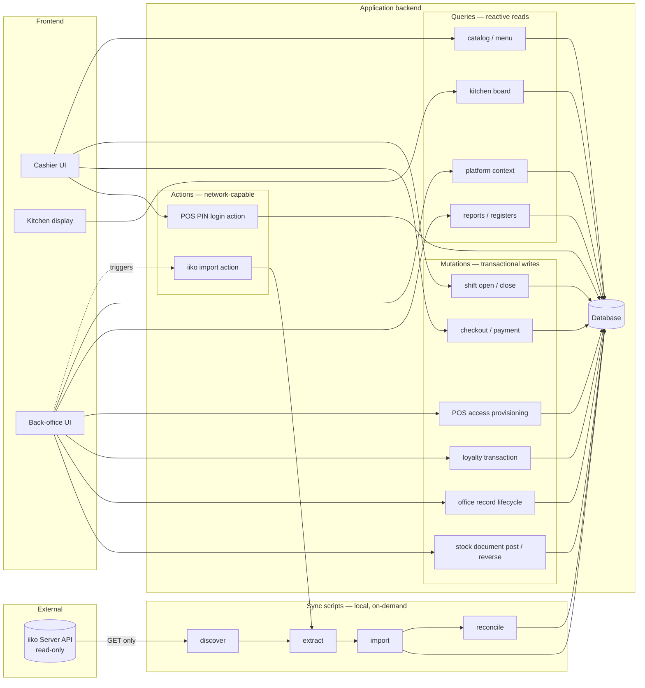
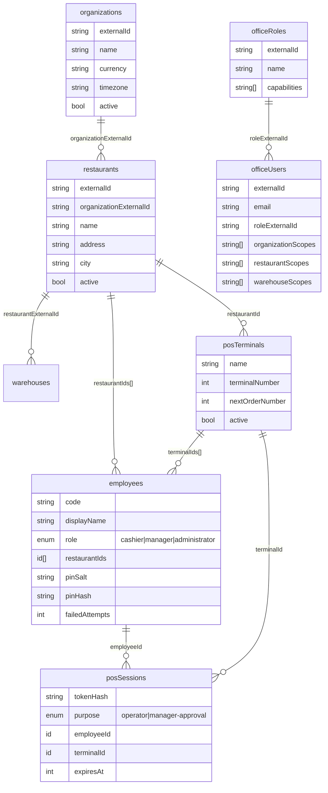
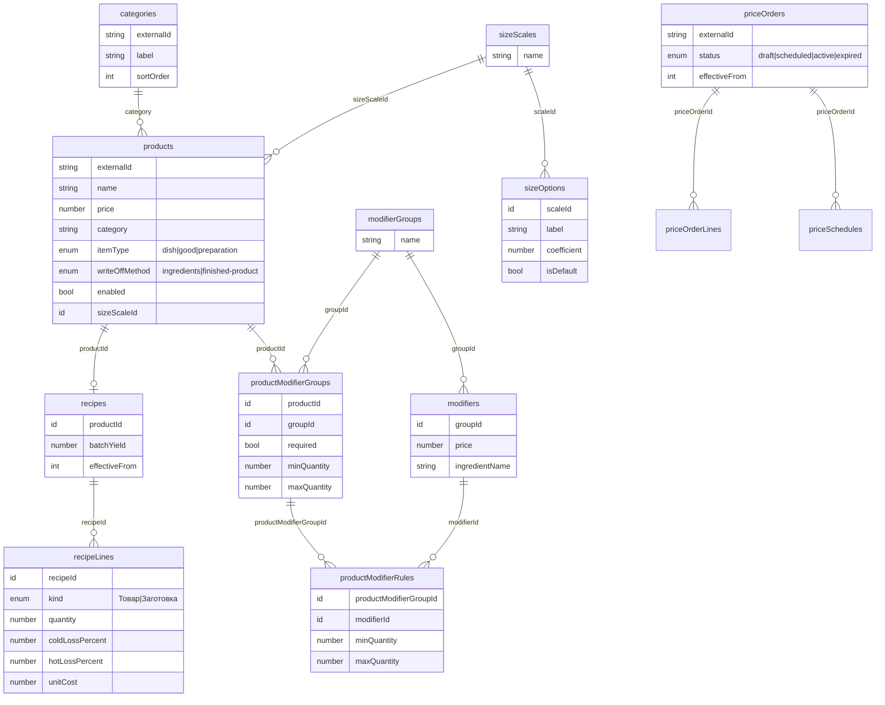
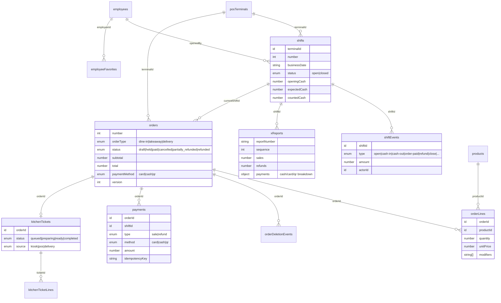
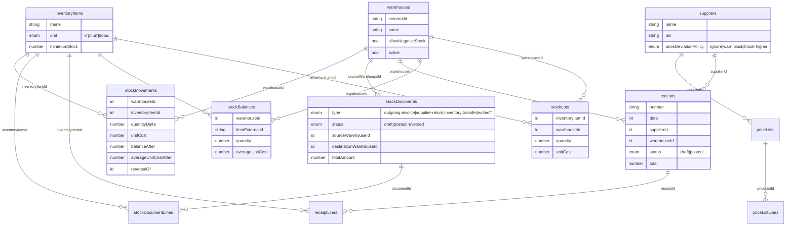
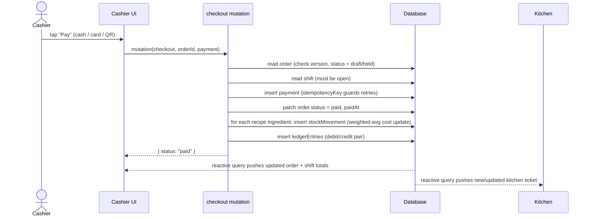
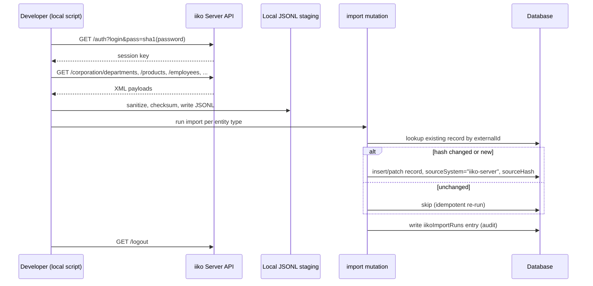

# Architecture — Sandyq

## Stack

- **Frontend**: React + Vite + TypeScript, Tailwind CSS for styling, a shared token-based theme file for brand color/typography/spacing so restyling never touches individual components.
- **Backend**: a serverless application backend (functions + database + realtime sync in one system, no separate REST server to run or host). The frontend subscribes to backend functions and receives live updates automatically whenever underlying data changes — no manual polling or cache invalidation.
- **Hosting**: static frontend build deployable to any static host; backend runs on its own managed cloud deployment, independent per environment (dev / production).

## Backend function model

Three function kinds, enforced by the platform itself:

- **Query** — read-only, reactive. The frontend subscribes via a query hook and re-renders automatically when the underlying data changes.
- **Mutation** — writes, executed transactionally (atomic, all-or-nothing).
- **Action** — the only function kind allowed to make outbound network calls (e.g. to the iiko API); has no direct database access and must call queries/mutations for that.

A single schema file (`convex/schema.ts` — its location is fixed by the platform, cannot be moved into a subfolder) defines every table, its validated field types, and its indexes, including full-text search indexes for register/list views.

### Folder structure

Domain-first, with responsibility (query/mutation/action) as the split inside each domain — mirrors the frontend's `feature/data|model|ui` layout, so a given business capability has one predictable home on both sides of the stack:

```
convex/
  schema.ts
  domains/
    catalog/
      queries.ts
      mutations.ts
      types.ts
    pos/
      queries.ts
      mutations.ts
      actions.ts
    inventory/
      queries.ts
      mutations.ts
    production/
      queries.ts
      mutations.ts
    finance/
      queries.ts
      mutations.ts
    workforce/
      queries.ts
      mutations.ts
    loyalty/
      queries.ts
      mutations.ts
    delivery/
      queries.ts
      mutations.ts
    office/
      queries.ts        # platformContext, register listings
      mutations.ts       # bootstrap, user/role management
    reports/
      queries.ts
    iiko/
      actions.ts          # network calls to the iiko API (discover/extract/import)
      mutations.ts        # internal writes into the mirror tables, called by actions.ts
  lib/
    auth.ts               # shared PIN/session + office-capability checks
    validators.ts          # shared v.* validators reused across domains
  _generated/              # Convex-generated, never hand-edited
```

Convex mirrors this layout in the generated `api` object, so a function's call site matches its file: `api.domains.catalog.queries.listProducts`, `api.domains.pos.mutations.checkout`, `api.domains.iiko.actions.runImport`. `types.ts` files are optional per domain, added where a domain's shared TypeScript types (not Convex validators) are large enough to warrant their own file rather than living at the top of `queries.ts`.

`lib/` holds plain TypeScript helpers only — no file in it calls `query`/`mutation`/`action`, so nothing in `lib/` appears in the generated `api` object.

## Frontend structure

Role-first, not feature-first: the top-level split is the application **surface** (`pos` vs `office`), matching the two distinct auth models and routes described above — a cashier and a back-office admin are effectively using two different apps that happen to share one codebase and one backend. Inside each role, capabilities are still organized feature-first (`data/model/ui`), and true cross-role concerns live in `shared/`.

```
src/
  pos/
    features/
      catalog/               # menu browsing for the cashier (read-only over the shared catalog data)
        ui/
      order-taking/
        data/
        model/
        ui/
      checkout/
        data/
        model/
        ui/
      shifts/
        data/
        model/
        ui/
      kitchen-display/
        data/
        ui/
    components/               # POS-only chrome: numpad, order panel, PIN pad
    router.tsx                 # routes under /pos

  office/
    features/
      catalog-management/
      inventory-costing/
      production/
      finance-management/
      workforce-management/
      loyalty-management/
      delivery-management/
      retail-management/
      stock-management/
      pricing-management/
      modifier-management/
      size-scales/
      office-platform/         # navigation shell, access control, integration status, report catalog
      <each with data/model/ui>
    components/                 # office-only chrome: register/list layout, page headers
    router.tsx                   # routes under /office

  shared/
    components/ui/               # design-system primitives (buttons, dialogs, inputs, tables)
    api/                          # thin data hooks for domains genuinely read by both roles (e.g. catalog reads)
    auth/                          # session/identity context providers for both auth models
    types/                          # cross-cutting domain types
    styles/theme.css                # single design-token source
    lib/                             # Convex client bootstrap, formatting/date utilities

  App.tsx                            # top-level switch between /pos and /office
  main.tsx
```

Rule of thumb for where code lives: if it's business logic or UI that only cashiers or only back-office staff ever see, it belongs inside `pos/` or `office/`. If two roles both need it — a read-only catalog lookup, the design-system button, the Convex client — it belongs in `shared/`, owned once, imported by both. A capability that both roles touch (catalog is the clearest example: cashiers read it, office edits it) still gets **separate UI** per role, but shares the same `shared/api/` read hooks rather than each role re-implementing its own catalog query.

This mirrors the backend's domain-first-then-responsibility layout (`convex/domains/<domain>/{queries,mutations,actions}`) with the equivalent split flipped to role-first-then-feature-then-responsibility on the frontend — intentional, since the backend has one shape serving both surfaces, while the frontend is genuinely two different apps.

## Two application surfaces, two auth models

- **Cashier surface**: PIN-based login scoped to a fixed terminal. Session tokens are short-lived, stored server-side as a hash (never the raw token), with automatic lockout after repeated failed attempts. A short-lived, single-use elevated session (manager PIN) authorizes specific sensitive actions (void, refund, cash withdrawal, exceptional discount) without granting a full manager login.
- **Back-office surface**: email-based authentication for staff, with role-based capabilities and per-user scoping to specific branches/warehouses. An administrator bootstrap path exists for the very first account on a fresh environment; every subsequent account is provisioned by an existing administrator.

The two are intentionally decoupled — cashier PIN access is never derived from or dependent on back-office login state, and vice versa.

## Core domain invariants

- **Append-only accounting.** Stock movements and financial ledger entries are immutable once created. The only supported correction is a reversal — an inverse entry owned by the same source document — never an edit or delete of the original fact.
- **Weighted-average costing.** Ingredient cost is the total lot value divided by total lot quantity per warehouse; recipe cost and sale write-off cost are both derived from it, not hardcoded.
- **Document lifecycle.** Operational documents (production, purchasing, price changes, HR/payroll, loyalty) move through a fixed state machine (draft → approval/posting → published/completed → optionally reversed) shared across domains, with every state transition audited.
- **Idempotency at the edges.** Payment attempts, loyalty transactions, and outbound integration jobs all carry idempotency keys so a network retry can never double-record a financial event.

## External data: iiko integration

The business's day-to-day operations already run on iiko (POS + back office). This system treats iiko as a **read-only upstream data source**, not a system it writes to:

- A set of standalone scripts authenticate against the iiko Server REST API, extract data (organization structure, menu/products, employees, stock, historical documents), sanitize and stage it locally, then import it into the backend as canonical, source-attributed records.
- Only GET / semantically read-only iiko operations are ever called. No sales, orders, or documents are ever written back to iiko.
- Imported records are owned by iiko (re-importing updates them); anything created directly in this system (new POS transactions, overlays on imported catalog items) is owned locally and never pushed upstream.
- POS employee login (code + PIN) is provisioned separately inside this system and is never sourced from or written to iiko — imported employee records carry no credentials.
- Sync is manual/on-demand, not a live subscription — run explicitly to discover the API surface, pull a fresh snapshot, or resume an interrupted import.

## Environments

Each environment (a developer's local setup, and eventually a shared production instance) gets its own fully isolated backend deployment — its own database, its own functions, its own environment-variable store. Nothing is shared by default; promoting code to production is an explicit, separate deploy step, never implicit in day-to-day development.

## Secrets

Three distinct places, never conflated:
1. **Client-exposed config** (e.g. the backend connection URL) — safe to be public, bundled into the frontend build.
2. **Backend environment variables** — managed by the backend platform itself, readable only from server-side functions, never shipped to the client.
3. **Local integration credentials** (iiko login) — used only by the standalone sync scripts running on a developer's machine, kept in a gitignored local file, never sent to or stored by the backend.

## System flow



## API surface — what needs to exist, by domain

Every entry below is a backend function (query = read/reactive, mutation = transactional write, action = network-capable, no direct DB access).

| Domain | Queries | Mutations | Actions |
|---|---|---|---|
| **Auth — cashier** | current session | — | PIN login, manager-approval login, logout |
| **Auth — back office** | current user / platform context | bootstrap first admin, provision/edit office users | — |
| **Catalog & menu** | list categories, list products (paginated/search), product detail, kiosk menu, modifier groups | create/update product, create/update recipe, manage modifier groups & rules, manage size scales | — |
| **Pricing** | active price orders, price schedule for a product | create/publish/expire price order | — |
| **Inventory & stock** | stock balances by warehouse, stock lots, receipts register, stock documents register | post/reverse stock document, post/reverse receipt, create production act | — |
| **Cashier / orders** | active draft order, held orders, order detail, employee favorites | create/update/hold/resume draft order, add/remove order line, apply discount, void line | — |
| **Checkout & payments** | payment history for order/shift | checkout (record payment, close order), refund | — |
| **Shifts** | open shift for terminal, X-report preview | open shift, cash-in/cash-out, close shift (generate Z-report) | — |
| **Kitchen** | kitchen board (by status) | advance ticket status (queued → preparing → ready → completed) | — |
| **Finance** | ledger by account/date, finance records register | post finance record, reverse ledger entry | — |
| **Workforce** | employee register, attendance, payroll runs | provision POS access (code + PIN), edit employee, run payroll | — |
| **Loyalty** | guest loyalty account, transaction history | accrue/redeem loyalty, guest consent event | — |
| **Delivery** | delivery orders register, courier locations | assign courier, update delivery status | — |
| **Reporting** | report catalog, saved report views, scheduled reports | save report view, schedule report | — |
| **iiko integration** | endpoint/sync status, reconciliation checks | write imported/mirrored records (internal, called by the action) | run discovery, run extraction, run import, run reconciliation |

## Database schema

Grouped by domain for legibility (the full schema has ~85 tables). Relationships shown are `v.id("table")` references — Convex's foreign-key equivalent, resolved at read time, not enforced at the database level (validity is the calling function's responsibility).

### Organization & access



### Catalog & menu



### Cashier / POS operations



### Inventory & stock



### Production, finance, workforce, loyalty, delivery — remaining domains

Field-level detail omitted here for brevity; each follows the same pattern as above (an `externalId`-keyed header record, `v.id()` references to its parents, and immutable/append-only movement or ledger tables where money or stock changes hands).

| Table | Domain | Purpose | Key references |
|---|---|---|---|
| `productionItems`, `productionMaterials`, `productionRecipes` | Production | Dishes/preparations produced in-house and their material recipe | `productionItems → productionRecipes → productionMaterials` |
| `productionActs`, `productionActLines` | Production | Posted document that consumes materials and adds finished stock | `→ productionItems`, `→ warehouses` |
| `productionRecords` | Production | Generic audited production workflow record (draft→posted→reversed) | `moduleId`, `restaurantExternalId` |
| `ledgerEntries` | Finance | Immutable double-entry debit/credit fact | `sourceExternalId`, `restaurantExternalId` |
| `financeRecords` | Finance | Accounts, journals, payments, obligations, budgets | `moduleId`, `businessDate` |
| `officeRecords` | Finance/ops | Shared audited record shape used by several office modules | `moduleId`, `recordType` |
| `periodLocks` | Finance | Prevents posting into a closed accounting period | `restaurantExternalId`, `lockedThrough` |
| `auditEvents` | Ops | Append-only audit trail for sensitive actions | `resourceExternalId`, `orderId`, `shiftId`, `terminalId` |
| `workforceRecords` | Workforce | Attendance, payroll runs, schedules, motivation | `employeeCode`, `moduleId`, `businessDate` |
| `loyaltyRecords` | Loyalty | Programs, categories, campaigns, reservations | `moduleId`, `guestExternalId` |
| `loyaltyAccounts` | Loyalty | Current bonus/deposit balance per guest+program | `guestExternalId`, `programExternalId` |
| `loyaltyTransactions` | Loyalty | Immutable balance-changing event, idempotent | `→ loyaltyAccounts`, `→ orders` |
| `deliveryOrders`, `deliveryZones`, `couriers`, `courierLocations`, `telephonyCalls`, `deliverySources` | Delivery | Dispatcher/call-center workflow | `restaurantExternalId`, `courierExternalId` |
| `retailSettings` | Ops | Versioned payment/order/discount/deletion/cash-op types | `kind`, `effectiveFrom` |
| `cashShiftAcceptances` | Ops | Manager acceptance record for a closed shift | `→ shifts` |
| `reportViews`, `reportSchedules` | Reporting | Saved/scheduled report configurations | `ownerKey`, `reportId` |
| `integrationJobs`, `outboxEvents` | Platform | Outbound integration queue, idempotent delivery jobs | `idempotencyKey`, `status` |
| `platformRecords` | Platform | Corporation/replication/provider/terminal/equipment config | `moduleId` |
| `datasetRuns`, `dailySalesFacts` | Platform | Seed/dataset run tracking and daily aggregate facts | `status`, `businessDate` |
| `posNotifications` | Ops | Terminal-scoped alerts (info/warning/critical) | `→ posTerminals` |
| `iikoImportRuns`, `iikoEndpointStates`, `iikoImportStaging` | iiko sync | Run tracking, discovered-endpoint state, staged rows pre-import | `externalId`, `endpointKey` |
| `iikoMirrorRecords`, `iikoEntityOverlays` | iiko sync | Read-only mirror of source records; Sandyq-owned overlay on top of them | `sourceExternalId`, `overlayKey` |
| `iikoDepartments`, `iikoEmployees`, `iikoEmployeeRoles` | iiko sync | Mirrored organization/workforce master data | `externalId` |
| `iikoDocuments`, `iikoCashShifts`, `iikoOrders`, `iikoReportFacts` | iiko sync | Mirrored transactional history (read-only, never posted locally) | `externalId`, `businessDate` |
| `iikoReconciliationChecks` | iiko sync | Sampled totals comparison between mirror and source | `checkKey`, `runExternalId` |

## How the API layer talks to the database

Two representative flows — checkout (a mutation-driven write path) and iiko sync (an action-driven external-read path).

### Checkout



Everything after the idempotency check happens inside **one mutation** — Convex mutations are transactional, so a partial failure (e.g. stock write succeeds but ledger write fails) can't happen; the whole mutation rolls back.

### iiko sync



No step in this flow ever issues a `POST`/`PUT`/`DELETE` against `IIKO` — only the initial `auth` and the read endpoints.

## User story — step by step

### Cashier: a full shift

1. Cashier opens the terminal, enters their employee **code + PIN** → `posAuth` action validates against `employees.pinHash`, issues a session token (hashed, stored in `posSessions`).
2. Cashier opens the shift, counting and entering the opening cash float → `shifts` row created with `status: "open"`, `openingCash` set.
3. A guest orders. Cashier adds products to a draft order (`orders` + `orderLines`), applying any size/modifier selections.
4. Cashier sends the order to the kitchen → a `kitchenTickets` row (+ `kitchenTicketLines`) is created; the kitchen display's reactive query updates instantly with no polling.
5. Kitchen advances the ticket through `queued → preparing → ready → completed` as the dish is made; the cashier's UI reflects each state change live.
6. Guest pays. Cashier records the payment (cash/card/QR) → the checkout mutation runs (see sequence diagram above): payment recorded, order marked `paid`, stock written off at weighted-average cost, ledger entries posted.
7. A refund or void, if needed, requires a **manager's PIN** for a short-lived, single-use approval session before the mutation is allowed to run.
8. At end of shift, cashier counts the cash drawer and closes the shift → the system computes `expectedCash` from opening float + cash sales − refunds + insertions − withdrawals, compares to the counted amount, and generates an immutable **Z-report** (`xReports`) recording any variance.

### Office admin: bringing Sandyq's real data online

1. Admin signs in to the back office (email-based auth); the very first account is created via a one-time bootstrap tied to a pre-configured admin email.
2. Admin (or a developer, from the command line) runs iiko discovery — confirms the API surface and credentials are valid, with nothing written yet.
3. Admin runs a master-data sync — pulls organization structure, branches, menu/products, employees from the real Sandyq iiko account into the mirror tables (`iikoDepartments`, `iikoEmployees`, products/categories with `sourceSystem: "iiko-server"`).
4. Admin reviews the imported catalog/branches in the back office and activates the ones in scope (e.g. only Sandyq's own branches, not the holding's other brands).
5. Admin provisions POS access for real staff: picks an imported iiko employee, assigns a terminal, and sets a **new** cashier code + PIN — this credential is generated here, not imported from iiko.
6. Cashiers can now log in at the terminal with their new code + PIN and start taking real orders against real menu data, following the cashier flow above.
7. Admin periodically re-runs the sync to refresh master data (new/changed products, new employees); reconciliation checks sample recent totals against iiko to catch drift.
